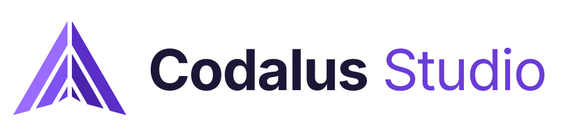

<h1>
  <picture>
    <source media="(prefers-color-scheme: dark)" srcset="assets/logo/codalus-wordmark-light.svg">
    
  </picture>
</h1>

Codalus IDE is an open-source (MIT), cross-platform IDE for .NET that runs natively on Windows, macOS and Linux: a rich semantic editor, a real project system, and integrated build, debugging and Git.

> **Status: pre-release (0.x).** The MVP (milestones M0–M7) is done, and the post-MVP milestones are under way ([roadmap](docs/roadmap.md#status)). Installers for Windows, macOS and Linux are on the [releases page](https://github.com/stavroskasidis/codalus-ide/releases): the latest stable release is 0.2.1, and nightly builds follow `develop` ([installing](docs/user-guide/getting-started.md)). The UI stack is Avalonia ([ADR 0001](docs/adr/0001-ui-stack.md)).

## Features

- **Solutions and projects**:
  - `.sln` and `.slnx` solutions and SDK-style projects.
  - A Solution Explorer with file operations, references, dependencies and analyzers.
  - Configurations, multi-targeting, restore, and templates for new projects.
  - Project property pages that show where each value comes from, launch profiles, the Reference Manager, Configuration Manager, build dependencies, unloading projects, solution filters and SDK selection.
  - Folder trust: untrusted code doesn't run.
- **NuGet**: a package manager for projects and the solution (browse, installed with transitive packages, updates, consolidate), Central Package Management, package sources with source mapping, Pack, and .NET tools.
- **Editor**:
  - Tabs with preview and split views, multiple carets, folding, a minimap and find/replace.
  - C# on Roslyn with your analyzers and source generators: semantic highlighting, completion, signature help, Quick Info, live diagnostics with an Error List.
  - Navigation: Go to Definition and Implementation (into generated and decompiled code), Find All References, Code Search (files, types, members and text with an editable preview, and Feature Search), Find in Files.
  - Refactoring: Rename, code fixes and refactorings (all with previews), and `.editorconfig` formatting.
- **Testing**: a Test Explorer for xUnit, NUnit, MSTest and TUnit on VSTest and Microsoft.Testing.Platform, test margins in the editor, playlists, and code coverage with Coverlet.
- **Build and run**: Build, Rebuild and Clean of the solution or a project (MSBuild, cancellable, errors in the Error List). Run the startup project with its launch profile (Ctrl+F5).
- **Debugging** on netcoredbg:
  - launch (F5) and attach
  - breakpoints with conditions, hit counts and logpoints
  - stepping and threads
  - Call Stack, Locals, Autos, Watch, data tips, a Debug Console, and exception settings
  - Run to Cursor and Run to Click; function, temporary and dependent breakpoints with labels, import and export; QuickWatch and editing values; Text, JSON, XML and HTML visualizers; PerfTips; the Threads and Modules windows
- **Git** through the git CLI:
  - a Changes view with per-file and per-hunk staging
  - commit and amend
  - branches: create, switch, merge
  - fetch, pull and push
  - side-by-side and inline diffs, gutter change markers, and blame
- **Terminal and C# Interactive**: an integrated terminal (your shells, splits, shell integration with clickable `file:line` links, `vim`-capable emulation) that can also run your console apps, and a C# REPL with `#r "nuget:"`, Send to Interactive and Initialize Interactive with Project.
- **Navigation and inline information**: Peek Definition, Go to Base, Call and Type Hierarchy, Find All References with read/write classification, the Document Outline, a Code Definition window, a navigation bar and sticky scroll; inlay hints, CodeLens, an inheritance margin, bracket pair colors and an overview ruler; library code shown from its embedded source or Source Link before decompiling.
- **Editing and analysis**: snippets (VS Code's format, Visual Studio's imported, contributed by plugins), Insert Snippet and Surround With, duplicate and move lines, Expand Selection, a clipboard ring, Paste JSON as Classes, Code Cleanup and format on save, refactorings with options (Generate Constructor, Equals and GetHashCode, Overrides, Extract Interface, Change Signature), configuring severities in `.editorconfig`, AutoRecover and local history, bookmarks, the Task List, Code Metrics, a Syntax Visualizer, Compare Files and an image viewer.
- **A classic IDE's look and feel**: the Classic Blue, Light, Dark and High Contrast themes (the default) and four theme families (Harbor, Graphite, Daylight and Ember, each Light, Dark and High contrast), the menu and a search box (Ctrl+Q) in the title bar, a standard toolbar with the configuration, startup project and Start, a status bar colored by state, the Solution Explorer on the right with search, an Options tree, and the classic keyboard scheme by default (VS Code's, ReSharper's and Emacs's as options).
- **Git depth**: a history graph with filters, file and line history, a 3-way merge editor, continue/skip/abort for merges, rebases, cherry-picks and reverts, interactive rebase, stash, tags, remotes, per-line staging, clone and init, and `codalus merge`/`--wait` as git's merge tool and editor; worktrees, Git LFS, solutions spanning several repositories, and a credentials prompt behind your credential helper.
- **GitHub, Azure DevOps and GitLab**: pull requests (check out, create, review comments in the editor), CI status, issues and work items with `#` completion, and publishing a repository. Nothing is sent to a host until you sign in; tokens stay in the OS credential store.
- **Web**: an Endpoints Explorer, `.http` files with environments and an HTTP Response window, the ASP.NET Core environment selector, the HTTPS development certificate and user secrets; Hot Reload through `dotnet watch`; Razor and Blazor editing with C# features inside `.razor` and `.cshtml`; and HTML, CSS, JavaScript and TypeScript language servers on a Node.js runtime downloaded on first use.
- **Data**: an Entity Framework window over your `dotnet ef` (migrations, scripts, bundles, reverse engineering, the model view) and a Database Explorer for SQL Server, PostgreSQL, MySQL/MariaDB and SQLite with a query editor, plans and a SQL language service.
- **Containers, Aspire and publishing**: a Containers window for Docker and Podman, Add Docker Support, run and debug in a container, Compose; Aspire AppHosts run and debug with their resources; publish profiles for folders, single-file, trimmed, ReadyToRun, Native AOT and container images.
- **Profiling**: CPU usage with call trees and flame graphs, .NET Counters, memory snapshots and diffs, allocations, .NET Async, threads, exceptions and file I/O, and BenchmarkDotNet results.
- **Avalonia**: `.axaml` editing with completion and diagnostics from your types, a XAML Previewer, and the Live Visual Tree and Live Property Explorer for running apps.
- **Remote development**: remote windows over SSH, in WSL and in containers (Dev Containers), with the build, language services, terminals and the debugger on the far side, port forwarding and reconnecting.
- **.NET versions**: Codalus runs on .NET 11; .NET 11 projects with C# 15, every target framework from .NET Core 2.0 to .NET 10, and older SDKs pinned in `global.json`.
- **Other languages**: highlighting for about forty languages from TextMate grammars; MSBuild editing with evaluated values on hover; JSON and YAML with schemas; `.editorconfig`; a Markdown preview; and any LSP language server through a plugin, without code.
- **Extensible**: a versioned, out-of-process plugin API, 1.0 since 0.2.0 ([docs/plugins.md](docs/plugins.md)), a Plugin Gallery of NuGet packages, and `dotnet new codalus-plugin`.
- **Yours**: a first-run setup (theme, keyboard scheme, your settings from elsewhere, a tools check), Fonts and Colors, profiles, settings sync through a folder or a Git repository, customizable menus and toolbars, a start window, Help → Check Environment, and self-update on the stable or nightly channel.
- **Private**: no telemetry. Crash reports are local and opt-in.

## Documentation

- [Website](https://stavroskasidis.com/codalus-ide/): downloads, features and the user guide.
- [User guide](docs/user-guide/README.md): installing, solutions, NuGet, editing, build and run, debugging, web development, data, containers, profiling, Avalonia, remote development, testing, Git, terminal and C# Interactive, older .NET versions, settings, troubleshooting.
- [Roadmap](docs/roadmap.md): the post-MVP milestones and the decisions behind them.
- [Writing plugins](docs/plugins.md).
- [Architecture decisions](docs/adr), [environment variables](docs/environment-variables.md), [accessibility](docs/accessibility.md), [contributing](CONTRIBUTING.md), [security](SECURITY.md).

## Architecture in one paragraph

The UI shell (`codalus`, Native AOT) is kept light and responsive. Heavy services run **out of process** and talk to the shell over JSON-RPC: a language service host (Roslyn), a build host (MSBuild), a markup host (JSON, XML and YAML), a C# Interactive host, a debug adapter (netcoredbg over DAP), plugin hosts, and language servers for other languages. A crashing service never takes the UI down. It is restarted, and the user is notified. Contracts are LSP/DAP-shaped and extended where an IDE needs more ([docs/protocol.md](docs/protocol.md)). Plugins use a versioned, out-of-process API ([docs/plugins.md](docs/plugins.md)), and built-in features use it too where practical. Decisions are recorded as ADRs in [docs/adr](docs/adr).

## Repository layout

| Path | Contents |
|---|---|
| `src/Codalus.Shell` | The IDE shell (`codalus`): Avalonia views on top of the workbench services. |
| `src/Codalus.Workbench`, `src/Codalus.Platform` | UI-independent services: commands, key bindings, menus, settings, notifications, output, the plugin manager; OS conventions. |
| `src/Codalus.Plugins.*`, `src/Plugins/` | The plugin SDK, protocol and host process, and the built-in plugins. |
| `src/Codalus.Projects.*` | The build host (`codalus-buildhost`): solutions, MSBuild evaluation, restore and project-file edits. |
| `src/Codalus.Rpc`, `src/Codalus.LanguageServices.*` | JSON-RPC and process supervision; the C# language service host (`codalus-lshost`, Roslyn over LSP) and its client. |
| `src/Codalus.Debugging`, `src/Codalus.Debugging.*` | The Debug Adapter Protocol client for netcoredbg; the debug companion host (`codalus-debughost`) and the startup hook for debugging in the terminal. |
| `src/Codalus.Data.*`, `src/Codalus.EntityFramework.Agent` | The data host (`codalus-datahost`: the Database Explorer and the SQL language server) and the EF Core model agent. |
| `src/Codalus.Diagnostics.*` | The diagnostics host (`codalus-diaghost`) for profiling, and the benchmark events. |
| `src/Codalus.Remote.*` | The remote server (`codalus-server`) and its protocol. |
| `src/Codalus.Previewer.Agent` | The Avalonia previewer's and Live Visual Tree's agent. |
| `src/Codalus.Previewer.Wpf`, `src/Codalus.WinForms.Designer` | Windows only: the WPF previewer's designer host and agent (`codalus-wpfpreviewer`), and the Windows Forms designer host (`codalus-winformsdesigner`). |
| `src/ThirdParty` | Vendored sources: Mono's soft debugger client (`Mono.Debugger.Soft`) for the Mono debugger adapter. |
| `src/Codalus.Templates` | The `dotnet new codalus-plugin` template. |
| `src/Codalus.Markup.Host` | The markup host (`codalus-markuphost`): JSON with schemas, XML and MSBuild, YAML and `.editorconfig`. |
| `src/Codalus.Interactive.*` | The C# Interactive host (`codalus-replhost`) and its protocol. |
| `src/Codalus.TextTemplating.*` | The T4 host (`codalus-t4host`, Mono.TextTemplating) and its protocol. |
| `src/Codalus.Terminal` | The terminal's VT engine (the pseudo-terminals are in `Codalus.Platform`). |
| `eng/` | Scripts and tools: `codalus-release` (`Codalus.Release`), packaging (`package.sh`), the smoke, validation, WSL and update tests, the Linux repositories and the AUR, fetching netcoredbg and the icons. |
| `tests/` | Unit, integration and headless UI tests. |
| `benchmarks/` | The `codalus-bench` harness, the fixture generator and committed results. |
| `samples/` | Fixture solutions and the sample plugins (`samples/plugins/`). Large fixtures are generated, not committed. |
| `website/` | The website (Blazor static SSR, exported for GitHub Pages), which renders the user guide. |
| `docs/` | ADRs, protocols, the roadmap, milestone checkpoints and the user guide. |

## Building

You need the .NET SDK pinned in `global.json` (11.0, its second release candidate until GA), the .NET 10 runtime for the fixtures that target `net10.0`, and git. For the debugger, run `eng/get-netcoredbg.sh` once.

```bash
dotnet build Codalus.slnx
```

```bash
dotnet test --solution Codalus.slnx
```

```bash
dotnet run --project src/Codalus.Shell
```

More commands, including publishing the shell and running the benchmarks, are in [CLAUDE.md](CLAUDE.md) and [benchmarks/README.md](benchmarks/README.md). `eng/package.sh [version] [stable|nightly|dev]` builds your OS's installers and packages ([ADR 0028](docs/adr/0028-release-cycle-and-installers.md)).

## License

[MIT](LICENSE). Third-party components are listed in [THIRD-PARTY-NOTICES.md](THIRD-PARTY-NOTICES.md).
