# Shell themes: Harbor, Graphite, Daylight and Ember

Four theme families for the shell. Each comes in Light, Dark and High contrast. They keep a classic IDE's layout and the icon palette, but each has its own colors and some layout differences. The maintainer asked for them on 2026-10-16 ("close to Visual Studio style but original too") and wants every one shipped, so users pick one. [M45](../roadmap.md#m45--theme-families) built the families ([ADR 0077](../adr/0077-theme-families.md), [checkpoint](../checkpoints/m45.md)): their colors come from the tables below, which the tests read, and their shapes from the Shapes table as tokens; the layout differences that need more than a value (Daylight's rail and toolbar groups, Ember's run controls in the title bar, Graphite's search box in the title row, tool window tabs in the header) wait for their own work. [M46](../roadmap.md#m46--first-run-setup) built the first-run setup that offers them ([checkpoint](../checkpoints/m46.md)): its appearance step follows the design below, its other steps are the setup window's own. [D32](../roadmap.md#decision-register) settled the rest on 2026-10-16: Harbor with Follow System is the default for new installs, today's Blue, Light, Dark and High Contrast stay as a Classic family, and `workbench.colorTheme` takes `<family>` or `<family>.<light|dark|highContrast>`.

| | Light | Dark | High contrast |
|---|---|---|---|
| **Harbor** | 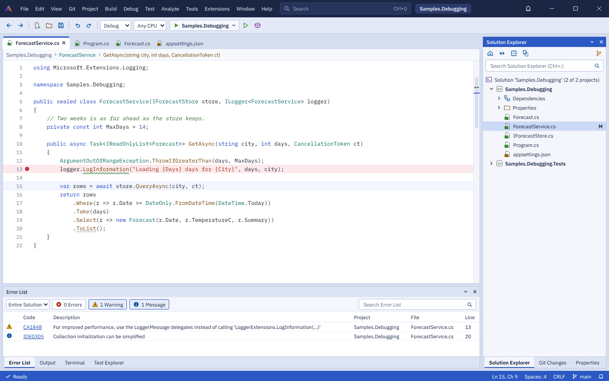 | 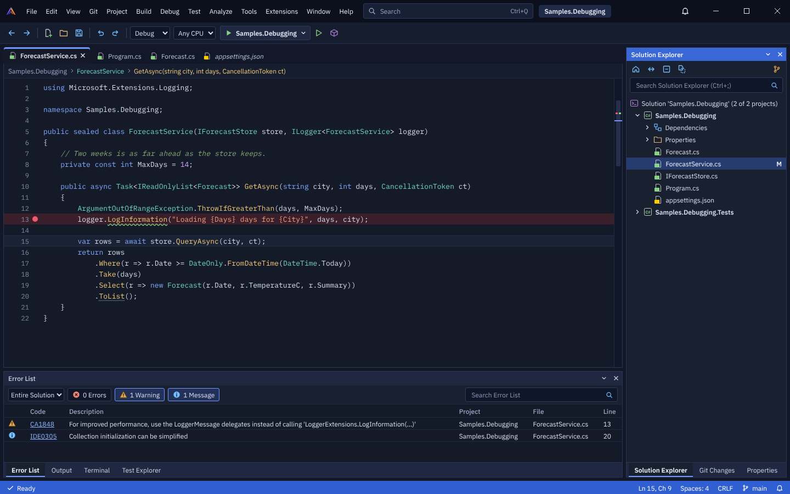 | 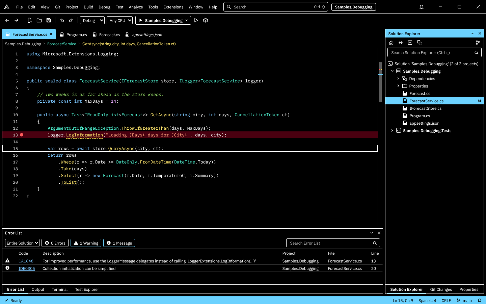 |
| **Graphite** | 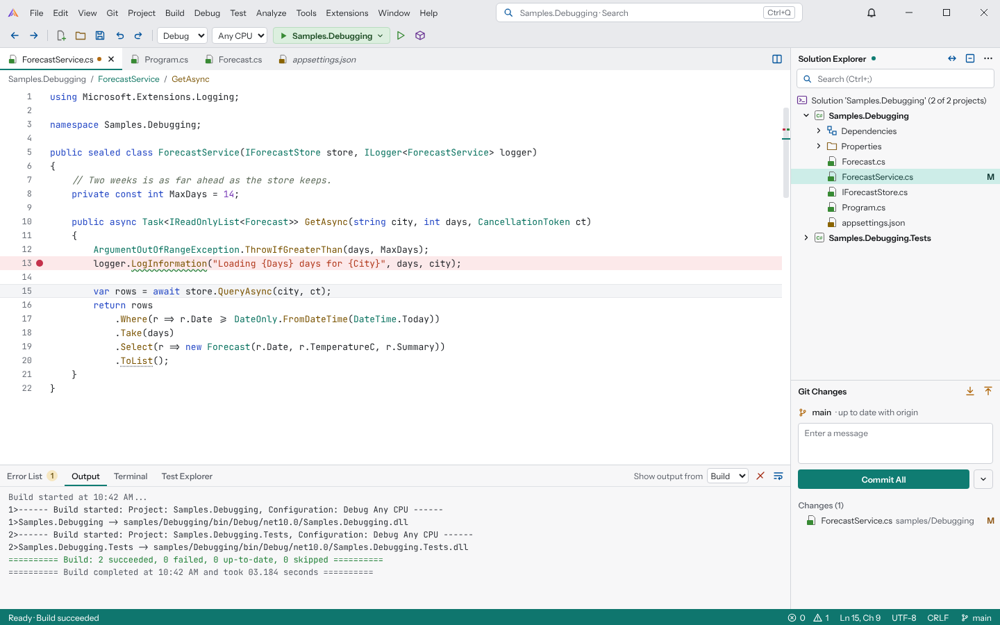 | 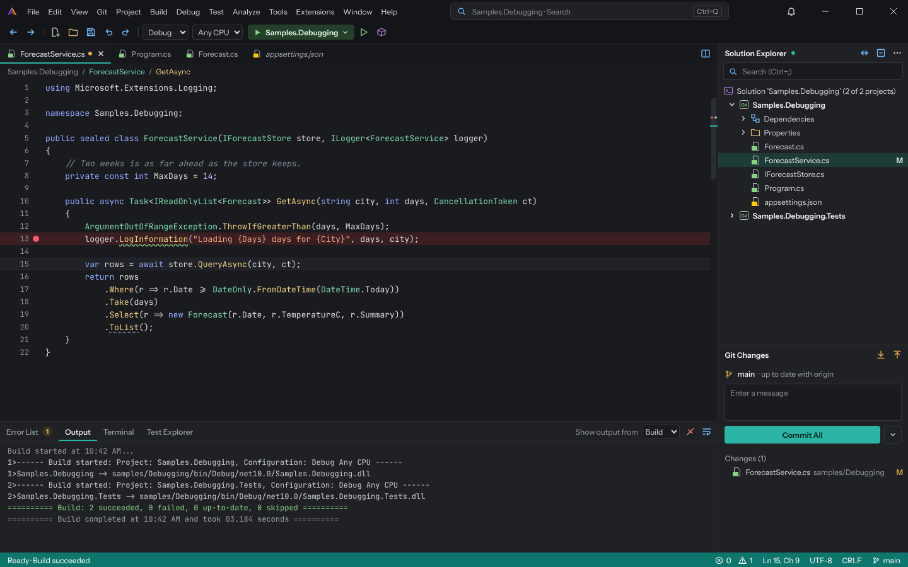 | 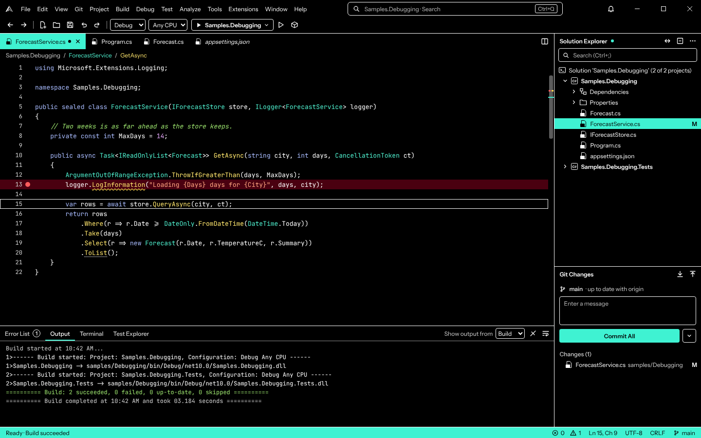 |
| **Daylight** | 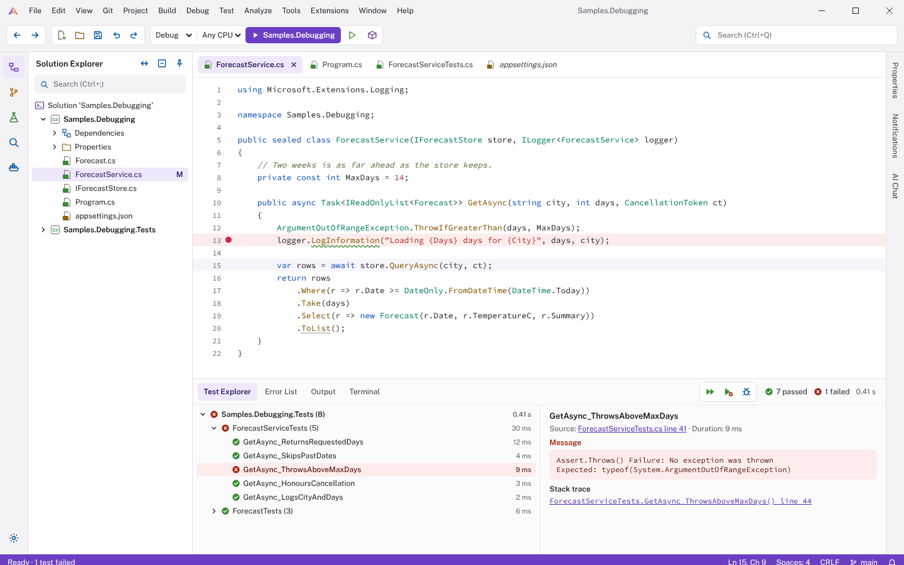 | 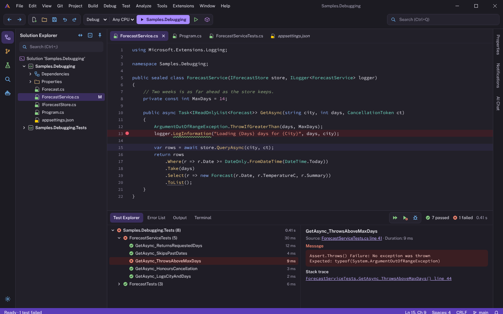 | 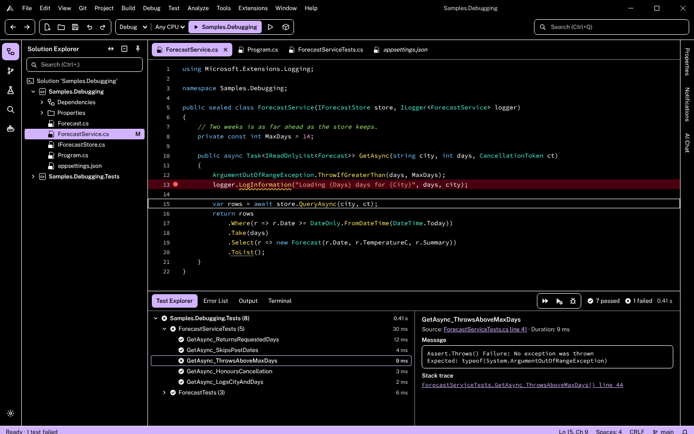 |
| **Ember** | 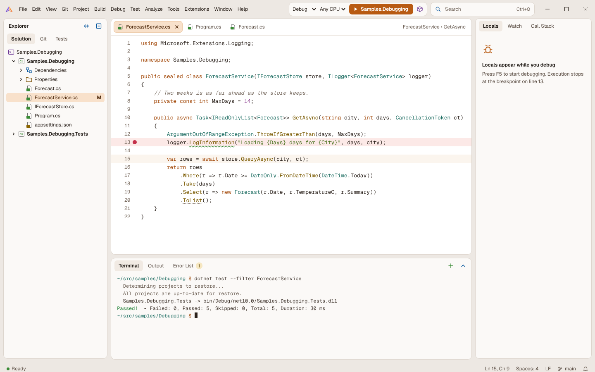 | 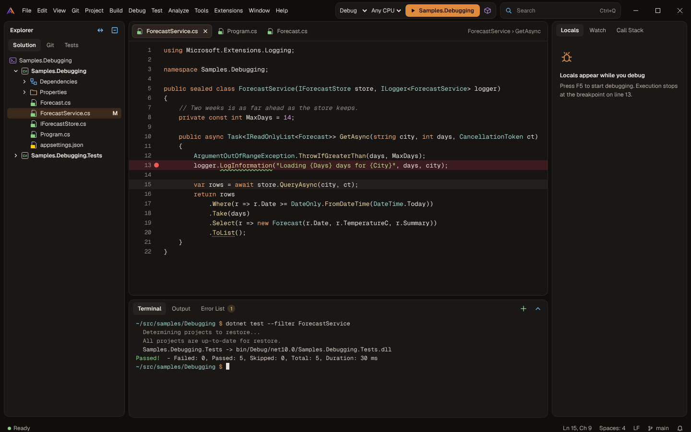 | 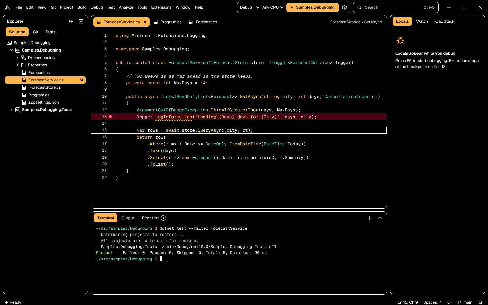 |

Two more pictures show the debugging state: [Harbor, Light](shell-themes/previews/harbor-light-debugging.png) and [Ember, Dark](shell-themes/previews/ember-dark-debugging.png).

## The design files

`shell-themes/` holds the designs as HTML mockups, and they are the source of truth for every color below:
- `Harbor.dc.html`, `Graphite.dc.html`, `Daylight.dc.html` and `Ember.dc.html`: one family each, with its three palettes in `palettes()`.
- `Setup.dc.html`: the first-run setup's appearance step.

Open a file in a browser. `support.js` is a small preview runtime that renders it. The query string picks the variant and the state: `Harbor.dc.html?theme=Dark`, `Ember.dc.html?theme=High%20contrast&mode=Debugging`, `Setup.dc.html?family=Graphite&mode=Dark`. The modes are `Solution open`, `Debugging` and `No solution`. The setup page is interactive. `previews/` has 1440 × 900 screenshots of each family and variant, plus 1280 × 800 screenshots of the setup step.

The mockups use web fonts (IBM Plex, Instrument Sans, Public Sans, Geist, with their mono faces) only so that the families look different side by side. The shell keeps its fonts: the system UI font at 9 pt and Cascadia Mono in the editor (M29). Changing fonts is out of scope.

## What every family shares

- **Layout:** Visual Studio's layout and terms: the menu bar, the configuration and platform pickers, the Start button, Solution Explorer, docked tool windows, the Error List, and the status bar's states (ready, debugging, no solution). Nothing says "Visual Studio" (CLAUDE.md's UI rules).
- **The logo:** the two-wing mark (`assets/logo/codalus.svg`) in the title bar; High contrast uses the single-color mark (`codalus-mono.svg`) in the text color.
- **Icons:** the icon rule from [`ui-guidelines.md`](../ui-guidelines.md#icons). The Light variants use Visual Studio's light image palette and the Dark variants its dark palette. In High Contrast every icon is monochrome, and shape carries the meaning.
- **Contrast:** text meets WCAG AA (4.5:1) on what it's drawn on in Light and Dark, and 7:1 in High contrast. Icons, focus rings and other graphics meet 3:1. Every pair in the tables below was checked. M45 added them to `tests/Codalus.Shell.Tests/TestData/contrast-pairs.txt`, so `PolishTests` keeps checking them.
- **High contrast:** black surfaces, white text, and white borders around every tool window and field. The family's accent marks selection, the active tab, the focused caption and the status bar, always with black text. Each family keeps its shapes, so its High contrast variant still looks like the family.
- **Editor colors:** each family has syntax colors for Light, Dark and High contrast, listed below. Fonts and Colors (M23a) still overrides them.

## The families

### Harbor

The closest to the classic IDE, and the default for new installs under D32 (since D36, 2026-10-19, Classic is).

- **Title bar:** deep navy (Light), with the menu, the search box and the solution name on a chip.
- **Tool windows:** docked with 6 px gutters between them. The focused tool window has an accent caption. Tab strips sit at the bottom of a tool window group.
- **Document tabs:** the active tab is joined to the editor and has a 3 px accent bar across its top.
- **Editor:** a scroll-bar map at the right edge.
- **Status bar:** the accent color; orange while debugging, slate with no solution.
- **Accent:** cobalt `#2B59C3` (Light).

### Graphite

Compact and dense, for people who want more code on the screen.

- **Title bar:** the title row and the toolbar share the window's background. The search box sits in the middle of the title row, showing the solution's name.
- **Tool windows:** separated by 1 px hairlines instead of gutters. A tool window's title is plain bold text with an accent dot when it has the focus; there are no caption bars. Solution Explorer and Git Changes are stacked on the right.
- **Document tabs:** flat, with a 2 px accent underline on the active tab and a dot on a modified one.
- **Status bar:** dark teal in both modes.
- **Accent:** teal `#2BB3A3` (Dark).

### Daylight

Flat and airy.

- **Toolbar:** commands in rounded groups, and the Start button filled with the accent.
- **Tool windows:** a tool window rail at the left edge (Solution Explorer, Git Changes, Test Explorer, Find in Files, Containers, and Settings at the bottom). Auto-hidden tool windows show as vertical tabs on the right.
- **Document tabs:** rounded tabs, the active one filled with a tint of the accent. Bottom-panel tabs look the same.
- **Status bar:** the accent color.
- **Accent:** violet `#6B3FC4` (Light), a nod to the classic IDE's purple.

### Ember

Warm, with floating panels.

- **Tool windows and editor:** rounded cards (10 px corners) with 8 px gutters on the window's background.
- **Title bar:** the run controls sit in a pill in the title bar. While debugging, the pill shows "Paused on breakpoint" and the Continue, Step and Stop buttons.
- **Status bar:** the window's background with a colored dot for the state; it turns orange only while debugging.
- **Debugging:** an empty state for Locals when nothing is being debugged ("Press F5 to start debugging").
- **Accent:** copper `#E08A3C` (Dark).

## Shapes

Each family's layout differences become shape tokens and style classes in `ShellStyles.axaml`, never separate views. Every view stays the same.

| | Harbor | Graphite | Daylight | Ember |
|---|---|---|---|---|
| Gutter between docked windows | 6 px, `Shell.Background` | 1 px hairline, `Shell.Border` | none, 1 px borders | 8 px, `Shell.Background` |
| Panel corners | 0 | 0 | 0 (tabs and groups 6–7 px) | 10 px |
| Active document tab | joined to the editor, 3 px accent bar on top | flat, 2 px accent underline | rounded, filled with the accent tint | rounded, filled with the accent tint, 1 px edge |
| Focused tool window | accent caption | bold title and an accent dot | bold title | bold title |
| Tool window tabs | strip at the bottom of the group | tabs in the header | rounded tabs in the header | rounded tabs in the header |
| Toolbar | one row, separators | one row with the title row's background | rounded groups | in a pill in the title bar |
| Tool window launcher | Dock's side tabs | Dock's side tabs | a rail at the left edge | Dock's side tabs |
| Status bar | filled: accent, debugging, no solution | filled: teal, debugging, no solution | filled: accent, debugging, no solution | window background with a state dot; filled only while debugging |

## Colors

The tokens are those of [`ui-guidelines.md`](../ui-guidelines.md#tokens). Tokens marked "new" were added by M45. Editor rows are the C# classification colors. A token missing from a family's table (such as captions in Graphite, Daylight and Ember) takes that family's panel colors.

### Harbor colors

| Role | Token | Light | Dark | High contrast |
|---|---|---|---|---|
| Window background | `Shell.Background` | `#D5DDEF` | `#121827` | `#000000` |
| Text | `Shell.Foreground` | `#1B2645` | `#D9DFEE` | `#FFFFFF` |
| Secondary text | `Shell.MutedForeground` | `#4E5873` | `#9AA5C2` | `#D6D6D6` |
| Borders and separators | `Shell.Border` | `#BCC7E0` | `#2A3553` | `#FFFFFF` |
| Tool windows and documents | `Shell.Panel` | `#F4F6FC` | `#19202F` | `#000000` |
| Selection | `Shell.Selection` | `#CCD9F6` | `#263C6E` | `#6CD2FF` |
| Text on the selection | `Shell.Selection.Foreground` (new) | `#0E1735` | `#F1F4FB` | `#000000` |
| Accent, focus | `Shell.Accent`, `Shell.Focus` | `#2B59C3` | `#6E98FF` | `#6CD2FF` |
| Text on the accent | `Shell.AccentForeground` | `#FFFFFF` | `#0A1124` | `#000000` |
| Title bar | `Shell.TitleBar` | `#1B2645` | `#0B101C` | `#000000` |
| Title bar text | `Shell.TitleBar.Foreground` | `#E8ECF7` | `#E3E8F5` | `#FFFFFF` |
| Search box | `Shell.Search` | `#26335A` | `#182036` | `#000000` |
| Toolbar | `Shell.Toolbar` | `#E3E9F6` | `#161D2F` | `#000000` |
| Text boxes and combo boxes | `Shell.Input` (new) | `#FFFFFF` | `#10162A` | `#000000` |
| Active document tab | `Shell.Tab.Active` | `#FFFFFF` | `#141A28` | `#6CD2FF` |
| Active tab text | `Shell.Tab.Active.Foreground` | `#0E1735` | `#F1F4FB` | `#000000` |
| Other tabs' text | `Shell.Tab.Inactive.Foreground` | `#2E3A5C` | `#B5C0DB` | `#FFFFFF` |
| Focused tool window caption | `Shell.Caption.Active` | `#2B59C3` | `#3A67D6` | `#6CD2FF` |
| Its text | `Shell.Caption.Active.Foreground` | `#FFFFFF` | `#FFFFFF` | `#000000` |
| Status bar | `Shell.StatusBar` | `#2B59C3` | `#2F5FD0` | `#6CD2FF` |
| Status bar text | `Shell.StatusBar.Foreground` | `#FFFFFF` | `#FFFFFF` | `#000000` |
| Status bar, debugging | `Shell.StatusBar.Debugging` | `#B4500F` | `#A8480C` | `#FFB000` |
| Status bar, no solution | `Shell.StatusBar.Empty` | `#56607A` | `#3B4560` | `#000000` |
| Links | `Shell.Link` | `#1D49B0` | `#8DB4FF` | `#7CC7FF` |
| Editor background | `Shell.Editor.Background` | `#FFFFFF` | `#141A28` | `#000000` |
| Editor text | `Shell.Editor.Foreground` | `#1B1F2A` | `#D9DFEE` | `#FFFFFF` |
| Line numbers | `Shell.Editor.LineNumbers` | `#6A7490` | `#7F8AA8` | `#D6D6D6` |
| Current line | `Shell.Editor.CurrentLine` (new) | `#F2F6FE` | `#1A2236` | `#000000` |
| Breakpoint line | `Shell.Editor.Breakpoint.Line` (new) | `#FCE9EC` | `#3A1E2A` | `#4A0010` |
| Current statement line | `Shell.Editor.CurrentStatement` (new) | `#FFF1B8` | `#3D3514` | `#2E2600` |
| Breakpoint glyph | `Shell.Editor.Breakpoint` (new) | `#C4314B` | `#F05A6E` | `#FF5C5C` |
| Keywords | editor: keyword | `#1D3FBF` | `#82A9FF` | `#7CC7FF` |
| Types | editor: type | `#0F7068` | `#6FD1C4` | `#4FF0CF` |
| Methods | editor: method | `#74460A` | `#F0C97A` | `#FFE66D` |
| Strings | editor: string | `#A3361A` | `#F29E7E` | `#FFA680` |
| Numbers | editor: number | `#6A3A9E` | `#C9A2FF` | `#E8AAFF` |
| Comments | editor: comment | `#3D6B2C` | `#84A676` | `#9FE870` |
| Icons: blue, green, red | `Shell.Icon.Blue`, `.Green`, `.Red` | `#00539C` `#388A34` `#A1260D` | `#75BEFF` `#89D185` `#F48771` | `#FFFFFF` `#FFFFFF` `#FFFFFF` |
| Icons: orange, purple, yellow | `Shell.Icon.Orange`, `.Purple`, `.Yellow` | `#B26B12` `#652D90` `#8A6400` | `#E8AB53` `#B180D7` `#FFCC00` | `#FFFFFF` `#FFFFFF` `#FFFFFF` |
| Icons: folder, outline | `Shell.Icon.Folder`, `.Outline` | `#8A6320` `#6E6E6E` | `#DCB67A` `#C5C5C5` | `#FFFFFF` `#FFFFFF` |

### Graphite colors

| Role | Token | Light | Dark | High contrast |
|---|---|---|---|---|
| Window background | `Shell.Background` | `#E9EAED` | `#141518` | `#000000` |
| Text | `Shell.Foreground` | `#1F2226` | `#D5D8DE` | `#FFFFFF` |
| Secondary text | `Shell.MutedForeground` | `#555A63` | `#9A9FAA` | `#D6D6D6` |
| Borders and separators | `Shell.Border` | `#D3D6DB` | `#2A2D34` | `#FFFFFF` |
| Tool windows and documents | `Shell.Panel` | `#F7F7F8` | `#1F2125` | `#000000` |
| Selection | `Shell.Selection` | `#CDEDE8` | `#1F3B38` | `#3FF2D2` |
| Text on the selection | `Shell.Selection.Foreground` (new) | `#062E2A` | `#E8F4F2` | `#000000` |
| Accent, focus | `Shell.Accent`, `Shell.Focus` | `#0F7C72` | `#2BB3A3` | `#3FF2D2` |
| Text on the accent | `Shell.AccentForeground` | `#FFFFFF` | `#0B1F1C` | `#000000` |
| Title bar | `Shell.TitleBar` | `#E9EAED` | `#141518` | `#000000` |
| Title bar text | `Shell.TitleBar.Foreground` | `#1F2226` | `#D5D8DE` | `#FFFFFF` |
| Search box | `Shell.Search` | `#FFFFFF` | `#1F2125` | `#000000` |
| Toolbar | `Shell.Toolbar` | `#E9EAED` | `#141518` | `#000000` |
| Text boxes and combo boxes | `Shell.Input` (new) | `#FFFFFF` | `#1A1B1F` | `#000000` |
| Active document tab | `Shell.Tab.Active` | `#FFFFFF` | `#1A1B1F` | `#3FF2D2` |
| Active tab text | `Shell.Tab.Active.Foreground` | `#0E1013` | `#F1F3F6` | `#000000` |
| Other tabs' text | `Shell.Tab.Inactive.Foreground` | `#4A4F57` | `#AEB3BD` | `#FFFFFF` |
| Status bar | `Shell.StatusBar` | `#0F766E` | `#0F766E` | `#3FF2D2` |
| Status bar text | `Shell.StatusBar.Foreground` | `#FFFFFF` | `#FFFFFF` | `#000000` |
| Status bar, debugging | `Shell.StatusBar.Debugging` | `#B4500F` | `#A8480C` | `#FFB000` |
| Status bar, no solution | `Shell.StatusBar.Empty` | `#5A5F69` | `#3A3D45` | `#000000` |
| Links | `Shell.Link` | `#0B5CAD` | `#7CC4FF` | `#7CC7FF` |
| Editor background | `Shell.Editor.Background` | `#FFFFFF` | `#1A1B1F` | `#000000` |
| Editor text | `Shell.Editor.Foreground` | `#1F2226` | `#D5D8DE` | `#FFFFFF` |
| Line numbers | `Shell.Editor.LineNumbers` | `#6B7079` | `#8A8F9A` | `#D6D6D6` |
| Current line | `Shell.Editor.CurrentLine` (new) | `#F4F5F7` | `#202227` | `#000000` |
| Breakpoint line | `Shell.Editor.Breakpoint.Line` (new) | `#FCE9EA` | `#3A1E22` | `#4A0010` |
| Current statement line | `Shell.Editor.CurrentStatement` (new) | `#FFF1B8` | `#3D3514` | `#2E2600` |
| Breakpoint glyph | `Shell.Editor.Breakpoint` (new) | `#C4314B` | `#F05A6E` | `#FF5C5C` |
| Keywords | editor: keyword | `#2347C5` | `#93A9FF` | `#A9BCFF` |
| Types | editor: type | `#0A7360` | `#7FD8AE` | `#4FF0CF` |
| Methods | editor: method | `#7A5300` | `#F0CF85` | `#FFE66D` |
| Strings | editor: string | `#B23A1E` | `#F2A27E` | `#FFA680` |
| Numbers | editor: number | `#7A3DB8` | `#CDA6FF` | `#E8AAFF` |
| Comments | editor: comment | `#5D6B5A` | `#808D9A` | `#9FE870` |
| Icons: blue, green, red | `Shell.Icon.Blue`, `.Green`, `.Red` | `#00539C` `#388A34` `#A1260D` | `#75BEFF` `#89D185` `#F48771` | `#FFFFFF` `#FFFFFF` `#FFFFFF` |
| Icons: orange, purple, yellow | `Shell.Icon.Orange`, `.Purple`, `.Yellow` | `#B26B12` `#652D90` `#8A6400` | `#E8AB53` `#B180D7` `#FFCC00` | `#FFFFFF` `#FFFFFF` `#FFFFFF` |
| Icons: folder, outline | `Shell.Icon.Folder`, `.Outline` | `#8A6320` `#6E6E6E` | `#DCB67A` `#C5C5C5` | `#FFFFFF` `#FFFFFF` |

### Daylight colors

| Role | Token | Light | Dark | High contrast |
|---|---|---|---|---|
| Window background | `Shell.Background` | `#F3F3F6` | `#1C1B22` | `#000000` |
| Text | `Shell.Foreground` | `#1F1F24` | `#E4E2EC` | `#FFFFFF` |
| Secondary text | `Shell.MutedForeground` | `#5C5C66` | `#A7A3B8` | `#D6D6D6` |
| Borders and separators | `Shell.Border` | `#E0E0E6` | `#34313F` | `#FFFFFF` |
| Tool windows and documents | `Shell.Panel` | `#FFFFFF` | `#222029` | `#000000` |
| Selection | `Shell.Selection` | `#EEE8FA` | `#3A2E5E` | `#D2B3FF` |
| Text on the selection | `Shell.Selection.Foreground` (new) | `#2A1660` | `#F1EBFF` | `#000000` |
| Accent, focus | `Shell.Accent`, `Shell.Focus` | `#6B3FC4` | `#A98BFF` | `#D2B3FF` |
| Text on the accent | `Shell.AccentForeground` | `#FFFFFF` | `#160A33` | `#000000` |
| Title bar | `Shell.TitleBar` | `#F3F3F6` | `#1C1B22` | `#000000` |
| Title bar text | `Shell.TitleBar.Foreground` | `#1F1F24` | `#E4E2EC` | `#FFFFFF` |
| Search box | `Shell.Search` | `#FFFFFF` | `#25232E` | `#000000` |
| Toolbar | `Shell.Toolbar` | `#FFFFFF` | `#25232E` | `#000000` |
| Text boxes and combo boxes | `Shell.Input` (new) | `#F3F3F6` | `#2A2834` | `#000000` |
| Active document tab | `Shell.Tab.Active` | `#EEE8FA` | `#3A2E5E` | `#D2B3FF` |
| Active tab text | `Shell.Tab.Active.Foreground` | `#2A1660` | `#F1EBFF` | `#000000` |
| Other tabs' text | `Shell.Tab.Inactive.Foreground` | `#3D3D45` | `#C4C0D3` | `#FFFFFF` |
| Status bar | `Shell.StatusBar` | `#6B3FC4` | `#5B3DB8` | `#D2B3FF` |
| Status bar text | `Shell.StatusBar.Foreground` | `#FFFFFF` | `#FFFFFF` | `#000000` |
| Status bar, debugging | `Shell.StatusBar.Debugging` | `#B4500F` | `#A8480C` | `#FFB000` |
| Status bar, no solution | `Shell.StatusBar.Empty` | `#55555F` | `#3C3949` | `#000000` |
| Links | `Shell.Link` | `#5A2FB0` | `#C4AEFF` | `#D2B3FF` |
| Editor text | `Shell.Editor.Foreground` | `#1F1F24` | `#E4E2EC` | `#FFFFFF` |
| Line numbers | `Shell.Editor.LineNumbers` | `#6B6B76` | `#8E8AA0` | `#D6D6D6` |
| Current line | `Shell.Editor.CurrentLine` (new) | `#F7F5FC` | `#29263A` | `#000000` |
| Breakpoint line | `Shell.Editor.Breakpoint.Line` (new) | `#FCEDEC` | `#3A1E26` | `#4A0010` |
| Current statement line | `Shell.Editor.CurrentStatement` (new) | `#FFF3BF` | `#3D3514` | `#2E2600` |
| Breakpoint glyph | `Shell.Editor.Breakpoint` (new) | `#C4314B` | `#F05A6E` | `#FF5C5C` |
| Keywords | editor: keyword | `#0B4FB8` | `#8FB3FF` | `#7CC7FF` |
| Types | editor: type | `#00796B` | `#6FD6C0` | `#4FF0CF` |
| Methods | editor: method | `#845300` | `#F0CC85` | `#FFE66D` |
| Strings | editor: string | `#B3261E` | `#F49A8C` | `#FFA680` |
| Numbers | editor: number | `#9C2F7A` | `#E39AD0` | `#FFA3E0` |
| Comments | editor: comment | `#56703F` | `#8FA67E` | `#9FE870` |
| Icons: blue, green, red | `Shell.Icon.Blue`, `.Green`, `.Red` | `#00539C` `#388A34` `#A1260D` | `#75BEFF` `#89D185` `#F48771` | `#FFFFFF` `#FFFFFF` `#FFFFFF` |
| Icons: orange, purple, yellow | `Shell.Icon.Orange`, `.Purple`, `.Yellow` | `#B26B12` `#652D90` `#8A6400` | `#E8AB53` `#B180D7` `#FFCC00` | `#FFFFFF` `#FFFFFF` `#FFFFFF` |
| Icons: folder, outline | `Shell.Icon.Folder`, `.Outline` | `#8A6320` `#6E6E6E` | `#DCB67A` `#C5C5C5` | `#FFFFFF` `#FFFFFF` |

### Ember colors

| Role | Token | Light | Dark | High contrast |
|---|---|---|---|---|
| Window background | `Shell.Background` | `#EDE8E3` | `#0F0E0D` | `#000000` |
| Text | `Shell.Foreground` | `#2A211B` | `#E6DFD8` | `#FFFFFF` |
| Secondary text | `Shell.MutedForeground` | `#6B5E53` | `#A39A90` | `#D6D6D6` |
| Borders and separators | `Shell.Border` | `#DDD5CD` | `#2B2724` | `#FFFFFF` |
| Tool windows and documents | `Shell.Panel` | `#FBF9F7` | `#1A1816` | `#000000` |
| Selection | `Shell.Selection` | `#F8E1CB` | `#3A2A1C` | `#FFB547` |
| Text on the selection | `Shell.Selection.Foreground` (new) | `#4A2508` | `#F7E7D6` | `#000000` |
| Accent, focus | `Shell.Accent`, `Shell.Focus` | `#B85A12` | `#E08A3C` | `#FFB547` |
| Text on the accent | `Shell.AccentForeground` | `#FFFFFF` | `#1A0F05` | `#000000` |
| Title bar | `Shell.TitleBar` | `#EDE8E3` | `#0F0E0D` | `#000000` |
| Title bar text | `Shell.TitleBar.Foreground` | `#2A211B` | `#E6DFD8` | `#FFFFFF` |
| Search box | `Shell.Search` | `#FBF9F7` | `#1A1816` | `#000000` |
| Toolbar | `Shell.Toolbar` | `#FBF9F7` | `#1A1816` | `#000000` |
| Active document tab | `Shell.Tab.Active` | `#F8E1CB` | `#2B2420` | `#FFB547` |
| Active tab text | `Shell.Tab.Active.Foreground` | `#4A2508` | `#F7E7D6` | `#000000` |
| Other tabs' text | `Shell.Tab.Inactive.Foreground` | `#5A4D43` | `#B8AFA5` | `#FFFFFF` |
| Status bar | `Shell.StatusBar` | `#EDE8E3` | `#0F0E0D` | `#000000` |
| Status bar text | `Shell.StatusBar.Foreground` | `#5A4D43` | `#B8AFA5` | `#FFFFFF` |
| Status bar, debugging | `Shell.StatusBar.Debugging` | `#B4500F` | `#A8480C` | `#FF7A45` |
| Status bar, no solution | `Shell.StatusBar.Empty` | `#EDE8E3` | `#0F0E0D` | `#000000` |
| Links | `Shell.Link` | `#A04E10` | `#F2B27A` | `#7CF0FF` |
| Editor background | `Shell.Editor.Background` | `#FFFFFF` | `#171513` | `#000000` |
| Editor text | `Shell.Editor.Foreground` | `#2A211B` | `#E6DFD8` | `#FFFFFF` |
| Line numbers | `Shell.Editor.LineNumbers` | `#7A6C60` | `#8F867D` | `#D6D6D6` |
| Current line | `Shell.Editor.CurrentLine` (new) | `#FBF5EE` | `#211E1B` | `#000000` |
| Breakpoint line | `Shell.Editor.Breakpoint.Line` (new) | `#FCE9E7` | `#3A1C1C` | `#4A0010` |
| Current statement line | `Shell.Editor.CurrentStatement` (new) | `#FFF0BF` | `#3B3112` | `#3D3300` |
| Breakpoint glyph | `Shell.Editor.Breakpoint` (new) | `#C4314B` | `#F05A5A` | `#FF5C5C` |
| Keywords | editor: keyword | `#A34A0B` | `#F0A36B` | `#FFB86B` |
| Types | editor: type | `#1F6E63` | `#9DD3C8` | `#4FF0CF` |
| Methods | editor: method | `#7A5A00` | `#E8D29A` | `#FFE66D` |
| Strings | editor: string | `#44701A` | `#B9D98A` | `#B8F07A` |
| Numbers | editor: number | `#8A3C8F` | `#D9A6E0` | `#F0AAFF` |
| Comments | editor: comment | `#76695E` | `#938980` | `#D6D6D6` |
| Icons: blue, green, red | `Shell.Icon.Blue`, `.Green`, `.Red` | `#00539C` `#388A34` `#A1260D` | `#75BEFF` `#89D185` `#F48771` | `#FFFFFF` `#FFFFFF` `#FFFFFF` |
| Icons: orange, purple, yellow | `Shell.Icon.Orange`, `.Purple`, `.Yellow` | `#B26B12` `#652D90` `#8A6400` | `#E8AB53` `#B180D7` `#FFCC00` | `#FFFFFF` `#FFFFFF` `#FFFFFF` |
| Icons: folder, outline | `Shell.Icon.Folder`, `.Outline` | `#8A6320` `#6E6E6E` | `#DCB67A` `#C5C5C5` | `#FFFFFF` `#FFFFFF` |

## The first-run setup: appearance

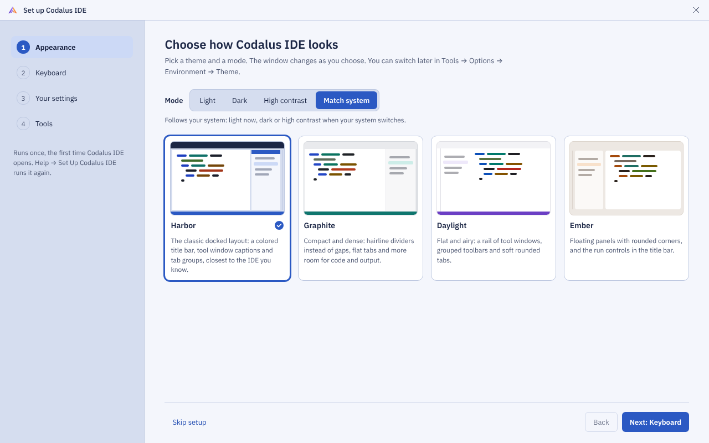

The first step of the first-run setup (M46, built as `SetupWindow`; the smoke step `shell.setup` photographs it as the website's `setup.png`):

- **The families as cards** (since D36, 2026-10-19, five: Classic first and preselected, then the four; on Classic the modes are its Light, Dark and High Contrast, and Blue stays in Options): each card has a small picture of the family's layout in the chosen mode and a line about it. Since M34h the picture is the shell's own chrome in miniature (`ThemePictureView`, shared with Options' cards), drawn with the variant's real resources and syntax colors, not the mockup's drawing: the maintainer asked for the actual look.
- **A mode picker:** Light, Dark, High contrast or Match system. Match system is the default and follows the OS's light, dark and high-contrast settings, as Follow System does today.
- **Live preview:** the setup window repaints in the chosen family and mode as the user clicks ([Ember, Dark](shell-themes/previews/setup-appearance-ember-dark.png)). The IDE behind it does too, through the theme picker's preview (`ThemeService.Preview`).
- **The steps:** Appearance, Keyboard, Your settings, Tools. Skip setup keeps the defaults; Help → Set Up Codalus IDE runs it again.
