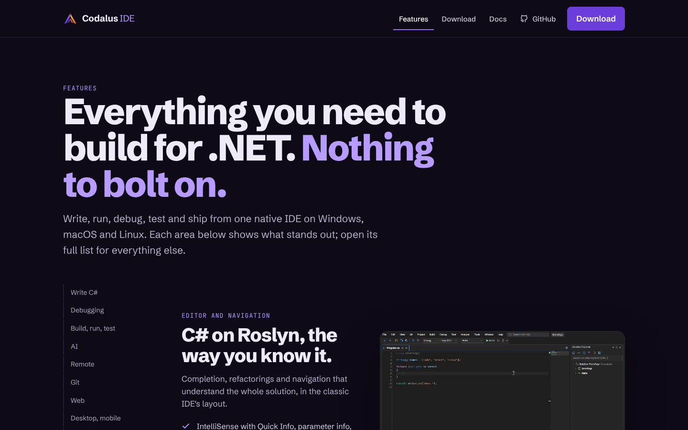
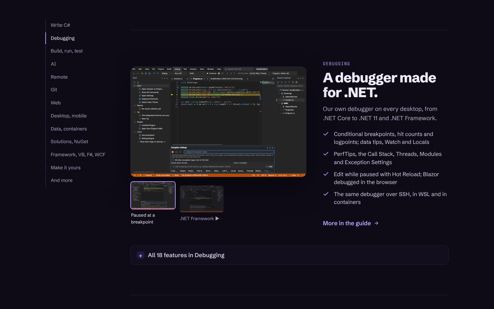
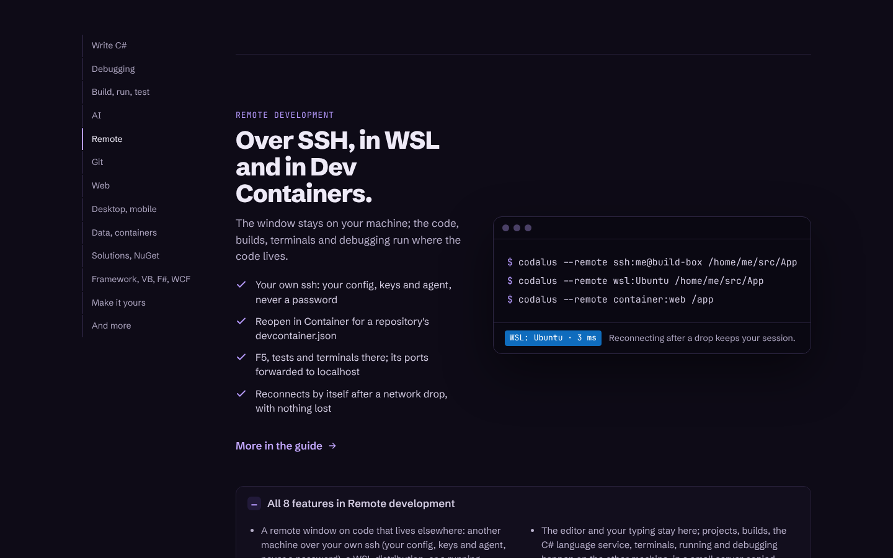
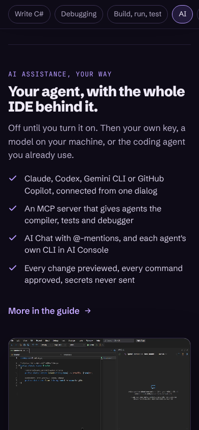

# The Features page: a section per area

The website's Features page (`website/Components/Pages/Features.razor`) as one page with a section per area: its pictures
and videos beside four highlights, its full list folded under them, and a rail that follows the reader. The maintainer
found the current layout hard to use (2026-11-15) and chose this direction over an overview with a page per area and
over a searchable feature table.

Open `website-features/Features.html` in a browser from the repository (it takes the site's own styles, fonts, pictures
and videos from `website/wwwroot/assets/`). It was generated from the page as exported at `faa32801`: the header, the
footer and every card's bullets are the page's own, word for word; the layout, the areas' grouping, the titles, leads and
highlights are new.

| Desktop: the top | Desktop: a section | Desktop: a full list open | Phone |
|---|---|---|---|
|  |  |  |  |

## What changes

- **Now:** a 21-tab screenshot tour, the theme gallery, then 18 cards of equal weight with about 4,700 words of bullets,
  many of them 40 to 60 words long. The tour runs by picture and the cards by area, so a feature's picture and its details
  are a screen apart. The page is about 14,900 pixels tall on a desktop and 28,900 on a phone.
- **Proposed:** 13 sections, in the order a visitor weighs an IDE: Write C# (Editor and Navigation), Debugging, Build, run
  and test, AI, Remote development, Git, Web, Desktop and mobile (WPF, Windows Forms, WinUI 3, Avalonia, .NET MAUI), Data
  and containers, Solutions and NuGet, .NET Framework, Visual Basic, F# and WCF, Make it yours (the theme gallery), And
  more. Each has:
  - an eyebrow, a title that says why it matters, and a one-line lead;
  - four highlights of about 12 words, with a check;
  - its pictures, with thumbnails to switch between them; a picture that has a video plays it, as on the home page
    (site.js, `data-video`); Remote development, without a picture, shows its three `--remote` command lines;
  - "All N features in …": the area's full list, folded (`
`, no script needed), in two columns on a wide screen;
  - a link to its user guide page.
- **The tour goes**: its pictures move into their sections' thumbnails (all but the first-start setup's two, see below).
- **The rail**: on a desktop, a sticky list of the areas beside the sections, marking the one in view; on a phone, a
  sticky row of chips that scrolls sideways. It replaces the chips above the cards.
- About 11,400 pixels tall on a desktop with the lists folded, and 14,600 on a phone: half the phone's length.
- Every item of today's cards stays (194), in its area's full list. Shortening the long ones is a separate pass.

## Open questions

1. **The order.** As above, by what a visitor looks for first; or the current cards' order.
2. **The groups.** Desktop and mobile takes WPF, Windows Forms, WinUI 3, Avalonia and .NET MAUI; .NET Framework,
   Visual Basic, F# and WCF share a section. Or each its own section (18 in all).
3. **The first-start setup's pictures** (`setup.png`, `setup-ai.png`): as thumbnails in Make it yours beside the themes,
   or left out.
4. **The intro**: kept short, with no picture, so the first section's video is the first thing that moves.
5. **Highlights' wording**: written for the mockup from the cards; the build would check each against the user guide.
