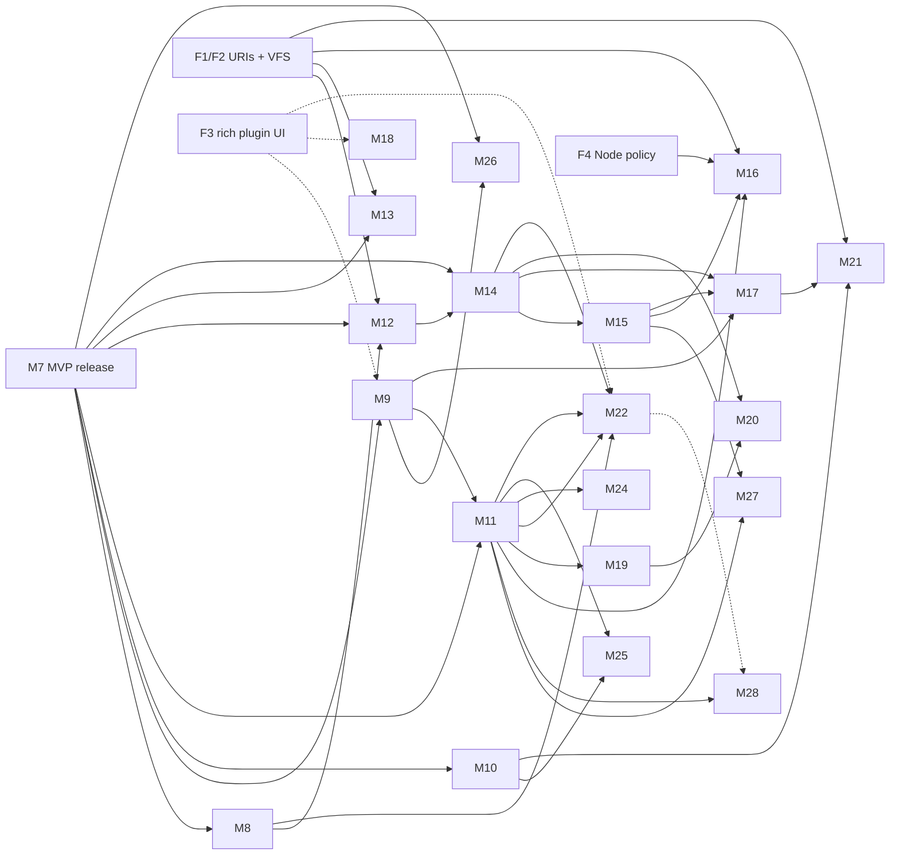

# Post-MVP roadmap

This is the plan for everything after the MVP (M0–M7 in `ide-prompt.md`). It turns the mission's one-line post-MVP list into milestones that future sessions can plan and build one at a time. It also covers the rest of the Visual Studio feature set that the mission's "parity is reachable" goal implies. The [Visual Studio parity matrix](#visual-studio-parity-matrix) maps every VS feature area to the milestone that delivers it, or records it as a gap or a non-goal. It is the checklist that keeps this plan complete.

- **Status:** written 2026-10-08 while M1 was in progress, and checked against Visual Studio 2026 on 2026-10-09. The MVP (M0–M7) is done; M8 was built on 2026-10-09 (checkpoints [M8a](checkpoints/m8a.md) and [M8b](checkpoints/m8b.md)), and M9 the same day ([M9a](checkpoints/m9a.md), [M9b](checkpoints/m9b.md)). On 2026-10-09 the maintainer gave a standing go-ahead for M9 through M16, built in order with each milestone validated on Windows, Linux and macOS.
- **Authority:** `ide-prompt.md` wins over this document. The fixed decisions and non-goals there still apply. ADRs win over this document once they are accepted.
- **Licences:** the licences given below are what we believe them to be when this was written. Check each one again before adopting it, and record it in `THIRD-PARTY-NOTICES.md`. If a licence is ambiguous, stop and ask the maintainer.

## How future sessions use this document

1. Read `ide-prompt.md`, then the latest checkpoint summary, then this document's [status table](#status).
2. Pick the next milestone allowed by the [dependency graph](#dependency-graph) and the maintainer's instructions. The numbers are identifiers, not a strict order. The maintainer may reorder phases.
3. Check the milestone's **Decisions needed** entries against the [decision register](#decision-register). Don't start work that depends on an open decision. Raise it at the checkpoint instead.
4. Follow the normal milestone workflow from `ide-prompt.md`:
   - plan mode
   - ADRs before code
   - task breakdown
   - the definition of done (unit, integration and headless UI tests, CI green on three OSes, budgets met, docs updated)
   - **stop at the checkpoint**
5. The scope lists here are the **target**. At plan time, split a milestone (for example M12a/M12b) if it is too big to ship in one checkpoint. Move items out explicitly with a `TODO(issue)`. Never drop them silently.
6. When planning a milestone, also go through the parity matrix rows that point at it. A row can only move to "gap" or to another milestone with a stated reason.
7. After each checkpoint, update the status table, the parity matrix, the decision register and the [change log](#change-log) at the end of this file.

## Status

| Milestone | Title | Status |
|---|---|---|
| M0 | Scaffold and UI stack spike | done (ADR 0001, 0002) |
| M1 | Shell and plugin foundation | done |
| M2–M7 | MVP (`ide-prompt.md`) | done (checkpoints in `docs/checkpoints/`; M7 is the MVP) |
| M8 | Testing: Test Explorer and code coverage | at checkpoint: M8a (Test Explorer) and M8b (coverage), ADR 0010 and 0011 |
| M9 | Packages and project management | at checkpoint: M9a (NuGet), M9b (properties and solution management), ADR 0012 and 0013 |
| M10 | Integrated terminal and interactive windows | at checkpoint: terminal and C# Interactive, ADR 0014 and 0015 |
| M11 | Language platform: LSP bridge, grammars, file-type editing | at checkpoint: language registry, TextMate grammars, LSP bridge, markup host, ADR 0016 |
| M12 | Editor and code-navigation depth | at checkpoint: M12a (navigation and inline information, ADR 0017) and M12b (editing, refactoring UI and analysis, ADR 0018) |
| M13 | Git depth and hosting integration | planned |
| M14 | Debugger depth | planned |
| M15 | ASP.NET Core and Hot Reload | planned |
| M16 | Razor, Blazor and web front-end | planned |
| M17 | Containers, Aspire and publishing | planned |
| M18 | Profiling and diagnostics tools | planned |
| M19 | Avalonia XAML editing and live previewer | planned |
| M20 | .NET MAUI | exploratory, needs a go/no-go (D6) |
| M21 | Remote development | planned |
| M22 | Plugin platform 1.0 and marketplace | planned |
| M23 | Personalization, settings sync and localization | planned |
| M24 | Visual Basic | planned |
| M25 | F# | planned |
| M26 | Build and project-system depth | planned |
| M27 | Data and Entity Framework Core tooling | planned |
| M28 | AI assistance | needs a decision (D7) |
| M29 | Visual Studio look and feel | at checkpoint: title row and search, standard toolbar, themes, keyboard schemes, Solution Explorer, Options tree, ADR 0019 |

New milestones get the next free number and join the phase they belong to, so the numbers stay stable. The phase tables give the order.

## Baseline: what the MVP is assumed to deliver

This plan assumes M7 ends with what `ide-prompt.md` describes. **At the M7 checkpoint, compare this list with what was actually built, and carry any deferred `TODO(issue)` items into the right post-MVP milestone.**

- **Shell** (`Daedalus.Shell`, Avalonia 12, Native AOT): docking with persisted layouts, commands, key bindings, the palette and menus, JSON settings with a UI, themes (light, dark, high contrast), status bar, Output window, notifications.
- **Workbench services** (`Daedalus.Workbench`) and the platform layer (`Daedalus.Platform`: paths, file watching, process launching, shell integration, keys).
- **Language service host** (`daedalus-lshost`): Roslyn C# with the M3 feature set (highlighting, completion, navigation, rename, code fixes with preview, formatting, Go To All, Find in Files, analyzers, source generators).
- **Build host**: MSBuild evaluation and builds, solution and project model, file nesting, project edits, `dotnet new` templates, configurations, multi-targeting.
- **Debugging**: a DAP client plus netcoredbg, with the M5 feature list and a documented list of known gaps.
- **Git**: the M6 feature set, using LibGit2Sharp or the git CLI as decided in the M6 ADR.
- **Plugins**: plugin API 0.x (ADR 0003): out-of-process hosts, declarative contributions, tree and Markdown views. The rich-UI ADR (webview or remote UI) is due by M6.
- **Release**: installers for three OSes, local opt-in crash reporting, performance gates in CI, a public repository.

## Principles for post-MVP work

These add to the architecture principles in `ide-prompt.md`. They don't replace them.

- **Every feature names its process.** Each milestone says where its code runs: shell, an existing host, a new supervised host, or the user's process. A new host starts lazily, never at startup, so the idle-memory budget (ADR 0002, ≤ 250 MB) holds. It is supervised by `SupervisedProcess` and follows the crash-loop policy.
- **Plugin first, where latency allows.** As ADR 0003 says, a new feature is a built-in plugin unless it sits on a latency-critical path. When a feature needs an API that doesn't exist yet, it is added under `Daedalus.Plugins.Abstractions.Proposed` first. Built-ins using proposed APIs is how the API gets proved before 1.0 (M22).
- **The shell owns generic UI, providers own data.** Examples: the shell renders Test Explorer, and test controllers supply tests. The shell renders language features, and language services (Roslyn, LSP servers) supply data. This keeps large views virtualized and AOT-clean, and lets third parties plug in.
- **Reuse before writing.** Prefer maintained MIT, Apache-2.0 or BSD components. When a VS feature is backed by something proprietary, say so, and either build an open replacement or record a known gap.
- **Every interactive surface gets a budget.** Each milestone adds harness scenarios, measures Rider (and VS Code where relevant), and proposes budgets at its checkpoint. The rule is the same as in ADR 0002: at least as good as VS Code for editor surfaces, and at least as good as Rider for solution and language features.
- **Every protocol extension is documented** in `docs/protocol.md` or `docs/plugin-protocol.md` with the `daedalus/` prefix. Plugin API changes are listed in the plugin changelog.

### Known proprietary traps

These come up repeatedly in post-MVP areas. They are **off limits** unless a later licence check shows otherwise:

- **vsdbg** and the **C# Dev Kit** (named in the mission).
- **Debugging and diagnostics:** Visual Studio's debugger engines, the Visual Studio profiler and diagnostics hub, IntelliTrace.
- **Code coverage:** `Microsoft.CodeCoverage` and `Microsoft.Testing.Extensions.CodeCoverage`. Verify their licences. Treat them as excluded unless they are OSI-licensed.
- **AI and collaboration:** IntelliCode, the GitHub Copilot language server and Copilot's Visual Studio integrations, Live Share.
- **Testing:** Microsoft Fakes, IntelliTest (Pex), and the Visual Studio test adapters' proprietary extensions.
- **Remote and cloud debugging:** the Visual Studio remote debugger (msvsmon) and the Snapshot Debugger.
- **UI designers:** the .NET MAUI extension for VS Code and Visual Studio's XAML designer and XAML Hot Reload.
- **Visual Studio packages:** most `Microsoft.VisualStudio.*` packages, which ship under Visual Studio licence terms. Check each one. Some, such as `Microsoft.VisualStudio.Threading`, are MIT.
- **Hosted services:** Dev Tunnels and other Microsoft-hosted services. Don't depend on them by default. If one is ever offered, it is an opt-in plugin.

## Foundational decisions to settle early

These decisions get more expensive with every milestone. **Raise them at the M7 checkpoint at the latest.** Some of them (F1 and F4) affect public contracts that become harder to change once the repository is public and plugins exist.

| # | Decision | Why it matters | Recommendation |
|---|---|---|---|
| F1 | **Document identity: file paths or URIs.** The M0–M3 protocols identify documents by file path. | Remote development (M21), decompiled and Source Link documents (M12), Git revisions in diff views (M13), virtual and generated documents (Razor, M16), and untitled buffers all need non-file documents. LSP uses URIs. | Switch every shell↔host and plugin contract to URIs (`file:`, `untitled:`, `daedalus-decompiled:`, `daedalus-git:`, `daedalus-remote:`) before the plugin API reaches 1.0, ideally before going public. Keep path helpers in the SDK. |
| F2 | **Virtual file system.** `Daedalus.Platform` has a file watcher, but there is no file-system abstraction. | The same features as F1. Without this, remote development becomes a rewrite. | Add `IFileSystemProvider`, chosen by URI scheme, in `Daedalus.Platform`. Route every editor, Solution Explorer and search read through it. |
| F3 | **Rich plugin UI.** ADR 0003 requires a webview or remote-UI ADR by M6. | NuGet UI (if built as a plugin), test result details, profiler views, the previewer, and third-party tools. | Follow the M6 ADR. This plan assumes some rich surface exists by M9. If it doesn't, those UIs are built into the shell and move later. |
| F4 | **Node.js policy.** | The best open web language servers (HTML, CSS, JSON, TypeScript) and debuggers (`vscode-js-debug`, which also bridges Blazor WebAssembly debugging) run on Node. So do the Dockerfile language server and the Dev Containers CLI. | Download a pinned, checksum-verified Node runtime on demand, the first time a feature needs it. Don't bundle it, and don't require a user install. This needs an ADR (D3). |
| F5 | **Language host topology.** | VB, F#, Razor and LSP servers need a home. | Roslyn C# and VB share `daedalus-lshost`. Razor is cohosted in the same Roslyn host. F# runs in its own process (FsAutoComplete or our own FCS host). Everything else goes through the generic LSP bridge (M11). |
| F6 | **Workspace trust.** | Opening a solution runs MSBuild evaluation, analyzers and source generators, all of which can run arbitrary code. Plugins and tasks add more. That matters once the repository is public. | Add a "restricted mode" for untrusted folders before or with the public release. It parses but doesn't evaluate, build or load analyzers, generators or workspace plugins until the user trusts the folder. Raise this at the M7 checkpoint (D4). |
| F7 | **Per-solution state.** | Breakpoints, open documents, layouts, test playlists, profiles and caches need a home. | `.daedalus/` next to the solution (git-ignored, like `.vs/`) for state the user may want to inspect or share. User-local caches go in the platform data directory, keyed by a solution hash. |

## Phase overview

| Phase | Milestones | Theme |
|---|---|---|
| 1. Daily driver | M8, M9, M10 | What a C# developer misses most on day one after the MVP: tests, packages, a terminal. |
| 2. Language platform | M11 | Pluggable languages (LSP bridge, grammars) and editing for the non-C# files every .NET repository has. |
| 3. Depth | M12, M29, M13, M14, M26 | Bringing the editor, Git, the debugger and the build and project tooling from "MVP" to "VS-class", and the look and feel from VS Code's to Visual Studio's (M29). |
| 4. Web, data and cloud-native | M15, M16, M27, M17 | ASP.NET Core, Blazor, Hot Reload, EF Core and databases, containers, Aspire, publishing. |
| 5. Diagnostics | M18 | Profiling, counters, memory analysis, dumps, benchmarks. |
| 6. UI frameworks | M19, M20 | Avalonia XAML with a live previewer. MAUI is exploratory. |
| 7. Remote | M21 | SSH, WSL, Dev Containers. |
| 8. Ecosystem | M22, M23, M28 | Plugin API 1.0, marketplace, profiles, sync, localization, and AI assistance if D7 says yes. |
| 9. Visual Basic and F# | M24, M25 | Rich editing for the mission's other .NET languages, on top of the language platform. |

**Why this order.**
- Tests, NuGet and a terminal are what stop people from using the IDE every day.
- The language platform (M11) comes early, because it proves the "pluggable language services" requirement and every later language and file type builds on it.
- Web development is the biggest .NET workload. It comes after depth work because Hot Reload and Blazor debugging build on M12 and M14. Data tooling (M27) sits with it, because EF Core and a database are part of most web apps.
- AI assistance (M28) is a headline Visual Studio 2026 feature, but it waits for D7. It goes after the plugin API freeze (M22), because it should be built on public provider APIs.
- Remote development comes late because it touches every host. F1 and F2 make sure it doesn't need a rewrite.
- VB and F# come last, after everything else. Solutions with VB and F# projects already load, build and run from the MVP, and the C# depth, web and tooling work serves more users first. M11 keeps them cheap whenever they are picked up.

### Dependency graph

A dashed edge means "better with", not "blocked by".

---

## Phase 1: Daily driver

### M8 — Testing: Test Explorer and code coverage

**Status.** Built as M8a and M8b ([m8a.md](checkpoints/m8a.md), [m8b.md](checkpoints/m8b.md)). Deferred, each with a `TODO(issue)` in the checkpoint notes: the HTML coverage report (ReportGenerator), coverage in the Solution Explorer, CodeLens test entries (M12), Rider comparison numbers, and test hosts the IDE doesn't start itself.

**Goal.** Discover, run, debug and analyse tests across the solution, with coverage shown in the editor. This should be at least as capable as Rider's unit-test runner for the mainstream frameworks.

**Depends on.** M4 (builds), M5 (debugging). A split into **M8a** (Test Explorer) and **M8b** (coverage) is allowed.

**Scope.**
- **Frameworks:**
  - xUnit v2 and v3, NUnit 3 and 4, MSTest 3 and later.
  - Both test platforms: VSTest, and Microsoft.Testing.Platform (MTP) for projects that opt into it.
  - TUnit (MTP only), if its licence checks out.
  - F# frameworks (Expecto) are added in M25.
- **Discovery:**
  - **Source-based** discovery from Roslyn gives a tree immediately after the solution opens, before any build. It finds methods with known test attributes.
  - **Runner-based** discovery runs after a build and is authoritative: data rows, theories, dynamic tests.
  - The two are merged by fully qualified name and source location.
- **Test Explorer tool window:**
  - A virtualized hierarchy: project, namespace, class, method, data row.
  - Grouping by project, namespace, class, trait, outcome or duration.
  - A filter syntax: free text, `trait:`, `outcome:`, `project:`.
  - Run all, failed, selected or not-run tests. Repeat the last run. Cancel.
  - Playlists, saved as JSON under `.daedalus/`. VS `.playlist` files can be imported.
- **Results:**
  - outcome, duration, message, stack trace with clickable frames, stdout and stderr, attachments
  - the history of the last N runs per test
  - export to TRX and import TRX files (for example from CI), shown in the same views
  - snapshot-testing support: Daedalus can be registered as the diff tool for Verify and similar libraries, through the `daedalus diff` command line (see [Release, updates and the command line](#release-updates-and-the-command-line))
- **Create Unit Tests:** a command on a method or type that generates a test stub in a chosen (or new) test project for the chosen framework, like Visual Studio's command.
- **Remote test environments** (running tests in WSL, a container or over SSH, like Visual Studio's `testenvironments.json`) come with M21.
- **Editor integration:** run, debug and status glyphs in the gutter. CodeLens entries ("Run | Debug | ✓ 12 ms") come once CodeLens lands in M12. Failed tests can be navigated to with F8-style "next failure" commands.
- **Debugging tests:**
  - **VSTest:** the IDE launches the test host itself through the translation layer's custom-launcher API, under netcoredbg.
  - **MTP:** the test application runs under the debugger with a filter by test UID.
- **Settings:**
  - the `.runsettings` selection and MTP `testconfig.json`
  - the target framework for multi-targeted test projects, the architecture, environment variables, parallelism
  - an option to run affected tests after a build
- **Coverage (M8b):**
  - **Coverlet:** the VSTest collector, and Coverlet's MTP integration if it is available. Otherwise `coverlet.console`.
  - **Coverage Results window:** a tree by assembly, namespace, class and method, with line and branch percentages.
  - **Editor:** covered, partially covered and uncovered gutter colouring.
  - **Results:** merged across test projects, exported as Cobertura, and optionally turned into an HTML report.

**Out of scope.** Live Unit Testing (see [candidates](#unscheduled-candidates)) and test impact analysis.

**Architecture.**
- **Shell:** owns the Test Explorer view, the gutter glyphs, the result details view and the coverage overlay (generic, AOT-clean, virtualized).
- **New plugin API (proposed):** a **test controller** API, modelled on VS Code's `TestController`, to report items, run requests, results and output. Test providers are plugins.
- **Built-in plugin `Daedalus.Plugins.DotNetTest`:**
  - implements the controller with the VSTest translation layer and an MTP client
  - runs in a **dedicated** plugin host, because it can be heavy
  - gets two other new plugin APIs (proposed): `IBuild` to request builds, and `IDebug` to start a debug session with a launch configuration
- **`daedalus-lshost`:** adds `daedalus/testCandidates` for source-based discovery: test methods per document, with ranges. The shell forwards the results to the controller.
- **Coverage:** runs inside the test plugin. Line data is pushed to the shell as a decoration layer, keyed by document URI.

**Dependencies.**
- `Microsoft.TestPlatform.TranslationLayer` (MIT)
- An MTP server-mode client. MTP (`microsoft/testfx`) is MIT. Implement against its documented JSON-RPC protocol, and reference packages only where needed.
- `coverlet.collector` and `coverlet.console` (MIT)
- ReportGenerator (Apache-2.0, optional)

**Decisions needed.** None beyond the standing ones. The ADR covers the VSTest/MTP split.

**ADRs.** "Test platform integration" (process model, controller API, VSTest vs MTP, debugging tests). "Code coverage engine".

**Fixtures and tests.**
- `samples/Testing/`:
  - xUnit v2, xUnit v3 (MTP), NUnit, MSTest in both VSTest and MTP modes
  - theories and data rows, a multi-targeted test project
  - failing, skipped, hanging (for cancellation) and output-writing tests
- A `FixtureGen` target that generates 5,000 tests across 20 projects.
- Integration tests drive the plugin against the fixtures. A headless UI test checks tree population and filtering.

**Budgets to propose** (measure Rider first):
- Source-based tree for Solution50 plus the 5k-test fixture: ≤ 1 s after the solution tree appears.
- Discovery after a build: compare with Rider.
- Filtering 10k nodes: no frame > 50 ms.
- Run → first result shown: compare with Rider.

**Risks.**
- Different VSTest and MTP behaviour across framework versions.
- Timing of the test-host debug launch.
- Stability of the MTP server protocol across .NET SDK versions.
- Coverlet's support for MTP.

**Exit criteria.** All four frameworks discover, run, debug and report on three OSes. Coverage is shown in the editor for the fixtures. The controller API is documented as proposed.

### M9 — Packages and project management

**Goal.** The NuGet Package Manager, project properties, and the solution-management dialogs VS users rely on. No more hand-editing XML for routine work.

**Depends on.** M2 (project system), M4 (build/restore). F3 is helpful but not required.

**Scope.**
- **NuGet Package Manager**, at project and solution level:
  - Browse, Installed, Updates and Consolidate tabs.
  - Search across all sources from the effective `NuGet.Config`. Prerelease toggle and version picker.
  - Package details: dependencies per TFM, licence, README rendered as Markdown, links, download counts.
  - Badges for vulnerabilities, deprecation and the alternative package.
  - Licence acceptance for packages that require it.
  - Transitive packages view with "why is this here".
  - Restore progress and errors.
- **Central Package Management:**
  - edits `Directory.Packages.props`
  - understands `VersionOverride`, `GlobalPackageReference` and package source mapping
- **Package sources UI:** add, remove, enable and order sources, and map package patterns to sources.
- **Credential providers:** use the NuGet cross-platform credential-provider protocol, and invoke installed providers such as the Azure Artifacts provider. Don't bundle them.
- **Project properties UI.** Each page shows evaluated values, where a value comes from (the project file, `Directory.Build.props` or the SDK default), and its conditions. It writes the minimal change.
  - **Application:** TFMs, output type, assembly name, root namespace, nullable, implicit usings, language version.
  - **Build:** defines, warnings as errors, `NoWarn`, platform target, optimisation, debug symbols, deterministic builds.
  - **Package:** pack metadata, icon, README, licence expression, symbols.
  - **Code analysis:** `AnalysisLevel`, `EnforceCodeStyleInBuild`, analyzer packages.
  - **Signing:** strong naming.
  - **Debug:** a launch profile editor for `launchSettings.json` (command name, arguments, environment, working directory, application URL, launch browser).
- **References:**
  - add project and assembly references, with a filter
  - analyzer references
  - shared projects (`.projitems` imports), as display and edit only, at low priority
- **Solution management:**
  - Configuration Manager: solution-to-project configuration and platform mapping, written to `.sln` and `.slnx`.
  - Project build dependencies and build order.
  - Load and unload projects. Solution filters (`.slnf`): open, create and save.
  - `global.json` SDK selection, and status of installed SDKs and workloads.
- **Pack:** a `dotnet pack` command with output navigation.
- **Local .NET tools:** view and edit the `.config/dotnet-tools.json` manifest, install and update tools, and restore them. Global tools are listed too.
- **Package Manager Console:** Visual Studio's PowerShell console isn't reproduced. Its main uses are covered elsewhere: package commands by this UI, EF Core commands by M27, and `dotnet` commands in the integrated terminal (M10).

Build-level and file-level project features (the Properties window, Show All Files, batch build, the binlog viewer, custom tools) are in M26.

**Architecture.**
- **Build host:**
  - `daedalus/packages/*`: search, metadata, install, update, uninstall and consolidate. Built on NuGet.Protocol. Edits go through MSBuild's `ProjectRootElement`, followed by a restore.
  - `daedalus/projectProperties/*`: read evaluated and unevaluated values with provenance, and write them with a condition scope.
  - All network access happens here. It is cancellable, uses the system proxy, supports an offline mode, and caches results.
- **UI:**
  - **NuGet manager:** if F3 delivered a rich plugin surface, the UI is a built-in plugin and the first real consumer of that surface. Otherwise it is a built-in shell view.
  - **Property pages:** built into the shell and generated from a page schema, so F# and VB pages reuse the same machinery.
- **Edits must match the CLI.** The resulting file content must match what `dotnet add package` and `dotnet remove package` would produce. Tests compare the two.

**Dependencies.** NuGet.Protocol, NuGet.Configuration, NuGet.Versioning and NuGet.Packaging (Apache-2.0). Reuse the Markdown renderer chosen in M1.

**ADRs.** "Package management architecture", covering the NuGet API surface used, CPM, credentials and offline mode. "Project property pages schema".

**Fixtures and tests.**
- `samples/Packages/`: plain PackageReference, CPM, multi-targeted, and package source mapping.
- A local file feed generated by `FixtureGen`, with packages that need licence acceptance, prerelease packages and deprecated packages.
- An in-process mock NuGet V3 server (Kestrel) in tests, for search and vulnerability data.
- Golden-file tests that check project file edits preserve formatting.

**Budgets to propose.**
- Browse, first page rendered after the response arrives: ≤ 200 ms.
- Install → restored and IntelliSense updated: ≤ restore time + 2 s.
- Property pages open: ≤ 300 ms.

**Risks.**
- Preserving formatting and comments in project files.
- CPM edge cases.
- Credential providers on macOS and Linux.
- Large `Directory.Build.props` hierarchies make provenance hard to show clearly.

### M10 — Integrated terminal and interactive windows

**Goal.** A fast, accessible integrated terminal, and a C# Interactive window.

**Depends on.** M1 (shell), M3 (the editor control, its automation peer and themes). M9 is optional (`#r "nuget:"`).

**Scope.**
- **Terminal tool window:**
  - Several instances and splits.
  - Profiles: pwsh, bash, zsh, fish and cmd, plus a "dotnet developer" profile with the SDK environment.
  - The working directory defaults to the solution directory.
- **Shell integration:**
  - cwd tracking (OSC 7) and command marks (OSC 133)
  - clickable paths with `file:line:col` that open in the editor
  - clickable URLs
- **Emulation:** xterm-compatible.
  - true colour, wide and emoji characters, combining marks
  - alternate screen (vim and htop work), mouse reporting, bracketed paste
  - IME, resizing, configurable scrollback, find
- **Theme and fonts:**
  - IDE theme colours, including high contrast
  - font settings
  - configurable key passthrough: which shortcuts go to the terminal and which go to the IDE
- **Accessibility:** a screen-reader mode that exposes the buffer through the same UIA/AX text-pattern peer the editor got in M3.
- **Run in terminal:** console apps run with "Run without debugging" can use the integrated terminal for stdin and stdout, controlled by a setting (the external console is the alternative). The same option exists for debugging, through a netcoredbg console redirect.
- **C# Interactive:**
  - A REPL on Roslyn scripting, with its own editor input (highlighting, completion and signature help served by `daedalus-lshost` as script documents) and a history.
  - Supports `#r` and `#load`. `#r "nuget:"` uses the M9 package service.
  - "Initialize Interactive with Project" and "Send selection to Interactive".

**Architecture.**
- **PTY:** lives in `Daedalus.Platform`, using ConPTY on Windows and `openpty`/`forkpty` on Unix through P/Invoke. This is AOT-safe and needs no extra host.
  - **Justification to record:** terminal I/O is latency-critical but light, and child processes are already isolated from the shell.
  - If the ADR concludes that PTY handling must leave the shell (for example for crash isolation), it becomes `daedalus-ptyhost`.
- **VT engine and renderer:** a VT parser and screen model, plus a custom Avalonia control that renders glyph runs with dirty-row invalidation and a glyph cache.
- **REPL host:** a new `daedalus-replhost`, out of process. It runs user code, which must never run in the shell or the language host. It is supervised, so a crash or `Environment.Exit` in a script only restarts the REPL.

**Dependencies (candidates for the ADR).**
- XtermSharp (MIT): VT engine. Check its maintenance and AOT compatibility.
- `vs-pty.net` (MIT): PTY. Check its AOT compatibility, or write our own P/Invoke.
- `Microsoft.CodeAnalysis.CSharp.Scripting` (MIT).

**ADRs.** "Terminal emulator: engine, renderer, PTY placement". "Interactive (REPL) host".

**Fixtures and tests.** Recorded VT streams (`ls --color`, vim, htop, a progress bar, `dotnet build`) are replayed into the engine and compared with screen snapshots. PTY integration tests run on all three OSes. REPL tests cover crash and restart.

**Budgets to propose** (compare with VS Code's terminal and Windows Terminal):
- Keystroke echo → displayed frame: p99 within the editor typing budget.
- `cat` of a 1M-line file: no frame > 50 ms, and throughput comparable to VS Code.
- Memory per terminal with 10k scrollback lines: ≤ 30 MB.

**Risks.**
- ConPTY differences between Windows versions. The supported Windows floor needs a decision.
- The macOS login-shell environment.
- IME in a custom-drawn control.
- Screen-reader support for a live buffer.

---

## Phase 2: Language platform

### M11 — Language platform: LSP bridge, grammars and file-type editing

**Goal.** Make "a language" a pluggable unit, as the mission requires for F# and VB. Give first-class editing to the non-C# files every .NET repository has.

**Status.** Built ([m11.md](checkpoints/m11.md), [ADR 0016](adr/0016-language-platform.md)). Deviations: LSP types stay narrowed and source-generated, with a normalizer instead of a `metaModel.json` generator; JSON, XML, MSBuild and YAML services run in a new `daedalus-markuphost`, which asks the build host for evaluated MSBuild values through the shell; JSON Schema validation is our own subset (JsonSchema.Net is no longer OSI-licensed). Deferred, each with a `TODO(issue)` in the checkpoint: XSD validation, the `.resx` editor, YAML completion, package completion in MSBuild, Go to Definition across imports, inlay hints, hierarchies, pull diagnostics, selection ranges, linked editing, CodeLens and document symbols for non-C# languages, snippet tab stops, several servers per language, and the PowerShell Editor Services sample (a smaller `.todo` sample with its own server proves the same path).

**Depends on.** M3 (the language-service abstraction), M9 (package and property data for MSBuild editing). F1 strongly recommended.

**Scope.**
- **Language registry.** Plugins contribute these through `contributes.languages`, `contributes.grammars` and `contributes.languageConfigurations`:
  - language ids, extensions, file names and first-line patterns
  - TextMate grammars
  - language configuration: comments, brackets, auto-closing pairs, indentation rules, word pattern, folding markers
- **Generic LSP bridge.** A plugin declares a language server (`contributes.languageServers`: command, arguments, transport, activation, initialization options, settings section). The shell supervises it and maps LSP 3.17 onto the same UI C# uses:
  - completion, hover, signature help
  - definition, declaration, implementation, references, rename
  - code actions, formatting (document, range and on-type)
  - semantic tokens, inlay hints, call and type hierarchy
  - push and pull diagnostics
  - document and workspace symbols (which feed Go To All)
  - folding, selection ranges, linked editing, CodeLens
- **Built-in file types:**
  - **MSBuild** (`.csproj`, `.fsproj`, `.vbproj`, `.props`, `.targets`, `Directory.Packages.props`):
    - Completion for elements, properties, items, metadata and well-known targets. Value completion for TFMs, RIDs, package ids and versions (from M9), and enums.
    - Hover shows the **evaluated value and its origin** from the build host.
    - Go to definition across imports.
    - Diagnostics for unknown items and invalid values.
    - This is a strength no other cross-platform editor has, because we own the evaluation.
  - **JSON with schemas:**
    - `global.json`, `launchSettings.json`, `appsettings*.json`, `.config/dotnet-tools.json`, `daedalus-plugin.json`
    - `testconfig.json` and `runtimeconfig.template.json`
    - any file mapped through the SchemaStore catalogue (cached, with an offline fallback)
  - **XML with XSD validation:** `.runsettings`, `nuget.config`, `.slnx`, `.resx`, `.xsd` and `.xml`.
  - **`.editorconfig`:** key and value completion from Roslyn's option metadata, plus hover documentation.
  - **`.resx` editor:** a grid editor for string resources (name, value, comment), with an "open as XML" toggle. Image and file resources can be viewed and replaced. It also generates the strongly typed resource class, which Visual Studio does with its `ResXFileCodeGenerator` custom tool. Use the SDK's own strongly-typed resource generation where the project allows it, and the M26 custom-tool mechanism otherwise. A multi-language view shows the neutral and localized `.resx` files side by side, with missing translations highlighted. The WinForms resource designer is a non-goal.
  - **YAML with schemas:** GitHub Actions and Azure Pipelines.
  - **Markdown** with a live preview.
- **Language-agnostic features:**
  - word-based completion as a fallback
  - indentation folding, bracket matching
  - encoding and BOM detection, binary-file detection
- **Other languages.** Visual Studio's other workloads (Python, Node.js, C++, PowerShell, Bicep and so on) aren't first-party goals. The bridge makes each of them a plugin over an existing open-source language server. Only the web languages (M16) and SQL (M27) are built in.
- **Samples:** a sample plugin that contributes a grammar plus an LSP server (for example PowerShell Editor Services, MIT) as an end-to-end proof, shipped under `samples/plugins/`.

**Architecture.**
- **New library `Daedalus.LanguageServices.Lsp`:** LSP types are **source-generated from the LSP `metaModel.json`** (MIT, from `vscode-languageserver-node`), which keeps them AOT-safe. It also holds the client and the adapter to the shell's language-service abstraction.
- **LSP servers:** supervised child processes of the shell. They are declared by manifests, so no plugin code is loaded to start a server.
- **TextMate tokenization:** runs off the UI thread, viewport first, like semantic tokens.
- **MSBuild language service:** lives in the **build host**, next to the evaluator. JSON, XML and YAML services run in a small `daedalus-markuphost`, or in the plugin host. The ADR decides.

**Dependencies.**
- TextMateSharp (MIT; AvaloniaEdit already integrates it).
- TextMate grammars: check each one. Most of VS Code's are MIT.
- JsonSchema.Net or NJsonSchema (MIT).
- YamlDotNet (MIT).
- Markdig (BSD-2-Clause), if it isn't adopted earlier.

**ADRs.** "Language service abstraction v1 and the LSP bridge" (feature mapping, multi-server per language, ordering and merging). "MSBuild language service". "Schema-based editing".

**Fixtures and tests.**
- A **conformance test LSP server** in `tests/`, with a scripted subset per feature, for the bridge tests.
- MSBuild editing tests against `samples/Solution50` and CPM fixtures.
- Grammar tokenization snapshot tests.

**Budgets.** Typing budget 2 must hold in every file type, since tokenization and LSP calls are async. Opening a 100k-line XML or JSON file must meet budget 3a.

**Risks.**
- LSP servers that only work well in VS Code (custom client capabilities).
- Grammar licences.
- Merging results from several providers (for example C# plus a plugin's CodeLens).

---

## Phase 3: Depth

### M12 — Editor and code-navigation depth

**Goal.** Close the gap between the MVP editor and Visual Studio or Rider for daily C# work. This milestone is large. **Plan it as M12a** (navigation and inline information) **and M12b** (editing, refactoring UI and analysis).

**Status.** M12a built ([m12a.md](checkpoints/m12a.md), [ADR 0017](adr/0017-navigation-and-inline-information.md)). Deviations: CodeLens shows at the end of the declaration's line (AvaloniaEdit has no variable line heights). Deferred, each with a `TODO(issue)` in the checkpoint: members and generated sources in Solution Explorer, Class View and the Object Browser, symbol servers, Git and test CodeLens, and the persistent Go To All index.

**Depends on.** M3, M8 (test CodeLens), M6 (Git CodeLens), F1 (decompiled and Source Link documents).

**Scope, M12a (navigation and inline information).**
- **Navigation:**
  - Peek Definition, Go to Base and Go to Derived, Call Hierarchy, Type Hierarchy
  - a navigation bar (project, type and member drop-downs), breadcrumbs, Document Outline
  - navigation history, if it wasn't finished in M3, plus go to the last edit location
  - **Code Definition window:** a tool window that follows the caret and shows the definition of the symbol under it
  - **Find All References depth:** grouping (project, definition, path), read and write classification, filters, and kept result sets
  - **Solution Explorer members:** expand a file node to see its types and members, as Visual Studio does
  - **Generated sources:** files produced by source generators are listed under each analyzer in Solution Explorer and open as read-only documents
  - **F1 help:** opens the API documentation page for the symbol under the caret (learn.microsoft.com for framework types, the package's project URL otherwise)
- **Metadata navigation:**
  - Go to definition on a library symbol opens **Source Link** sources, or embedded sources from the PDB, when they are available.
  - Otherwise it opens **decompiled C#** (ICSharpCode.Decompiler).
  - Symbol servers (the Microsoft and NuGet symbol servers) are an opt-in setting, because they make network calls.
- **Class View and Object Browser:** browse the solution's types and the referenced assemblies, with search.
- **Inline information:**
  - **CodeLens:** reference counts, implementations, tests (M8), and Git authors and changes (M6). Computed lazily, for the viewport only, off the UI thread.
  - inlay hints for parameters and types
  - sticky scroll, structure guides, bracket-pair colourization, reference highlighting
  - an **inheritance margin**: gutter glyphs for implemented, implementing, overridden and overriding members, with navigation
  - **inline diagnostics**: messages shown at the end of the line, as an option
  - **scroll-bar annotations** (Visual Studio's "map mode"): changes, errors and warnings, breakpoints, bookmarks, find results and the caret
  - **embedded languages:** Roslyn's highlighting, completion and diagnostics for regular expressions, JSON and date-format strings inside string literals (`StringSyntax`)
  - a document health indicator (error and warning counts for the file, with navigation)

**Scope, M12b (editing, refactoring UI and analysis).**
- **Snippets:**
  - our JSON format, and import of VS `.snippet` XML
  - Insert Snippet and Surround With
  - snippets as completion items
  - snippet contributions from plugins
  - a Code Snippets Manager (browse, import, edit, per language)
- **Editing:**
  - paste with automatic usings, smart paste
  - duplicate line, move line, box selection (if it wasn't done in M3)
  - expand and shrink selection (Roslyn selection ranges)
  - format on save, paste and type
  - XML doc comment generation
  - a clipboard ring (paste from the last N copies)
  - Paste JSON as classes and Paste XML as classes
  - per-language text editor options for what `.editorconfig` doesn't cover: word wrap, whitespace display, column guides, line numbers, font ligatures, zoom per editor
- **Safety:**
  - **AutoRecover / hot exit:** dirty buffers are saved to a backup location periodically, and restored after a crash or when the IDE closes with unsaved changes (if it wasn't done in M3)
  - **local history:** a timeline of saved versions of each file, kept independently of Git, with diff and restore (a Rider feature that Visual Studio lacks, cheap given the M6 diff viewer)
- **Tabs and windows:**
  - pinned tabs, vertical tabs, tab colouring by project or file type
  - "close all but this", "close all to the right"
  - the Ctrl+Tab window switcher (most-recently-used documents and tool windows)
  - documents floating on other monitors (Dock supports floating windows)
- **Refactorings that need UI.** Roslyn's "options services" need dialogs:
  - Change Signature, Extract Interface, Extract Class, Pull Members Up, Move Type and Move Static Members
  - Generate Overrides, Generate Equals/GetHashCode and Generate Constructor (member pickers)
  - Encapsulate Field, Introduce Parameter
  - **Protocol:** a generic `daedalus/codeAction/resolveOptions`. The host returns an options schema, the shell renders a generic, accessible dialog, and the host applies the result with the usual diff preview.
- **Code Cleanup:** profiles (sets of fixers, as in `dotnet format`), run on demand or on save.
- **Analysis configuration:**
  - "Configure severity" writes to `.editorconfig` or `.globalconfig`.
  - An EditorConfig settings UI, generated from Roslyn's option metadata.
  - Suppressions: in source, in a suppression file, or in `.editorconfig`.
- **Error List depth:**
  - grouping and filtering by project, document, severity, code, and build vs live diagnostics
  - full-solution analysis scope: open documents, the current project, or the whole solution
- **Task List:** the `TODO`, `HACK` and `UNDONE` tokens, which can be configured.
- **Code Metrics:**
  - maintainability index, cyclomatic complexity, depth of inheritance, class coupling, lines of code
  - per project, type and member
- **Other:**
  - bookmarks, with names and folders
  - a compare-any-two-files command (reuses the M6 diff viewer)
  - encoding and line-ending UI
  - a hex viewer for binaries, and an image viewer (PNG, JPEG, GIF, SVG, ICO) with zoom
- **Spell checking** in comments and strings (D9: dictionary licensing).
- **Roslyn component authoring**, for people who write analyzers and source generators:
  - a **Syntax Visualizer** tool window: syntax tree, tokens, trivia and the `IOperation` tree for the caret position, plus semantic information (symbol, type, converted type)
  - templates for analyzer, code fix and source generator projects
  - debugging a generator or analyzer by running the compiler under the debugger (Visual Studio's `DebugRoslynComponent` launch profile) is in M14

**Architecture.**
- Mostly `daedalus-lshost` (Roslyn) and the shell.
- Decompilation and Source Link resolution run in `daedalus-lshost` and produce `daedalus-decompiled:` and `daedalus-sourcelink:` documents (F1).
- **Go To All index:** a persisted cache for fast reopen. Investigate Roslyn's own persistent storage before writing our own.

**Dependencies.**
- ICSharpCode.Decompiler (MIT).
- Microsoft.SymbolStore (MIT, `dotnet/symstore`).
- The Code Metrics implementation from `roslyn-analyzers` (MIT; verify which package exposes it).
- Spell checking: WeCantSpell.Hunspell (verify the licence), with dictionaries per D9.

**ADRs.** "Rich refactoring UI over the language protocol". "Metadata navigation: decompilation, Source Link, symbol servers". "Persistent index storage".

**Budgets to propose.**
- CodeLens and inlay hints must not regress budget 2.
- Inlay hints for the viewport: ≤ 100 ms.
- Decompiling a type: ≤ 1 s.
- First level of the call hierarchy on Solution50: compare with Rider.

### M29 — Visual Studio look and feel

**Goal.** Make the shell look and work like Visual Studio rather than VS Code: a Visual Studio user should feel at home without relearning the layout, the toolbars, the colors or the keyboard. The maintainer asked for this on 2026-10-10. It goes right after M12b, because every later milestone adds UI that should be built in the new style.

**Depends on.** M1 (shell, themes, keybindings), M12 (the editor chrome it restyles).

**Scope.**
- **Themes:** Visual Studio's Blue, Dark and Light themes as the defaults (High Contrast stays), with Visual Studio's chrome colors: title bar, menus, toolbars, document well, tool window captions, status bar states (ready, building, debugging), and the editor's default C# colors.
- **Title bar and search:** a custom title bar with the menu inline, the solution name, and the search box ("Search (Ctrl+Q)") for commands, settings, files and symbols, as Visual Studio's Feature Search.
- **Standard toolbar:** back and forward; new, open, save and save all; undo and redo; solution configuration and platform; the startup project and the Start button (▶ with the launch profile) and Start Without Debugging; while debugging, the Debug toolbar (continue, break all, stop, restart, step). Customizable toolbars stay in M23.
- **Document well:** Visual Studio's tab shapes and colors, the preview tab on the right, pinned tabs, the tab overflow drop-down, and colored tabs by project as an option.
- **Tool windows:** captions with the window menu, auto-hide (pin) and close; auto-hidden windows as side tabs that slide out; Visual Studio's default layout (Solution Explorer and Properties on the right, Output and Error List at the bottom). Dock already supports these; the work is the styling and the defaults.
- **Solution Explorer:** Visual Studio's node icons for solutions, projects and file types, its toolbar (home, sync with active document, show all files, collapse all, properties), and its search box.
- **Keyboard:** the Visual Studio keyboard scheme as the default (F6 or Ctrl+Shift+B build, Ctrl+Q search, Ctrl+, Go To All, Ctrl+K Ctrl+C/U comments, F5/Ctrl+F5, Ctrl+Alt+L Solution Explorer, Ctrl+\ Ctrl+E Error List…), with VS Code's scheme as an option (settings → Keyboard).
- **Options:** the settings UI as Visual Studio's Tools → Options tree (Environment, Text Editor → C#, Debugging, Projects and Solutions…), still backed by settings.json.
- **Status bar:** Visual Studio's layout: ready/progress on the left, Ln/Col/Ch/INS and the Git branch and repository on the right, the notification bell.
- **Fonts and density:** Segoe UI 9 pt (system UI fonts elsewhere) and Cascadia Mono 10 pt in the editor, with Visual Studio's spacing.

**Constraints.**
- No Visual Studio branding or trade dress copied as is (product rule). Colors and layout follow Visual Studio's conventions, but icons are our own or come from libraries whose license allows it. The Visual Studio Image Library's license must be checked before any of its images are used, and recorded in THIRD-PARTY-NOTICES.
- Accessibility: the High Contrast theme and screen-reader names stay complete; the contrast of the new themes is checked against WCAG AA.
- Native AOT and compiled bindings, as everywhere in the shell.

**Tests.** Headless UI tests for the toolbar's state (configuration, startup project, start/stop while debugging), the search box, the keyboard schemes and the theme switch; screenshots of each theme in the smoke test.

**Budgets.** The startup and typing budgets must not regress.

### M13 — Git depth and hosting integration

**Goal.** Cover the Git workflows people currently leave the IDE for, starting with merge conflicts.

**Depends on.** M6 (and its LibGit2Sharp-or-CLI ADR), F1 (`daedalus-git:` documents for revisions).

**Scope.**
- **Repository lifecycle** (whatever M6 didn't cover):
  - clone, with a URL and a destination, plus browsing the user's repositories once a hosting provider is signed in
  - create a repository for a solution, with a `.gitignore` for .NET
  - publish a local repository to a hosting provider
- **External tool integration:** `daedalus diff` and `daedalus merge` can be configured as git's `difftool` and `mergetool`, and `daedalus --wait` as `core.editor` (see [Release, updates and the command line](#release-updates-and-the-command-line)).
- **Conflict resolution:**
  - a **3-way merge editor**: base, ours, theirs and the result
  - accept per hunk or per line, conflict navigation
  - abort and continue for merge, rebase and cherry-pick
- **History:**
  - a graph view with filters (branch, author, path, message, date)
  - file history and line history
  - navigation from blame to the commit, and "compare with branch or commit"
- **Operations:**
  - stash: create, partial stash, apply, pop and drop
  - cherry-pick, revert
  - reset (soft, mixed or hard, with a confirmation)
  - rebase, including an **interactive rebase** todo editor
  - tags: create, push and delete
  - remotes management
  - per-line staging (per-hunk staging is MVP)
- **Repository features:**
  - worktrees, submodules (status, update, init)
  - Git LFS awareness (status, locks shown)
  - commit signing (honours the user's git configuration for GPG or SSH signing)
  - commit message templates
  - "Add to .gitignore" from Solution Explorer
  - solutions spanning several repositories
- **Authentication:** honour the user's credential helper, such as Git Credential Manager (MIT). An IDE askpass prompt handles HTTPS and SSH passphrases. **Never store credentials ourselves.** Anything that must be stored goes through a `Daedalus.Platform` credential-store abstraction: Windows Credential Manager, macOS Keychain, or libsecret on Linux.
- **Hosting integration** (D8). This is a built-in plugin for GitHub, GitLab and Azure DevOps. It stays inactive until the user signs in (OAuth device flow, with the token in the OS credential store).
  - list and check out pull requests
  - review comments shown inline in the editor
  - create a pull request
  - CI status for the current branch
  - issues and work items: link them in commit messages (completion for `#123`), and show the ones assigned to you
- **Not planned:** Team Foundation Version Control (TFVC). It is a legacy centralized system tied to Azure DevOps Server. Git is the only built-in source control. Other systems (Mercurial, Perforce, TFVC) can come as plugins through the SCM provider API.

**Architecture.** The Git UI is a built-in plugin (ADR 0003). The merge editor and the history graph are shell components, because they are rendering-heavy and reusable. Graph layout is computed in the Git backend and streamed in pages.

**Fixtures and tests.**
- Scripted repositories created in temporary directories by test helpers: merge, rebase and cherry-pick conflicts, submodules, LFS pointer files.
- A generated repository with 100k commits for graph performance.

**Budgets to propose** (compare with Rider and VS Code):
- Graph of 100k commits, first page: ≤ 300 ms. Scrolling has no frame > 50 ms.
- Status refresh on a 50k-file working tree: ≤ 500 ms.

### M14 — Debugger depth

**Goal.** Close the gaps between the M5 debugger and Visual Studio as far as netcoredbg allows, and fill the rest with our own components. **Start by re-reading the M5 known-gaps list.** Anything netcoredbg can't do is either contributed upstream (MIT, Samsung), worked around in a companion host, or documented.

**Depends on.** M5, M12 (Source Link and decompilation).

**Scope.**
- **Display:**
  - `DebuggerDisplay`, `DebuggerTypeProxy` and `DebuggerBrowsable`. Check netcoredbg's support, and fill gaps in the companion.
  - Pinned data tips with comments.
  - The exception helper, with the inner-exception chain.
  - Return values after a step-out, if netcoredbg exposes them.
  - **PerfTips:** the elapsed time since the last break, shown at the end of the line after each step or breakpoint.
  - **QuickWatch:** a dialog for evaluating one expression and adding it to Watch.
  - **Edit values** in Locals, Watch and data tips (DAP `setVariable` and `setExpression`).
  - **Make Object ID:** pin an object as `$1`, `$2` and so on, so it can be watched outside its scope. If netcoredbg can't keep the handles, the companion host keeps them.
- **Visualizers:**
  - Built-in: text, JSON, XML and HTML source.
  - A grid visualizer for `IEnumerable` and `DataTable`.
  - An image visualizer for byte arrays with image headers.
  - A **visualizer plugin API**: the object is serialized by evaluation and rendered by the plugin through a declarative view, or through F3's rich surface.
- **Windows:**
  - Threads (flag, and freeze if supported)
  - **Parallel Stacks**: thread view, plus a task view built from async state where possible
  - **Parallel Watch:** one expression evaluated across all threads
  - Modules (symbol status, load symbols)
  - **Processes:** every process in the session, with detach, terminate and switch
  - a **Debug Location** toolbar to pick the process, thread and frame
  - Immediate window
  - a Memory window, if netcoredbg implements DAP `readMemory`
  - **Known gaps** unless netcoredbg gains them: Disassembly, Registers, and mixed-mode (managed plus native) debugging. Debugging native dependencies through `lldb-dap` (Apache-2.0 with LLVM exception), as a separate session, is a candidate.
- **Symbol settings:** symbol server list and cache folder, "load only specified modules", and the symbol load status per module.
- **Breakpoints:**
  - function, temporary and dependent breakpoints
  - labels, groups, import and export
  - exception conditions per type and module
  - filters by process, thread or machine
  - data breakpoints, if supported (likely a gap)
- **Execution:**
  - Run to Cursor, Force Run to Cursor, Run to Click (a gutter glyph), Step Into Specific, Set Next Statement (if supported)
  - Just My Code settings, and step filters (skip properties and operators)
  - stepping into Source Link sources (from M12)
  - stepping into decompiled code is a stretch goal: it needs PDB generation for decompiled assemblies
- **Sessions:**
  - multiple startup projects and compound launches
  - attach by name or PID with a filter, and re-attach to the last process
  - attach over SSH (pipe transport), into a Docker container (`docker exec` with netcoredbg mounted or copied in), and into WSL
  - a **WSL launch profile**: run and debug a console or web project inside a WSL distribution from Windows, like Visual Studio's WSL launch profile
  - **Roslyn components:** debug a source generator or analyzer by running the compiler on a target project under the debugger (the `DebugRoslynComponent` launch profile)
  - **Just-In-Time debugging:** optionally register Daedalus as the OS just-in-time debugger, so a crashing .NET process can be attached to. It is off by default, and needs explicit user consent on each OS.
- **Dumps:**
  - Open Windows minidumps and Linux or macOS core dumps with **ClrMD**: threads, managed stacks, the faulting exception, heap statistics and object inspection. This is a read-only "dump session" with the same windows.
  - "Create dump" for a running process, through DiagnosticsClient.
- **Hot Reload while debugging:** research only in this milestone. The goal is to know whether runtime metadata updates (M15) can be applied while netcoredbg is attached. Record the result in an ADR. VS Edit and Continue parity is **not** promised.
- **Not planned:** IntelliTrace and time-travel debugging (proprietary in Visual Studio, with no open-source .NET equivalent), and the Snapshot Debugger (an Azure service). They are listed as gaps.

**Architecture.**
- A new **debug companion host** (`daedalus-debughost`) sits between the shell and netcoredbg, or next to it. It:
  - proxies DAP
  - adds `daedalus/` debug extensions (visualizer payloads, parallel stacks aggregation, dump sessions through ClrMD)
  - downloads Source Link files
- netcoredbg stays an unmodified adapter, unless we contribute upstream.

**Dependencies.** Microsoft.Diagnostics.Runtime (ClrMD, MIT), Microsoft.Diagnostics.NETCore.Client (MIT).

**ADRs.** "Debug companion host and DAP extensions". "Visualizer plugin API". "Dump analysis".

**Fixtures.** `samples/Debugging/`:
- a multithreaded app and an async deadlock
- nested exceptions
- large collections
- `DebuggerDisplay` and type-proxy types
- an app that crashes on purpose, for dumps
- a two-project compound launch

**Budgets to propose** (compare with Rider):
- F10 → UI updated with locals: p95 ≤ 150 ms.
- Data tip: ≤ 100 ms.
- Expanding a collection with 10k elements: paged, with no frame > 50 ms.

**Risks.** Whatever netcoredbg can't support is a permanent gap until it is contributed upstream. The checkpoint must list each gap with an issue link.

### M26 — Build and project-system depth

**Goal.** The rest of Visual Studio's project and build features: per-file properties, build diagnostics, custom tools, templates, and folder workflows. After this, nothing in a .NET project needs Visual Studio or hand-editing.

**Depends on.** M2, M4, M9 (property-page machinery). M11 helps (MSBuild editing).

**Scope.**
- **Properties window** (F4) for the selected Solution Explorer item:
  - for files: Build Action (`Compile`, `None`, `Content`, `EmbeddedResource`, `AdditionalFiles`, …), Copy to Output Directory, Custom Tool and its namespace, Link, and any item metadata
  - for folders, projects and the solution: a read-only summary with links to the property pages
  - For SDK-style globs, edits write `Update` items, never duplicate `Include` items. Tests compare the result with what Visual Studio writes.
- **Show All Files,** and include or exclude from project. With globbing, exclusion writes a `Remove` item, or `None Remove` where that is the convention.
- **Linked files** (add as link), and drag-and-drop between projects (copy or move, with the project files updated).
- **Build depth:**
  - **Batch Build:** pick any set of project × configuration × platform and build, rebuild or clean them together.
  - **Build settings:** MSBuild verbosity for the Output window and the log, maximum parallel project builds, "build only startup projects and dependencies on Run", "on Run when projects are out of date" (always build, never build, prompt), and code analysis on build.
  - **A fast up-to-date check** (Visual Studio's "FUTD"): the build host skips MSBuild for projects whose inputs haven't changed. It is built on design-time data (M2/M3), and verified against real builds in tests. MSBuild's own incrementality stays the source of truth: a wrong skip is a bug, not a trade-off.
  - **Build timings:** a per-project and per-target timeline, the critical path of the solution build, and the slowest targets and tasks.
  - **Binary logs:** capture a `.binlog` for any build (a setting, or "build with log"), and view it in an integrated **structured log viewer**. Reuse MSBuild Structured Log Viewer's `StructuredLogger` library (MIT, already Avalonia-based upstream) in the build host, and render the tree, search and timeline in the shell.
  - pre-build and post-build events in the property pages (M9), stored as MSBuild targets the same way Visual Studio stores them
- **Custom tools and text templates:**
  - **Custom tools** (Visual Studio's single-file generators): "Run Custom Tool" on a file, and running on save, from the item's `Generator` metadata. Built-in generators: T4 (`TextTemplatingFileGenerator`) and ResX (`ResXFileCodeGenerator`, public and internal). A plugin contribution point covers other generators.
  - **T4 text templates** (`.tt`, `.ttinclude`): highlighting and basic completion for directives, design-time transformation through Mono.TextTemplating (MIT) in a supervised process (it runs template code, so workspace trust applies), and build-time transformation through its MSBuild integration.
- **Templates:**
  - an **Add New Item** dialog with item templates (`dotnet new` item templates plus the built-in .NET set), search and a preview, filtered by project type and language
  - **Export Template:** turn a project or item into a `dotnet new` template (`.template.config/template.json`) and install it locally
  - a template management page: installed template packages, with install, update and uninstall
- **Folder mode** (Visual Studio's "Open Folder"), for repositories without a solution:
  - file tree, search, Git and the terminal work without one
  - discovered projects can be opened individually, or as a generated in-memory solution
  - per-folder build and launch configuration in `.daedalus/` (the equivalent of `tasks.vs.json` and `launch.vs.json`)
- **External Tools:**
  - user-defined commands with argument macros (`$(ItemPath)`, `$(SolutionDir)`, `$(CurLine)`, …)
  - options to capture output in the Output window and to prompt for arguments
  - they appear in a Tools menu group and the command palette, and can get key bindings

**Architecture.** Everything that touches MSBuild stays in the build host (ADR 0004): item edits, the up-to-date check, binlog capture and parsing, and template instantiation. T4 transformation runs in its own supervised process. The shell gets the Properties window, the batch build dialog, the timeline and the log viewer views.

**Dependencies.**
- `MSBuild.StructuredLogger` (MIT).
- Mono.TextTemplating (MIT).

**ADRs.** "Fast up-to-date check". "Custom tools and generators". "Folder mode".

**Fixtures.** `samples/ProjectSystem` gets more cases:
- files with every common Build Action
- a project with linked files, a `.tt` template with an include, a `.resx` with a generated class
- a folder-only repository with no solution

The fast up-to-date check is tested with a matrix of edits (source, project file, imported props, referenced project, content file), and each skip decision is compared with an MSBuild run.

**Budgets to propose.**
- No-op build of Solution50 with the up-to-date check: compare with Rider and with `dotnet build`.
- Opening a 100 MB binlog: tree shown ≤ 3 s, with search staying responsive.

---

## Phase 4: Web and cloud-native

### M15 — ASP.NET Core and Hot Reload

**Goal.** A productive ASP.NET Core loop: run, browse, call endpoints, change code, and see the change without a restart.

**Depends on.** M4, M5, M14 (only for the Hot-Reload-while-debugging result), M11 (JSON schemas).

**Scope.**
- **Templates:** web, webapi, mvc, razor, blazor, grpc and worker (through the M2 `dotnet new` support).
- **Run:**
  - Launch profiles with application URLs and launch-browser (the system default or a chosen browser).
  - **Kestrel only**: IIS and IIS Express are Windows-only and a non-goal.
  - An environment selector (`ASPNETCORE_ENVIRONMENT`).
- **HTTPS development certificates:**
  - check, create and trust them through `dotnet dev-certs`
  - platform-specific guidance for Linux trust stores
- **User secrets:** initialize `UserSecretsId` and edit `secrets.json`.
- **Configuration:** completion for `appsettings*.json` keys and values. This uses the ASP.NET schema, plus keys discovered from options classes where Roslyn can find them.
- **Endpoints Explorer:**
  - minimal API routes and controller actions, found by Roslyn analysis (`daedalus/aspnet/endpoints`)
  - navigation from a route to its handler
  - "generate request" into a `.http` file
- **`.http` files:**
  - an editor (grammar, variables, environments in `http-client.env.json`)
  - a request runner, with the response shown in a tool window (headers, body formatted by content type, timing)
  - request history
- **Scaffolding** (Visual Studio's "Add > New Scaffolded Item"):
  - controllers (empty, with read/write actions, API controllers with EF Core), Razor Pages, MVC views, minimal API endpoint groups
  - Blazor CRUD pages, and ASP.NET Core Identity pages
  - built on the open-source scaffolders (`dotnet scaffold` and `dotnet-aspnet-codegenerator`, MIT; the ADR picks one), with a dialog generated from each scaffolder's parameters
  - The EF Core parts need M27's DbContext discovery. Until M27 ships, the dialog takes the context type by name.
- **Service references:**
  - OpenAPI client generation through Kiota (MIT) or NSwag (MIT); the ADR decides
  - gRPC client and server generation through `Grpc.Tools`, with `.proto` editing (grammar)
- **Hot Reload**, for all project types (console, web, worker, Blazor Server):
  - Applies code edits to a running process without a restart, on save (configurable).
  - **Rude edits** offer a restart.
  - Web apps get **browser refresh** and CSS hot reload.
- **Library manager and npm:** listed as candidates. Not committed in this milestone.

**Architecture.**
- **Hot Reload, the same way `dotnet watch` (MIT) does it:**
  - **Delta computation:** `daedalus-lshost` computes deltas with Roslyn's hot-reload service (the `ExternalAccess` watch/hot-reload API), comparing the current solution with the baseline from the launch.
  - **Delivery:** an agent assembly is injected with `DOTNET_STARTUP_HOOKS`, and `DOTNET_MODIFIABLE_ASSEMBLIES=debug` is set. It is based on `Microsoft.Extensions.DotNetDeltaApplier` from `dotnet/sdk` (MIT; vendor or reference it). The agent applies deltas through `MetadataUpdater.ApplyUpdate`.
  - **Browser refresh:** for web apps, the agent cooperates with the browser-refresh middleware script (from `dotnet/sdk`, MIT).
  - **Orchestration:** the shell decides when to apply. The launcher (build host or shell) owns the process.
- **Protocol:** `daedalus/hotReload/*` (start a session, apply, report rude edits, restart).

**Dependencies.**
- The Roslyn `ExternalAccess` hot-reload packages (MIT). **Availability risk:** they may only be published on the .NET engineering feeds. Decide between the feed, building from source and vendoring, and record the supply-chain decision.
- Delta applier and browser refresh (MIT, `dotnet/sdk`).
- Kiota or NSwag (MIT).

**ADRs.** "Hot Reload architecture". "HTTP file format and runner". "Service reference generation".

**Fixtures.** `samples/Web/`: minimal API, MVC, Razor Pages, gRPC and worker apps. A hot-reload app with scripted edits: a method body change (supported), a signature change (rude) and a CSS change.

**Budgets to propose** (compare with `dotnet watch` and Rider):
- Save → change active in the running app, for a single-method edit: ≤ 1 s.
- Endpoints Explorer populated: ≤ 1 s after the solution loads.

**Risks.**
- The `ExternalAccess` APIs change with every SDK.
- Combining the startup-hook agent with netcoredbg.
- Trusting development certificates on Linux.

### M16 — Razor, Blazor and web front-end

**Goal.** Rich editing for `.razor` and `.cshtml`, Blazor run, debug and hot reload, and good HTML, CSS and JavaScript editing.

**Depends on.** M15, M11, F1 (generated and virtual documents), F4 (Node policy).

**Decisions needed.** D3 (Node).

**Scope.**
- **Razor language services** from `dotnet/razor` (MIT):
  - **Recommended approach:** "cohosting" inside the Roslyn language host, which is upstream's direction.
  - **C# inside Razor:** completion, diagnostics, navigation, rename and code actions, mapped through generated documents.
  - **Razor syntax:** tag helper and component completion, directives, component parameters, formatting, and go to a component's definition.
- **HTML, CSS and JavaScript/TypeScript:**
  - **Inside Razor:** HTML and CSS editing.
  - **Standalone files:** `.html`, `.css`, `.js`, `.ts` and `.json`.
  - **Recommended under D3:** the VS Code HTML, CSS and JSON language services (MIT) and the TypeScript language server (TypeScript is Apache-2.0; `typescript-language-server` is MIT), all running on the on-demand Node runtime through the M11 LSP bridge.
- **Blazor:**
  - Run Server, WebAssembly and Web App (interactive render modes).
  - Hot Reload for components (M15).
  - **WebAssembly debugging:** the BrowserDebugProxy (`dotnet/runtime`, MIT) speaks the Chrome DevTools Protocol to Chromium-based browsers, and the DAP side is bridged through `vscode-js-debug` (MIT, Node). Firefox is a gap.
- **JavaScript debugging** for web apps, through `vscode-js-debug`: breakpoints in `.js` and `.ts` with source maps, and compound sessions with the server-side C# debugger.
- **Static web assets and scoped CSS** (`.razor.css` nesting and completion).
- **npm:** `package.json` scripts shown as runnable tasks, and npm restore. Library Manager (`libman.json`) is a candidate.

**Dependencies.**
- `dotnet/razor` (MIT). **Availability risk:** the packages are on the .NET engineering feeds, and the APIs are `ExternalAccess`.
- The VS Code HTML, CSS and JSON language services (MIT).
- TypeScript (Apache-2.0) and `typescript-language-server` (MIT).
- `vscode-js-debug` (MIT).
- Node.js (MIT), downloaded on demand under D3.

**ADRs.** "Razor integration (cohosting)". "Web language services and the Node runtime". "Browser debugging".

**Fixtures.** `samples/Web/Blazor*`: Server, WebAssembly, Web App, a Razor class library, an MVC app with tag helpers, and a site with TypeScript.

**Budgets to propose.**
- Typing budget 2 holds in `.razor` files.
- Razor completion: compare with Rider.
- Diagnostics updated ≤ 500 ms after the user pauses typing.

**Risks.**
- Razor's coupling to specific Roslyn versions.
- The size of the Node download and keeping it up to date.
- CDP debugging differences between browsers and OSes.

### M27 — Data and Entity Framework Core tooling

**Goal.** Replace what Visual Studio's Server Explorer, SQL Server Object Explorer, SQL editor and EF Core integration give a .NET developer, for the databases .NET developers actually use.

**Depends on.** M11 (language registry, LSP bridge), M15 (scaffolding uses DbContext discovery). M13's credential store (in `Daedalus.Platform`) holds connection secrets.

**Decisions needed.** D15 (database scope and the SQL language service).

**Scope.**
- **Entity Framework Core:**
  - discover `DbContext` types and their providers in the solution (Roslyn plus design-time builds)
  - **migrations:** add, remove, list, apply to a chosen connection, revert to a migration, generate an idempotent SQL script, and bundles (`migrations bundle`), with each migration's SQL shown before it is applied
  - **reverse engineering** (`dbcontext scaffold`): pick a connection, tables and options, then generate entities and the context
  - a **model view:** entities, keys, relationships and owned types as a read-only diagram, plus the `DbContext` debug view
  - **compiled models** (`dbcontext optimize`)
  - All of these run the user's own `dotnet-ef` (MIT, EF Core) against the user's projects, in a separate process, never inside a host. Workspace trust applies, because design-time EF runs the user's code.
- **Database explorer:**
  - **connections:** SQL Server, PostgreSQL, SQLite and MySQL/MariaDB at first, with connection strings taken from `appsettings*.json`, user secrets and Aspire resources
  - browse the schema: databases, schemas, tables, columns, keys, indexes, views, procedures and functions
  - a data grid to view and edit table data (paged, with explicit commit), and import and export as CSV or JSON
  - **a query editor:** run all or the current statement, with results grids, messages, execution time, cancel, and history. It also shows the estimated and actual execution plan where the engine offers one (SQL Server XML plans, PostgreSQL `EXPLAIN`).
- **SQL language service:**
  - highlighting, completion of keywords and of schema objects from the active connection, diagnostics and formatting
  - **T-SQL:** Microsoft's SQL Tools Service (`microsoft/sqltoolsservice`, MIT; it powers the open-source mssql extension) through the M11 LSP bridge, or our own built on ScriptDom (`microsoft/SqlScriptDOM`, MIT). D15 decides.
  - **Other dialects:** grammar-based highlighting plus schema completion from the connection
- **SQL database projects:** SDK-style `.sqlproj` (Microsoft.Build.Sql) loads and builds through MSBuild like any project. Add schema compare and publish to a database, if the DacFx licence allows it (verify; D15).
- **Secrets:** connection passwords never go in settings. They stay in the source the user chose (user secrets, environment), or in the OS credential store.

**Architecture.**
- A new lazy `daedalus-datahost` holds the ADO.NET providers, the connections and query execution. It is supervised, so a hung query or a provider crash never reaches the shell. Every query is cancellable.
- The shell renders the explorer tree, the grids (virtualized) and the plan viewer.
- EF commands run `dotnet-ef` as a child process of the build host, which has the project context.

**Dependencies.**
- Microsoft.Data.SqlClient (MIT), Npgsql (PostgreSQL licence, which is OSI-approved and permissive), Microsoft.Data.Sqlite (MIT, with SQLitePCLRaw Apache-2.0 and SQLite in the public domain), MySqlConnector (MIT).
- `microsoft/sqltoolsservice` (MIT) or ScriptDom (MIT).
- `dotnet-ef` is the user's tool, not our dependency. We install it as a local tool on request (M9).

**ADRs.** "Data host and providers". "SQL language service". "EF Core integration".

**Fixtures.**
- `samples/Data/`: a web app with an EF Core context and migrations for SQLite (runs everywhere, including CI), plus a reverse-engineering source database.
- SQL Server and PostgreSQL tests use containers on the Linux runner only (see M17's CI note).

**Budgets to propose.**
- Opening a table with 1M rows: first page ≤ 500 ms after the server responds, with scrolling smooth.
- Completion from the schema: ≤ 100 ms after the schema is cached.

### M17 — Containers, Aspire and publishing

**Goal.** Get an app from the IDE to a deployable artefact or container, and develop multi-service apps with .NET Aspire.

**Depends on.** M15, M14 (container attach), M9 (property pages).

**Decisions needed.** D12 (Aspire's orchestrator licensing).

**Scope.**
- **Publish profiles** (`.pubxml`), with a UI:
  - folder output
  - framework-dependent or self-contained, RID
  - single-file, trimmed, ReadyToRun, **Native AOT** (trim and AOT warnings are surfaced in the Error List)
  - **container images** through the SDK's built-in container support (`PublishContainer`, MIT), to the local daemon or a registry
  - Cloud-specific targets (Azure, AWS, GCP) are opt-in plugins, not core.
- **Docker:**
  - **Files:** Dockerfile and `compose.yaml` editing (grammar, schema, and optionally the Dockerfile language server under D3).
  - **Add Docker support:** generates a Dockerfile that matches the official .NET templates.
  - **Build and run:** build and run a container, and run compose.
  - **Compose projects:** load Visual Studio's Docker Compose project files (`.dcproj`) as solution items, so solutions created in Visual Studio open without errors. Also run and debug the compose file directly, with no project file needed.
  - **Debugging:** debug a project running in a container (netcoredbg made available in the container and attached through `docker exec`, using M14).
  - **Containers tool window:** containers, images, logs, environment, ports and files.
  - **Engines:** Docker and Podman, through their CLIs or the Engine API.
  - "Fast mode" (mount the build output into a base image, as VS does) is a candidate.
- **.NET Aspire:**
  - Detect AppHost projects, and run the AppHost.
  - Show the **resource tree** (projects, containers and executables, with state, endpoints and logs) inside the IDE, and open the Aspire dashboard (MIT).
  - Implement the IDE side of Aspire's **IDE execution protocol**, so the AppHost asks Daedalus to launch, and optionally debug, each project.
  - Debug all services as one compound session.

**Dependencies.** Docker.DotNet (MIT), if the Engine API is used rather than the CLIs. The Aspire packages are the user's dependencies, not ours.
- **D12:** check the licence of Aspire's orchestrator (DCP). It runs as part of the user's app, and we don't redistribute it. Our integration must not need to ship it.

**ADRs.** "Publishing and container tooling". "Aspire integration".

**Fixtures.** `samples/Containers/`: a web app with a Dockerfile, a compose app, and an Aspire AppHost with two projects plus a Redis container.

**CI note.** Container tests run on Linux runners only, because GitHub's macOS runners have no Docker and Windows runners don't run Linux containers. Other OSes are covered by manual checkpoint testing.

---

## Phase 5: Diagnostics

### M18 — Profiling and diagnostics tools

**Goal.** Replace the Visual Studio Diagnostic Tools, the performance profiler and the memory analysis tools with open EventPipe-based equivalents. They work on all three OSes.

**Depends on.** M5, M14 (the dump view is shared). F3 helps for rich views.

**Scope.**
- **Performance Profiler hub:**
  - Like Visual Studio's Alt+F2 page: pick one or more tools, and a target (the startup project, a running process, or an executable with arguments).
  - Results are saved as session files under `.daedalus/` that can be reopened and compared.
- **Diagnostic Tools window** during debugging or a normal run:
  - CPU usage, GC heap and working set over time
  - GC events and an exceptions timeline
  - a live view of `System.Runtime` counters
- **Counters monitor:**
  - attach to any .NET process by PID or name
  - custom EventCounters and `System.Diagnostics.Metrics` meters
  - export as CSV or JSON
- **CPU profiling:**
  - EventPipe sample profiler, started and stopped on a running process, or from launch to profile startup
  - **Views:** a top-down call tree, a bottom-up hot-path view, a **flame graph**, and caller/callee
  - **Filtering:** by time range and thread
  - **Source:** hot-line attribution in the editor gutter
- **Allocations:** allocation sampling events, shown as types and allocation stacks.
- **.NET Async:** task and async-method timelines from the TPL event provider (start, await, completion), with the longest-running tasks and their stacks. This is Visual Studio's ".NET Async" tool.
- **Threads and contention:** lock contention events with the contending stacks, thread pool starvation and injection events, and a per-thread state timeline.
- **Exceptions:** first-chance exceptions over time, grouped by type and throw site.
- **File I/O:** read and write activity where the runtime or OS emits it. Windows ETW gives the most detail. Expect partial data on Linux and macOS, and document what each OS gives.
- **Instrumentation** (exact call counts and times, which Visual Studio has as a separate tool): a candidate. It needs a CLR profiler (`ICorProfiler`) of our own, written as native code. Decide after the sampling tools ship.
- **Memory:**
  - GC heap snapshots (gcdump), with type statistics and paths to roots
  - **diffs between two snapshots**, for leak hunting
  - full-dump object inspection through ClrMD (shared with M14)
- **Events viewer:**
  - open and save `.nettrace`, and view arbitrary EventSource and EventPipe events with filters
  - export to the Speedscope and Chromium trace formats
- **Activity views:**
  - HTTP requests (from `System.Net` events)
  - database commands, for providers that emit DiagnosticSource events
  - `Activity` spans in a timeline
- **BenchmarkDotNet integration:**
  - find `[Benchmark]` methods and run them with gutter glyphs
  - results table, and history across runs
- **Out of scope:** kernel-level native profiling (ETW kernel stacks, `perf_events`). It is a candidate.

**Architecture.**
- A new `daedalus-diaghost` handles trace processing (TraceEvent is heavy and needs JIT). It is supervised and lazy.
- Large traces stay in the host. The shell asks for aggregated, paged views, so large trees and flame graphs never cross the wire in full.
- The flame graph is a custom Avalonia control.

**Dependencies.**
- Microsoft.Diagnostics.NETCore.Client (MIT).
- Microsoft.Diagnostics.Tracing.TraceEvent (MIT; also check the licences of the native binaries the package contains).
- ClrMD (MIT).
- BenchmarkDotNet (MIT).

**ADRs.** "Diagnostics host and trace processing". "Profiler views".

**Fixtures.** `samples/Diagnostics/`: a CPU-bound app, an allocation-heavy app, a leaking app, an async-heavy app, and a benchmark project.

**Budgets to propose.**
- Sampling overhead in the CPU fixture: ≤ 10%.
- Opening a 1 GB `.nettrace` file: first view within a measured target. The UI is never blocked.
- Flame graph zoom and pan: no frame > 50 ms.

---

## Phase 6: UI frameworks

### M19 — Avalonia XAML editing and live previewer

**Goal.** First-class Avalonia development: rich `.axaml` editing and a live previewer. This is where ADR 0001's Avalonia choice pays off, because the previewer is .NET and Avalonia.

**Depends on.** M11 (XML infrastructure), M4 (builds), M12 (navigation).

**Scope.**
- **`.axaml` editing:**
  - **Completion:** elements, attributes, property values and enums, markup extensions, resources, style selectors, `x:Class` and `x:DataType`.
  - **Compiled bindings:** binding-path completion, which needs Roslyn type information.
  - **Diagnostics:** live parse errors, plus XAML compiler (XamlX) errors mapped back from builds.
  - **Navigation and editing:** go to definition (types, resources, styles), `x:Name` rename, hover, formatting.
- **Live previewer:**
  - Renders the edited file side by side with the editor, updated on edit (debounced).
  - Design-time data (`d:DataContext`, `d:DesignWidth`, `d:DesignHeight`), zoom, theme variant switching and scale.
  - Clicking in the preview selects the element in the XAML, and the reverse.
  - The preview needs a build of the project. Code-behind changes trigger an incremental rebuild.
- **Templates:** the Avalonia templates (MIT) through `dotnet new`.
- **Live Visual Tree and Live Property Explorer** for a running Avalonia app, as Visual Studio has for XAML apps:
  - the element tree, with selection in the app shown as highlighted adorners
  - property values with their sources (local, style, template, inherited), editable live
  - go from an element to its XAML source line
  - This needs a diagnostics agent injected into the app through a startup hook (the same technique as M15's Hot Reload agent). Reuse the open-source `Avalonia.Diagnostics` model where it fits, and check its licence.
- **Runtime XAML hot reload** for running apps: a candidate, which needs an open-source approach.

**Architecture.**
- **Previewer process:** the user's app runs out of process under Avalonia's designer host, with the remote protocol (`Avalonia.Remote.Protocol`, MIT): XAML updates go in, frames come out over a local transport. Out of process is required, because it runs user code and possibly a different Avalonia version from the shell.
- **Rendering:** the shell renders the frames in a tool window and forwards input.
- **XAML language service:** in the build host or a markup host, reusing the open-source Avalonia XAML completion engine from AvaloniaVS or the Avalonia VS Code extension (MIT; verify the licence and that it can be reused) where possible.

**ADRs.** "Avalonia previewer hosting". "XAML language service".

**Fixtures.** `samples/Avalonia/`: an MVVM app, a control library, styles and resources, compiled bindings, and design-time data.

**Budgets to propose.**
- Edit → preview updated: p95 ≤ 300 ms after the first render.
- Build → first preview frame: ≤ 3 s.

### M20 — .NET MAUI (exploratory)

**Status: needs a go/no-go decision (D6) before any planning.**

**Constraints to put to the maintainer.**
- MAUI has no Linux target.
- Its Windows target is WinUI, which the mission lists as a non-goal technology.
- iOS and Mac Catalyst builds need macOS and Xcode. Android needs the Android SDK and a JDK.
- MAUI apps run on the **Mono runtime** on Android and iOS, and **netcoredbg doesn't debug Mono**. A Mono soft-debugger DAP adapter (MonoDevelop's debugger libraries and `vscode-mono-debug` are MIT) would be needed.
- Microsoft's MAUI XAML language service, XAML Hot Reload and Live Preview are proprietary. We would have to build our own or accept gaps.

**If go, proposed scope.**
- **Phase 1:** the Android target on all three OSes:
  - device and emulator list (adb)
  - deploy and debug through a Mono debugger adapter
  - MAUI XAML editing (the M19 engine with MAUI schemas taken from assemblies)
  - C# Hot Reload, if the Mono runtime path supports it
- **Phase 2:** iOS and Mac Catalyst on macOS hosts.
- **Gaps:** the WinUI target (non-goal) and a XAML previewer (none exists in open source; candidate).

---

## Phase 7: Remote

### M21 — Remote development

**Goal.** Work on code that lives on another machine (SSH), in WSL or in a container, with local-feeling editing.

**Depends on.** F1 and F2 (required), M10 (terminals), M14 (remote attach), M17 (containers).

**Scope.**
- **Split architecture:**
  - **Local:** the shell keeps the UI and the editor buffers, so typing never crosses the network.
  - **Remote:** a version-locked **`daedalus-server`** runs on the remote machine and hosts:
    - the language and build hosts
    - debug adapters and test runs
    - terminals (PTYs)
    - workspace plugin hosts and the file-system provider
  - **Transport:** multiplexed JSON-RPC channels over a single stdio stream.
- **Targets:**
  - **SSH** to Linux, macOS and Windows machines.
  - **WSL** on Windows (`wsl.exe` launch).
  - **Dev Containers:** the `devcontainer.json` subset (image, Dockerfile, compose, features, ports, `postCreateCommand`). Use the Dev Containers CLI (MIT, Node, under D3), or implement the subset in C#. The ADR decides.
  - Attaching to a running container.
- **Server installation:**
  - The client copies or downloads a self-contained server bundle for the remote RID, verifies its checksum, and caches it in `~/.daedalus-server/<version>/`.
  - Updates happen with the client.
- **Port forwarding:** for web apps (M15) and debug sessions, with automatic detection of listening ports.
- **Remote test environments:** run and debug tests from a local solution in WSL, a container or an SSH target, without opening the whole workspace remotely (Visual Studio's `testenvironments.json`). This reuses the M8 controller with a remote test runner started by `daedalus-server`.
- **Plugin placement:** the manifest gets a field (for example `"runsOn": "ui" | "workspace"`) that says where a plugin runs.
- **Resilience:** reconnect after a network drop, resynchronizing the open documents and sessions.
- **Security:**
  - Use the **system OpenSSH client**, which honours `~/.ssh/config`, agents, `known_hosts` and keys. The IDE never sees passwords.
  - The server listens on stdio only, never on a network port.
  - The threat model is written in the ADR.

**ADRs.** "Remote development architecture". "Transport and multiplexing". "Dev Containers support".

**Fixtures and tests.**
- CI: SSH into a container on the Linux runner, with a full open/edit/build/debug cycle.
- WSL: manual on Windows at the checkpoint.
- A Dev Containers sample.

**Budgets to propose.**
- Typing: unchanged from local.
- Completion: ≤ local + one RTT + 20 ms at 50 and 150 ms RTT (simulated).
- Opening Solution50 remotely: ≤ local + 2 s at 50 ms RTT.
- Reconnect: ≤ 5 s.

---

## Phase 8: Ecosystem

### M22 — Plugin platform 1.0 and marketplace

**Goal.** Freeze plugin API 1.0, make plugin development pleasant, and give users a safe way to find and install plugins.

**Depends on.** F1, F3, and the proposed APIs proved by built-ins: test controllers (M8), language servers (M11), the visualizer API (M14), the SCM provider used by Git (M13), and placement (M21).

**Decisions needed.** D5 (distribution).

**Scope.**
- **Freeze API 1.0.** Promote the proved proposed APIs, and apply ADR 0003's post-1.0 policy (additive minor releases, the `DAEDALUS0001` deprecation diagnostics).
- **Contribution points to complete:**
  - **From earlier milestones:** languages, grammars and language servers (M11), test controllers (M8), visualizers (M14), SCM providers (M13).
  - **Debuggers:** DAP adapter contributions.
  - **Appearance:** themes and icon themes, snippets.
  - **UI:** quick picks and input boxes, progress, webviews or rich UI (F3), custom editors for file types.
  - **Platform:** file-system providers, authentication providers.
- **Developer experience:**
  - a `dotnet new daedalus-plugin` template
  - a `Daedalus.Plugins.Testing` package for headless plugin tests
  - "Run plugin in a development instance", with a debugger attached to its plugin host
  - an API reference generated from XML docs, plus samples
- **Distribution (D5).**
  - **Recommendation:** use **NuGet as the transport**. Use a dedicated package type, discover plugins through nuget.org search filtered by that type, and reuse author and repository signing.
  - **Alternative:** a static index hosted by the project.
  - **UI either way:** a plugin browser in the IDE, auto-update, enable and disable per workspace, and a "bisect plugins" troubleshooting command.
- **IDE components** (the equivalent of Visual Studio Installer's workloads and components):
  - One "Components" page lists everything Daedalus downloads on demand: Node, FsAutoComplete, the web language servers, `vscode-js-debug`, the remote server bundles, grammars and schema caches.
  - For each component: version, size, licence, and update or remove.
  - **Offline layout:** an exported folder of components for air-gapped machines.
- **Plugin performance attribution,** like Visual Studio's "Manage Extension Performance":
  - activation time, slow calls and memory, per plugin and per host
  - a notification when a plugin keeps slowing a feature, offering to disable it
- **Trust:**
  - signature verification and a publisher identity
  - a **declared permissions** manifest (network, processes, file system outside the workspace), shown before install
  - **Be honest that .NET plugins can't be sandboxed in-process.** The permissions inform the user. They aren't enforced. WASM-based plugins with enforced capabilities are a candidate.
- **Non-.NET plugins:** the wire protocol is language-agnostic, but whether to ship an official non-.NET SDK (for example TypeScript) is a candidate decision.

### M23 — Personalization, settings sync and localization

**Scope.**
- **Profiles:** named sets of settings, key bindings, layout and enabled plugins. Switch profiles, export and import them.
- **Keymap presets:** Visual Studio, VS Code, Rider/ReSharper, Emacs. **Importers:** VS Code `settings.json` and `keybindings.json`, and the relevant parts of VS `.vssettings`.
- **Customization:**
  - **Fonts and Colors:** a UI for overriding the colours of individual syntax classifications, editor elements (selection, current line, find highlights) and UI elements, on top of the active theme
  - customize menus, toolbars and context menus: add, remove, reorder and create toolbars from any command
  - named window layouts (save, apply, switch per profile), full-screen mode, and a distraction-free editing mode
- **Import and export settings,** as a file, choosing categories (Visual Studio's Import and Export Settings wizard).
- **Managed settings for organizations:** an optional machine-wide policy file that locks settings, such as disabling network features or plugin installation (Visual Studio supports group policies). This is a candidate unless the maintainer wants it for 1.0.
- **Settings sync** with a **user-chosen backend**: a Git repository, a gist, or a synced folder. There is no Daedalus-hosted service, and nothing syncs until the user sets it up.
- **Localization:**
  - Move every UI string to resources (AOT-safe), with a pseudo-localization build and a test that catches hard-coded strings.
  - A community translation workflow (tool choice is D11).
  - An RTL layout review.
  - Plugin manifest localization (`%key%` placeholders with per-locale files).
- **Onboarding:** a first-run experience (theme, keymap, import), and tips, using the Welcome plugin.

### M28 — AI assistance

**Status: needs a decision (D7) before any planning.** Visual Studio 2026 makes GitHub Copilot central:
- inline and next-edit suggestions, chat and agent mode
- MCP servers
- AI help in the debugger, the profiler, test generation, commit messages and pull request descriptions

Copilot's integration is proprietary, and so is IntelliCode (see the [traps](#known-proprietary-traps)). Parity therefore means an open design, or an explicit decision not to build this.

**If go, proposed design.**
- **Principles:**
  - off by default, with no telemetry
  - the user picks a provider, and nothing is sent anywhere until then
  - a visible indicator and a per-workspace switch
  - secrets and files that `.gitignore` or a `.daedalusignore` excludes are never sent
- **Provider API** (plugin API, proposed first):
  - chat and completion models from any vendor, behind one interface
  - local models (for example through an OpenAI-compatible local server)
  - bring your own key, stored in the OS credential store
  - Built-in providers are thin plugins. None of them is privileged.
- **Features, in order:**
  1. chat with solution context (selection, open files, symbols, diagnostics, build output), with code blocks applied through the M3 diff preview
  2. inline completions and next-edit suggestions, which must stay within budget 2 (never blocking typing; suggestions arrive asynchronously)
  3. AI actions on existing surfaces, each one opt-in: explain an exception or a failing test, propose a fix for a diagnostic, generate tests (M8's Create Unit Tests), draft commit messages and pull request descriptions (M13), and summarize a profile (M18)
  4. **agent mode:** multi-step edits and commands. Every file change goes through the preview, and every command through an approval prompt. It is bounded by workspace trust.
- **MCP client:** connect user-configured MCP servers, and expose Daedalus' own context (solution model, diagnostics, tests, build) as an MCP server for external agents.

**ADRs.** "AI provider API and data boundaries". "Agent mode safety model".

---

## Phase 9: Visual Basic and F#

### M24 — Visual Basic

**Goal.** Rich editing for VB projects at the same level as C#. Since the MVP, VB projects only load, build and run.

**Depends on.** M3, M11 (language registry). Not much new infrastructure: Roslyn already contains VB.

**Scope.**
- Enable the VB language in `daedalus-lshost`, in the same workspace as C#:
  - classification (append VB-specific token types to the legend; the legend is append-only)
  - completion, Quick Info, signature help, diagnostics, navigation, rename
  - code fixes and refactorings, formatting
- **VB editor behaviour** (the "pretty listing" experience):
  - keyword casing, `End` construct generation (`If` → `End If`), automatic line continuation handling, and XML literal editing
  - **Note:** Roslyn implements part of this in its VS-specific `EditorFeatures` layers. Reimplement it on our editor through on-type formatting hooks, and document which parts are ours.
- VB snippets, project templates (console, classlib, tests) and property pages (M9 pages with VB-specific options: `Option Strict`, `Explicit`, `Infer`, `Compare`, imports).
- Test Explorer works for VB test projects (M8).
- Debugging is known to work through portable PDBs.
  - **Gap:** netcoredbg evaluates expressions with C# syntax, so VB expressions in Watch and Immediate may fail.
  - Document the gap. Investigate translating simple VB expressions, or contributing upstream.
- The `My` namespace: only basic support. The WinForms application framework is a non-goal.

**Fixtures.** `samples/VisualBasic/`: a VB console app, a VB library with XML literals, a mixed C#/VB solution with cross-language references, and VB tests.

**Budgets.** The same as C# (budget 2, plus the M3 language budgets).

### M25 — F#

**Goal.** First-class F# editing, scripting and project handling, on par with Ionide or Rider for everyday work.

**Depends on.** M11 (LSP bridge), M10 (REPL infrastructure for F# Interactive), M8 (tests).

**Decisions needed.** D10: the host approach.

**Scope.**
- **Language service.**
  - **Recommendation:** run **FsAutoComplete** (Apache-2.0, built on FSharp.Compiler.Service, MIT) as a built-in plugin, through the M11 LSP bridge. Pin its version, and update it together with the SDK's F# version.
  - Add `daedalus/` extensions through a thin wrapper, or upstream them, where LSP isn't enough.
  - **Alternative:** our own host directly on FCS. It gives full control, but costs much more. The ADR decides.
- **Features:**
  - semantic highlighting, completion (including unopened namespaces), tooltips with signatures and XML docs
  - signature help, diagnostics, go to definition and references, rename
  - code fixes (FsAutoComplete has many)
  - inlay hints (types and parameter names), signature CodeLens
  - formatting with **Fantomas** (Apache-2.0), honouring `.editorconfig`
  - F# analyzers (FSharp.Analyzers.SDK, MIT)
- **Project system:**
  - **compile order** in Solution Explorer: move up and down, add above or below, and drag and drop. Edits change the order of `Compile` items through the build host.
  - `.fsi` signature-file pairing (nesting).
- **Scripts:** `.fsx` editing with `#r "nuget:"` and `#load` resolution.
- **F# Interactive:** a `dotnet fsi` session in the M10 REPL infrastructure. Send line, selection or file. Reset. Shows bound values.
- **Testing:** Test Explorer for xUnit, NUnit and Expecto (through the YoloDev.Expecto.TestSdk VSTest adapter, MIT).
- **Debugging:** works through portable PDBs.
  - **Gap:** F# expression syntax in Watch. Mitigation: document it, and investigate simple translation.
  - **Gap:** cross-language navigation. C# → F# goes to metadata or decompiled source, and so does F# → C#. Document both.
- **Templates:** F# console, classlib and test projects.
- **Type providers:** design-time type providers run inside the F# host. Treat this as user code: workspace trust (F6) applies.

**Fixtures.**
- `samples/FSharp/`: console, library, a mixed C#/F# solution, scripts, a type-provider project (FSharp.Data, Apache-2.0), a Fantomas configuration and Expecto tests.

**Budgets.**
- Typing budget 2 holds (F# highlighting is async).
- Completion in a 2k-line F# file: compare with Rider.
- FsAutoComplete memory is counted in the "solution open" memory scenario, never in idle memory.

**Risks.**
- FsAutoComplete and FCS version alignment with the installed SDK.
- FsAutoComplete memory on large solutions.
- Type providers that load native or incompatible assemblies.

---

## Cross-cutting tracks

### Plugin API evolution

New APIs start in `Daedalus.Plugins.Abstractions.Proposed` and are promoted in M22.

| Milestone | API additions |
|---|---|
| M8 | Test controller, `IBuild` (request builds), `IDebug` (start debug sessions), editor gutter decorations |
| M9 | Package and project-property queries (read only), the first rich-UI consumer (if F3 exists) |
| M10 | Terminals (create, send text, read output events), task-style "run command in terminal" |
| M11 | `contributes.languages`, `grammars`, `languageConfigurations`, `languageServers`; JSON schema associations |
| M12 | Snippet contributions, CodeLens providers (through LSP), code-action options dialogs (schema) |
| M13 | SCM provider API (Git built-in on it), authentication providers |
| M14 | Debugger visualizers, DAP adapter contributions |
| M15–M17 | Launch configuration providers, a port-forwarding API |
| M21 | `runsOn` placement, a file-system provider API |
| M22 | Freeze 1.0, permissions manifest, custom editors, themes and icon themes |
| M26 | Custom tool (single-file generator) contributions, Properties window property providers, external-tool macros |
| M27 | Database connection providers (more engines as plugins) |
| M28 | AI model providers, AI context providers, MCP server contributions (all proposed, after 1.0) |

### Performance

- **Rider measurement is a prerequisite** for every "at least as good as Rider" budget. ADR 0002 has it pending. Do it before M8's budgets are proposed.
- Each milestone adds harness scenarios for its surfaces (listed in the milestone) and proposes budgets at its checkpoint. They become gates once the maintainer approves them.
- **Scaling:**
  - Add a **500-project solution** fixture (`FixtureGen`) by M12, and propose a large-solution budget.
  - Lightweight solution loading (show the structure and defer evaluation) and project unloading (M9) are the main tools.
- **Hosts and memory:** every new host has a lazy-start test. The idle-memory scenario must not change when a milestone adds a host.

### Accessibility

Every new surface must:
- be fully keyboard-operable
- name every element for UIA, AX and AT-SPI
- announce state changes (test outcomes, build results, debugger stops)
- respect high contrast

The terminal (M10), merge editor (M13), profiler views (M18) and previewer (M19) each need an explicit screen-reader design in their ADR. Automation-peer unit tests cover the trees exposed by custom controls.

### Security

- **Workspace trust** (F6). Applies to MSBuild evaluation, analyzers, source generators, F# type providers, workspace plugins, Hot Reload agents and the previewer.
- **Credential store abstraction** in `Daedalus.Platform` (M13 onward). Never store a secret in settings files.
- **Downloaded tools** (Node, FsAutoComplete, netcoredbg, the server bundle, grammars, schemas):
  - pinned versions, verified checksums (and signatures where they exist)
  - an offline path
  - a record in `THIRD-PARTY-NOTICES.md`
- **Network calls** are listed in the documentation and each can be turned off: NuGet, symbol servers, SchemaStore, update checks and hosting integrations.
- **Plugins:** signature checks and declared permissions (M22).
- **Remote:** a threat model (M21).

### Platforms

- **Targets:** Windows x64 and ARM64, macOS ARM64 and x64, Linux x64 and ARM64 (X11 and Wayland). Decide the ARM64 and Wayland status at M7. Each milestone lists any OS-specific behaviour.
- **Windows:** ConPTY versions and dev-certificate trust.
- **macOS:** the Keychain, notarization of downloaded tools, and the login-shell environment.
- **Linux:** libsecret availability, distribution trust stores, and Flatpak sandbox restrictions on spawning processes. The Flatpak build may need `--talk-name` and host-spawn permissions for the SDK, Docker and the terminal. Decide this in M7, and revisit it for M10, M17 and M21.

### Release, updates and the command line

M7 delivers installers. Visual Studio parity also needs the following. Plan them at the M7 checkpoint or early in Phase 1.
- **Self-update** (D16):
  - stable, preview and nightly channels
  - background download, applied on restart, with delta updates
  - an "update available" notification that never interrupts work
  - Package-manager installs (winget, Homebrew, apt/Flatpak) update through their own channel instead.
- **Offline installs:** a full installer plus the M22 components layout for air-gapped machines.
- **The `daedalus` command line,** for the integrations other tools expect:
  - `daedalus <path>[:line[:col]]` opens a file, folder or solution in the running instance
  - `--new-window`
  - `--wait`, for `core.editor` and `$EDITOR`
  - `daedalus diff <a> <b>` and `daedalus merge <base> <ours> <theirs> <result>`, for git and for snapshot-testing libraries
  - `--list-plugins` and `--install-plugin`
  - shell integration installs the command on the `PATH` on each OS
- **Help and feedback:**
  - Help menu links to the user documentation
  - "Report a problem": opens a pre-filled GitHub issue with a diagnostics bundle the user reviews first (versions, OS, the logs they choose, no telemetry)
  - "What's new" after updates

### Documentation

Each milestone updates:
- the user documentation for its features
- `docs/protocol.md` and `docs/plugin-protocol.md`
- the plugin changelog
- the **known gaps** page, with one entry per known gap and an issue link
- this roadmap's status table

### Fixtures

The fixtures to add under `samples/` are named in each milestone. Rules:
- They stay standalone (see `CLAUDE.md`).
- Large fixtures are generated by `Daedalus.Benchmarks.FixtureGen`.
- Network-dependent tests use local mock servers (NuGet, Git hosting, HTTP).

---

## Visual Studio parity matrix

This table lists Visual Studio 2026's features by area, and says where each one is delivered. Visual Studio's own menus and tool windows were the checklist, so a feature missing here is a gap in this plan. Add it.

The "Daedalus" column uses these terms:
- **M1–M7:** the MVP, per `ide-prompt.md`.
- **M8 and later:** the milestones in this document.
- **Candidate:** unscheduled, see [candidates](#unscheduled-candidates).
- **Gap:** wanted, but blocked, for the reason given.
- **Trap:** the VS version is proprietary, see [traps](#known-proprietary-traps).
- **Non-goal:** excluded by the mission.

"Verify at M7" marks MVP items that `ide-prompt.md` implies but doesn't name. If one is missing at the M7 checkpoint, it moves to the milestone named after it.

### Environment and shell

| Visual Studio feature | Daedalus |
|---|---|
| Start window, recent solutions, clone or open | M1 (Welcome plugin); clone M6/M13 |
| Docking, floating windows, layout persistence | M1; documents floating on other monitors M12; named layouts M23 |
| Commands, key bindings, keyboard mapping schemes | M1; keymap presets and importers M23 |
| Feature search (Ctrl+Q), command palette | M1 |
| Tools > Options with search | M1 |
| Themes (light, dark, high contrast) | M1; theme contributions M22 |
| Fonts and Colors per element | M23 |
| Customize menus, toolbars and context menus | M23 |
| Import and Export Settings, settings sync | M23 |
| Notifications, Output window, status bar | M1 |
| Command Window (typed commands and aliases) | Not planned: the command palette covers it |
| External Tools | M26 |
| Full screen, distraction-free mode | M23 |
| Localized UI | M23 |
| Keyboard, screen reader and high-contrast accessibility | M1 onward, required in every milestone ([Accessibility](#accessibility)) |
| F1 help, Help menu, "What's new" | M12 (F1); [release track](#release-updates-and-the-command-line) |
| Report a Problem, Suggest a Feature | Release track (no telemetry, user-reviewed bundle) |
| Installer, workloads and components, updates, offline layout | M7 (installers); M22 (components); release track (updates, offline) |
| Group policy and managed settings | M23 (candidate unless wanted for 1.0) |
| `devenv` command-line switches | Release track (`daedalus` CLI) |

### Solutions and projects

| Visual Studio feature | Daedalus |
|---|---|
| Open `.sln`, `.slnx` and SDK-style projects | M2 |
| Solution folders, nested projects, Dependencies node, file nesting | M2 |
| Solution Explorer search, sync with active document, "scope to this" | M2 (verify at M7, otherwise M26) |
| File members in Solution Explorer | M12 |
| Show All Files, include and exclude from project | M26 |
| Add, rename, delete and move with project file updates; file watching | M2 |
| Drag and drop between projects, linked files | M26 |
| Properties window (Build Action, Copy to Output Directory, Custom Tool) | M26 |
| Project property pages | M9 |
| Launch profiles (`launchSettings.json`) UI | M9 |
| New Project dialog (`dotnet new` templates) | M2 |
| Add New Item with item templates | M26 |
| Export Template, template management | M26 |
| Configurations and platforms, Configuration Manager | M2; Configuration Manager dialog M9 |
| Multi-targeting, project context switcher | M2/M3; navigation bar drop-down M12 |
| Project build dependencies and build order | M9 |
| Load and unload projects, solution filters (`.slnf`) | M9 |
| Shared projects (`.shproj`, `.projitems`) | M9 (low priority) |
| Project, assembly and analyzer references | M9 |
| COM references | Non-goal |
| Connected Services, OpenAPI and gRPC service references | M15 |
| Custom tools (single-file generators), T4 text templates | M26 |
| User secrets | M15 |
| Open Folder (no solution) | M26 |
| Docker Compose projects (`.dcproj`) | M17 |
| SQL database projects (`.sqlproj`) | M27 |
| Non-SDK-style projects, .NET Framework-only scenarios | Non-goal |
| WinForms, WPF, UWP and WinUI project types and designers | Non-goal |
| C++, Python and Node.js workloads | Not first-party: plugins over the M11 LSP bridge (C++/CLI is a non-goal) |
| Visual Studio Installer Projects | Non-goal (Windows-only). WiX SDK projects build through MSBuild like any project. |

### Build and run

| Visual Studio feature | Daedalus |
|---|---|
| Build, Rebuild and Clean for the solution and for projects; cancel | M4 |
| Structured build output, Error List navigation | M4 |
| Startup project, Run without debugging, launch profiles | M4 |
| Multiple startup projects | M14 |
| Batch Build | M26 |
| Build settings (verbosity, parallel builds, build before run) | M26 |
| Fast up-to-date check, build acceleration | M26 |
| Build timings, binary logs and log viewer | M26 |
| Pre-build and post-build events | M26 (in the M9 property pages) |
| Code analysis on build | M26 |
| Publish: folder, self-contained, single-file, trimmed, ReadyToRun, Native AOT, container | M17 |
| Publish to Azure or other clouds | Candidate (plugins) |
| Pack NuGet packages | M9 |

### Editor

| Visual Studio feature | Daedalus |
|---|---|
| Tabs, preview tab, split views, multi-caret, folding, minimap, find and replace | M3 |
| Pinned and vertical tabs, tab colouring, Ctrl+Tab window switcher | M12 |
| Semantic highlighting, completion, signature help, Quick Info | M3 |
| IntelliCode (AI-ranked completion, whole-line completion) | Trap; an open equivalent is M28 |
| Code snippets, Surround With, Code Snippets Manager | M12 |
| Code Cleanup profiles, format on save | M12 |
| Clipboard ring, Paste JSON/XML as classes, smart paste | M12 |
| Expand and shrink selection, duplicate and move line, box selection | M12 (box selection M3 if done there) |
| Inheritance margin, CodeLens, inlay hints, sticky scroll, structure guides | M12 |
| Scroll bar map mode and annotations | M12 |
| Inline diagnostics, document health indicator | M12 |
| Regex, JSON and date-format support inside strings | M12 |
| Spell checker | M12 (D9) |
| AutoRecover | M12 (verify at M3) |
| Local history | M12 (beyond Visual Studio) |
| Large files | M3 (budget 3) |
| Encoding and line-ending control | M12 |
| Markdown editing and preview | M11 |
| JSON, XML, YAML and `.editorconfig` editing with schemas | M11 |
| MSBuild project file IntelliSense | M11 |
| `.resx` resource editor | M11 |
| Image viewer, hex viewer | M12 |
| Image editor (pixel editing of icons and bitmaps) | Candidate |
| File compare | M6 (diff viewer); arbitrary files M12 |

### Navigation and search

| Visual Studio feature | Daedalus |
|---|---|
| Go To All, file, type, member, symbol and line | M3 |
| Go to Definition and Implementation, Find All References | M3; grouping, read/write and filters M12 |
| Peek Definition, Go to Base and Derived | M12 |
| Call Hierarchy, Type Hierarchy | M12 |
| Navigation bar, breadcrumbs, Document Outline | M12 |
| Code Definition window | M12 |
| Class View, Object Browser | M12 |
| Navigate to decompiled sources, Source Link, symbol servers | M12 |
| Find in Files, Replace in Files | M3 |
| Bookmarks, Task List | M12 |
| Navigate backward and forward, last edit location | M3; last edit location M12 |

### Code analysis and refactoring

| Visual Studio feature | Daedalus |
|---|---|
| Live diagnostics, Roslyn analyzers, source generators | M3 |
| Light bulb code fixes and refactorings with preview | M3 |
| Rename with preview | M3 |
| Refactorings with dialogs (Change Signature, Extract Interface, Pull Members Up, generate members) | M12 |
| Configure severity, EditorConfig UI, suppressions | M12 |
| Full-solution analysis, Error List filters | M12 |
| Code Metrics | M12 |
| Syntax Visualizer, analyzer and generator authoring templates | M12 |
| Debugging analyzers and source generators | M14 |
| Code maps, dependency validation, Class Designer | Candidate |

### Languages

| Visual Studio feature | Daedalus |
|---|---|
| C# | M3 |
| Visual Basic | M24 (load, build and run since M2) |
| F# | M25 (load, build and run since M2) |
| Razor and Blazor | M16 |
| HTML, CSS, JavaScript and TypeScript | M16 |
| SQL (T-SQL and other dialects) | M27 |
| XAML: Avalonia | M19 |
| XAML: .NET MAUI | M20 (D6) |
| MSBuild, JSON, XML, YAML | M11 |
| T4 | M26 |
| C# Interactive | M10 |
| F# Interactive | M25 |
| Other languages | Plugins over M11 |

### Debugging

| Visual Studio feature | Daedalus |
|---|---|
| Launch and attach; line, conditional and hit-count breakpoints; tracepoints | M5 |
| Stepping, Call Stack, Locals, Autos, Watch, debug console, data tips, threads | M5 |
| Exception settings, break on throw | M5 |
| Function, temporary and dependent breakpoints; breakpoint filters, labels, import and export | M14 |
| Data breakpoints | M14 if netcoredbg supports them, otherwise a gap |
| Immediate window, QuickWatch, PerfTips, Make Object ID, editing values | M14 |
| Parallel Stacks, Parallel Watch, Tasks, Modules, Processes, Debug Location toolbar | M14 |
| Memory window | M14 if netcoredbg supports `readMemory` |
| Disassembly, Registers, mixed-mode (managed and native) | Gap (netcoredbg). Native-only debugging through `lldb-dap` is a candidate. |
| Debugger visualizers, `DebuggerDisplay`, type proxies | M14 |
| Exception helper | M14 |
| Run to Cursor, Run to Click, Set Next Statement | M14 (Set Next Statement if netcoredbg supports it) |
| Just My Code, step filters | M14 |
| Source Link stepping, symbol settings | M14 |
| Attach over SSH, into containers and into WSL; WSL launch profile | M14 |
| Visual Studio remote debugger (msvsmon) | Trap (SSH attach replaces it) |
| Dump files (open and create) | M14 |
| Just-In-Time debugger | M14 (opt-in) |
| Hot Reload, Edit and Continue | Hot Reload M15; Hot Reload while debugging researched in M14. Full Edit and Continue is a gap. |
| IntelliTrace, time-travel debugging, Snapshot Debugger | Gap / Trap |
| Debugging tests | M8 (done) |
| Blazor WebAssembly and JavaScript debugging | M16 |
| Android and iOS debugging | M20 (D6) |
| Graphics (DirectX) debugging, GPU usage | Non-goal |

### Testing

| Visual Studio feature | Daedalus |
|---|---|
| Test Explorer: discover, run, debug, group, filter, playlists | M8 (done) |
| Code coverage | M8 (done: Coverlet, editor coloring, Coverage Results, Cobertura export; the HTML report is deferred) |
| Create Unit Tests | M8 (done) |
| TRX results | M8 (done: export and import) |
| Remote testing (`testenvironments.json`) | M21 |
| Live Unit Testing | Candidate |
| Microsoft Fakes, IntelliTest | Trap |
| Load tests, web performance tests, Coded UI tests | Non-goal (removed from Visual Studio) |
| Benchmarks (BenchmarkDotNet) | M18 |

### Profiling and diagnostics

| Visual Studio feature | Daedalus |
|---|---|
| Diagnostic Tools window while debugging | M18 |
| Performance Profiler hub and sessions | M18 |
| CPU usage, .NET object allocations, memory snapshots and diffs | M18 |
| .NET Async, .NET counters, events viewer, exceptions, file I/O, threads and contention | M18 |
| Database and HTTP activity | M18 |
| Instrumentation profiling | Candidate (decide in M18) |
| GPU usage, Application Timeline (WPF/UWP) | Non-goal |
| AI insights in the profiler | M28 (D7) |

### Packages and tools

| Visual Studio feature | Daedalus |
|---|---|
| NuGet Package Manager (Browse, Installed, Updates, Consolidate), CPM, sources, credentials | M9 |
| Package Manager Console | Not planned: covered by M9, M27 and the M10 terminal |
| Local and global .NET tools | M9 |
| SDK and workload status | M9 |
| npm | M16 |
| Library Manager (`libman.json`) | Candidate |

### Web and cloud

| Visual Studio feature | Daedalus |
|---|---|
| ASP.NET Core templates, run on Kestrel, launch browser, HTTPS dev certificates | M15 |
| IIS and IIS Express | Non-goal |
| `appsettings` completion, user secrets | M15 |
| Endpoints Explorer, `.http` files | M15 |
| Scaffolding (controllers, Razor Pages, Identity, Blazor CRUD) | M15 |
| Hot Reload with browser refresh | M15 |
| Razor and Blazor editing, debugging and hot reload | M16 |
| Docker files, compose, container debugging, Containers window | M17 |
| .NET Aspire orchestration and dashboard | M17 |
| Azure tooling (publish, Functions, Connected Services to Azure, Cloud Explorer) | Candidate (plugins) |
| Dev Tunnels | Trap |
| Kubernetes | Candidate |

### Data

| Visual Studio feature | Daedalus |
|---|---|
| Server Explorer, SQL Server Object Explorer | M27 |
| SQL editor, results grid, execution plans | M27 |
| Table data viewer and editor | M27 |
| EF Core migrations, reverse engineering, model view | M27 |
| SQL database projects, schema compare, publish | M27 (D15) |
| Entity Data Model designer (EF6, EDMX) | Non-goal (.NET Framework) |

### UI frameworks and designers

| Visual Studio feature | Daedalus |
|---|---|
| WinForms, WPF, UWP and WinUI designers | Non-goal |
| XAML editing, previewer, Live Visual Tree and Live Property Explorer (Avalonia) | M19 |
| XAML Hot Reload (Avalonia) | Candidate |
| .NET MAUI XAML, Hot Reload, Live Preview, Android and iOS deployment | M20 (D6). The previewer is a gap. |
| Accessibility Checker for UI apps | Candidate |

### Version control

| Visual Studio feature | Daedalus |
|---|---|
| Changes, per-file and per-hunk staging, commit and amend, branches, fetch, pull, push | M6 |
| Diff viewer, gutter change markers, blame | M6 |
| Clone, create and publish repositories | M6, otherwise M13 |
| Stash, cherry-pick, revert, reset, rebase, interactive rebase, tags, remotes | M13 |
| Git Repository window, history graph, file and line history | M13 |
| Merge conflict editor | M13 |
| Line staging | M13 |
| Worktrees, submodules, LFS, commit signing | M13 |
| GitHub and Azure DevOps pull requests and work items | M13 (D8) |
| AI commit messages and pull request descriptions | M28 (D7) |
| Team Foundation Version Control | Not planned (plugins through the SCM API) |

### Collaboration and AI

| Visual Studio feature | Daedalus |
|---|---|
| GitHub Copilot: completions, next-edit suggestions, chat, agent mode, MCP | M28 (D7), with an open design |
| Live Share | Trap; an open alternative is a candidate |

### Extensibility

| Visual Studio feature | Daedalus |
|---|---|
| Out-of-process extensions (VisualStudio.Extensibility) | M1 (plugin host v0); 1.0 in M22 |
| Extension Manager, Marketplace | M22 |
| Experimental instance, extension templates and SDK | M22 |
| Extension performance manager | M22 |
| VSIX compatibility | Non-goal |

### Remote development

| Visual Studio feature | Daedalus |
|---|---|
| WSL, SSH and container targets | M21 |
| Dev Containers | M21 |
| GitHub Codespaces, Microsoft Dev Box | Not planned (hosted services). A plugin could connect to them over SSH. |

## Unscheduled candidates

These are VS or Rider features, or common requests, that aren't scheduled. Each needs a maintainer decision before it gets a milestone.

| Candidate | Notes |
|---|---|
| Real-time collaboration | A Live Share alternative. Large. Would need its own protocol and relay design. |
| Live Unit Testing | Test impact from coverage maps (M8b) plus continuous runs. Expensive. Belongs after M8 and M18. |
| Code maps and dependency diagrams, architecture validation, Class Designer | Project, namespace and type graphs; layer rules as analyzers; class diagrams (`.cd`) that can be viewed and edited. |
| Native debugging | `lldb-dap` sessions for native dependencies, side by side with a managed session. True mixed mode needs netcoredbg changes. |
| Instrumentation profiler | Exact call counts through our own `ICorProfiler`. Decide after M18. |
| Cloud tooling plugins | Azure, AWS and GCP: publish targets, Functions and Lambda projects, resource explorers. Their SDKs are MIT or Apache-2.0, but they are vendor services, so they are plugins, not core. |
| Image editor | Pixel editing of icons and bitmaps, as Visual Studio has. |
| Accessibility checker | Automated accessibility checks for running Avalonia apps, built on M19's diagnostics agent. |
| Native AOT tooling | A trim and AOT warnings view, and a binary size analyzer (sizoscope, MIT). |
| Kubernetes tooling | Manifests, cluster explorer, debugging in a pod. Builds on M17 and M21. |
| Notebooks | `.ipynb` and Polyglot Notebooks through .NET Interactive (MIT). |
| Unity, Godot and other game-engine C# | Mono soft-debugger reuse from M20. Community plugins. |
| Uno Platform tooling | Community plugin. Uno is Apache-2.0. |
| Runtime XAML hot reload (Avalonia) | After M19. |
| Kernel-level profiling | ETW and `perf_events` with native stacks. After M18. |
| WebAssembly-sandboxed plugins | Enforced capabilities. After M22. |
| Library Manager and npm deep integration | After M16. |

## Out of scope

Restated from `ide-prompt.md`, plus what follows from it for the areas above:
- **Windows-only technologies:** WinForms, WPF, UWP and WinUI, including their designers, and therefore MAUI's Windows target (see M20). IIS and IIS Express. C++/CLI and COM. Visual Studio Installer Projects. DirectX graphics debugging.
- **Retired Visual Studio features:** load and web performance tests, Coded UI tests, and the EF6 Entity Data Model designer (.NET Framework).
- **Legacy projects:** non-SDK-style projects and .NET Framework-only run and debug scenarios.
- **Visual Studio compatibility:** VSIX compatibility and Visual Studio's extension APIs.
- **Proprietary components:** everything in the [known traps](#known-proprietary-traps) list.
- **Telemetry:** none on by default, in any feature or plugin we ship.

## Decision register

These are the maintainer decisions this plan depends on. Update the status column at each checkpoint.

| ID | Question | Needed by | Recommendation | Status |
|---|---|---|---|---|
| D1 | Switch document identity to URIs and add a VFS (F1, F2)? | M7 checkpoint | Yes, before going public and before API 1.0 | open |
| D2 | Rich plugin UI: webview, remote UI, or both (F3)? | M6 (ADR 0003) | Per the M6 ADR | open |
| D3 | Node.js policy (F4) | M16 (M11 if a Node LSP is wanted earlier) | Pinned, verified, on-demand download | open |
| D4 | Workspace trust and restricted mode (F6) | M7 checkpoint | Yes, with the public release | open |
| D5 | Plugin distribution channel | M22 | NuGet package type, with a plugin browser in the IDE | open |
| D6 | MAUI go/no-go, and the scope without WinUI | Before M20 | Decide after M19 | open |
| D7 | AI assistance (M28): whether, and in what form | Before M28 (any time) | Yes, because it is now central to Visual Studio. Only as opt-in, provider-agnostic plugins, with no telemetry. | open |
| D8 | Hosting integrations (GitHub, GitLab, Azure DevOps) built in? | M13 | A built-in plugin, inactive until sign-in | open |
| D9 | Spell-check dictionaries and their licences | M12b | Only MIT/BSD-compatible dictionaries, or user-supplied ones | open |
| D10 | F# host: FsAutoComplete or our own FCS host | M25 | FsAutoComplete through the LSP bridge | open |
| D11 | Translation platform for localization | M23 | Decide at M23 | open |
| D12 | Licence of Aspire's orchestrator (DCP), and the IDE's relationship to it | M17 | Integrate through the IDE execution protocol only, never redistribute | open |
| D13 | Phase order | Each phase start | As listed in this document | open |
| D14 | Product 1.0 criteria (as opposed to preview releases) | After Phase 2 | Phases 1–2 complete, and plugin API 1.0 frozen early (pulled ahead of the marketplace work) | open |
| D15 | Data tooling scope: which database engines first, the T-SQL language service (SQL Tools Service or our own on ScriptDom), and whether DacFx's licence allows schema compare and publish | M27 | SQL Server, PostgreSQL, SQLite and MySQL; SQL Tools Service through the LSP bridge; DacFx only if its licence is OSI-approved | open |
| D16 | Self-update mechanism and release channels | M7 checkpoint | An updater for the direct-download builds, with stable, preview and nightly channels; package-manager builds update through their own channel | open |

## Change log

- 2026-10-08: first draft, written during M1.
- 2026-10-08: M1 reached its checkpoint (shell, plugin host v0, Welcome plugin, budgets and regression gates).
- 2026-10-09: Visual Basic and F# moved after everything else, into a new Phase 9 (now M24 and M25). The former M14–M25 are renumbered M12–M23.
- 2026-10-09: checked against Visual Studio 2026 and added the [parity matrix](#visual-studio-parity-matrix).
  - **New milestones:** M26 (build and project-system depth), M27 (data and EF Core tooling) and M28 (AI assistance, gated by D7).
  - **New track:** release, updates and the command line.
  - **New decisions:** D15 and D16.
  - **Additions to existing milestones:** Create Unit Tests and TRX (M8), local tools (M9), resx code generation (M11), about thirty editor and navigation features (M12), clone, publish and difftool integration (M13), PerfTips, QuickWatch, Make Object ID, Parallel Watch, symbol settings and JIT debugging (M14), scaffolding (M15), `.dcproj` (M17), the profiler hub plus the async, contention, exceptions and file I/O tools (M18), Live Visual Tree (M19), remote test environments (M21), IDE components and plugin performance (M22), Fonts and Colors and menu customization (M23).
- 2026-10-09: M8 built and at its checkpoint, as M8a (Test Explorer, ADR 0010) and M8b (coverage, ADR 0011). The status table now also records M1–M7 as done. The proposed plugin API gained test controllers, `IWorkspace`, `IBuild` and `IDebug` (API 0.2.1). No decisions in the register changed.
- 2026-10-09: M9 built and at its checkpoint, as M9a (NuGet package management, ADR 0012) and M9b (project properties and solution management, ADR 0013). The NuGet manager is a built-in shell document because D2 (rich plugin UI) is still open. The proposed plugin API gained read-only package and property queries (API 0.2.2). Shared projects and workload management are deferred (`TODO(issue)` in the checkpoint).
- 2026-10-10: M10 built and at its checkpoint: the integrated terminal (our own VT engine, ConPTY and `posix_spawn` pseudo-terminals, shell integration, run in terminal; ADR 0014) and C# Interactive in a new supervised host, `daedalus-replhost` (ADR 0015). The REPL host serves the input's completion itself instead of the language host. The proposed plugin API gained terminals (API 0.2.3). Deferred: screen-reader announcements, the debugger's console redirect, real-program VT recordings and a newer ConPTY on Windows (`TODO(issue)` in the checkpoint).
- 2026-10-10: M11 built and at its checkpoint (ADR 0016): the language registry, TextMate grammars for about forty languages, language configurations (comments, auto-closing, folding, word completion), a generic LSP bridge with result normalization, and a new supervised `daedalus-markuphost` for JSON (schemas), XML/MSBuild (evaluated values on hover), YAML and `.editorconfig`, plus a Markdown preview. Plugins can contribute languages, grammars and language servers without code (API 0.2.4). New budget scenario `markup-100k`. The XSD, `.resx` and YAML-completion work, and the remaining LSP features, are deferred (`TODO(issue)` in the checkpoint).
- 2026-10-10: M12a built and at its checkpoint (ADR 0017): document symbols (Document Outline, navigation bar, sticky scroll), Peek Definition, Go to Base, call and type hierarchy, Find All References with read/write classification and kept result sets, a Code Definition window, F1 help, inlay hints, end-of-line CodeLens, an inheritance margin, indentation guides, bracket pair colors, an overview ruler, and library sources from embedded PDB sources or Source Link before decompiling. The standard LSP requests give plugin language servers the same UI. Deferred: Solution Explorer members, Class View and the Object Browser, symbol servers (`TODO(issue)` in the checkpoint).
- 2026-10-10: added M29 (Visual Studio look and feel: themes, title bar and search, the standard toolbar, document well, tool window captions, Visual Studio's keyboard scheme as the default, an Options tree), at the maintainer's request. It goes after M12b and before M13.
- 2026-10-10: M12b built and at its checkpoint (ADR 0018): snippets (VS Code's format, Visual Studio import, plugin contributions, API 0.2.5), editing commands (duplicate and move lines, Expand Selection over `textDocument/selectionRange`, doc comment templates, a clipboard ring, Paste JSON as Classes, per-editor zoom), Code Cleanup and format on save, refactorings with options through a generic `daedalus/codeActionOptions` dialog, suppression and severity configuration, AutoRecover and local history, bookmarks, the Task List, Code Metrics, a Syntax Visualizer, Compare Files, Close All to the Right and an image viewer. Deferred: the Snippets Manager, the remaining dialog refactorings, the EditorConfig UI, Error List grouping, spell checking (D9), pinned and vertical tabs, the hex viewer and analyzer templates (`TODO(issue)` in the checkpoint).
- 2026-10-10: M29 built and at its checkpoint (ADR 0019): the menu, a search box (Ctrl+Q) and the solution's name in the title row (the window's title bar on Windows), a standard toolbar (configuration, platform, startup project, Start; the debug commands while debugging), Blue, Light and Dark themes with Dock's tabs and captions mapped onto them, a status bar colored by state, the classic keyboard scheme by default with VS Code's as an option, the Solution Explorer on the right with a toolbar and search, an Options tree, and 9 pt UI text. Deferred: Blue's dark inactive tabs, pinned and colored tabs, inactive caption colors, file-type icons, customizable toolbars (M23) (`TODO(issue)` in the checkpoint).
