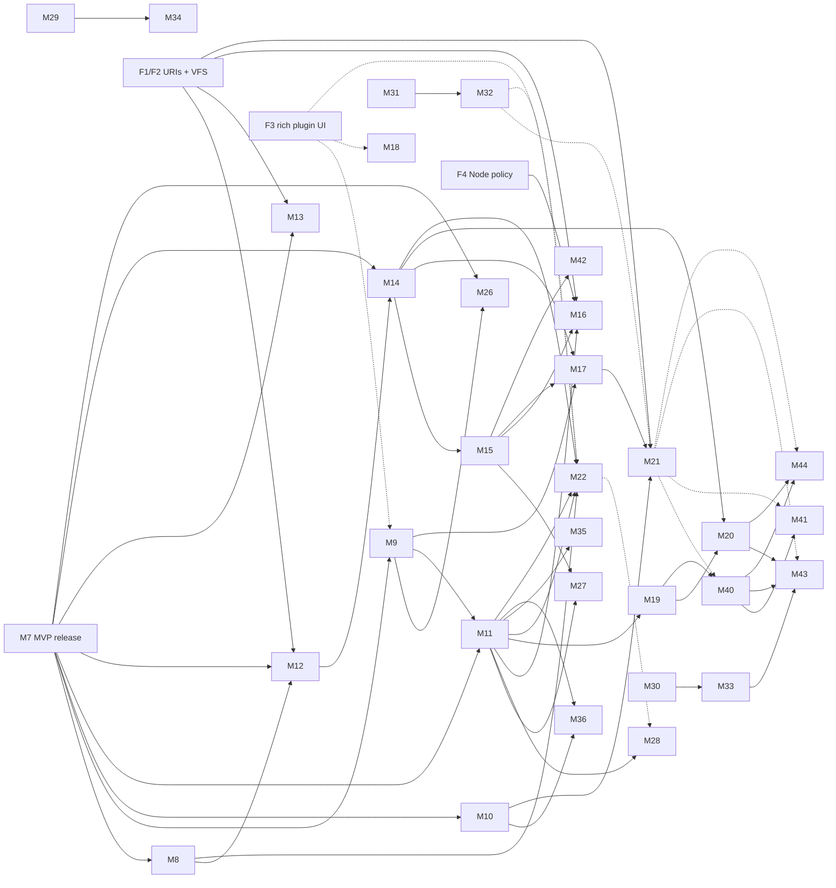

# Post-MVP roadmap

This is the plan for everything after the MVP, M0–M7. The MVP's milestones came from the original project brief, `ide-prompt.md`, which was removed after M7. It turns the mission's one-line post-MVP list into milestones that future sessions can plan and build one at a time. It also covers the rest of the Visual Studio feature set that the mission's "parity is reachable" goal implies. The [Visual Studio parity matrix](#visual-studio-parity-matrix) maps every VS feature area to the milestone that delivers it, or records it as a gap or a non-goal. It is the checklist that keeps this plan complete.

- **Status:** written 2026-10-08 while M1 was in progress, and checked against Visual Studio 2026 on 2026-10-09. The MVP (M0–M7) is done; M8 was built on 2026-10-09 (checkpoints [M8a](checkpoints/m8a.md) and [M8b](checkpoints/m8b.md)), and M9 the same day ([M9a](checkpoints/m9a.md), [M9b](checkpoints/m9b.md)). On 2026-10-09 the maintainer gave a standing go-ahead for M9 through M16, built in order with each milestone validated on Windows, Linux and macOS. On 2026-10-10 the maintainer added a platform and release phase (M30–M33), placed next, after M16b and before M16c. The same day they added UI polish (M34) as the last milestone before Visual Basic and F#, which were renumbered M35 and M36 so that they stay last. The repository went public on 2026-10-11 (D29). By 2026-10-14 phases 1–9 were built except M28 and M30b (M28 followed on 2026-10-15), M34a–e were pulled forward, M37–M39 were added and built, and 0.1.0, 0.2.0 and 0.2.1 were released; the [status table](#status) is the current state.
- **Authority:** the original project brief's fixed decisions and non-goals still apply. The brief (`ide-prompt.md`) was removed after M7. Its non-goals are restated under [Out of scope](#out-of-scope), and its decisions live on in the ADRs. ADRs win over this document once they are accepted.
- **Licences:** the licences given below are what we believe them to be when this was written. Check each one again before adopting it, and record it in `THIRD-PARTY-NOTICES.md`. If a licence is ambiguous, stop and ask the maintainer.

## How future sessions use this document

1. Read `CLAUDE.md`, then the latest checkpoint summary, then this document's [status table](#status).
2. Pick the next milestone allowed by the [dependency graph](#dependency-graph) and the maintainer's instructions. The numbers are identifiers, not a strict order. The maintainer may reorder phases.
3. Check the milestone's **Decisions** entries against the [decision register](#decision-register). Every decision there is closed as of 2026-10-10, except D31 (2026-10-13). If a new question comes up, don't start work that depends on it. Add it to the register and raise it with the maintainer.
4. Follow the milestone workflow:
   - plan mode
   - ADRs before code
   - task breakdown
   - the definition of done (unit, integration and headless UI tests, CI green on three OSes, budgets met, docs updated, and a screenshot review of the milestone's own panels against [M34's checklist](#m34--ui-polish), D25)
   - **stop at the checkpoint**
5. The scope lists here are the **target**. At plan time, split a milestone (for example M12a/M12b) if it is too big to ship in one checkpoint. Move items out explicitly with a `TODO(issue)`. Never drop them silently.
6. When planning a milestone, also go through the parity matrix rows that point at it. A row can only move to "gap" or to another milestone with a stated reason.
7. After each checkpoint, update the status table, the parity matrix, the decision register and the [change log](#change-log) at the end of this file.

## Status

| Milestone | Title | Status |
|---|---|---|
| M0 | Scaffold and UI stack spike | done (ADR 0001, 0002) |
| M1 | Shell and plugin foundation | done |
| M2–M7 | MVP (the original project brief) | done (checkpoints for M3–M7 in `docs/checkpoints/`; M7 is the MVP) |
| M8 | Testing: Test Explorer and code coverage | done (M8a and M8b at checkpoint): Test Explorer ([m8a](checkpoints/m8a.md)) and coverage ([m8b](checkpoints/m8b.md)), ADR 0010 and 0011 |
| M9 | Packages and project management | done (M9a and M9b at checkpoint): NuGet ([m9a](checkpoints/m9a.md)), properties and solution management ([m9b](checkpoints/m9b.md)), ADR 0012 and 0013 |
| M10 | Integrated terminal and interactive windows | done (at checkpoint, [m10](checkpoints/m10.md)): terminal and C# Interactive, ADR 0014 and 0015 |
| M11 | Language platform: LSP bridge, grammars, file-type editing | done (at checkpoint, [m11](checkpoints/m11.md)): language registry, TextMate grammars, LSP bridge, markup host, ADR 0016 |
| M12 | Editor and code-navigation depth | done (M12a and M12b at checkpoint): M12a ([m12a](checkpoints/m12a.md), navigation and inline information, ADR 0017) and M12b ([m12b](checkpoints/m12b.md), editing, refactoring UI and analysis, ADR 0018) |
| M13 | Git depth and hosting integration | done (M13a and M13b at checkpoint, [m13a](checkpoints/m13a.md), [m13b](checkpoints/m13b.md)): history, merge editor, operations (ADR 0020); GitHub, Azure DevOps and GitLab plugins (sign-in through the OS credential store, pull requests, review comments, CI status, work items, publishing), askpass, worktrees, Git LFS, several repositories (ADR 0031) |
| M14 | Debugger depth | done (M14a–M14c at checkpoint). M14a: exception settings, Run to Cursor, breakpoint depth, QuickWatch, visualizers, Threads and Modules, PerfTips, ADR 0021; M14b ([m14b](checkpoints/m14b.md), ADR 0032): the debug companion host, `[DebuggerDisplay]`, grid, image and plugin visualizers, pinned data tips, Parallel Stacks and Watch, Processes and Debug Location, breakpoint filters, exception module conditions, dumps; M14c ([m14c](checkpoints/m14c.md), ADR 0039 and 0040): multiple startup projects in one session, debugging in the integrated terminal (Detach All for launched programs), attach over SSH, in containers and in WSL, the WSL launch profile, Roslyn components, Just-In-Time crash dumps, the Hot Reload-while-debugging research |
| M15 | ASP.NET Core and Hot Reload | done (M15a–M15c at checkpoint, [m15a](checkpoints/m15a.md), [m15b](checkpoints/m15b.md), [m15c](checkpoints/m15c.md)): Endpoints Explorer, `.http` files, environment selector, development certificate, user secrets, Hot Reload through `dotnet watch` (ADR 0022); scaffolding through the user's `dotnet-aspnet-codegenerator` and the SDK's item templates, OpenAPI and gRPC service references (ADR 0041) |
| M16 | Razor, Blazor and web front-end | done (M16a–M16d at checkpoint, [m16a](checkpoints/m16a.md)–[m16d](checkpoints/m16d.md)): Razor editing through the Razor source generator, Blazor run and Hot Reload (ADR 0023); HTML, CSS and JavaScript/TypeScript language servers on an on-demand Node.js (ADR 0024); Blazor WebAssembly debugging in the browser through vscode-js-debug (ADR 0026); compound server-and-page debugging, Debug a Web Page, HTML and CSS inside Razor, scoped CSS, npm scripts in the Task Runner Explorer, ESLint and Prettier (ADR 0027) |
| M17 | Containers, Aspire and publishing | done (M17a–M17c at checkpoint): M17a ([m17a](checkpoints/m17a.md), ADR 0042): the Containers window, Add Docker Support, run and debug in a container (fast mode), compose up, down and debug, `.dcproj` as a solution item, the compose schema, Docker and Podman; M17b ([m17b](checkpoints/m17b.md), ADR 0043): Aspire AppHosts run and debug their projects through the IDE execution protocol, the Aspire window from the resource service, the dashboard; M17c ([m17c](checkpoints/m17c.md), ADR 0042): publish profiles and the Publish page, folder, self-contained, single-file, trimmed, ReadyToRun, Native AOT and container publishing |
| M18 | Profiling and diagnostics tools | done (M18a and M18b at checkpoint). M18a ([m18a](checkpoints/m18a.md), ADR 0044 and 0045): the supervised, lazy `codalus-diaghost` (EventPipe through Microsoft.Diagnostics.NETCore.Client, traces through TraceEvent), the Performance Profiler with saved sessions, CPU Usage (call tree, bottom-up, functions with caller/callee, flame graph, time and thread filters, hot lines in the editor), .NET Counters (EventCounters and meters, CSV and JSON export), the Diagnostic Tools window; M18b ([m18b](checkpoints/m18b.md), ADR 0046): memory snapshots and diffs, allocations, .NET Async, threads and contention, exceptions, file I/O, the events viewer and exports, activity views, BenchmarkDotNet |
| M19 | Avalonia XAML editing and live previewer | done (M19a and M19b at checkpoint). M19a ([m19a](checkpoints/m19a.md), ADR 0047 and 0048): `.axaml` editing in the C# host on Roslyn's type information (completion, compiled binding paths, live diagnostics and the XAML compiler's errors from builds, hover, definition, `x:Name` rename, formatting), the XAML Previewer on Avalonia's designer host and remote protocol (debounced edits, design-time data, zoom, scale, theme variants, selection both ways through a startup-hook agent, rebuilds on code changes); M19b ([m19b](checkpoints/m19b.md), ADR 0052): the Live Visual Tree and Live Property Explorer for running Avalonia apps (the previewer's agent in a live mode: trees, properties with their sources, editing, highlight, pick, Go to XAML), the Avalonia templates in New Project |
| M20 | .NET MAUI | planned (D6: go, for Android, iOS and Mac Catalyst), after M28 and before M34 |
| M21 | Remote development | done (M21a and M21b at checkpoint). M21a ([m21a](checkpoints/m21a.md), ADR 0050 and 0051): `codalus-server` (self-contained per platform, version-locked, copied and checked into `~/.codalus-server/<version>/`), multiplexed channels with flow control over one stdio stream, remote windows over SSH (the system OpenSSH, keys and agents only) and WSL with the build, C# and markup hosts, terminals, netcoredbg and a file-system provider on the server, path mapping, port forwarding with detection, the Ports window and the remote status; M21b ([m21b](checkpoints/m21b.md), ADR 0053, 0054, 0055, 0057): containers and Dev Containers as remote windows, reconnecting after a network drop (a server that outlives its link), remote test environments (`testenvironments.json`) and plugin placement (`runsOn`); M21b needs checking on the Mac (no result recorded) |
| M22 | Plugin platform 1.0 and marketplace | done (M22a–M22d at checkpoint). M22a ([m22a](checkpoints/m22a.md), ADR 0058): plugin API 1.0 frozen (the proved proposed APIs on `IPluginContext`, `PublicAPI.txt`, `CODALUS0001`), progress and running tasks in the status bar, color and file icon themes in VS Code's formats, debug adapter contributions, declarative views and custom editors, file system, authentication and source control providers; M22b ([m22b](checkpoints/m22b.md), ADR 0059): `Codalus.Plugins.Testing`, `dotnet new codalus-plugin`, Run and Debug Plugin in Development Instance, the generated API reference, SVG icons in icon themes; M22c ([m22c](checkpoints/m22c.md), ADR 0060): plugins as NuGet packages (`CodalusPlugin`), the Plugin Gallery (search, install with permissions and signatures shown, updates, uninstall), per-workspace turning off, Bisect Plugins; M22d ([m22d](checkpoints/m22d.md), ADR 0061): the Components window (on-demand components with version, size and licence; download, remove; offline layouts), plugin performance attribution (activation, commands, host memory; slow plugins offered to turn off) |
| M23 | Personalization, settings sync and localization | done (M23a–M23c at checkpoint) except hosted Weblate. M23a ([m23a](checkpoints/m23a.md)): Fonts and Colors over the theme (VS Code's two color settings), the ReSharper and Emacs keyboard schemes, importers for VS Code and `.vssettings`, Export and Import Settings, named window layouts, full screen and distraction-free mode, onboarding on the Start page with tips; M23b ([m23b](checkpoints/m23b.md)): profiles, settings sync with a folder or a Git repository, Tools → Customize for menus and toolbars, turning plugins off and File → Restart, the localization foundation (catalogues, the display language, pseudo-languages and right to left, plugin manifest placeholders, the test that stops new hard-coded strings); M23c ([m23c](checkpoints/m23c.md)): every view's text and the messages built in code in the catalogues, plugins' own text through `context.Localize` (API 0.2.9); Weblate waits for the maintainer's account |
| M26 | Build and project-system depth | done (M26a and M26b at checkpoint). M26a ([m26a](checkpoints/m26a.md), ADR 0033): the Properties window, Show All Files, Include and Exclude, links and moves between projects, Add New Item, Export Template, the template manager, folder mode with tasks and launch configurations, External Tools; M26b ([m26b](checkpoints/m26b.md), ADR 0034, 0035): build settings, the fast up-to-date check, Batch Build, Build Timings with the critical path, binary logs and their viewer, build events, custom tools (ResX, T4 in its own host, plugins) |
| M27 | Data and Entity Framework Core tooling | done (M27a and M27b at checkpoint): the Entity Framework window over the user's dotnet-ef (migrations with their SQL shown first, scripts, bundles, compiled models, reverse engineering, the model view; [m27a](checkpoints/m27a.md), ADR 0036); the Database Explorer in `codalus-datahost` (SQL Server, PostgreSQL, MySQL/MariaDB, SQLite), table data with explicit commit, CSV/JSON export and import, the query editor with results, messages, cancel, history and plans, the SQL language service (ScriptDom), `.sqlproj` loading and builds ([m27b](checkpoints/m27b.md), ADRs 0037 and 0038); schema compare and publish are a gap (D15: DacFx is proprietary) |
| M28 | AI assistance | M28a at checkpoint ([m28a](checkpoints/m28a.md), ADR 0062), 2026-10-15: the language model provider API (proposed), the OpenAI-compatible (with Ollama) and Anthropic provider plugins, the data boundary (off by default, a workspace can only turn it off, ignored files and secrets never sent, the request log), AI Chat with the context the user chooses and code applied after a preview; validated on Linux only, so it needs checking on Windows and the Mac. M28b at checkpoint ([m28b](checkpoints/m28b.md)), 2026-10-15: inline suggestions and next edit suggestions (each with its own switch, off by default), and AI actions (commit messages, pull request descriptions, Ask AI in the exception helper and for a failing test, Fix with AI, Generate Tests, profile summaries); also Linux only. M28c at checkpoint ([m28c](checkpoints/m28c.md), ADR 0063), 2026-10-15: agent mode (workspace-confined tools, every change in the preview, every command and MCP tool after an approval whose default is Reject, trusted folders only, a step limit), the MCP client for user-configured servers, and `codalus mcp` exposing the IDE's context to external agents; Linux only. M28 is done |
| M29 | Visual Studio look and feel | done (at checkpoint, [m29](checkpoints/m29.md)): title row and search, standard toolbar, themes, keyboard schemes, Solution Explorer, Options tree, ADR 0019 |
| M30 | .NET 11 and following .NET releases | M30a at checkpoint ([m30a](checkpoints/m30a.md)): .NET 11 projects on the release candidate, the hosts on any SDK (ADR 0025); M30b (Codalus itself on .NET 11, Roslyn 5.11) at .NET 11 GA, expected in November 2026 |
| M31 | Automated release cycle and installers | done (M31 and M31b at checkpoint). M31 ([m31](checkpoints/m31.md), ADR 0028): `develop`/`master`, `VERSION` and `codalus-release`, Velopack installers on every platform, `.deb`/`.rpm`, signed apt and dnf repositories, the release workflows (since 2026-10-14 the one `pipeline.yml`, with `pages.yml`); M31b ([m31b](checkpoints/m31b.md)): the first published releases, pulled forward by the maintainer on 2026-10-13: nightlies from `develop`, 0.1.0 from `master`, Linux ARM64 packages, the apt and dnf repositories on Pages; unsigned until certificates (D19) |
| M32 | Self-update | done (at checkpoint, [m32](checkpoints/m32.md), ADR 0029): Velopack updates from signed feeds (ECDSA P-256), stable and nightly channels, Restart to update, What's New, notifications for the other installs |
| M33 | Older .NET: .NET Core 2.0 to .NET 10 | done (at checkpoint, [m33](checkpoints/m33.md)): every target framework from .NET Core 2.0 to .NET 10 with the current SDK, older SDKs in `global.json` down to 2.1.200, the support table in the user guide, ADR 0030; validated on Windows, WSL and the Mac |
| M34 | UI polish | M34a at checkpoint ([m34a](checkpoints/m34a.md)), pulled forward by the maintainer on 2026-10-12: Fluent UI System Icons compiled at build time (D24) with command-family colors, every menu a tree like a classic IDE's, output windows that follow new output, the minimap docked at the editor's edge, completion keys per OS (the editor's key bindings now match a focused editor), then Material Icon Theme's file, folder and project icons, a flat navigation bar and themed outlining markers; M34b at checkpoint ([m34b](checkpoints/m34b.md)), pulled forward the same day: batched project loading in the language host, no false errors while loading, a parallel background pass, parallel design-time builds and their persisted cache, restore on open only when needed; M34d at checkpoint ([m34d](checkpoints/m34d.md)), 2026-10-13: spacing, size and type tokens, document tabs and captions in every state (selected without the focus, pinned, preview on the right, colored by project), toolbars that overflow instead of wrapping, High Contrast's black menus, the gallery in the smoke test, clipped-text and WCAG AA contrast tests, the UI guide (needs checking on the Mac: no result recorded); M34e at checkpoint ([m34e](checkpoints/m34e.md)), 2026-10-13: document tabs that fit their group, Window → Open Documents…, our own tab context menu, toolbar overflow in the remaining windows, the Error List's project names; M34c at checkpoint ([m34c](checkpoints/m34c.md)), 2026-10-13: the language host keeps diagnostics and reference assemblies between sessions, open documents compile against unchanged projects' assemblies, and CS4014 the build wouldn't report is left out (ADR 0049; needs checking on the Mac: no result recorded); the rest of M34 (its final pass) stays the last milestone before Visual Basic and F# |
| M39 | Rename to Codalus IDE | done (no checkpoint of its own; ADR 0056 is the record; the name chosen 2026-10-13; validated on Windows, WSL, the Mac and CI; the repository renamed to `stavroskasidis/codalus-ide`): the clean rename of everything from Daedalus Studio (code, CLI, hosts, protocols, plugins, data folders, installers, repository, site, docs) with `eng/rename.py`, with no compatibility (no users yet); the new mark (violet and ember wings). Reserving the NuGet prefix (`docs/release/nuget-prefix-reservation.md`) and the AUR package (the pipeline's `aur` job, skipped until the `AUR_SSH_PRIVATE_KEY` secret exists) wait for the maintainer |
| M37 | Environment setup | done (at checkpoint, [m37](checkpoints/m37.md)): a missing or mismatched .NET SDK (a solution's `global.json`), git, Git LFS, Docker, Podman and WSL found, Help → Check Environment, installs with the user's consent (winget, `dotnet-install` into `~/.dotnet`, `xcode-select`, the distribution's packages in the terminal); MAUI's workloads come with M20 |
| M38 | Start window | done (at checkpoint, [m38](checkpoints/m38.md)): "What would you like to do?" at startup, with recent solutions, projects and folders (search, pinned, grouped by date, missing entries) and Create, Open, Open Folder and Clone; File → Start Window; On Startup chooses it, an empty window or the last solution |
| M40 | WinForms and WPF projects, WPF XAML and previewer | proposed ([Windows desktop](#proposed-phase-windows-desktop)), waits for D31 |
| M41 | Windows Forms designer | proposed, waits for D31 |
| M42 | WCF | proposed, unscheduled (cross-platform, so it doesn't wait for D31) |
| M43 | .NET Framework | proposed, waits for D31 and a spike on debugging the desktop CLR |
| M44 | MAUI on Windows and WinUI 3 | proposed, waits for D31 and M20 |
| M35 | Visual Basic | planned, always second to last |
| M36 | F# | planned, always last |

New milestones get the next free number and join the phase they belong to, so the numbers stay stable. The phase tables give the order.

**Visual Basic and F# are always the last two milestones** (the maintainer's rule, 2026-10-10). They keep the two highest numbers: a new milestone takes Visual Basic's current number, and Visual Basic and F# each move up by one. The change log records every such renumbering. M24 and M25 are retired: they were Visual Basic and F# until 2026-10-10 and aren't reused.

## Baseline: what the MVP is assumed to deliver

This plan assumed that M7 would end with what the original project brief described. **At the M7 checkpoint, compare this list with what was actually built, and carry any deferred `TODO(issue)` items into the right post-MVP milestone.**

- **Shell** (`Codalus.Shell`, Avalonia 12, Native AOT): docking with persisted layouts, commands, key bindings, the palette and menus, JSON settings with a UI, themes (light, dark, high contrast), status bar, Output window, notifications.
- **Workbench services** (`Codalus.Workbench`) and the platform layer (`Codalus.Platform`: paths, file watching, process launching, shell integration, keys).
- **Language service host** (`codalus-lshost`): Roslyn C# with the M3 feature set (highlighting, completion, navigation, rename, code fixes with preview, formatting, Go To All, Find in Files, analyzers, source generators).
- **Build host**: MSBuild evaluation and builds, solution and project model, file nesting, project edits, `dotnet new` templates, configurations, multi-targeting.
- **Debugging**: a DAP client plus netcoredbg, with the M5 feature list and a documented list of known gaps.
- **Git**: the M6 feature set, using LibGit2Sharp or the git CLI as decided in the M6 ADR.
- **Plugins**: plugin API 0.x (ADR 0003): out-of-process hosts, declarative contributions, tree and Markdown views. The rich-UI ADR (webview or remote UI) is due by M6.
- **Release**: installers for three OSes, local opt-in crash reporting, performance gates in CI, a public repository. M7 delivered packages rather than setup installers (installers are M31), and the repository stayed private until after M32 (D29); it went public on 2026-10-11.

## Principles for post-MVP work

These add to the architecture principles of the original project brief, which live on in the ADRs and in `CLAUDE.md`'s conventions. They don't replace them.

- **Every feature names its process.** Each milestone says where its code runs: shell, an existing host, a new supervised host, or the user's process. A new host starts lazily, never at startup, so the idle-memory budget (ADR 0002, ≤ 250 MB) holds. It is supervised by `SupervisedProcess` and follows the crash-loop policy.
- **Plugin first, where latency allows.** As ADR 0003 says, a new feature is a built-in plugin unless it sits on a latency-critical path. When a feature needs an API that doesn't exist yet, it is added under `Codalus.Plugins.Proposed` first. Built-ins using proposed APIs is how the API gets proved before 1.0 (M22).
- **The shell owns generic UI, providers own data.** Examples: the shell renders Test Explorer, and test controllers supply tests. The shell renders language features, and language services (Roslyn, LSP servers) supply data. This keeps large views virtualized and AOT-clean, and lets third parties plug in.
- **Reuse before writing.** Prefer maintained MIT, Apache-2.0 or BSD components. When a VS feature is backed by something proprietary, say so, and either build an open replacement or record a known gap.
- **Every interactive surface gets a budget.** Each milestone adds harness scenarios, measures VS Code where relevant, and proposes absolute budgets at its checkpoint. Editor surfaces must be at least as good as VS Code (ADR 0002). Rider is no longer a reference (D28): where a milestone below says "compare with Rider", it sets an absolute target instead.
- **Every protocol extension is documented** in `docs/protocol.md` or `docs/plugin-protocol.md` with the `codalus/` prefix. Plugin API changes are listed in the plugin changelog.

### Known proprietary traps

These come up repeatedly in post-MVP areas. They are **off limits** unless a later licence check shows otherwise:

- **vsdbg** and the **C# Dev Kit** (named in the mission).
- **Debugging and diagnostics:** Visual Studio's debugger engines, the Visual Studio profiler and diagnostics hub, IntelliTrace.
- **Code coverage:** `Microsoft.CodeCoverage` and `Microsoft.Testing.Extensions.CodeCoverage`. Verify their licences. Treat them as excluded unless they are OSI-licensed.
- **AI and collaboration:** IntelliCode, the GitHub Copilot language server and Copilot's Visual Studio integrations, Live Share.
- **Testing:** Microsoft Fakes, IntelliTest (Pex), and the Visual Studio test adapters' proprietary extensions.
- **Remote and cloud debugging:** the Visual Studio remote debugger (msvsmon) and the Snapshot Debugger.
- **UI designers:** the .NET MAUI extension for VS Code and Visual Studio's XAML designer and XAML Hot Reload, and its Windows Forms designer.
- **Windows desktop and .NET Framework:** Visual Studio's WCF Test Client and Service Configuration Editor, and Visual Studio's MSBuild and targets (Build Tools): only ever the user's own install, and only if its licence allows it (M43).
- **Visual Studio packages:** most `Microsoft.VisualStudio.*` packages, which ship under Visual Studio licence terms. Check each one. Some, such as `Microsoft.VisualStudio.Threading`, are MIT.
- **Hosted services:** Dev Tunnels and other Microsoft-hosted services. Don't depend on them by default. If one is ever offered, it is an opt-in plugin.

## Foundational decisions to settle early

These decisions get more expensive with every milestone. **Raise them at the M7 checkpoint at the latest.** Some of them (F1 and F4) affect public contracts that become harder to change once the repository is public and plugins exist.

| # | Decision | Why it matters | Recommendation |
|---|---|---|---|
| F1 | **Document identity: file paths or URIs.** The M0–M3 protocols identify documents by file path. | Remote development (M21), decompiled and Source Link documents (M12), Git revisions in diff views (M13), virtual and generated documents (Razor, M16), and untitled buffers all need non-file documents. LSP uses URIs. | Switch every shell↔host and plugin contract to URIs (`file:`, `untitled:`, `codalus-decompiled:`, `codalus-git:`, `codalus-remote:`) before the plugin API reaches 1.0, ideally before going public. Keep path helpers in the SDK. |
| F2 | **Virtual file system.** `Codalus.Platform` has a file watcher, but there is no file-system abstraction. | The same features as F1. Without this, remote development becomes a rewrite. | Add `IFileSystemProvider`, chosen by URI scheme, in `Codalus.Platform`. Route every editor, Solution Explorer and search read through it. |
| F3 | **Rich plugin UI.** ADR 0003 requires a webview or remote-UI ADR by M6. | NuGet UI (if built as a plugin), test result details, profiler views, the previewer, and third-party tools. | Follow the M6 ADR. This plan assumes some rich surface exists by M9. If it doesn't, those UIs are built into the shell and move later. |
| F4 | **Node.js policy.** | The best open web language servers (HTML, CSS, JSON, TypeScript) and debuggers (`vscode-js-debug`, which also bridges Blazor WebAssembly debugging) run on Node. So do the Dockerfile language server and the Dev Containers CLI. | Download a pinned, checksum-verified Node runtime on demand, the first time a feature needs it. Don't bundle it, and don't require a user install. This needs an ADR (D3). |
| F5 | **Language host topology.** | VB, F#, Razor and LSP servers need a home. | Roslyn C# and VB share `codalus-lshost`. Razor is cohosted in the same Roslyn host. F# runs in its own process (FsAutoComplete or our own FCS host). Everything else goes through the generic LSP bridge (M11). |
| F6 | **Workspace trust.** | Opening a solution runs MSBuild evaluation, analyzers and source generators, all of which can run arbitrary code. Plugins and tasks add more. That matters once the repository is public. | Add a "restricted mode" for untrusted folders before or with the public release. It parses but doesn't evaluate, build or load analyzers, generators or workspace plugins until the user trusts the folder. Raise this at the M7 checkpoint (D4). |
| F7 | **Per-solution state.** | Breakpoints, open documents, layouts, test playlists, profiles and caches need a home. | `.codalus/` next to the solution (git-ignored, like `.vs/`) for state the user may want to inspect or share. User-local caches go in the platform data directory, keyed by a solution hash. |

All seven are settled:
- F1–F4 and F6 are D1–D4 in the [decision register](#decision-register).
- F5 and F7 are as built:
  - F5: Razor is cohosted in the C# host, F# runs on FsAutoComplete (D10), and the LSP bridge serves the rest.
  - F7: `.codalus/` sits next to the solution.

## Phase overview

| Phase | Milestones | Theme |
|---|---|---|
| 1. Daily driver | M8, M9, M10 | What a C# developer misses most on day one after the MVP: tests, packages, a terminal. |
| 2. Language platform | M11 | Pluggable languages (LSP bridge, grammars) and editing for the non-C# files every .NET repository has. |
| 3. Depth | M12, M29, M13, M14, M26 | Bringing the editor, Git, the debugger and the build and project tooling from "MVP" to "VS-class", and the look and feel from VS Code's to Visual Studio's (M29). |
| 4. Platform and release | M30, M31, M32, M33 | The newest .NET (11, then each new release), automated nightly and stable releases with setup installers, self-update, and proof that .NET Core 2.0 to .NET 10 projects work. |
| 5. Web, data and cloud-native | M15, M16, M27, M17 | ASP.NET Core, Blazor, Hot Reload, EF Core and databases, containers, Aspire, publishing. |
| 6. Diagnostics | M18 | Profiling, counters, memory analysis, dumps, benchmarks. |
| 7. UI frameworks | M19 | Avalonia XAML with a live previewer. |
| 8. Remote | M21 | SSH, WSL, Dev Containers. |
| 9. Ecosystem | M22, M23, M28 | Plugin API 1.0, marketplace, profiles, sync, localization, and AI assistance (opt-in, with any provider). |
| 10. Mobile | M20 | .NET MAUI for Android, iOS and Mac Catalyst. |
| Proposed: Windows desktop | M40–M44 | WinForms, WPF, WCF, .NET Framework and MAUI's Windows target, on Windows and from the other OSes through a Windows machine. Waits for D31; M42 (WCF) doesn't. |
| 11. Polish | M34, M39, M37, M38 | Every panel, window and feature brought to one finished standard; a setup that installs what's missing (M37); a start window (M38). |
| 12. Visual Basic and F# | M35, M36 | Rich editing for the mission's other .NET languages, on top of the language platform. Always last. |

Phase 4 was added on 2026-10-10, after M15, M16a and M16b (phase 5) were built. After M30a, the maintainer moved M16c ahead of the rest of phase 4 (M31–M33).

**Why this order.**
- Tests, NuGet and a terminal are what stop people from using the IDE every day.
- The language platform (M11) comes early, because it proves the "pluggable language services" requirement and every later language and file type builds on it.
- Platform and release (phase 4) came next, by the maintainer's choice:
  - .NET 11 (M30) goes first, so that Codalus is ready when .NET 11 is released.
  - Automated releases (M31) and self-update (M32) come before the repository goes public, so that the first public users get installers and updates.
  - The older-.NET validation (M33) builds on M30's hosts, which must start with any SDK.
- Web development is the biggest .NET workload. It comes after depth work because Hot Reload and Blazor debugging build on M12 and M14. Data tooling (M27) sits with it, because EF Core and a database are part of most web apps.
- AI assistance (M28) is a headline Visual Studio 2026 feature. D7 settles it as opt-in, with any provider. It goes after the plugin API freeze (M22), because it should be built on public provider APIs.
- .NET MAUI (M20) comes after everything except polish, VB and F#, by the maintainer's choice (D6). It builds on the XAML engine (M19), and the polish pass then covers its panels too.
- Remote development comes late because it touches every host. F1 and F2 make sure it doesn't need a rewrite.
- UI polish (M34) comes after every other milestone except VB and F#, so that one pass covers all the UI, MAUI's included. Until then, each milestone reviews its own panels against M34's checklist. The maintainer pulled M34a–e forward on 2026-10-12 and 2026-10-13; only M34's final pass stays last.
- VB and F# come last, after everything else, and stay last when milestones are added. Solutions with VB and F# projects already load, build and run from the MVP, and the C# depth, web and tooling work serves more users first. M11 keeps them cheap whenever they are picked up.

### Dependency graph

A dashed edge means "better with", not "blocked by".

---

## Phase 1: Daily driver

### M8 — Testing: Test Explorer and code coverage

**Status.** Built as M8a and M8b ([m8a.md](checkpoints/m8a.md), [m8b.md](checkpoints/m8b.md)). Deferred, each with a `TODO(issue)` in the checkpoint notes: the HTML coverage report (ReportGenerator), coverage in the Solution Explorer, CodeLens test entries (M12), Rider comparison numbers, and test hosts the IDE doesn't start itself.

**Goal.** Discover, run, debug and analyse tests across the solution, with coverage shown in the editor. This should be at least as capable as Rider's unit-test runner for the mainstream frameworks.

**Depends on.** M4 (builds), M5 (debugging). A split into **M8a** (Test Explorer) and **M8b** (coverage) is allowed.

**Scope.**
- **Frameworks:**
  - xUnit v2 and v3, NUnit 3 and 4, MSTest 3 and later.
  - Both test platforms: VSTest, and Microsoft.Testing.Platform (MTP) for projects that opt into it.
  - TUnit (MTP only), if its licence checks out.
  - F# frameworks (Expecto) are added in M36.
- **Discovery:**
  - **Source-based** discovery from Roslyn gives a tree immediately after the solution opens, before any build. It finds methods with known test attributes.
  - **Runner-based** discovery runs after a build and is authoritative: data rows, theories, dynamic tests.
  - The two are merged by fully qualified name and source location.
- **Test Explorer tool window:**
  - A virtualized hierarchy: project, namespace, class, method, data row.
  - Grouping by project, namespace, class, trait, outcome or duration.
  - A filter syntax: free text, `trait:`, `outcome:`, `project:`.
  - Run all, failed, selected or not-run tests. Repeat the last run. Cancel.
  - Playlists, saved as JSON under `.codalus/`. VS `.playlist` files can be imported.
- **Results:**
  - outcome, duration, message, stack trace with clickable frames, stdout and stderr, attachments
  - the history of the last N runs per test
  - export to TRX and import TRX files (for example from CI), shown in the same views
  - snapshot-testing support: Codalus can be registered as the diff tool for Verify and similar libraries, through the `codalus diff` command line (see [Release, updates and the command line](#release-updates-and-the-command-line))
- **Create Unit Tests:** a command on a method or type that generates a test stub in a chosen (or new) test project for the chosen framework, like Visual Studio's command.
- **Remote test environments** (running tests in WSL, a container or over SSH, like Visual Studio's `testenvironments.json`) come with M21.
- **Editor integration:** run, debug and status glyphs in the gutter. CodeLens entries ("Run | Debug | ✓ 12 ms") come once CodeLens lands in M12. Failed tests can be navigated to with F8-style "next failure" commands.
- **Debugging tests:**
  - **VSTest:** the IDE launches the test host itself through the translation layer's custom-launcher API, under netcoredbg.
  - **MTP:** the test application runs under the debugger with a filter by test UID.
- **Settings:**
  - the `.runsettings` selection and MTP `testconfig.json`
  - the target framework for multi-targeted test projects, the architecture, environment variables, parallelism
  - an option to run affected tests after a build
- **Coverage (M8b):**
  - **Coverlet:** the VSTest collector, and Coverlet's MTP integration if it is available. Otherwise `coverlet.console`.
  - **Coverage Results window:** a tree by assembly, namespace, class and method, with line and branch percentages.
  - **Editor:** covered, partially covered and uncovered gutter colouring.
  - **Results:** merged across test projects, exported as Cobertura, and optionally turned into an HTML report.

**Out of scope.** Live Unit Testing (see [candidates](#unscheduled-candidates)) and test impact analysis.

**Architecture.**
- **Shell:** owns the Test Explorer view, the gutter glyphs, the result details view and the coverage overlay (generic, AOT-clean, virtualized).
- **New plugin API (proposed):** a **test controller** API, modelled on VS Code's `TestController`, to report items, run requests, results and output. Test providers are plugins.
- **Built-in plugin `Codalus.Plugins.DotNetTest`:**
  - implements the controller with the VSTest translation layer and an MTP client
  - runs in a **dedicated** plugin host, because it can be heavy
  - gets two other new plugin APIs (proposed): `IBuild` to request builds, and `IDebug` to start a debug session with a launch configuration
- **`codalus-lshost`:** adds `codalus/testCandidates` for source-based discovery: test methods per document, with ranges. The shell forwards the results to the controller.
- **Coverage:** runs inside the test plugin. Line data is pushed to the shell as a decoration layer, keyed by document URI.

**Dependencies.**
- `Microsoft.TestPlatform.TranslationLayer` (MIT)
- An MTP server-mode client. MTP (`microsoft/testfx`) is MIT. Implement against its documented JSON-RPC protocol, and reference packages only where needed.
- `coverlet.collector` and `coverlet.console` (MIT)
- ReportGenerator (Apache-2.0, optional)

**Decisions needed.** None beyond the standing ones. The ADR covers the VSTest/MTP split.

**ADRs.** "Test platform integration" (process model, controller API, VSTest vs MTP, debugging tests). "Code coverage engine".

**Fixtures and tests.**
- `samples/Testing/`:
  - xUnit v2, xUnit v3 (MTP), NUnit, MSTest in both VSTest and MTP modes
  - theories and data rows, a multi-targeted test project
  - failing, skipped, hanging (for cancellation) and output-writing tests
- A `FixtureGen` target that generates 5,000 tests across 20 projects.
- Integration tests drive the plugin against the fixtures. A headless UI test checks tree population and filtering.

**Budgets to propose** (measure Rider first):
- Source-based tree for Solution50 plus the 5k-test fixture: ≤ 1 s after the solution tree appears.
- Discovery after a build: compare with Rider.
- Filtering 10k nodes: no frame > 50 ms.
- Run → first result shown: compare with Rider.

**Risks.**
- Different VSTest and MTP behaviour across framework versions.
- Timing of the test-host debug launch.
- Stability of the MTP server protocol across .NET SDK versions.
- Coverlet's support for MTP.

**Exit criteria.** All four frameworks discover, run, debug and report on three OSes. Coverage is shown in the editor for the fixtures. The controller API is documented as proposed.

### M9 — Packages and project management

**Goal.** The NuGet Package Manager, project properties, and the solution-management dialogs VS users rely on. No more hand-editing XML for routine work.

**Depends on.** M2 (project system), M4 (build/restore). F3 is helpful but not required.

**Scope.**
- **NuGet Package Manager**, at project and solution level:
  - Browse, Installed, Updates and Consolidate tabs.
  - Search across all sources from the effective `NuGet.Config`. Prerelease toggle and version picker.
  - Package details: dependencies per TFM, licence, README rendered as Markdown, links, download counts.
  - Badges for vulnerabilities, deprecation and the alternative package.
  - Licence acceptance for packages that require it.
  - Transitive packages view with "why is this here".
  - Restore progress and errors.
- **Central Package Management:**
  - edits `Directory.Packages.props`
  - understands `VersionOverride`, `GlobalPackageReference` and package source mapping
- **Package sources UI:** add, remove, enable and order sources, and map package patterns to sources.
- **Credential providers:** use the NuGet cross-platform credential-provider protocol, and invoke installed providers such as the Azure Artifacts provider. Don't bundle them.
- **Project properties UI.** Each page shows evaluated values, where a value comes from (the project file, `Directory.Build.props` or the SDK default), and its conditions. It writes the minimal change.
  - **Application:** TFMs, output type, assembly name, root namespace, nullable, implicit usings, language version.
  - **Build:** defines, warnings as errors, `NoWarn`, platform target, optimisation, debug symbols, deterministic builds.
  - **Package:** pack metadata, icon, README, licence expression, symbols.
  - **Code analysis:** `AnalysisLevel`, `EnforceCodeStyleInBuild`, analyzer packages.
  - **Signing:** strong naming.
  - **Debug:** a launch profile editor for `launchSettings.json` (command name, arguments, environment, working directory, application URL, launch browser).
- **References:**
  - add project and assembly references, with a filter
  - analyzer references
  - shared projects (`.projitems` imports), as display and edit only, at low priority
- **Solution management:**
  - Configuration Manager: solution-to-project configuration and platform mapping, written to `.sln` and `.slnx`.
  - Project build dependencies and build order.
  - Load and unload projects. Solution filters (`.slnf`): open, create and save.
  - `global.json` SDK selection, and status of installed SDKs and workloads.
- **Pack:** a `dotnet pack` command with output navigation.
- **Local .NET tools:** view and edit the `.config/dotnet-tools.json` manifest, install and update tools, and restore them. Global tools are listed too.
- **Package Manager Console:** Visual Studio's PowerShell console isn't reproduced. Its main uses are covered elsewhere: package commands by this UI, EF Core commands by M27, and `dotnet` commands in the integrated terminal (M10).

Build-level and file-level project features (the Properties window, Show All Files, batch build, the binlog viewer, custom tools) are in M26.

**Architecture.**
- **Build host:**
  - `codalus/packages/*`: search, metadata, install, update, uninstall and consolidate. Built on NuGet.Protocol. Edits go through MSBuild's `ProjectRootElement`, followed by a restore.
  - `codalus/projectProperties/*`: read evaluated and unevaluated values with provenance, and write them with a condition scope.
  - All network access happens here. It is cancellable, uses the system proxy, supports an offline mode, and caches results.
- **UI:**
  - **NuGet manager:** if F3 delivered a rich plugin surface, the UI is a built-in plugin and the first real consumer of that surface. Otherwise it is a built-in shell view.
  - **Property pages:** built into the shell and generated from a page schema, so F# and VB pages reuse the same machinery.
- **Edits must match the CLI.** The resulting file content must match what `dotnet add package` and `dotnet remove package` would produce. Tests compare the two.

**Dependencies.** NuGet.Protocol, NuGet.Configuration, NuGet.Versioning and NuGet.Packaging (Apache-2.0). Reuse the Markdown renderer chosen in M1.

**ADRs.** "Package management architecture", covering the NuGet API surface used, CPM, credentials and offline mode. "Project property pages schema".

**Fixtures and tests.**
- `samples/Packages/`: plain PackageReference, CPM, multi-targeted, and package source mapping.
- A local file feed generated by `FixtureGen`, with packages that need licence acceptance, prerelease packages and deprecated packages.
- An in-process mock NuGet V3 server (Kestrel) in tests, for search and vulnerability data.
- Golden-file tests that check project file edits preserve formatting.

**Budgets to propose.**
- Browse, first page rendered after the response arrives: ≤ 200 ms.
- Install → restored and IntelliSense updated: ≤ restore time + 2 s.
- Property pages open: ≤ 300 ms.

**Risks.**
- Preserving formatting and comments in project files.
- CPM edge cases.
- Credential providers on macOS and Linux.
- Large `Directory.Build.props` hierarchies make provenance hard to show clearly.

### M10 — Integrated terminal and interactive windows

**Goal.** A fast, accessible integrated terminal, and a C# Interactive window.

**Depends on.** M1 (shell), M3 (the editor control, its automation peer and themes). M9 is optional (`#r "nuget:"`).

**Scope.**
- **Terminal tool window:**
  - Several instances and splits.
  - Profiles: pwsh, bash, zsh, fish and cmd, plus a "dotnet developer" profile with the SDK environment.
  - The working directory defaults to the solution directory.
- **Shell integration:**
  - cwd tracking (OSC 7) and command marks (OSC 133)
  - clickable paths with `file:line:col` that open in the editor
  - clickable URLs
- **Emulation:** xterm-compatible.
  - true colour, wide and emoji characters, combining marks
  - alternate screen (vim and htop work), mouse reporting, bracketed paste
  - IME, resizing, configurable scrollback, find
- **Theme and fonts:**
  - IDE theme colours, including high contrast
  - font settings
  - configurable key passthrough: which shortcuts go to the terminal and which go to the IDE
- **Accessibility:** a screen-reader mode that exposes the buffer through the same UIA/AX text-pattern peer the editor got in M3.
- **Run in terminal:** console apps run with "Run without debugging" can use the integrated terminal for stdin and stdout, controlled by a setting (the external console is the alternative). The same option exists for debugging, through a netcoredbg console redirect.
- **C# Interactive:**
  - A REPL on Roslyn scripting, with its own editor input (highlighting, completion and signature help served by `codalus-lshost` as script documents) and a history.
  - Supports `#r` and `#load`. `#r "nuget:"` uses the M9 package service.
  - "Initialize Interactive with Project" and "Send selection to Interactive".

**Architecture.**
- **PTY:** lives in `Codalus.Platform`, using ConPTY on Windows and `openpty` with `posix_spawn` on Unix through P/Invoke (never `forkpty`: managed code must not run in a forked child; ADR 0014). This is AOT-safe and needs no extra host.
  - **Justification to record:** terminal I/O is latency-critical but light, and child processes are already isolated from the shell.
  - If the ADR concludes that PTY handling must leave the shell (for example for crash isolation), it becomes `codalus-ptyhost`.
- **VT engine and renderer:** a VT parser and screen model, plus a custom Avalonia control that renders glyph runs with dirty-row invalidation and a glyph cache.
- **REPL host:** a new `codalus-replhost`, out of process. It runs user code, which must never run in the shell or the language host. It is supervised, so a crash or `Environment.Exit` in a script only restarts the REPL.

**Dependencies (candidates for the ADR).**
- XtermSharp (MIT): VT engine. Check its maintenance and AOT compatibility.
- `vs-pty.net` (MIT): PTY. Check its AOT compatibility, or write our own P/Invoke.
- `Microsoft.CodeAnalysis.CSharp.Scripting` (MIT).

**ADRs.** "Terminal emulator: engine, renderer, PTY placement". "Interactive (REPL) host".

**Fixtures and tests.** Recorded VT streams (`ls --color`, vim, htop, a progress bar, `dotnet build`) are replayed into the engine and compared with screen snapshots. PTY integration tests run on all three OSes. REPL tests cover crash and restart.

**Budgets to propose** (compare with VS Code's terminal and Windows Terminal):
- Keystroke echo → displayed frame: p99 within the editor typing budget.
- `cat` of a 1M-line file: no frame > 50 ms, and throughput comparable to VS Code.
- Memory per terminal with 10k scrollback lines: ≤ 30 MB.

**Risks.**
- ConPTY differences between Windows versions. The supported floor is Windows 11 (D26).
- The macOS login-shell environment.
- IME in a custom-drawn control.
- Screen-reader support for a live buffer.

---

## Phase 2: Language platform

### M11 — Language platform: LSP bridge, grammars and file-type editing

**Goal.** Make "a language" a pluggable unit, as the mission requires for F# and VB. Give first-class editing to the non-C# files every .NET repository has.

**Status.** Built ([m11.md](checkpoints/m11.md), [ADR 0016](adr/0016-language-platform.md)). Deviations: LSP types stay narrowed and source-generated, with a normalizer instead of a `metaModel.json` generator; JSON, XML, MSBuild and YAML services run in a new `codalus-markuphost`, which asks the build host for evaluated MSBuild values through the shell; JSON Schema validation is our own subset (JsonSchema.Net is no longer OSI-licensed). Deferred, each with a `TODO(issue)` in the checkpoint: XSD validation, the `.resx` editor, YAML completion, package completion in MSBuild, Go to Definition across imports, inlay hints, hierarchies, pull diagnostics, selection ranges, linked editing, CodeLens and document symbols for non-C# languages, snippet tab stops, several servers per language, and the PowerShell Editor Services sample (a smaller `.todo` sample with its own server proves the same path).

**Depends on.** M3 (the language-service abstraction), M9 (package and property data for MSBuild editing). F1 strongly recommended.

**Scope.**
- **Language registry.** Plugins contribute these through `contributes.languages`, `contributes.grammars` and `contributes.languageConfigurations`:
  - language ids, extensions, file names and first-line patterns
  - TextMate grammars
  - language configuration: comments, brackets, auto-closing pairs, indentation rules, word pattern, folding markers
- **Generic LSP bridge.** A plugin declares a language server (`contributes.languageServers`: command, arguments, transport, activation, initialization options, settings section). The shell supervises it and maps LSP 3.17 onto the same UI C# uses:
  - completion, hover, signature help
  - definition, declaration, implementation, references, rename
  - code actions, formatting (document, range and on-type)
  - semantic tokens, inlay hints, call and type hierarchy
  - push and pull diagnostics
  - document and workspace symbols (which feed Go To All)
  - folding, selection ranges, linked editing, CodeLens
- **Built-in file types:**
  - **MSBuild** (`.csproj`, `.fsproj`, `.vbproj`, `.props`, `.targets`, `Directory.Packages.props`):
    - Completion for elements, properties, items, metadata and well-known targets. Value completion for TFMs, RIDs, package ids and versions (from M9), and enums.
    - Hover shows the **evaluated value and its origin** from the build host.
    - Go to definition across imports.
    - Diagnostics for unknown items and invalid values.
    - This is a strength no other cross-platform editor has, because we own the evaluation.
  - **JSON with schemas:**
    - `global.json`, `launchSettings.json`, `appsettings*.json`, `.config/dotnet-tools.json`, `codalus-plugin.json`
    - `testconfig.json` and `runtimeconfig.template.json`
    - any file mapped through the SchemaStore catalogue (cached, with an offline fallback)
  - **XML with XSD validation:** `.runsettings`, `nuget.config`, `.slnx`, `.resx`, `.xsd` and `.xml`.
  - **`.editorconfig`:** key and value completion from Roslyn's option metadata, plus hover documentation.
  - **`.resx` editor:** a grid editor for string resources (name, value, comment), with an "open as XML" toggle. Image and file resources can be viewed and replaced. It also generates the strongly typed resource class, which Visual Studio does with its `ResXFileCodeGenerator` custom tool. Use the SDK's own strongly-typed resource generation where the project allows it, and the M26 custom-tool mechanism otherwise. A multi-language view shows the neutral and localized `.resx` files side by side, with missing translations highlighted. The WinForms resource designer is a non-goal.
  - **YAML with schemas:** GitHub Actions and Azure Pipelines.
  - **Markdown** with a live preview.
- **Language-agnostic features:**
  - word-based completion as a fallback
  - indentation folding, bracket matching
  - encoding and BOM detection, binary-file detection
- **Other languages.** Visual Studio's other workloads (Python, Node.js, C++, PowerShell, Bicep and so on) aren't first-party goals. The bridge makes each of them a plugin over an existing open-source language server. Only the web languages (M16) and SQL (M27) are built in.
- **Samples:** a sample plugin that contributes a grammar plus an LSP server (for example PowerShell Editor Services, MIT) as an end-to-end proof, shipped under `samples/plugins/`.

**Architecture.**
- **New library `Codalus.LanguageServices.Lsp`:** LSP types are **source-generated from the LSP `metaModel.json`** (MIT, from `vscode-languageserver-node`), which keeps them AOT-safe. It also holds the client and the adapter to the shell's language-service abstraction.
- **LSP servers:** supervised child processes of the shell. They are declared by manifests, so no plugin code is loaded to start a server.
- **TextMate tokenization:** runs off the UI thread, viewport first, like semantic tokens.
- **MSBuild language service:** lives in the **build host**, next to the evaluator. JSON, XML and YAML services run in a small `codalus-markuphost`, or in the plugin host. The ADR decides.

**Dependencies.**
- TextMateSharp (MIT; AvaloniaEdit already integrates it).
- TextMate grammars: check each one. Most of VS Code's are MIT.
- JsonSchema.Net or NJsonSchema (MIT).
- YamlDotNet (MIT).
- Markdig (BSD-2-Clause), if it isn't adopted earlier.

**ADRs.** "Language service abstraction v1 and the LSP bridge" (feature mapping, multi-server per language, ordering and merging). "MSBuild language service". "Schema-based editing".

**Fixtures and tests.**
- A **conformance test LSP server** in `tests/`, with a scripted subset per feature, for the bridge tests.
- MSBuild editing tests against `samples/Solution50` and CPM fixtures.
- Grammar tokenization snapshot tests.

**Budgets.** Typing budget 2 must hold in every file type, since tokenization and LSP calls are async. Opening a 100k-line XML or JSON file must meet budget 3a.

**Risks.**
- LSP servers that only work well in VS Code (custom client capabilities).
- Grammar licences.
- Merging results from several providers (for example C# plus a plugin's CodeLens).

---

## Phase 3: Depth

### M12 — Editor and code-navigation depth

**Goal.** Close the gap between the MVP editor and Visual Studio or Rider for daily C# work. This milestone is large. **Plan it as M12a** (navigation and inline information) **and M12b** (editing, refactoring UI and analysis).

**Status.** M12a built ([m12a.md](checkpoints/m12a.md), [ADR 0017](adr/0017-navigation-and-inline-information.md)). Deviations: CodeLens shows at the end of the declaration's line (AvaloniaEdit has no variable line heights). Deferred, each with a `TODO(issue)` in the checkpoint: members and generated sources in Solution Explorer, Class View and the Object Browser, symbol servers, Git and test CodeLens, and the persistent Go To All index. M12b built ([m12b.md](checkpoints/m12b.md), [ADR 0018](adr/0018-editing-refactoring-ui-and-analysis.md)), with its own deferred list in the checkpoint.

**Depends on.** M3, M8 (test CodeLens), M6 (Git CodeLens), F1 (decompiled and Source Link documents).

**Scope, M12a (navigation and inline information).**
- **Navigation:**
  - Peek Definition, Go to Base and Go to Derived, Call Hierarchy, Type Hierarchy
  - a navigation bar (project, type and member drop-downs), breadcrumbs, Document Outline
  - navigation history, if it wasn't finished in M3, plus go to the last edit location
  - **Code Definition window:** a tool window that follows the caret and shows the definition of the symbol under it
  - **Find All References depth:** grouping (project, definition, path), read and write classification, filters, and kept result sets
  - **Solution Explorer members:** expand a file node to see its types and members, as Visual Studio does
  - **Generated sources:** files produced by source generators are listed under each analyzer in Solution Explorer and open as read-only documents
  - **F1 help:** opens the API documentation page for the symbol under the caret (learn.microsoft.com for framework types, the package's project URL otherwise)
- **Metadata navigation:**
  - Go to definition on a library symbol opens **Source Link** sources, or embedded sources from the PDB, when they are available.
  - Otherwise it opens **decompiled C#** (ICSharpCode.Decompiler).
  - Symbol servers (the Microsoft and NuGet symbol servers) are an opt-in setting, because they make network calls.
- **Class View and Object Browser:** browse the solution's types and the referenced assemblies, with search.
- **Inline information:**
  - **CodeLens:** reference counts, implementations, tests (M8), and Git authors and changes (M6). Computed lazily, for the viewport only, off the UI thread.
  - inlay hints for parameters and types
  - sticky scroll, structure guides, bracket-pair colourization, reference highlighting
  - an **inheritance margin**: gutter glyphs for implemented, implementing, overridden and overriding members, with navigation
  - **inline diagnostics**: messages shown at the end of the line, as an option
  - **scroll-bar annotations** (Visual Studio's "map mode"): changes, errors and warnings, breakpoints, bookmarks, find results and the caret
  - **embedded languages:** Roslyn's highlighting, completion and diagnostics for regular expressions, JSON and date-format strings inside string literals (`StringSyntax`)
  - a document health indicator (error and warning counts for the file, with navigation)

**Scope, M12b (editing, refactoring UI and analysis).**
- **Snippets:**
  - our JSON format, and import of VS `.snippet` XML
  - Insert Snippet and Surround With
  - snippets as completion items
  - snippet contributions from plugins
  - a Code Snippets Manager (browse, import, edit, per language)
- **Editing:**
  - paste with automatic usings, smart paste
  - duplicate line, move line, box selection (if it wasn't done in M3)
  - expand and shrink selection (Roslyn selection ranges)
  - format on save, paste and type
  - XML doc comment generation
  - a clipboard ring (paste from the last N copies)
  - Paste JSON as classes and Paste XML as classes
  - per-language text editor options for what `.editorconfig` doesn't cover: word wrap, whitespace display, column guides, line numbers, font ligatures, zoom per editor
- **Safety:**
  - **AutoRecover / hot exit:** dirty buffers are saved to a backup location periodically, and restored after a crash or when the IDE closes with unsaved changes (if it wasn't done in M3)
  - **local history:** a timeline of saved versions of each file, kept independently of Git, with diff and restore (a Rider feature that Visual Studio lacks, cheap given the M6 diff viewer)
- **Tabs and windows:**
  - pinned tabs, vertical tabs, tab colouring by project or file type
  - "close all but this", "close all to the right"
  - the Ctrl+Tab window switcher (most-recently-used documents and tool windows)
  - documents floating on other monitors (Dock supports floating windows)
- **Refactorings that need UI.** Roslyn's "options services" need dialogs:
  - Change Signature, Extract Interface, Extract Class, Pull Members Up, Move Type and Move Static Members
  - Generate Overrides, Generate Equals/GetHashCode and Generate Constructor (member pickers)
  - Encapsulate Field, Introduce Parameter
  - **Protocol:** a generic `codalus/codeAction/resolveOptions`. The host returns an options schema, the shell renders a generic, accessible dialog, and the host applies the result with the usual diff preview.
- **Code Cleanup:** profiles (sets of fixers, as in `dotnet format`), run on demand or on save.
- **Analysis configuration:**
  - "Configure severity" writes to `.editorconfig` or `.globalconfig`.
  - An EditorConfig settings UI, generated from Roslyn's option metadata.
  - Suppressions: in source, in a suppression file, or in `.editorconfig`.
- **Error List depth:**
  - grouping and filtering by project, document, severity, code, and build vs live diagnostics
  - full-solution analysis scope: open documents, the current project, or the whole solution
- **Task List:** the `TODO`, `HACK` and `UNDONE` tokens, which can be configured.
- **Code Metrics:**
  - maintainability index, cyclomatic complexity, depth of inheritance, class coupling, lines of code
  - per project, type and member
- **Other:**
  - bookmarks, with names and folders
  - a compare-any-two-files command (reuses the M6 diff viewer)
  - encoding and line-ending UI
  - a hex viewer for binaries, and an image viewer (PNG, JPEG, GIF, SVG, ICO) with zoom
- **Spell checking** in comments and strings (D9: the en-US dictionary from SCOWL is bundled, and other languages download on demand).
- **Roslyn component authoring**, for people who write analyzers and source generators:
  - a **Syntax Visualizer** tool window: syntax tree, tokens, trivia and the `IOperation` tree for the caret position, plus semantic information (symbol, type, converted type)
  - templates for analyzer, code fix and source generator projects
  - debugging a generator or analyzer by running the compiler under the debugger (Visual Studio's `DebugRoslynComponent` launch profile) is in M14

**Architecture.**
- Mostly `codalus-lshost` (Roslyn) and the shell.
- Decompilation and Source Link resolution run in `codalus-lshost` and produce `codalus-decompiled:` and `codalus-sourcelink:` documents (F1).
- **Go To All index:** a persisted cache for fast reopen. Investigate Roslyn's own persistent storage before writing our own.

**Dependencies.**
- ICSharpCode.Decompiler (MIT).
- Microsoft.SymbolStore (MIT, `dotnet/symstore`).
- The Code Metrics implementation from `roslyn-analyzers` (MIT; verify which package exposes it).
- Spell checking: WeCantSpell.Hunspell (verify the licence), with dictionaries per D9.

**ADRs.** "Rich refactoring UI over the language protocol". "Metadata navigation: decompilation, Source Link, symbol servers". "Persistent index storage".

**Budgets to propose.**
- CodeLens and inlay hints must not regress budget 2.
- Inlay hints for the viewport: ≤ 100 ms.
- Decompiling a type: ≤ 1 s.
- First level of the call hierarchy on Solution50: compare with Rider.

### M29 — Visual Studio look and feel

**Goal.** Make the shell look and work like Visual Studio rather than VS Code: a Visual Studio user should feel at home without relearning the layout, the toolbars, the colors or the keyboard. The maintainer asked for this on 2026-10-10. It goes right after M12b, because every later milestone adds UI that should be built in the new style.

**Depends on.** M1 (shell, themes, keybindings), M12 (the editor chrome it restyles).

**Scope.**
- **Themes:** Visual Studio's Blue, Dark and Light themes as the defaults (High Contrast stays), with Visual Studio's chrome colors: title bar, menus, toolbars, document well, tool window captions, status bar states (ready, building, debugging), and the editor's default C# colors.
- **Title bar and search:** a custom title bar with the menu inline, the solution name, and the search box ("Search (Ctrl+Q)") for commands, settings, files and symbols, as Visual Studio's Feature Search.
- **Standard toolbar:** back and forward; new, open, save and save all; undo and redo; solution configuration and platform; the startup project and the Start button (▶ with the launch profile) and Start Without Debugging; while debugging, the Debug toolbar (continue, break all, stop, restart, step). Customizable toolbars stay in M23.
- **Document well:** Visual Studio's tab shapes and colors, the preview tab on the right, pinned tabs, the tab overflow drop-down, and colored tabs by project as an option.
- **Tool windows:** captions with the window menu, auto-hide (pin) and close; auto-hidden windows as side tabs that slide out; Visual Studio's default layout (Solution Explorer and Properties on the right, Output and Error List at the bottom). Dock already supports these; the work is the styling and the defaults.
- **Solution Explorer:** Visual Studio's node icons for solutions, projects and file types, its toolbar (home, sync with active document, show all files, collapse all, properties), and its search box.
- **Keyboard:** the Visual Studio keyboard scheme as the default (F6 or Ctrl+Shift+B build, Ctrl+Q search, Ctrl+, Go To All, Ctrl+K Ctrl+C/U comments, F5/Ctrl+F5, Ctrl+Alt+L Solution Explorer, Ctrl+\ Ctrl+E Error List…), with VS Code's scheme as an option (settings → Keyboard).
- **Options:** the settings UI as Visual Studio's Tools → Options tree (Environment, Text Editor → C#, Debugging, Projects and Solutions…), still backed by settings.json.
- **Status bar:** Visual Studio's layout: ready/progress on the left, Ln/Col/Ch/INS and the Git branch and repository on the right, the notification bell.
- **Fonts and density:** Segoe UI 9 pt (system UI fonts elsewhere) and Cascadia Mono 10 pt in the editor, with Visual Studio's spacing.

**Constraints.**
- No Visual Studio branding or trade dress copied as is (product rule). Colors and layout follow Visual Studio's conventions, but icons are our own or come from libraries whose license allows it. The Visual Studio Image Library's license must be checked before any of its images are used, and recorded in THIRD-PARTY-NOTICES.
- Accessibility: the High Contrast theme and screen-reader names stay complete; the contrast of the new themes is checked against WCAG AA.
- Native AOT and compiled bindings, as everywhere in the shell.

**Tests.** Headless UI tests for the toolbar's state (configuration, startup project, start/stop while debugging), the search box, the keyboard schemes and the theme switch; screenshots of each theme in the smoke test.

**Budgets.** The startup and typing budgets must not regress.

### M13 — Git depth and hosting integration

**Goal.** Cover the Git workflows people currently leave the IDE for, starting with merge conflicts.

**Depends on.** M6 (and its LibGit2Sharp-or-CLI ADR), F1 (`codalus-git:` documents for revisions).

**Scope.**
- **Repository lifecycle** (whatever M6 didn't cover):
  - clone, with a URL and a destination, plus browsing the user's repositories once a hosting provider is signed in
  - create a repository for a solution, with a `.gitignore` for .NET
  - publish a local repository to a hosting provider
- **External tool integration:** `codalus diff` and `codalus merge` can be configured as git's `difftool` and `mergetool`, and `codalus --wait` as `core.editor` (see [Release, updates and the command line](#release-updates-and-the-command-line)).
- **Conflict resolution:**
  - a **3-way merge editor**: base, ours, theirs and the result
  - accept per hunk or per line, conflict navigation
  - abort and continue for merge, rebase and cherry-pick
- **History:**
  - a graph view with filters (branch, author, path, message, date)
  - file history and line history
  - navigation from blame to the commit, and "compare with branch or commit"
- **Operations:**
  - stash: create, partial stash, apply, pop and drop
  - cherry-pick, revert
  - reset (soft, mixed or hard, with a confirmation)
  - rebase, including an **interactive rebase** todo editor
  - tags: create, push and delete
  - remotes management
  - per-line staging (per-hunk staging is MVP)
- **Repository features:**
  - worktrees, submodules (status, update, init)
  - Git LFS awareness (status, locks shown)
  - commit signing (honours the user's git configuration for GPG or SSH signing)
  - commit message templates
  - "Add to .gitignore" from Solution Explorer
  - solutions spanning several repositories
- **Authentication:** honour the user's credential helper, such as Git Credential Manager (MIT). An IDE askpass prompt handles HTTPS and SSH passphrases. **Never store credentials ourselves.** Anything that must be stored goes through a `Codalus.Platform` credential-store abstraction: Windows Credential Manager, macOS Keychain, or libsecret on Linux.
- **Hosting integration** (D8). This is a built-in plugin for GitHub, GitLab and Azure DevOps. It stays inactive until the user signs in (OAuth device flow, with the token in the OS credential store).
  - list and check out pull requests
  - review comments shown inline in the editor
  - create a pull request
  - CI status for the current branch
  - issues and work items: link them in commit messages (completion for `#123`), and show the ones assigned to you
- **Not planned:** Team Foundation Version Control (TFVC). It is a legacy centralized system tied to Azure DevOps Server. Git is the only built-in source control. Other systems (Mercurial, Perforce, TFVC) can come as plugins through the SCM provider API.

**Architecture.** The Git UI is a built-in plugin (ADR 0003). The merge editor and the history graph are shell components, because they are rendering-heavy and reusable. Graph layout is computed in the Git backend and streamed in pages.

**Fixtures and tests.**
- Scripted repositories created in temporary directories by test helpers: merge, rebase and cherry-pick conflicts, submodules, LFS pointer files.
- A generated repository with 100k commits for graph performance.

**Budgets to propose** (compare with Rider and VS Code):
- Graph of 100k commits, first page: ≤ 300 ms. Scrolling has no frame > 50 ms.
- Status refresh on a 50k-file working tree: ≤ 500 ms.

### M14 — Debugger depth

**Goal.** Close the gaps between the M5 debugger and Visual Studio as far as netcoredbg allows, and fill the rest with our own components. **Start by re-reading the M5 known-gaps list.**

**Split (ADR 0021).** **M14a** (done): what netcoredbg allows plus client-side features: per-type exception settings, the exception helper, Run to Cursor and Run to Click, function, temporary and dependent breakpoints with labels and import/export, QuickWatch, editing values, interactive data tips, string visualizers, PerfTips, the Threads and Modules windows, Reattach. **M14b** (done, ADR 0032): the companion host (`DebuggerDisplay`; type proxies and Make Object ID are gaps), the visualizer plugin API with grid and image visualizers, Parallel Stacks and Watch, dumps, pinned data tips; symbol settings are a gap. **M14c** (done, ADR 0039 and 0040): multiple startup projects as one compound session, programs in the integrated terminal (a startup hook holds them until netcoredbg attaches, so Detach All applies), attach over SSH, into Docker or Podman containers and into WSL through pipe transports with netcoredbg copied on first use, the WSL launch profile, Roslyn components, Just-In-Time debugging as per-user crash dumps, and the Hot Reload research (not possible under netcoredbg's DAP today). Anything netcoredbg can't do is either contributed upstream (MIT, Samsung), worked around in a companion host, or documented.

**Depends on.** M5, M12 (Source Link and decompilation).

**Scope.**
- **Display:**
  - `DebuggerDisplay`, `DebuggerTypeProxy` and `DebuggerBrowsable`. Check netcoredbg's support, and fill gaps in the companion.
  - Pinned data tips with comments.
  - The exception helper, with the inner-exception chain.
  - Return values after a step-out, if netcoredbg exposes them.
  - **PerfTips:** the elapsed time since the last break, shown at the end of the line after each step or breakpoint.
  - **QuickWatch:** a dialog for evaluating one expression and adding it to Watch.
  - **Edit values** in Locals, Watch and data tips (DAP `setVariable` and `setExpression`).
  - **Make Object ID:** pin an object as `$1`, `$2` and so on, so it can be watched outside its scope. If netcoredbg can't keep the handles, the companion host keeps them.
- **Visualizers:**
  - Built-in: text, JSON, XML and HTML source.
  - A grid visualizer for `IEnumerable` and `DataTable`.
  - An image visualizer for byte arrays with image headers.
  - A **visualizer plugin API**: the object is serialized by evaluation and rendered by the plugin through a declarative view, or through F3's rich surface.
- **Windows:**
  - Threads (flag, and freeze if supported)
  - **Parallel Stacks**: thread view, plus a task view built from async state where possible
  - **Parallel Watch:** one expression evaluated across all threads
  - Modules (symbol status, load symbols)
  - **Processes:** every process in the session, with detach, terminate and switch
  - a **Debug Location** toolbar to pick the process, thread and frame
  - Immediate window
  - a Memory window, if netcoredbg implements DAP `readMemory`
  - **Known gaps** unless netcoredbg gains them: Disassembly, Registers, and mixed-mode (managed plus native) debugging. Debugging native dependencies through `lldb-dap` (Apache-2.0 with LLVM exception), as a separate session, is a candidate.
- **Symbol settings:** symbol server list and cache folder, "load only specified modules", and the symbol load status per module.
- **Breakpoints:**
  - function, temporary and dependent breakpoints
  - labels, groups, import and export
  - exception conditions per type and module
  - filters by process, thread or machine
  - data breakpoints, if supported (likely a gap)
- **Execution:**
  - Run to Cursor, Force Run to Cursor, Run to Click (a gutter glyph), Step Into Specific, Set Next Statement (if supported)
  - Just My Code settings, and step filters (skip properties and operators)
  - stepping into Source Link sources (from M12)
  - stepping into decompiled code is a stretch goal: it needs PDB generation for decompiled assemblies
- **Sessions:**
  - multiple startup projects and compound launches
  - attach by name or PID with a filter, and re-attach to the last process
  - attach over SSH (pipe transport), into a Docker container (`docker exec` with netcoredbg mounted or copied in), and into WSL
  - a **WSL launch profile**: run and debug a console or web project inside a WSL distribution from Windows, like Visual Studio's WSL launch profile
  - **Roslyn components:** debug a source generator or analyzer by running the compiler on a target project under the debugger (the `DebugRoslynComponent` launch profile)
  - **Just-In-Time debugging:** optionally register Codalus as the OS just-in-time debugger, so a crashing .NET process can be attached to. It is off by default, and needs explicit user consent on each OS.
- **Dumps:**
  - Open Windows minidumps and Linux or macOS core dumps with **ClrMD**: threads, managed stacks, the faulting exception, heap statistics and object inspection. This is a read-only "dump session" with the same windows.
  - "Create dump" for a running process, through DiagnosticsClient.
- **Hot Reload while debugging:** research only in this milestone. The goal is to know whether runtime metadata updates (M15) can be applied while netcoredbg is attached. Record the result in an ADR. VS Edit and Continue parity is **not** promised.
- **Not planned:** IntelliTrace and time-travel debugging (proprietary in Visual Studio, with no open-source .NET equivalent), and the Snapshot Debugger (an Azure service). They are listed as gaps.

**Architecture.**
- A new **debug companion host** (`codalus-debughost`) sits between the shell and netcoredbg, or next to it. It:
  - proxies DAP
  - adds `codalus/` debug extensions (visualizer payloads, parallel stacks aggregation, dump sessions through ClrMD)
  - downloads Source Link files
- netcoredbg stays an unmodified adapter, unless we contribute upstream.

**Dependencies.** Microsoft.Diagnostics.Runtime (ClrMD, MIT), Microsoft.Diagnostics.NETCore.Client (MIT).

**ADRs.** "Debug companion host and DAP extensions". "Visualizer plugin API". "Dump analysis".

**Fixtures.** `samples/Debugging/`:
- a multithreaded app and an async deadlock
- nested exceptions
- large collections
- `DebuggerDisplay` and type-proxy types
- an app that crashes on purpose, for dumps
- a two-project compound launch

**Budgets to propose** (compare with Rider):
- F10 → UI updated with locals: p95 ≤ 150 ms.
- Data tip: ≤ 100 ms.
- Expanding a collection with 10k elements: paged, with no frame > 50 ms.

**Risks.** Whatever netcoredbg can't support is a permanent gap until it is contributed upstream. The checkpoint must list each gap with an issue link.

### M26 — Build and project-system depth

**Goal.** The rest of Visual Studio's project and build features: per-file properties, build diagnostics, custom tools, templates, and folder workflows. After this, nothing in a .NET project needs Visual Studio or hand-editing.

**Depends on.** M2, M4, M9 (property-page machinery). M11 helps (MSBuild editing).

**Split** (rule 5, 2026-10-11): **M26a** is the project system (the Properties window, Show All Files, include and exclude, linked files, drag and drop between projects, templates, folder mode, External Tools; [ADR 0033](adr/0033-project-items-templates-and-folder-mode.md), [checkpoint](checkpoints/m26a.md)). **M26b** is build depth (Batch Build, build settings, the fast up-to-date check, timings and the critical path, binary logs and the structured log viewer, pre- and post-build events, custom tools and T4; [ADR 0034](adr/0034-build-depth.md), [ADR 0035](adr/0035-custom-tools-and-text-templates.md), [checkpoint](checkpoints/m26b.md)).

**Scope.**
- **Properties window** (F4) for the selected Solution Explorer item:
  - for files: Build Action (`Compile`, `None`, `Content`, `EmbeddedResource`, `AdditionalFiles`, …), Copy to Output Directory, Custom Tool and its namespace, Link, and any item metadata
  - for folders, projects and the solution: a read-only summary with links to the property pages
  - For SDK-style globs, edits write `Update` items, never duplicate `Include` items. Tests compare the result with what Visual Studio writes.
- **Show All Files,** and include or exclude from project. With globbing, exclusion writes a `Remove` item, or `None Remove` where that is the convention.
- **Linked files** (add as link), and drag-and-drop between projects (copy or move, with the project files updated).
- **Build depth:**
  - **Batch Build:** pick any set of project × configuration × platform and build, rebuild or clean them together.
  - **Build settings:** MSBuild verbosity for the Output window and the log, maximum parallel project builds, "build only startup projects and dependencies on Run", "on Run when projects are out of date" (always build, never build, prompt), and code analysis on build.
  - **A fast up-to-date check** (Visual Studio's "FUTD"): the build host skips MSBuild for projects whose inputs haven't changed. It is built on design-time data (M2/M3), and verified against real builds in tests. MSBuild's own incrementality stays the source of truth: a wrong skip is a bug, not a trade-off.
  - **Build timings:** a per-project and per-target timeline, the critical path of the solution build, and the slowest targets and tasks.
  - **Binary logs:** capture a `.binlog` for any build (a setting, or "build with log"), and view it in an integrated **structured log viewer**. Reuse MSBuild Structured Log Viewer's `StructuredLogger` library (MIT, already Avalonia-based upstream) in the build host, and render the tree, search and timeline in the shell.
  - pre-build and post-build events in the property pages (M9), stored as MSBuild targets the same way Visual Studio stores them
- **Custom tools and text templates:**
  - **Custom tools** (Visual Studio's single-file generators): "Run Custom Tool" on a file, and running on save, from the item's `Generator` metadata. Built-in generators: T4 (`TextTemplatingFileGenerator`) and ResX (`ResXFileCodeGenerator`, public and internal). A plugin contribution point covers other generators.
  - **T4 text templates** (`.tt`, `.ttinclude`): highlighting and basic completion for directives, design-time transformation through Mono.TextTemplating (MIT) in a supervised process (it runs template code, so workspace trust applies), and build-time transformation through its MSBuild integration.
- **Templates:**
  - an **Add New Item** dialog with item templates (`dotnet new` item templates plus the built-in .NET set), search and a preview, filtered by project type and language
  - **Export Template:** turn a project or item into a `dotnet new` template (`.template.config/template.json`) and install it locally
  - a template management page: installed template packages, with install, update and uninstall
- **Folder mode** (Visual Studio's "Open Folder"), for repositories without a solution:
  - file tree, search, Git and the terminal work without one
  - discovered projects can be opened individually, or as a generated in-memory solution
  - per-folder build and launch configuration in `.codalus/` (the equivalent of `tasks.vs.json` and `launch.vs.json`)
- **External Tools:**
  - user-defined commands with argument macros (`$(ItemPath)`, `$(SolutionDir)`, `$(CurLine)`, …)
  - options to capture output in the Output window and to prompt for arguments
  - they appear in a Tools menu group and the command palette, and can get key bindings

**Architecture.** Everything that touches MSBuild stays in the build host (ADR 0004): item edits, the up-to-date check, binlog capture and parsing, and template instantiation. T4 transformation runs in its own supervised process. The shell gets the Properties window, the batch build dialog, the timeline and the log viewer views.

**Dependencies.**
- `MSBuild.StructuredLogger` (MIT).
- Mono.TextTemplating (MIT).

**ADRs.** "Fast up-to-date check". "Custom tools and generators". "Folder mode".

**Fixtures.** `samples/ProjectSystem` gets more cases:
- files with every common Build Action
- a project with linked files, a `.tt` template with an include, a `.resx` with a generated class
- a folder-only repository with no solution

The fast up-to-date check is tested with a matrix of edits (source, project file, imported props, referenced project, content file), and each skip decision is compared with an MSBuild run.

**Budgets to propose.**
- No-op build of Solution50 with the up-to-date check: compare with Rider and with `dotnet build`.
- Opening a 100 MB binlog: tree shown ≤ 3 s, with search staying responsive.

---

## Phase 4: Platform and release

The maintainer added this phase on 2026-10-10 and put it next, after M16b and before M16c. It has four goals:
- keep Codalus on the newest .NET
- prove that the older versions of .NET work
- automate releases and updates
- have all of this in place before the repository goes public

### M30 — .NET 11 and following .NET releases

**Goal.** Codalus runs on .NET 11. On the day .NET 11 is released (GA is expected in November 2026), it fully supports .NET 11 projects. After that, Codalus moves to every new .NET release (D22).

**Split (ADR 0025, [checkpoint](checkpoints/m30a.md)).**
- **M30a** (done, on the first release candidate): the hosts on any SDK, and .NET 11 projects while Codalus still runs on .NET 10.
- **M30b** (at GA): Codalus on .NET 11, and Roslyn 5.11 in the language host and C# Interactive, which brings C# 15 and the .NET 11 SDK's Razor generator. Also the `net11.0` targets in the regular fixtures.

**Depends on.** Nothing new, but it touches every host.

**Decisions.** D22: Codalus moves to each new .NET major version when it ships, starting with .NET 11.

**Scope.**
- **Codalus on .NET 11:**
  - `global.json` uses the .NET 11 SDK, and `Directory.Build.props` targets `net11.0` for the shell and every host. The shell is Native AOT on 11, with no new trimming warnings.
  - Check every dependency on 11: Avalonia, Dock, the Roslyn, MSBuild and NuGet client packages, Microsoft.Testing.Platform, Coverlet, Velopack (M31) and the TextMate engine. Record any version changes in `THIRD-PARTY-NOTICES.md`.
  - CI, `eng/validate.sh`, `eng/wsl-test.sh` and the Mac validation install the .NET 11 SDK.
- **The hosts and the user's SDK.**
  - The build host loads MSBuild from the user's SDK. An SDK's MSBuild needs that SDK's runtime or a newer one.
  - The hosts must start with whatever SDK the user has installed, from the oldest one M33 supports to the newest.
  - The ADR picks one of two options:
    - the hosts carry the runtime they target: one private runtime in the package, shared by all hosts
    - the hosts roll forward onto the newest installed runtime
  - The installers' prerequisites (M31) change to match.
- **.NET 11 projects** (`net11.0` with the .NET 11 SDK):
  - **Opening:** projects open and evaluate. `net11.0` appears in the New Project dialog, the target framework lists and the property pages.
  - **C# 15 in the language host:** the host's Roslyn tracks the compiler of the newest SDK. New syntax doesn't show false errors, and analyzers and source generators built against the new Roslyn load.
  - **Build and run:** build, run, Hot Reload (`dotnet watch` from SDK 11) and Razor (the SDK 11 source generator).
  - **Debugging:** a netcoredbg release that supports the .NET 11 runtime.
  - **Tests and C# Interactive:** tests and coverage on 11 (VSTest, MTP, Coverlet), and C# Interactive with C# 15.
  - **Markup host schemas:** the new `global.json`, `runtimeconfig` and MSBuild properties.
  - **SDK status:** the SDK and workload status (M9) shows 11 and marks SDKs that are out of support.
- **The upgrade checklist.**
  - `docs/release/dotnet-upgrade.md` lists every step above.
  - Each later major version of .NET (12 in November 2027, and so on) follows it as a milestone-sized task. The task starts at the first release candidate and finishes at GA.

**Fixtures.**
- `net11.0` targets in `samples/BuildAndRun` and `samples/Debugging`.
- A multi-targeted `net10.0;net11.0` project in `samples/Testing`.
- C# 15 features in `samples/LanguageFeatures`.

**Budgets.** Measure startup, typing, idle memory and the size of the shell's binary before and after the move. None of them may regress.

**Risks.**
- netcoredbg can lag behind a new runtime. If no netcoredbg release supports 11 at GA, debugging on 11 is a documented gap until one does.
- Avalonia, Dock or another dependency may not support the new runtime or its AOT compiler on day one.
- Work can start on the release candidate, with `allowPrerelease` in `global.json` for the time being. The milestone isn't done until it builds on the GA SDK.

**Exit criteria.**
- Codalus builds on .NET 11 and passes its tests and the smoke test on three OSes.
- The `net11.0` fixtures open, build, run, debug, test and Hot Reload.

### M31 — Automated release cycle and installers

**Goal.** Releases are fully automated.
- Work lands on `develop`, which publishes nightly builds.
- A merge into `master` publishes a stable build.
- Each release is a GitHub release, with setup installers for every platform.

**Depends on.** M7 (packaging, ADR 0009). M31 replaces the manual packages of `release.yml`.

**Decisions.**
- D17: installers built with Velopack
- D18: the Linux formats
- D19: no code signing for now
- D20: switched on when the repository goes public
- D21: branches and versioning

**Scope.**
- **Branches** (D21):
  - `develop` is the default branch. Day-to-day commits land there directly. Every push runs the CI on Windows, macOS and Linux (`pipeline.yml`).
  - `master` only receives merges from `develop` (each one is a stable release) and hotfixes. After a hotfix release, the workflow merges `master` back into `develop`.
  - `CLAUDE.md`, `CONTRIBUTING.md` and the go-public checklist change from committing to `master` to committing to `develop`. The `validate` scratch branch stays.
- **Versioning** (D21):
  - A one-line `VERSION` file at the repository root holds the version of the next release (for example `0.2.0`). `Directory.Build.props` and the workflows read it. The shell's `VersionPrefix` moves there.
  - **Stable:** the version as it is, tagged `v0.2.0`. The release fails if the tag already exists.
  - **Nightly:** `0.2.0-nightly.20261011.1` (the date and the run number), so it sorts before the stable `0.2.0`.
  - After a stable release, the workflow commits the next minor version (`0.3.0`) to `develop`. A new major version or a patch is a manual edit of the file.
  - Local builds keep the `-dev` suffix and never update themselves (M32).
  - Versions stay 0.x until the maintainer says otherwise, even after the repository goes public (D14).
- **Builds** (D27): Windows x64, macOS on Apple silicon, Linux x64 and Linux ARM64. The Linux ARM64 packages use GitHub's ARM64 Linux runners.
- **Workflows:**
  - **Nightlies**: every push to `develop` whose run passes is published as a nightly (`pipeline.yml`, since 2026-10-14; before that `release.yml` with kind `nightly`, and `nightly.yml` until 2026-10-13). There is no schedule.
    - It builds the installers on three OSes and smoke-tests the installed packages.
    - It publishes a GitHub prerelease, `v0.2.0-nightly.20261011.1`, with the commits since the previous nightly as its notes.
    - Only the last 14 nightlies are kept.
  - **Stable releases**: `pipeline.yml` runs on every push to `master` (`release.yml` until 2026-10-14).
    - It runs the same build and smoke test.
    - It publishes a GitHub release `v0.2.0` with release notes, the update feed (M32), the apt and dnf repositories, and the winget manifests.
  - **Release notes** are generated from the commits since the previous stable tag. They are grouped by milestone (commit subjects name the milestone) and link to the checkpoint summaries. If `CHANGELOG.md` has a hand-written section, it goes first.
  - **While the repository was private** (D20, until 2026-10-11) the workflows ran on manual dispatch only; since it went public every push to `develop` or `master` runs them.
- **Installers** (D17, D18):
  - **Windows:**
    - a Velopack `Setup.exe`: per-user, no administrator rights, a Start menu entry, an uninstall entry, and the `codalus` command on the `PATH`
    - the portable zip, which stays
    - the winget manifests, which point at the installer
  - **macOS:** a Velopack `.pkg`, which replaces the `.dmg`, plus a zip of the `.app`.
  - **Linux:**
    - an **AppImage** (Velopack), which updates itself
    - **`.deb` and `.rpm`** packages, served from an apt repository and a dnf repository that the release workflow publishes on GitHub Pages. They are signed with the project's repository key. These packages update with the system (`apt upgrade`, `dnf upgrade`).
    - the **`.tar.gz`**, which stays
    - Flatpak stays a `TODO(issue)` (ADR 0009). The manifest is kept.
  - **Prerequisites:**
    - The installers don't install the .NET SDK or git. The installer or the first run checks for them and links to their downloads.
    - The `.deb` and `.rpm` declare them as dependencies.
- **Signing** (D19):
  - The installers aren't code-signed for now.
  - Every asset has a SHA-256 checksum in the release, and the update feed is signed with the project key (M32).
  - The user guide shows how to get past SmartScreen ("More info → Run anyway") and Gatekeeper (right-click → Open).
  - **Revisit when going public:**
    - Windows: SignPath Foundation (free for open source) or Azure Trusted Signing
    - macOS: an Apple Developer ID, with notarization
    - The workflows already contain the signing steps. They wait behind secrets that aren't set yet.
- **Secrets:**
  - Repository secrets hold the signing key of the apt and dnf repositories and the feed signing key.
  - The public halves are in the repository and in the app.

**Architecture.**
- The only change in the app is where the version comes from.
- `eng/package.sh` becomes the per-OS build step that the workflows call. It can still be run locally.

**ADRs.** "Release cycle and installers". It replaces ADR 0009's packaging table.

**Tests.**
- `eng/smoke-test.sh --packages` installs each package the way a user would, runs the smoke test on the installed app, then uninstalls it and checks that nothing is left behind:
  - a silent `Setup.exe` on Windows
  - `installer -pkg` on macOS
  - the AppImage on Linux, plus the `.deb` and `.rpm` in containers
- A dry-run mode (`pipeline.yml`'s `dry_run` dispatch input) builds and verifies without publishing, so the workflow itself can be tested.
- The version stamping, the tag check and the version bump are scripts with unit tests.

**Exit criteria.** One nightly release from `develop` and one stable release from `master` are published by the workflows. Both install and pass the smoke test on Windows, macOS and Linux.

### M32 — Self-update

**Goal.** Codalus keeps itself up to date without getting in the way. Updates download in the background and are applied at the next restart (D16).

**Depends on.** M31 (releases and the update feed).

**Decisions.**
- D16: Velopack, a silent download, applied at restart
- D19: the feed has its own signature while the installers are unsigned

**Scope.**
- **Channels:**
  - stable (from `master`) and nightly (from `develop`)
  - The installed build sets the default. Options → Environment → Updates switches it.
  - Moving from nightly to stable installs the newest stable release, even though its version is lower, after a confirmation.
- **Checks:**
  - after startup, once the shell is interactive, off the UI thread
  - then every four hours
  - Help → Check for Updates checks right away.
- **Download and apply:**
  - Velopack's delta packages download in the background, at low priority.
  - The update is applied when the IDE next restarts.
  - A status bar item offers "Restart to update (0.3.0)". The restart reopens the solution and the documents (the AutoRecover state, M12).
  - Nothing is modal, and the restart isn't offered while debugging or building.
  - While the single instance has more than one window, the update waits until the last one closes.
- **Settings:**
  - `update.mode`: `auto` (the default), `notify` or `off`
  - `update.channel`
  - Turning updates off stops all update traffic. The update check is listed with the other network calls (Security track).
- **Feed verification:**
  - The release manifest is signed with the project key (ECDSA P-256 as built, since .NET 10 has no Ed25519; ADR 0029). The public key is built into the app.
  - The updater refuses a manifest whose signature doesn't verify, and a package whose hash doesn't match the manifest.
  - The ADR confirms that a custom Velopack update source is the place for this check.
- **Other kinds of install:**
  - **`.deb` and `.rpm`:** no self-update. A notification says that a new version is available through the package manager.
  - **`.tar.gz`:** Velopack only updates Windows and macOS installs and AppImages. The tar.gz build gets "update available" notifications with a link to the release, unless the ADR finds a way to update it in place.
  - **winget:** winget installs are Velopack installs, and they update themselves.
  - **Development builds** (`-dev` versions, `dotnet run`) never check.
- **What's new:** after an update, the release notes of every version since the previous one open once in a document. Help → What's New opens them again.
- **Everything ships together:**
  - The helper hosts, the built-in plugins and netcoredbg are inside the package, so they update with the shell.
  - M21's server bundles follow the client's version.
  - M22's plugin updates and components reuse the download and verification code.
- **Pulled releases:** a bad release can be pulled from the feed. Clients that haven't installed it skip it, and the next release fixes the clients that have.

**Architecture.**
- The Velopack client (the `Velopack` NuGet package, MIT) runs in the shell:
  - its startup hook runs at the start of `Main`
  - the checks and downloads run in a workbench `UpdateService`
- Velopack's own update process applies the packages after the shell exits.
- The ADR checks that the client works under Native AOT. If it doesn't, the update logic moves to a small supervised helper process.

**ADRs.** "Self-update": channels, verification, kinds of install.

**Tests.**
- **Integration tests against a local folder feed.**
  - Install version N, publish N+1 to the feed, then check, download and restart, and verify that N+1 runs.
  - Cover a delta update and a refused unsigned manifest.
- **Headless UI tests** for the status bar item, the settings and What's New.
- **Release workflows:** they run the same update test against the installed packages on three OSes.

**Budgets.**
- Startup must not regress. Velopack's hook is measured in the cold-start scenario.
- The background download doesn't affect the typing budget.
- Idle memory doesn't change.

**Exit criteria.**
- On each OS, an installed nightly updates itself to the next nightly through the published feed.
- The same works for a stable install updating to the next stable release.
- While the repository is private, the feed is read with a token (D20).

**Then: going public** (D29, done 2026-10-11). After M32's checkpoint, work through the go-public checklist. The maintainer changes the visibility. That switches on the automatic releases (D20) and hosted Weblate (D11), and starts the review of code signing (D19).

### M33 — Older .NET: .NET Core 2.0 to .NET 10

**Goal.** Prove that projects targeting every version of .NET (Core) from 2.0 to 10.0 work in Codalus. Fix what doesn't work, or document it (D23).

**Status ([ADR 0030](adr/0030-older-dotnet.md), [checkpoint](checkpoints/m33.md)).** Built on 2026-10-11, in one checkpoint. The support table is [Older .NET versions](user-guide/dotnet-versions.md) in the user guide; the SDK floor is 2.1.200.

**Depends on.**
- M30 (the hosts start with any SDK)
- It relies on M4 (build and run), M5 and M14 (debugging), and M8 (tests).

**Decisions.** D23: what is validated.

**Scope.**
- **Target frameworks:**
  - `netcoreapp2.0`, `2.1`, `2.2`, `3.0` and `3.1`
  - `net5.0`, `net6.0`, `net7.0`, `net8.0`, `net9.0` and `net10.0`
  - `netstandard2.0` and `netstandard2.1` libraries referenced from them
  - Out of scope: `netcoreapp1.x`, and .NET Framework (a non-goal).
- **With the current SDK** (the common case: an old project in a new IDE), each target framework goes through:
  - **Opening:** evaluation, the Dependencies node (including the package-based `Microsoft.NETCore.App` of 2.x) and the property pages.
  - **IntelliSense:** references are resolved from targeting packs or packages, and the default language version of each framework applies (C# 7.3 for 2.x, 8 for 3.x, …), so diagnostics match the compiler.
  - **Build, run and debug.**
  - **Tests:** the test SDK and adapter versions that these frameworks support (VSTest for the old ones), and coverage.
  - **Hot Reload:** works from .NET 6. For older frameworks the command is disabled, and the reason is given.
  - **NuGet:** the package manager offers the versions that are compatible with the framework.
- **Older SDKs pinned by `global.json`:**
  - Opening and building are checked down to the oldest SDK the build host can load. That floor is recorded in the ADR and the user guide.
  - Below the floor, Codalus names the SDK the solution asks for and says why it can't load it, instead of failing silently.
- **Operating systems:** every OS where the framework's runtime installs.
  - **Windows x64:** all of the frameworks.
  - **Linux x64:**
    - The old runtimes (2.x to 5.0) need OpenSSL 1.x and an old ICU, which current distributions don't have.
    - Test them in containers of the distributions they supported.
    - Document what users on current distributions need.
  - **macOS on Apple silicon:**
    - .NET 6 and later run natively. 2.x to 5.0 run as x64 under Rosetta.
    - Run and Debug must launch the x64 `dotnet`.
    - Debugging an x64 process needs the x64 netcoredbg. Ship it, download it, or record a gap.
- **A support page** in the user guide: a table of target framework × feature × OS, with every gap and its reason.
- **Keeping it checked:** the matrix becomes a test suite. It runs at every milestone checkpoint and for every new .NET release (M30's checklist).

**Fixtures.** `samples/TargetFrameworks/`, standalone like every sample:
- a console app, a library and an xUnit test project for each framework
- a multi-targeted library (`netstandard2.0;netcoreapp3.1;net8.0`)
- an ASP.NET Core 2.1 app (the old hosting model) and an ASP.NET Core 3.1 app
- folders that pin older SDKs in `global.json`

**Tests.**
- `eng/get-runtimes.sh` installs the runtimes and SDKs into `.work/dotnet-compat`, locally and in CI. The versions are pinned, and the official install script does the installing.
- The suite runs on Windows, in WSL and on the Mac.
- Hosted CI runs it on manual dispatch only, because installing a dozen runtimes is slow.

**Risks.**
- netcoredbg's support for 2.x and 3.x runtimes: its `dbgshim` and the runtimes' debugging interfaces.
- Old test SDKs and adapters may not work with the current VSTest or MTP clients.
- MSBuild from very old SDKs may not load in a host on a new runtime. That sets the `global.json` floor.

**Exit criteria.**
- The support table is filled in from test results on three OSes.
- Every "no" in it has a reason, and either a `TODO(issue)` or a documented gap.

---

## Phase 5: Web and cloud-native

### M15 — ASP.NET Core and Hot Reload

**Goal.** A productive ASP.NET Core loop: run, browse, call endpoints, change code, and see the change without a restart.

**Split (ADR 0022).** **M15a** (done): the Endpoints Explorer (`codalus/aspnet/endpoints`), `.http` files with environments, request variables and an HTTP Response window, the environment selector, the HTTPS development certificate and user secrets. **M15b** (done, [checkpoint](checkpoints/m15b.md)): Hot Reload through `dotnet watch` (Roslyn's hot-reload packages aren't on nuget.org), with browser refresh. **M15c** (done, [ADR 0041](adr/0041-scaffolding-and-service-references.md)): Add New Scaffolded Item, with the Entity Framework and Identity scaffolders run by the user's `dotnet-aspnet-codegenerator` (the ADR's pick over `dotnet scaffold`) as a child of the build host, empty items from the SDK's item templates, and a form generated from each scaffolder's parameters with M27's DbContext discovery; service references as `OpenApiReference` (NSwag, the ADR's pick over Kiota) and `Protobuf` (`Grpc.Tools`) items, from a file or a URL, with Refresh.

**Depends on.** M4, M5, M14 (only for the Hot-Reload-while-debugging result), M11 (JSON schemas).

**Scope.**
- **Templates:** web, webapi, mvc, razor, blazor, grpc and worker (through the M2 `dotnet new` support).
- **Run:**
  - Launch profiles with application URLs and launch-browser (the system default or a chosen browser).
  - **Kestrel only**: IIS and IIS Express are Windows-only and a non-goal.
  - An environment selector (`ASPNETCORE_ENVIRONMENT`).
- **HTTPS development certificates:**
  - check, create and trust them through `dotnet dev-certs`
  - platform-specific guidance for Linux trust stores
- **User secrets:** initialize `UserSecretsId` and edit `secrets.json`.
- **Configuration:** completion for `appsettings*.json` keys and values. This uses the ASP.NET schema, plus keys discovered from options classes where Roslyn can find them.
- **Endpoints Explorer:**
  - minimal API routes and controller actions, found by Roslyn analysis (`codalus/aspnet/endpoints`)
  - navigation from a route to its handler
  - "generate request" into a `.http` file
- **`.http` files:**
  - an editor (grammar, variables, environments in `http-client.env.json`)
  - a request runner, with the response shown in a tool window (headers, body formatted by content type, timing)
  - request history
- **Scaffolding** (Visual Studio's "Add > New Scaffolded Item"):
  - controllers (empty, with read/write actions, API controllers with EF Core), Razor Pages, MVC views, minimal API endpoint groups
  - Blazor CRUD pages, and ASP.NET Core Identity pages
  - built on the open-source scaffolders (`dotnet scaffold` and `dotnet-aspnet-codegenerator`, MIT; the ADR picks one), with a dialog generated from each scaffolder's parameters
  - The EF Core parts need M27's DbContext discovery. Until M27 ships, the dialog takes the context type by name.
- **Service references:**
  - OpenAPI client generation through Kiota (MIT) or NSwag (MIT); the ADR decides
  - gRPC client and server generation through `Grpc.Tools`, with `.proto` editing (grammar)
- **Hot Reload**, for all project types (console, web, worker, Blazor Server):
  - Applies code edits to a running process without a restart, on save (configurable).
  - **Rude edits** offer a restart.
  - Web apps get **browser refresh** and CSS hot reload.
- **Library manager and npm:** listed as candidates. Not committed in this milestone.

**Architecture.**
- **Hot Reload, the same way `dotnet watch` (MIT) does it:**
  - **Delta computation:** `codalus-lshost` computes deltas with Roslyn's hot-reload service (the `ExternalAccess` watch/hot-reload API), comparing the current solution with the baseline from the launch.
  - **Delivery:** an agent assembly is injected with `DOTNET_STARTUP_HOOKS`, and `DOTNET_MODIFIABLE_ASSEMBLIES=debug` is set. It is based on `Microsoft.Extensions.DotNetDeltaApplier` from `dotnet/sdk` (MIT; vendor or reference it). The agent applies deltas through `MetadataUpdater.ApplyUpdate`.
  - **Browser refresh:** for web apps, the agent cooperates with the browser-refresh middleware script (from `dotnet/sdk`, MIT).
  - **Orchestration:** the shell decides when to apply. The launcher (build host or shell) owns the process.
- **Protocol:** `codalus/hotReload/*` (start a session, apply, report rude edits, restart).

**Dependencies.**
- The Roslyn `ExternalAccess` hot-reload packages (MIT). **Availability risk:** they may only be published on the .NET engineering feeds. Decide between the feed, building from source and vendoring, and record the supply-chain decision.
- Delta applier and browser refresh (MIT, `dotnet/sdk`).
- Kiota or NSwag (MIT).

**ADRs.** "Hot Reload architecture" and "HTTP file format and runner" ([ADR 0022](adr/0022-aspnet-core-loop.md)). "Service reference generation" ([ADR 0041](adr/0041-scaffolding-and-service-references.md), with scaffolding).

**Fixtures.** `samples/Web/`: minimal API, MVC, Razor Pages, gRPC and worker apps. A hot-reload app with scripted edits: a method body change (supported), a signature change (rude) and a CSS change.

**Budgets to propose** (compare with `dotnet watch` and Rider):
- Save → change active in the running app, for a single-method edit: ≤ 1 s.
- Endpoints Explorer populated: ≤ 1 s after the solution loads.

**Risks.**
- The `ExternalAccess` APIs change with every SDK.
- Combining the startup-hook agent with netcoredbg.
- Trusting development certificates on Linux.

### M16 — Razor, Blazor and web front-end

**Goal.** Rich editing for `.razor` and `.cshtml`, Blazor run, debug and hot reload, and good HTML, CSS and JavaScript editing.

**Split (ADR 0023).** **M16a** (done): Razor through the Razor source generator in the C# host (C# features mapped through the generated code, component, parameter and directive completion, diagnostics), Blazor Web App run and Hot Reload. **M16b** (done): HTML, CSS and JavaScript/TypeScript language services on a pinned, on-demand Node runtime (D3, ADR 0024). **M16c** (done, ADR 0026): Blazor WebAssembly run and Hot Reload, and WebAssembly and JavaScript debugging through `vscode-js-debug`. **M16d** (done, ADR 0027): compound sessions (server and browser together), debugging a URL, npm scripts as tasks, scoped CSS, HTML and CSS inside Razor, ESLint and Prettier.

**Depends on.** M15, M11, F1 (generated and virtual documents), F4 (Node policy).

**Decisions.** D3 (Node), decided in ADR 0024.

**Scope.**
- **Razor language services** from `dotnet/razor` (MIT):
  - **Recommended approach:** "cohosting" inside the Roslyn language host, which is upstream's direction.
  - **C# inside Razor:** completion, diagnostics, navigation, rename and code actions, mapped through generated documents.
  - **Razor syntax:** tag helper and component completion, directives, component parameters, formatting, and go to a component's definition.
- **HTML, CSS and JavaScript/TypeScript:**
  - **Inside Razor:** HTML and CSS editing.
  - **Standalone files:** `.html`, `.css`, `.js`, `.ts` and `.json`.
  - **Recommended under D3:** the VS Code HTML, CSS and JSON language services (MIT) and the TypeScript language server (TypeScript is Apache-2.0; `typescript-language-server` is MIT), all running on the on-demand Node runtime through the M11 LSP bridge.
- **Blazor:**
  - Run Server, WebAssembly and Web App (interactive render modes).
  - Hot Reload for components (M15).
  - **WebAssembly debugging:** the BrowserDebugProxy (`dotnet/runtime`, MIT) speaks the Chrome DevTools Protocol to Chromium-based browsers, and the DAP side is bridged through `vscode-js-debug` (MIT, Node). Firefox is a gap.
- **JavaScript debugging** for web apps, through `vscode-js-debug`: breakpoints in `.js` and `.ts` with source maps, and compound sessions with the server-side C# debugger.
- **Static web assets and scoped CSS** (`.razor.css` nesting and completion).
- **npm:** `package.json` scripts shown as runnable tasks, and npm restore. Library Manager (`libman.json`) is a candidate.

**Dependencies.**
- `dotnet/razor` (MIT). **Availability risk:** the packages are on the .NET engineering feeds, and the APIs are `ExternalAccess`.
- The VS Code HTML, CSS and JSON language services (MIT).
- TypeScript (Apache-2.0) and `typescript-language-server` (MIT).
- `vscode-js-debug` (MIT).
- Node.js (MIT), downloaded on demand under D3.

**ADRs.** "Razor integration (cohosting)". "Web language services and the Node runtime". "Browser debugging".

**Fixtures.** `samples/Web/Blazor*`: Server, WebAssembly, Web App, a Razor class library, an MVC app with tag helpers, and a site with TypeScript.

**Budgets to propose.**
- Typing budget 2 holds in `.razor` files.
- Razor completion: compare with Rider.
- Diagnostics updated ≤ 500 ms after the user pauses typing.

**Risks.**
- Razor's coupling to specific Roslyn versions.
- The size of the Node download and keeping it up to date.
- CDP debugging differences between browsers and OSes.

### M27 — Data and Entity Framework Core tooling

**Goal.** Replace what Visual Studio's Server Explorer, SQL Server Object Explorer, SQL editor and EF Core integration give a .NET developer, for the databases .NET developers actually use.

**Split (rule 5).** **M27a** (EF Core, [ADR 0036](adr/0036-ef-core-integration.md), [checkpoint](checkpoints/m27a.md)): DbContext discovery, migrations, scripts, bundles, reverse engineering, the model view and compiled models, all through the user's `dotnet-ef` run by the build host. **M27b** (ADRs 0037 and 0038, [checkpoint](checkpoints/m27b.md)): the database explorer in `codalus-datahost`, the data grid, the query editor and plans, the SQL language service and SQL database projects.

**Depends on.** M11 (language registry, LSP bridge), M15 (scaffolding uses DbContext discovery). M13's credential store (in `Codalus.Platform`) holds connection secrets.

**Decisions.** D15: SQL Server, PostgreSQL, SQLite and MySQL/MariaDB first, T-SQL through SQL Tools Service, and DacFx only if its licence is OSI-approved.

**Scope.**
- **Entity Framework Core:**
  - discover `DbContext` types and their providers in the solution (Roslyn plus design-time builds)
  - **migrations:** add, remove, list, apply to a chosen connection, revert to a migration, generate an idempotent SQL script, and bundles (`migrations bundle`), with each migration's SQL shown before it is applied
  - **reverse engineering** (`dbcontext scaffold`): pick a connection, tables and options, then generate entities and the context
  - a **model view:** entities, keys, relationships and owned types as a read-only diagram, plus the `DbContext` debug view
  - **compiled models** (`dbcontext optimize`)
  - All of these run the user's own `dotnet-ef` (MIT, EF Core) against the user's projects, in a separate process, never inside a host. Workspace trust applies, because design-time EF runs the user's code.
- **Database explorer:**
  - **connections:** SQL Server, PostgreSQL, SQLite and MySQL/MariaDB at first, with connection strings taken from `appsettings*.json`, user secrets and Aspire resources
  - browse the schema: databases, schemas, tables, columns, keys, indexes, views, procedures and functions
  - a data grid to view and edit table data (paged, with explicit commit), and import and export as CSV or JSON
  - **a query editor:** run all or the current statement, with results grids, messages, execution time, cancel, and history. It also shows the estimated and actual execution plan where the engine offers one (SQL Server XML plans, PostgreSQL `EXPLAIN`).
- **SQL language service:**
  - highlighting, completion of keywords and of schema objects from the active connection, diagnostics and formatting
  - **T-SQL:** Microsoft's SQL Tools Service (`microsoft/sqltoolsservice`, MIT; it powers the open-source mssql extension) through the M11 LSP bridge (D15).
  - **Other dialects:** grammar-based highlighting plus schema completion from the connection
- **SQL database projects:** SDK-style `.sqlproj` (Microsoft.Build.Sql) loads and builds through MSBuild like any project. Add schema compare and publish to a database, if the DacFx licence allows it (verify; D15).
- **Secrets:** connection passwords never go in settings. They stay in the source the user chose (user secrets, environment), or in the OS credential store.

**Architecture.**
- A new lazy `codalus-datahost` holds the ADO.NET providers, the connections and query execution. It is supervised, so a hung query or a provider crash never reaches the shell. Every query is cancellable.
- The shell renders the explorer tree, the grids (virtualized) and the plan viewer.
- EF commands run `dotnet-ef` as a child process of the build host, which has the project context.

**Dependencies.**
- Microsoft.Data.SqlClient (MIT), Npgsql (PostgreSQL licence, which is OSI-approved and permissive), Microsoft.Data.Sqlite (MIT, with SQLitePCLRaw Apache-2.0 and SQLite in the public domain), MySqlConnector (MIT).
- `microsoft/sqltoolsservice` (MIT) or ScriptDom (MIT).
- `dotnet-ef` is the user's tool, not our dependency. We install it as a local tool on request (M9).

**ADRs.** "Data host and providers". "SQL language service". "EF Core integration".

**Fixtures.**
- `samples/Data/`: a web app with an EF Core context and migrations for SQLite (runs everywhere, including CI), plus a reverse-engineering source database.
- SQL Server and PostgreSQL tests use containers on the Linux runner only (see M17's CI note).

**Budgets to propose.**
- Opening a table with 1M rows: first page ≤ 500 ms after the server responds, with scrolling smooth.
- Completion from the schema: ≤ 100 ms after the schema is cached.

### M17 — Containers, Aspire and publishing

**Goal.** Get an app from the IDE to a deployable artefact or container, and develop multi-service apps with .NET Aspire.

**Depends on.** M15, M14 (container attach), M9 (property pages).

**Decisions.** D12: integrate with Aspire only through the IDE execution protocol, and never redistribute its orchestrator (DCP).

**Scope.**
- **Publish profiles** (`.pubxml`), with a UI:
  - folder output
  - framework-dependent or self-contained, RID
  - single-file, trimmed, ReadyToRun, **Native AOT** (trim and AOT warnings are surfaced in the Error List)
  - **container images** through the SDK's built-in container support (`PublishContainer`, MIT), to the local daemon or a registry
  - Cloud-specific targets (Azure, AWS, GCP) are opt-in plugins, not core.
- **Docker:**
  - **Files:** Dockerfile and `compose.yaml` editing (grammar, schema, and optionally the Dockerfile language server under D3).
  - **Add Docker support:** generates a Dockerfile that matches the official .NET templates.
  - **Build and run:** build and run a container, and run compose.
  - **Compose projects:** load Visual Studio's Docker Compose project files (`.dcproj`) as solution items, so solutions created in Visual Studio open without errors. Also run and debug the compose file directly, with no project file needed.
  - **Debugging:** debug a project running in a container (netcoredbg made available in the container and attached through `docker exec`, using M14).
  - **Containers tool window:** containers, images, logs, environment, ports and files.
  - **Engines:** Docker and Podman, through their CLIs or the Engine API.
  - "Fast mode" (mount the build output into a base image, as VS does) is a candidate.
- **.NET Aspire:**
  - Detect AppHost projects, and run the AppHost.
  - Show the **resource tree** (projects, containers and executables, with state, endpoints and logs) inside the IDE, and open the Aspire dashboard (MIT).
  - Implement the IDE side of Aspire's **IDE execution protocol**, so the AppHost asks Codalus to launch, and optionally debug, each project.
  - Debug all services as one compound session.

**Dependencies.** Docker.DotNet (MIT), if the Engine API is used rather than the CLIs. The Aspire packages are the user's dependencies, not ours.
- **D12:** check the licence of Aspire's orchestrator (DCP). It runs as part of the user's app, and we don't redistribute it. Our integration must not need to ship it.

**ADRs.** "Publishing and container tooling". "Aspire integration".

**Split (rule 5, 2026-10-11).** **M17a** (containers, [ADR 0042](adr/0042-container-tooling-and-publishing.md), [checkpoint](checkpoints/m17a.md)): Dockerfile and compose editing, Add Docker Support, run and debug in a container, compose files and `.dcproj`, the Containers window, Docker and Podman. **M17b** (Aspire, ADR 0043, [checkpoint](checkpoints/m17b.md)): AppHost run, the resource tree, the dashboard, the IDE execution protocol, compound debugging. **M17c** (publishing, ADR 0042, [checkpoint](checkpoints/m17c.md)): publish profiles and their UI, folder, self-contained, single-file, trimmed, ReadyToRun, Native AOT and container publishing.

**Fixtures.** `samples/Containers/`: a web app with a Dockerfile, a compose app, and an Aspire AppHost with two projects plus a Redis container.

**CI note.** Container tests run on Linux runners only, because GitHub's macOS runners have no Docker and Windows runners don't run Linux containers. Other OSes are covered by manual checkpoint testing.

---

## Phase 6: Diagnostics

### M18 — Profiling and diagnostics tools

**Goal.** Replace the Visual Studio Diagnostic Tools, the performance profiler and the memory analysis tools with open EventPipe-based equivalents. They work on all three OSes.

**Depends on.** M5, M14 (the dump view is shared). F3 helps for rich views.

**Scope.**
- **Performance Profiler hub:**
  - Like Visual Studio's Alt+F2 page: pick one or more tools, and a target (the startup project, a running process, or an executable with arguments).
  - Results are saved as session files under `.codalus/` that can be reopened and compared.
- **Diagnostic Tools window** during debugging or a normal run:
  - CPU usage, GC heap and working set over time
  - GC events and an exceptions timeline
  - a live view of `System.Runtime` counters
- **Counters monitor:**
  - attach to any .NET process by PID or name
  - custom EventCounters and `System.Diagnostics.Metrics` meters
  - export as CSV or JSON
- **CPU profiling:**
  - EventPipe sample profiler, started and stopped on a running process, or from launch to profile startup
  - **Views:** a top-down call tree, a bottom-up hot-path view, a **flame graph**, and caller/callee
  - **Filtering:** by time range and thread
  - **Source:** hot-line attribution in the editor gutter
- **Allocations:** allocation sampling events, shown as types and allocation stacks.
- **.NET Async:** task and async-method timelines from the TPL event provider (start, await, completion), with the longest-running tasks and their stacks. This is Visual Studio's ".NET Async" tool.
- **Threads and contention:** lock contention events with the contending stacks, thread pool starvation and injection events, and a per-thread state timeline.
- **Exceptions:** first-chance exceptions over time, grouped by type and throw site.
- **File I/O:** read and write activity where the runtime or OS emits it. Windows ETW gives the most detail. Expect partial data on Linux and macOS, and document what each OS gives.
- **Instrumentation** (exact call counts and times, which Visual Studio has as a separate tool): a candidate. It needs a CLR profiler (`ICorProfiler`) of our own, written as native code. Not in M18: it is reviewed with the other candidates after the last milestone (D30).
- **Memory:**
  - GC heap snapshots (gcdump), with type statistics and paths to roots
  - **diffs between two snapshots**, for leak hunting
  - full-dump object inspection through ClrMD (shared with M14)
- **Events viewer:**
  - open and save `.nettrace`, and view arbitrary EventSource and EventPipe events with filters
  - export to the Speedscope and Chromium trace formats
- **Activity views:**
  - HTTP requests (from `System.Net` events)
  - database commands, for providers that emit DiagnosticSource events
  - `Activity` spans in a timeline
- **BenchmarkDotNet integration:**
  - find `[Benchmark]` methods and run them with gutter glyphs
  - results table, and history across runs
- **Out of scope:** kernel-level native profiling (ETW kernel stacks, `perf_events`). It is a candidate.

**Architecture.**
- A new `codalus-diaghost` handles trace processing (TraceEvent is heavy and needs JIT). It is supervised and lazy.
- Large traces stay in the host. The shell asks for aggregated, paged views, so large trees and flame graphs never cross the wire in full.
- The flame graph is a custom Avalonia control.

**Dependencies.**
- Microsoft.Diagnostics.NETCore.Client (MIT).
- Microsoft.Diagnostics.Tracing.TraceEvent (MIT; also check the licences of the native binaries the package contains).
- ClrMD (MIT).
- BenchmarkDotNet (MIT).

**ADRs.** "Diagnostics host and trace processing". "Profiler views".

**Fixtures.** `samples/Diagnostics/`: a CPU-bound app, an allocation-heavy app, a leaking app, an async-heavy app, and a benchmark project.

**Split (rule 5).** **M18a** ([ADR 0044](adr/0044-diagnostics-host-and-trace-processing.md), [ADR 0045](adr/0045-profiler-views.md), [checkpoint](checkpoints/m18a.md)): `codalus-diaghost`, the Performance Profiler hub and saved sessions, the Diagnostic Tools window, the counters monitor, CPU profiling with its views and hot lines; fixtures `CpuBound`, `Allocations`, `Leaky` and `AsyncHeavy`. **M18b** ([ADR 0046](adr/0046-profiler-tools.md), [checkpoint](checkpoints/m18b.md)): allocations, memory snapshots (gcdump) and their diffs, full-dump inspection shared with M14, .NET Async, threads and contention, exceptions, file I/O, the events viewer with Speedscope and Chromium export, activity views, BenchmarkDotNet (and its fixture), comparing sessions; fixtures `Activities` and `Benchmarks`.

**Budgets to propose.**
- Sampling overhead in the CPU fixture: ≤ 10%.
- Opening a 1 GB `.nettrace` file: first view within a measured target. The UI is never blocked.
- Flame graph zoom and pan: no frame > 50 ms.

---

## Phase 7: UI frameworks

### M19 — Avalonia XAML editing and live previewer

**Goal.** First-class Avalonia development: rich `.axaml` editing and a live previewer. This is where ADR 0001's Avalonia choice pays off, because the previewer is .NET and Avalonia.

**Depends on.** M11 (XML infrastructure), M4 (builds), M12 (navigation).

**Scope.**
- **`.axaml` editing:**
  - **Completion:** elements, attributes, property values and enums, markup extensions, resources, style selectors, `x:Class` and `x:DataType`.
  - **Compiled bindings:** binding-path completion, which needs Roslyn type information.
  - **Diagnostics:** live parse errors, plus XAML compiler (XamlX) errors mapped back from builds.
  - **Navigation and editing:** go to definition (types, resources, styles), `x:Name` rename, hover, formatting.
- **Live previewer:**
  - Renders the edited file side by side with the editor, updated on edit (debounced).
  - Design-time data (`d:DataContext`, `d:DesignWidth`, `d:DesignHeight`), zoom, theme variant switching and scale.
  - Clicking in the preview selects the element in the XAML, and the reverse.
  - The preview needs a build of the project. Code-behind changes trigger an incremental rebuild.
- **Templates:** the Avalonia templates (MIT) through `dotnet new`.
- **Live Visual Tree and Live Property Explorer** for a running Avalonia app, as Visual Studio has for XAML apps:
  - the element tree, with selection in the app shown as highlighted adorners
  - property values with their sources (local, style, template, inherited), editable live
  - go from an element to its XAML source line
  - This needs a diagnostics agent injected into the app through a startup hook (the same technique as M15's Hot Reload agent). Reuse the open-source `Avalonia.Diagnostics` model where it fits, and check its licence.
- **Runtime XAML hot reload** for running apps: a candidate, which needs an open-source approach.

**Architecture.**
- **Previewer process:** the user's app runs out of process under Avalonia's designer host, with the remote protocol (`Avalonia.Remote.Protocol`, MIT): XAML updates go in, frames come out over a local transport. Out of process is required, because it runs user code and possibly a different Avalonia version from the shell.
- **Rendering:** the shell renders the frames in a tool window and forwards input.
- **XAML language service:** in the build host or a markup host, reusing the open-source Avalonia XAML completion engine from AvaloniaVS or the Avalonia VS Code extension (MIT; verify the licence and that it can be reused) where possible.

**ADRs.** "Avalonia previewer hosting". "XAML language service".

**Fixtures.** `samples/Avalonia/`: an MVVM app, a control library, styles and resources, compiled bindings, and design-time data.

**Budgets to propose.**
- Edit → preview updated: p95 ≤ 300 ms after the first render.
- Build → first preview frame: ≤ 3 s.

MAUI (M20) moved to [phase 10](#phase-10-mobile) on 2026-10-10 (D6).

---

## Phase 8: Remote

### M21 — Remote development

**Goal.** Work on code that lives on another machine (SSH), in WSL or in a container, with local-feeling editing.

**Depends on.** F1 and F2 (required), M10 (terminals), M14 (remote attach), M17 (containers).

**Scope.**
- **Split architecture:**
  - **Local:** the shell keeps the UI and the editor buffers, so typing never crosses the network.
  - **Remote:** a version-locked **`codalus-server`** runs on the remote machine and hosts:
    - the language and build hosts
    - debug adapters and test runs
    - terminals (PTYs)
    - workspace plugin hosts and the file-system provider
  - **Transport:** multiplexed JSON-RPC channels over a single stdio stream.
- **Targets:**
  - **SSH** to Linux, macOS and Windows machines.
  - **WSL** on Windows (`wsl.exe` launch).
  - **Dev Containers:** the `devcontainer.json` subset (image, Dockerfile, compose, features, ports, `postCreateCommand`). Use the Dev Containers CLI (MIT, Node, under D3), or implement the subset in C#. The ADR decides.
  - Attaching to a running container.
- **Server installation:**
  - The client copies or downloads a self-contained server bundle for the remote RID, verifies its checksum, and caches it in `~/.codalus-server/<version>/`.
  - Updates happen with the client.
- **Port forwarding:** for web apps (M15) and debug sessions, with automatic detection of listening ports.
- **Remote test environments:** run and debug tests from a local solution in WSL, a container or an SSH target, without opening the whole workspace remotely (Visual Studio's `testenvironments.json`). This reuses the M8 controller with a remote test runner started by `codalus-server`.
- **Plugin placement:** the manifest gets a field (for example `"runsOn": "ui" | "workspace"`) that says where a plugin runs.
- **Resilience:** reconnect after a network drop, resynchronizing the open documents and sessions.
- **Security:**
  - Use the **system OpenSSH client**, which honours `~/.ssh/config`, agents, `known_hosts` and keys. The IDE never sees passwords.
  - The server listens on stdio only, never on a network port.
  - The threat model is written in the ADR.

**ADRs.** "Remote development architecture". "Transport and multiplexing". "Dev Containers support".

**Fixtures and tests.**
- CI: SSH into a container on the Linux runner, with a full open/edit/build/debug cycle.
- WSL: manual on Windows at the checkpoint.
- A Dev Containers sample.

**Budgets to propose.**
- Typing: unchanged from local.
- Completion: ≤ local + one RTT + 20 ms at 50 and 150 ms RTT (simulated).
- Opening Solution50 remotely: ≤ local + 2 s at 50 ms RTT.
- Reconnect: ≤ 5 s.

---

## Phase 9: Ecosystem

### M22 — Plugin platform 1.0 and marketplace

**Split.** M22a: API 1.0 and the contribution points ([checkpoint](checkpoints/m22a.md), ADR 0058). M22b: the developer experience ([checkpoint](checkpoints/m22b.md), ADR 0059). M22c: distribution and trust ([checkpoint](checkpoints/m22c.md), ADR 0060). M22d: the Components page with an offline layout, and plugin performance attribution ([checkpoint](checkpoints/m22d.md), ADR 0061).

**Goal.** Freeze plugin API 1.0, make plugin development pleasant, and give users a safe way to find and install plugins.

**Depends on.** F1, F3, and the proposed APIs proved by built-ins: test controllers (M8), language servers (M11), the visualizer API (M14), the SCM provider used by Git (M13), and placement (M21).

**Decisions.** D2 (declarative views first, webviews after 1.0), D5 (NuGet as the transport).

**Scope.**
- **Freeze API 1.0.** Promote the proved proposed APIs, and apply ADR 0003's post-1.0 policy (additive minor releases, the `CODALUS0001` deprecation diagnostics).
- **Contribution points to complete:**
  - **From earlier milestones:** languages, grammars and language servers (M11), test controllers (M8), visualizers (M14), SCM providers (M13).
  - **Debuggers:** DAP adapter contributions.
  - **Appearance:** themes and icon themes, snippets.
  - **UI:** quick picks and input boxes, progress, declarative views (D2: forms, lists, trees, tables and toolbars, rendered by the shell), and custom editors for file types. Webviews follow after 1.0 as a proposed API.
  - **Platform:** file-system providers, authentication providers.
- **Developer experience:**
  - a `dotnet new codalus-plugin` template
  - a `Codalus.Plugins.Testing` package for headless plugin tests
  - "Run plugin in a development instance", with a debugger attached to its plugin host
  - an API reference generated from XML docs, plus samples
- **Distribution (D5, decided):**
  - **NuGet is the transport.** Plugins use a dedicated package type, are discovered through nuget.org search filtered by that type, and reuse NuGet's author and repository signing. Private feeds work too.
  - **The UI:** a plugin browser in the IDE, auto-update (reusing M32's download and verification code), enable and disable per workspace, and a "bisect plugins" troubleshooting command.
- **IDE components** (the equivalent of Visual Studio Installer's workloads and components):
  - One "Components" page lists everything Codalus downloads on demand: Node, FsAutoComplete, the web language servers, `vscode-js-debug`, the remote server bundles, grammars and schema caches.
  - For each component: version, size, licence, and update or remove.
  - **Offline layout:** an exported folder of components for air-gapped machines.
- **Plugin performance attribution,** like Visual Studio's "Manage Extension Performance":
  - activation time, slow calls and memory, per plugin and per host
  - a notification when a plugin keeps slowing a feature, offering to disable it
- **Trust:**
  - signature verification and a publisher identity
  - a **declared permissions** manifest (network, processes, file system outside the workspace), shown before install
  - **Be honest that .NET plugins can't be sandboxed in-process.** The permissions inform the user. They aren't enforced. WASM-based plugins with enforced capabilities are a candidate.
- **Non-.NET plugins:** the wire protocol is language-agnostic, but whether to ship an official non-.NET SDK (for example TypeScript) is a candidate decision.

### M23 — Personalization, settings sync and localization

**Split.** M23a: Fonts and Colors, keymap presets, the importers, import and export, window layouts and onboarding ([checkpoint](checkpoints/m23a.md)). M23b: profiles, settings sync, customizing menus and toolbars, and the localization foundation ([checkpoint](checkpoints/m23b.md)). M23c: the rest of the UI's strings into the catalogues (the views' baseline and the messages built in code), a translation call in the plugin API for plugins' runtime text ([checkpoint](checkpoints/m23c.md)), and hosted Weblate (D11), which waits for the maintainer's account.

**Scope.**
- **Profiles:** named sets of settings, key bindings, layout and enabled plugins. Switch profiles, export and import them.
- **Keymap presets:** Visual Studio, VS Code, Rider/ReSharper, Emacs. **Importers:** VS Code `settings.json` and `keybindings.json`, and the relevant parts of VS `.vssettings`.
- **Customization:**
  - **Fonts and Colors:** a UI for overriding the colours of individual syntax classifications, editor elements (selection, current line, find highlights) and UI elements, on top of the active theme
  - customize menus, toolbars and context menus: add, remove, reorder and create toolbars from any command
  - named window layouts (save, apply, switch per profile), full-screen mode, and a distraction-free editing mode
- **Import and export settings,** as a file, choosing categories (Visual Studio's Import and Export Settings wizard).
- **Managed settings for organizations:** an optional machine-wide policy file that locks settings, such as disabling network features or plugin installation (Visual Studio supports group policies). Not in M23: it is a candidate, reviewed after the last milestone (D30).
- **Settings sync** with a **user-chosen backend**: a Git repository, a gist, or a synced folder. There is no Codalus-hosted service, and nothing syncs until the user sets it up.
- **Localization:**
  - Move every UI string to resources (AOT-safe), with a pseudo-localization build and a test that catches hard-coded strings.
  - A community translation workflow on hosted Weblate (D11). It starts once the repository is public, and translations come back to the resource files.
  - An RTL layout review.
  - Plugin manifest localization (`%key%` placeholders with per-locale files).
- **Onboarding:** a first-run experience (theme, keymap, import), and tips, using the Welcome plugin.

### M28 — AI assistance

**Status.** The maintainer decided yes on 2026-10-10 (D7), as the design below describes: off by default, with any provider. Visual Studio 2026 makes GitHub Copilot central:
- inline and next-edit suggestions, chat and agent mode
- MCP servers
- AI help in the debugger, the profiler, test generation, commit messages and pull request descriptions

Copilot's integration is proprietary, and so is IntelliCode (see the [traps](#known-proprietary-traps)). Parity therefore means an open design, or an explicit decision not to build this.

**Design.**
- **Principles:**
  - off by default, with no telemetry
  - the user picks a provider, and nothing is sent anywhere until then
  - a visible indicator and a per-workspace switch
  - secrets and files that `.gitignore` or a `.codalusignore` excludes are never sent
- **Provider API** (plugin API, proposed first):
  - chat and completion models from any vendor, behind one interface
  - local models (for example through an OpenAI-compatible local server)
  - bring your own key, stored in the OS credential store
  - Built-in providers are thin plugins. None of them is privileged.
- **Features, in order:**
  1. chat with solution context (selection, open files, symbols, diagnostics, build output), with code blocks applied through the M3 diff preview
  2. inline completions and next-edit suggestions, which must stay within budget 2 (never blocking typing; suggestions arrive asynchronously)
  3. AI actions on existing surfaces, each one opt-in: explain an exception or a failing test, propose a fix for a diagnostic, generate tests (M8's Create Unit Tests), draft commit messages and pull request descriptions (M13), and summarize a profile (M18)
  4. **agent mode:** multi-step edits and commands. Every file change goes through the preview, and every command through an approval prompt. It is bounded by workspace trust.
- **MCP client:** connect user-configured MCP servers, and expose Codalus' own context (solution model, diagnostics, tests, build) as an MCP server for external agents.

**ADRs.** "AI provider API and data boundaries". "Agent mode safety model".

---

## Phase 10: Mobile

### M20 — .NET MAUI

**Status.** The maintainer decided go on 2026-10-10 (D6): Android, iOS and Mac Catalyst. M20 comes after M28 and before UI polish (M34), so it is the last feature milestone before Visual Basic and F#.

**Goal.** Create, build, deploy, debug and edit .NET MAUI apps for Android, iOS and Mac Catalyst.

**Depends on.** M19 (the XAML engine), M14 (debugger depth), M17 (publishing), M9 (workloads).

**Constraints.**
- MAUI has no Linux target, so on Linux only the Android target works.
- Its Windows target is WinUI, which the mission lists as a non-goal technology, so the Windows target is out of scope. M44 proposes it (D31).
- iOS and Mac Catalyst builds need macOS and Xcode. Android needs the Android SDK and a JDK.
- MAUI apps run on the **Mono runtime** on Android and iOS, and **netcoredbg doesn't debug Mono**. M20 needs a Mono soft-debugger DAP adapter. MonoDevelop's debugger libraries and `vscode-mono-debug` are MIT.
- Microsoft's MAUI XAML language service, XAML Hot Reload and Live Preview are proprietary. We build our own or accept gaps.

**Scope.**
- **Android** on all three OSes:
  - **Devices:** the device and emulator list, starting emulators, and SDK and JDK detection. When something is missing, offer to install it through the Android workload's own targets.
  - **Deploy and debug** through a Mono debugger adapter.
- **iOS and Mac Catalyst** on macOS hosts:
  - **Devices:** simulators and devices, and the signing identities and provisioning profiles that a build will use.
  - **Deploy and debug** through the same Mono debugger adapter.
- **MAUI XAML editing:** the M19 engine, with MAUI schemas taken from assemblies.
- **C# Hot Reload,** where the Mono runtime supports it.
- **Workloads:** the status and installation of the `maui`, `android`, `ios` and `maccatalyst` workloads (M9's workload status).
- **Templates:** `dotnet new maui` and the related templates in the New Project dialog.
- **Gaps:**
  - the WinUI target (non-goal; proposed for M44)
  - a XAML previewer (none exists in open source; candidate)
  - XAML Hot Reload (candidate)

**Process.** The Mono debugger adapter is a new supervised host, started only when a mobile debug session starts.

**ADRs.** "Mobile debugging through a Mono adapter". "Devices, emulators and simulators".

**Fixtures and tests.**
- `samples/Maui/`: an app with a page, a view model and a platform-specific file.
- **Android:** tested in an emulator on Windows and Linux.
- **iOS and Mac Catalyst:** tested on the Mac, in the simulator.

**Risks.**
- The Mono debugger adapter's maturity.
- The workloads' size and installation time.
- Keeping the Xcode version aligned with the workloads.
- Apple signing for physical devices.

---

## Proposed phase: Windows desktop

**Status.** Proposed on 2026-10-13, from the maintainer's question: how far could the Windows-specific technologies left out of scope be supported, on Windows and from the other OSes, through emulation, Mono or a Windows machine? Nothing here is scheduled. WinForms, WPF, WinUI, non-SDK-style projects and .NET Framework run and debug are non-goals ([Out of scope](#out-of-scope)), and moving them into scope is D31. M42 (WCF) uses nothing Windows-only, so it can be scheduled without D31. Sizes are in sub-milestones the size of M19a, estimated before any spike.

**Why.** A large share of the .NET code in companies is WinForms, WPF and .NET Framework. The people who maintain it are among the users most likely to want an IDE other than Visual Studio, including on a Mac or a Linux machine.

**Three facts shape the plan.**
1. **Building and editing don't need Windows.** WinForms and WPF projects on modern .NET (`net8.0-windows`) build on Linux and macOS with `EnableWindowsTargeting=true`, and SDK-style .NET Framework projects build there with `Microsoft.NETFramework.ReferenceAssemblies` (MIT). Roslyn doesn't care which OS it runs on. So the editor, IntelliSense, navigation, refactoring and builds work on every OS.
2. **Running, debugging and rendering do.** From macOS and Linux they go through a Windows machine as a remote target: a local VM (Parallels or UTM on the Mac, QEMU/KVM or VirtualBox on Linux) or a PC on the network. Designers and previewers stream frames back the way the Avalonia previewer does, so they don't need a remote desktop. The running app's own window stays on the Windows desktop, seen through the VM's window or the user's remote desktop client.
3. **Emulation is a fallback, not a base.** Mono (maintained by WineHQ since 2024) runs much of .NET Framework 4.x, never had WPF, and doesn't run `net*-windows` apps; debugging on it comes from M20's Mono adapter. Wine runs some WinForms apps and WPF poorly, and debugging under it isn't realistic: at most a "Run under Wine" launch profile, as an experiment.

**At a glance.**

| | Windows | Linux and macOS | Size | Hardest part |
|---|---|---|---|---|
| WinForms and WPF projects, run, debug (M40a) | CoreCLR apps: netcoredbg debugs them | Edit and build locally; run and debug on the Windows target | ~⅓ | Nothing hard |
| WPF XAML editing (M40a) | The M19a engine | The same, locally | ~1 | WPF's conventions |
| WPF previewer and Live Visual Tree (M40b) | M19's designs on WPF | Frames from the Windows target | ~1–1.5 | Loading the project's own controls |
| WinForms designer (M41) | dotnet/winforms' design-time code (MIT) | Frames from the Windows target | ~2–3 | Reading and writing `InitializeComponent` |
| WCF (M42) | Clients, CoreWCF, `dotnet-svcutil` | The same | ~½–1 | Nothing hard |
| .NET Framework (M43) | Build, run; a desktop-CLR debugger | Edit and build locally; run on Mono or the Windows target | ~3+ | The debugger |
| MAUI on Windows and WinUI 3 (M44) | CoreCLR: netcoredbg | Only through the Windows target | ~1 | MSIX launch and attach |

Together about 10–14 sub-milestones, plus the Windows target (below).

**Shared prerequisite: Windows as a remote target.** M21's scope already includes SSH to Windows machines, and the M21a checkpoint left it as a `TODO(issue)`: the path map is Unix-only. These milestones need it on the other OSes, with:
- Windows paths under the local root: drive letters, case-insensitive matching and `\` separators (`RemotePathMap`).
- A `win-x64` bundle in `$(CodalusServerRids)`, and terminals on ConPTY with pwsh or cmd (Windows ships its own OpenSSH server).
- The previewer and designer hosts placed on the server, with their frames on a channel, and the remote-aware previewer that M21a listed as missing.
- About 1–1.5. M21b closed without it (the `TODO(issue)` from M21a stands), so it becomes a milestone part of its own once D31 is decided.

**Order (recommended).** M42 at any time, since it is small and cross-platform. Then, once D31 is decided: the Windows remote target, M40, M41, M44 after M20, and M43 last, after a spike on its debugger. The phase should come before M34's last pass, so that polish covers the designers.

### M40 — WinForms and WPF projects, WPF XAML and previewer

**Goal.** WinForms and WPF apps on modern .NET open, build, run, debug and test on Windows, and open, edit and build on every OS. WPF XAML gets the M19 engine and a previewer.

**Depends on.** M19 (the XAML engine, the previewer and the live agent), M14 (debugger depth), M21b's Windows targets for the other OSes.

**Constraints.**
- WinForms and WPF run only on Windows. They are CoreCLR apps there, so netcoredbg debugs them, and startup hooks work.
- Visual Studio's XAML designer and XAML Hot Reload are proprietary ([known traps](#known-proprietary-traps)).

**Scope.**
- **Projects:**
  - `UseWPF` and `UseWindowsForms` projects. On Linux and macOS, design-time builds set `EnableWindowsTargeting`, so these projects load with IntelliSense instead of failing with NETSDK1100.
  - Validate run, debug, tests (`net*-windows` test projects) and Hot Reload through `dotnet watch` on Windows.
  - The `wpf`, `wpflib`, `wpfusercontrollib`, `winforms`, `winformslib` and `winformscontrollib` templates. Add New Item gets Window, Page, User Control and Resource Dictionary for WPF, and Form and User Control for WinForms. `.xaml.cs` and `.Designer.cs` nest under their files.
- **WPF XAML editing** (`.xaml`):
  - The M19a engine, with WPF's namespace from `XmlnsDefinitionAttribute`, dependency and attached properties by convention (`FooProperty`, `GetFoo`/`SetFoo`), and WPF's markup extensions (`StaticResource`, `DynamicResource`, `Binding`, `x:Static`, `RelativeSource`, `TemplateBinding`).
  - Styles, triggers and setters, and resource lookup through merged dictionaries and `App.xaml`.
  - Binding paths from `d:DataContext` and `d:DesignInstance`. WPF bindings aren't compiled, so a wrong path is a warning, not an error.
  - The markup compiler's `MC*` errors, mapped back from builds as M19a does with `AVLN`.
- **WPF previewer** (Windows, or the Windows target):
  - A designer host on the project's own build output and its WPF version: `XamlReader` on the edited text, frames from `RenderTargetBitmap`, input forwarded.
  - Design-time data, zoom, and selection both ways, reusing `XamlPreviewViewModel` and the previewer protocol's shape.
- **Live Visual Tree and Live Property Explorer for WPF:** M19b's agent model over `VisualTreeHelper`, `LogicalTreeHelper` and `DependencyPropertyHelper.GetValueSource`, added by a startup hook.
- **Gaps:**
  - XAML Hot Reload (a candidate, as for Avalonia).
  - WPF and WinForms on .NET Framework (M43).

**Split.** M40a: projects, run, debug and XAML editing (~1.5). M40b: the previewer and the live tree (~1–1.5).

**Process.** The WPF designer host is a new process per previewed project, like Avalonia's. It runs user code, so only for trusted folders. On the other OSes it runs on the Windows target.

**ADRs.** "WPF XAML language service" (or an amendment to ADR 0047). "WPF previewer hosting".

**Fixtures and tests.**
- `samples/WindowsDesktop/`: a WPF MVVM app with resources, styles and a user control; a WinForms app with a form, a user control and resources; a test project for each.
- XAML editing tests run on every OS (Roslyn only). Run, debug and previewer tests run on Windows and skip elsewhere.

**Risks.** Third-party control suites in previews; WPF's XAML conventions are looser than Avalonia's, so completion has more to guess.

### M41 — Windows Forms designer

**Goal.** Design forms and user controls visually: a design surface, the Toolbox and the Properties window, with `InitializeComponent` written back as Visual Studio writes it.

**Depends on.** M40a, and M26a's Properties window.

**Constraints.**
- Visual Studio's Windows Forms designer is proprietary. The parts it is built from are open: `DesignSurface`, the control designers, `UndoEngine` and the CodeDOM serializers are in dotnet/winforms (MIT). SharpDevelop 5's Windows Forms designer (MIT) was a whole designer built on them, and is the reference.
- The designer renders real controls, so it runs on Windows, or on the Windows target.

**Scope.**
- **Loading:** a Roslyn-based reader from `InitializeComponent` (and the fields in `.Designer.cs`) into CodeDOM. Code it can't read opens as code, with the reason, as Visual Studio does.
- **Writing:** CodeDOM back to C# through our own generator, applied as text edits, so that undo, local history and source control see a normal diff. Everything outside `InitializeComponent` is kept.
- **Surface:** selection, moving, resizing, snap lines, tab order, docking and anchoring, the component tray, smart tags (designer actions), menus and tool strips.
- **Toolbox:** the framework's controls, plus the project's own and its references' controls (`ToolboxItem` attributes).
- **Properties and events:** the M26a Properties window over the selected components' property descriptors, and an Events view that generates handlers.
- **Resources:** localizable forms (a `.resx` per culture), images into resources.
- **Optional:** a WPF design surface (selection, dragging, the Properties window over dependency properties) on M40b's previewer, with SharpDevelop's WpfDesigner (MIT) as prior art. About 2 more; decided at plan time.
- **Gaps:** data sources and the data binding designer.

**Architecture.**
- The designer host is a Windows process on the project's target framework, loading its build output. `DesignSurface` renders to bitmaps for the shell, and input comes back, the same shape as the previewer.
- Reading and writing CodeDOM happen in the C# host (Roslyn), so the code and the designer's model can't drift apart.

**Size.** About 2–3, the largest milestone of the phase.

**Risks.**
- Round-tripping `InitializeComponent` that Visual Studio wrote, without noisy diffs.
- Commercial control suites that rely on design-time licensing (`licenses.licx`) or on Visual Studio's own services.

### M42 — WCF

**Goal.** Build WCF clients and CoreWCF services on every OS.

**Depends on.** M15c (service references and scaffolding).

**Constraints.**
- Nothing here is Windows-only: WCF's client libraries (`System.ServiceModel.*`, dotnet/wcf, MIT), `dotnet-svcutil` (MIT) and CoreWCF (MIT) run on .NET everywhere. So M42 doesn't wait for D31.
- Visual Studio's WCF Test Client and Service Configuration Editor are proprietary.

**Scope.**
- **Add Service Reference for WCF:** from a URL or a WSDL file, through `dotnet-svcutil` as a local or global tool (as M15c runs the code generator). Options: namespace, collection types, synchronous or asynchronous operations, reused types. Update and Remove; `ConnectedService.json` as Visual Studio writes it.
- **CoreWCF services:** templates, and the service's metadata at run time.
- **A test client of our own:** the service's operations from its metadata, requests built from the contract, responses shown. Duplex contracts and message security are gaps.
- **Configuration:** the `system.serviceModel` schema for `app.config` and `web.config` in the markup host (useful with M43).

**Size.** About ½–1.

**Fixtures.** `samples/Wcf/`: a CoreWCF service and a client generated from it.

### M43 — .NET Framework

**Goal.** .NET Framework 4.x projects open, build, run, debug and test on Windows, and open, edit and build on every OS. They run on Mono where they can.

**Depends on.** M33 (older targets), M8 (tests), M20 (the Mono debugger adapter), M21b's Windows targets, M40 and M41 for desktop apps.

**Constraints.**
- **Debugging:** netcoredbg debugs only CoreCLR, and vsdbg is proprietary. The desktop CLR has the same ICorDebug API, but sessions start differently (`ICLRMetaHost`, `ICLRDebugging`), so the base is a desktop-CLR port of netcoredbg (MIT). A spike decides whether the port is viable before the milestone is committed.
- **Visual Studio's targets:** old-style projects that import Visual Studio's own targets (`Microsoft.WebApplication.targets` and others under `MSBuild\Microsoft\VisualStudio`) build only with Visual Studio's MSBuild. It is proprietary: we could use only the user's own Build Tools install, and only if its licence allows a third-party IDE to drive it. That needs a check.
- **Runtimes:** .NET Framework runs on Windows. Mono runs much of the 4.x API on Linux and macOS, without WPF and with WinForms through libgdiplus.
- **ASP.NET on System.Web** (Web Forms, MVC 5) needs IIS or IIS Express, and stays a non-goal.

**Scope.**
- **Projects:**
  - SDK-style `net4x` projects through the reference assemblies package, on every OS.
  - Non-SDK-style projects: evaluation and builds in the build host wherever the SDK's targets are enough; `packages.config` restore (`RestorePackagesConfig`); the Dependencies node from `<Reference>` and `HintPath`.
  - Convert to SDK-style: our own converter, in the spirit of `try-convert`, with a preview of the result.
  - Projects that need Visual Studio's targets: on Windows, a .NET Framework build host on the user's Build Tools MSBuild, if the licence check allows it. Otherwise they open and say why they can't build.
- **IntelliSense:** each framework's default C# version (7.3), its reference assemblies, and binding redirects in `app.config`.
- **Run:** on Windows directly; on Linux and macOS with the user's `mono` (a launch profile) or on the Windows target.
- **Debug:** the desktop-CLR adapter on Windows, and M20's Mono soft-debugger adapter for apps running on Mono.
- **Tests:** VSTest's .NET Framework test hosts (xUnit 2, NUnit 3, MSTest v2) on Windows, and on Mono where the adapters run.
- **WPF and WinForms on .NET Framework:** M40's XAML editing and M41's designer against the Framework's assemblies.
- **.NET Framework 2.0–3.5** (CLR 2): building and IntelliSense from the reference packages, and running where .NET 3.5 is installed. Debugging is a stretch, since it needs another version of ICorDebug.
- **Gaps:** COM references (`ResolveComReference`), ClickOnce, the EF6 designer, Web Forms, C++/CLI and VSTO.

**Split.** M43a: projects, builds, IntelliSense and run (~1). M43b: the debugger and tests (~2 or more), only if the spike shows that the netcoredbg port works.

**Process.** A new debug adapter (netcoredbg built for the desktop CLR, in `debugger/netfx/`), and a build host on .NET Framework only if Build Tools are used.

**ADRs.** ".NET Framework projects and builds". "Debugging the desktop CLR".

**Fixtures.** `samples/NetFramework/`: an SDK-style `net48` console app and library, an old-style project with `packages.config`, an xUnit test project, and a WinForms app on `net48`.

**Risks.**
- The netcoredbg port: expression evaluation and the runtime's internals differ from CoreCLR's.
- The Build Tools licence.
- Mono's maintenance status.

### M44 — MAUI on Windows and WinUI 3

**Goal.** MAUI's Windows target and WinUI 3 apps (Windows App SDK) build, deploy, run and debug on Windows, and from the other OSes through the Windows target.

**Depends on.** M20 (MAUI), M40a (WPF-style XAML conventions), M21b's Windows targets.

**Constraints.**
- WinUI 3 apps run on CoreCLR, so netcoredbg debugs them, unlike MAUI's Mono targets.
- As far as we know, the Windows App SDK's build tools (the WinUI XAML compiler, resource indexing, MSIX packaging) run only on Windows. Check at plan time. Until then, the other OSes go through the Windows target for everything but editing.
- UWP stays a non-goal (.NET Native is retired).

**Scope.**
- The `net*-windows10.0.x` target in MAUI projects and in the target picker, and the Windows App SDK's prerequisites in M37's environment check.
- **Unpackaged apps:** run and debug as programs.
- **Packaged apps (MSIX):** register the build's layout, launch through `IApplicationActivationManager`, attach netcoredbg. Developer mode is detected and explained.
- **WinUI XAML editing:** the M19 engine with WinUI's namespaces and `x:Bind`.
- **Gaps:** a previewer (Microsoft has none for WinUI either) and XAML Hot Reload.

**Size.** About 1.

**Fixtures.** The `samples/Maui/` app's Windows target, and a WinUI 3 app in `samples/WindowsDesktop/`.

---

## Phase 11: Polish

### M34 — UI polish

**Goal.** Go through every panel, window, dialog and feature, and bring each one to the same finished standard. The standard is a written checklist, and the maintainer approves the result from a screenshot gallery (D25). M34 comes last before Visual Basic and F#, so it covers the UI of every earlier milestone. Rounds M34a–e were pulled forward (2026-10-12 and 2026-10-13); the final pass stays last.

**Depends on.**
- M29 (the look and feel)
- every milestone before it, whose UI it polishes
- M22 (icon themes): our icon set becomes the default icon theme

**Decisions.**
- D24: the icons
- D25: the checklist and the gallery review

**Until then.** From 2026-10-10, every milestone's definition of done includes a screenshot review of its own panels against this checklist, so M34 finds less.

**M34a (pulled forward, 2026-10-12).** The command icons (Fluent, compiled at build time), the menus as trees, output that follows, the docked minimap and the completion keys per OS are done ([m34a](checkpoints/m34a.md)). The file-type icons (Material Icon Theme), the flat navigation bar and the themed outlining markers followed the same day. The rest of the scope below stays here: the inventory and the checklist on every surface, the gallery mode, the clipped-text and contrast tests, the UI guide and M29's open items.

**M34d (round 2, 2026-10-13).** The maintainer's 2026-10-12 focus on performance, UX and UI pulled the rest of the checklist forward: M29's and M34a's open items (High Contrast's black menus, readable tab titles in panes without the focus, Blue's inactive tabs, pinned tabs, tabs colored by project, the preview tab on the right, inactive captions, the Solution Explorer's root label, the Test Explorer's filter row, Light's muted text, the XAML Previewer's toolbar, a cross-thread refresh in the Test Explorer); spacing, size and type tokens next to the colors, applied through classes; toolbars that overflow instead of wrapping; the gallery mode in the smoke test; the clipped-text and contrast tests; and the UI guide, [`ui-guidelines.md`](ui-guidelines.md) ([m34d](checkpoints/m34d.md)). What stays for M34's final pass: the checklist on the dialogs and on MAUI's and later milestones' surfaces, the gallery's approval on three OSes, and display scales.

**Scope.**
- **An inventory of every surface:**
  - **Window chrome:** the title row, the menus, the toolbars, the status bar and the Start page.
  - **The Solution Explorer.**
  - **The editor's chrome:** tabs, the navigation bar, the gutter, sticky scroll, Peek, CodeLens, inlay hints and data tips.
  - **Finding things:** Find and Replace, Go To All, Search and the command palette.
  - **Options.**
  - **Tool windows:**
    - Error List, Output, Task List and Bookmarks
    - references, the hierarchies, Document Outline and Code Definition
    - Test Explorer and Coverage Results
    - NuGet and the project properties
    - the terminal and C# Interactive
    - Git Changes, the history and the merge editor
    - the debugger's windows
    - Endpoints Explorer and HTTP Response
    - the Syntax Visualizer and Code Metrics
  - **Dialogs:** New Project, Add New Item, the rename and code action previews, the refactoring options, Configuration Manager and Exception Settings.
  - **Notifications and plugin views.**
  - **Later additions:** everything the milestones after M29 added.
- **The checklist** (D25), applied to each surface:
  - **Layout:** spacing and alignment on a shared grid. Spacing and size tokens go in `Theming/Tokens.axaml`, next to the colors.
  - **Toolbars:** one height and one icon size, and tooltips that show the shortcut.
  - **Icons** (D24).
  - **Typography:** 9 pt UI text, consistent headings, sentence-case titles and consistent terms.
  - **States:** an empty state, a loading state and an error state, each with a next step.
  - **Keyboard:** the tab order, visible focus, and shortcuts shown in menus and tooltips. Context menus wherever users expect them.
  - **Narrow and wide sizes:** no text cut off without an ellipsis and a tooltip, and no wrapping toolbars.
  - **Themes:** Blue, Light, Dark and High Contrast, with WCAG AA contrast checked with a tool.
  - **Operating systems:** all three, including macOS conventions (Cmd shortcuts, the global menu), at display scales from 100 % to 200 %.
  - **Accessibility:** names and announcements, as the Accessibility track requires.
- **Icons** (D24):
  - Commands and tool windows: Fluent UI System Icons (MIT).
  - File types in the Solution Explorer, tabs, Go To and search: the SVGs from Material Icon Theme (MIT).
  - Both are compiled to Avalonia geometries at build time, so nothing parses SVG at runtime and the shell stays AOT-clean.
  - Check both licences again, and record them in `THIRD-PARTY-NOTICES.md`.
- **M29's open items:**
  - Blue's inactive tabs (Dock's tab template)
  - pinned tabs, tab colors by project, the preview tab on the right, and inactive caption colors
  - the Solution Explorer's root label, which is cut off
  - the Test Explorer's filter row, which wraps
  - Light's faint muted text
- **A UI guide,** `docs/ui-guidelines.md`: the checklist, the tokens and the icon rules, for later milestones and for plugin authors.

**Tests.**
- **The gallery:**
  - A smoke-test mode opens every surface in representative states (with data, empty, and with an error) and saves screenshots for each theme and OS.
  - The gallery is published for the maintainer to approve at the checkpoint (D25).
- **Clipped text:** a headless test walks each surface at its minimum width and flags text that is cut off without trimming.
- **Contrast:** checks for every token pair in every theme.

**Budgets.**
- Startup, typing and idle memory must not regress.
- Report how much the icon assets add to the size of the shell.

**Exit criteria.** Every surface in the inventory passes the checklist, and the maintainer has approved the gallery on three OSes.

#### M34b — Performance pass (pulled forward 2026-10-12)

**Why.** The maintainer's own 96-project web solution sat on "Loading C# projects…" for about two minutes, and its open files showed 78 errors on types that resolve.

**Scope.**
- Measure the cold and warm open phase by phase (solution file, evaluation, restore, design-time builds, the relay to the language host, the Roslyn workspace, first diagnostics) on that solution and on `Solution50`.
- Fix the largest costs: the language host's project loading, the relay, the background diagnostics pass, the design-time builds (parallel, and a persisted cache keyed by their inputs), the restore on open, repeated evaluations.
- No false errors while loading.
- Benchmarks and budgets for the cold and warm open of `Solution50`; tests for the cache and its invalidation.

**Status.** At checkpoint: [m34b](checkpoints/m34b.md).

#### M34c — Performance pass, round 2 (2026-10-13)

**Why.** After M34b, on the same 96-project solution, the open files' first real diagnostics came 35–38 s after a warm open (52 s cold) and the whole solution was ready after 53–58 s (76 s cold). What remained was Roslyn: compiling every project (about 16 s in parallel) and a serial chain of Razor projects (8–14 s each, mostly source generators) under the open files. And three CS4014 errors that the build doesn't report.

**Scope.**
- Open files first: semantic diagnostics, completion and Quick Info for an open document as soon as its own project can compile, without the chain of projects below it; requests served while the background pass runs.
- The source generator chain: measure each generator; don't compile again what hasn't changed since the last session; compile against reference assemblies where the dependency graph allows.
- Editor diagnostics consistent with the build (CS4014), with an ADR (ADR 0049).
- Completion and typing latency while the background pass runs, startup and idle memory with the large solution open: measure, keep within budgets, fix waste.
- Benchmarks and budgets with numbers before and after.

**Status.** At checkpoint: [m34c](checkpoints/m34c.md).

### M39 — Rename to Codalus IDE

**Why.** The maintainer decided on 2026-10-13 that the project will be renamed, and chose **Codalus IDE** the same day ("Treat the Codalus IDE as the final name", then "Do the rename as soon as possible"). The candidates were:
- **Codalus IDE**, from *Code* and *Daedalus*.
- **Akmon IDE**, from *ákmōn*, the anvil (Daedalus was a craftsman), stylized **Akmωn** with an omega. The omega would be in the wordmark and the display name only: identifiers, the CLI, package and file names stay ASCII (`Akmon`, `akmon`).
- **Akmonide**, Akmon and IDE in one word, also written **Akmon-ide** (`Akmonide`, `akmonide`).
- **Einion**, Welsh for anvil (`Einion`, `einion`).

Nothing was renamed until the name was final (Codalus, chosen 2026-10-13). There were no users yet, so the rename is a clean break: no compatibility with the old names, no migration of settings or data, no bridge release. It lands in the next minor release after the name is chosen.

The table and the steps below were written before the name was chosen; `<name>` stands for Codalus.

**Names.**

| What | Now | After |
|---|---|---|
| Product (UI, docs, site) | Daedalus Studio | Codalus IDE (Codalus where it's short: the About box, the window title's suffix) |
| CLI and executable | `daedalus` | `codalus` |
| Assemblies, namespaces, projects, solution | `DaedalusStudio.*`, `DaedalusStudio.slnx` | `Codalus.*`, `Codalus.slnx` (NuGet has no `Codalus` package; reserve the prefix) |
| Hosts | `daedalus-pluginhost`, `-buildhost`, `-lshost`, … | `codalus-pluginhost`, … |
| Environment variables | `DAEDALUS_*` | `CODALUS_*` |
| Protocol extensions | `daedalus/…` methods | `codalus/…` |
| Plugin manifest and ids | `daedalus-plugin.json`, `daedalus.welcome`, … | `codalus-plugin.json`, `codalus.welcome`, … (the plugin API's version moves to 0.3.0: a breaking change) |
| Per-solution folder | `.daedalus/` | `.codalus/` |
| User data folders | `Daedalus Studio`, `daedalus-studio` | `Codalus`, `codalus` |
| Container label, launch agents, bundle id | `dev.daedalus.*` | `dev.codalus.*` |
| Credential store service, single-instance pipe | Daedalus Studio | Codalus |
| Installers | Velopack `DaedalusStudio`, `daedalus-studio` packages, AUR `daedalus-studio-bin`, winget | Velopack `Codalus`, `codalus` deb/rpm/AppImage/tar.gz, AUR `codalus-bin`, winget `Codalus.Codalus` |
| Repository and site | `stavroskasidis/daedalus-studio`, `stavroskasidis.com/daedalus-studio/` | `stavroskasidis/codalus-ide`, `stavroskasidis.com/codalus-ide/` |
| Logo | the labyrinth mark, "Daedalus Studio" wordmark | a new mark and wordmark, chosen by the maintainer from proposals; the `.ico`/PNG sizes regenerated |

**Steps.**
1. **Freeze**: land or park the open branches, so that the rename is one change on `develop` with nothing in flight.
2. **Mechanical rename**, scripted and reviewed (`eng/rename.py`, kept for the record):
   - `git mv` of every path with the name: projects, folders, the solution, assets and fixtures;
   - ordered text replacements: `DaedalusStudio` → `Codalus`, `Daedalus Studio` → `Codalus IDE`, `daedalus-studio` → `codalus`, `DAEDALUS_` → `CODALUS_`, `daedalus/` → `codalus/`, `daedalus-` hosts and files, `.daedalus` → `.codalus`, `daedalus.` ids, then the remaining `daedalus` and `Daedalus`. Every replacement rule has a test of what it must not touch.
   - After the script, a search must find no `daedalus` anywhere except the ADRs and checkpoints (history) and the rename's own record.
3. **By hand**: UI strings in the catalogues (`Localization/en.json` regenerated), the About box, the window title, the installers' titles and descriptions, the desktop entry and file associations, `Info.plist`, the Windows `PATH` entry, the AUR PKGBUILD, the winget manifests, `THIRD-PARTY-NOTICES.md` headers, `README.md`, `CHANGELOG.md` (a 0.2.0 entry that explains the rename), the logo's wordmark.
4. **Docs**: every living document (user guide, plugins, protocols, CLAUDE.md, roadmap) says Codalus. ADRs and checkpoints keep their history as written, with a new ADR recording the rename and the names table.
5. **Website**: titles, the hero, the Download page's commands, every screenshot again from the smoke test, the new base path.
6. **Validation**: the full suite on Windows, Linux (WSL) and macOS, the smoke test on each, the packages built and installed (`eng/smoke-test.sh --packages`), the apt and dnf repositories tested (`eng/test-linux-repos.sh`), and the AUR package (`eng/test-aur.sh`).
7. **Outside the repository**, in order, after the rename is merged (the maintainer's, or with the maintainer's go-ahead):
   - rename the GitHub repository (GitHub redirects the old URLs, but not Pages);
   - the Pages site moves to `/codalus-ide/` (`pages.yml`, then `linux-repos.yml`, reads its address from `configure-pages`);
   - re-point the local clones and the Mac's (`git remote set-url`);
   - reserve the `Codalus` prefix on nuget.org;
   - register `codalus-bin` on the AUR when `AUR_SSH_PRIVATE_KEY` exists;
   - the 0.2.0 release publishes everything under the new names. The 0.1.0 release and the old apt/dnf address stay as they are (no users to move).
8. **Local environment**: the worktrees, the WSL mirror folder (`~/codalus`), the memory notes and the scripts that name the old folders.

**Decided** (2026-10-13), to apply to the final name: the repository is `<name>-ide`, the CLI is `<name>`, and the logo gets a new mark too. Mark proposals (SVG, light and dark, at 16 to 256 px) come first, and the maintainer picks one before step 2; the first set, made for Codalus, waits for the name.

**Status.** Done, released in 0.2.0: the mechanical rename (`eng/rename.py`), the plugin API 0.3.0 and the manual steps; the mark was chosen on 2026-10-13 (round 7's F4: the two-feather wings in violet and ember) and `eng/logo.py` writes its files; the GitHub repository is `stavroskasidis/codalus-ide` and Pages serves `/codalus-ide/`. Still open (step 7): reserving the `Codalus` prefix on nuget.org and the first AUR push, both the maintainer's.

### M37 — Environment setup

**Why.** Codalus IDE needs tools it doesn't ship: the .NET SDK (the one `global.json` pins, or any), git, and for some features Node.js, a container engine or WSL. Today a missing tool shows as a failed load or a log line. The maintainer asked (2026-10-13) for the IDE to notice what's missing and offer to install it, and to do the same later for MAUI's workloads.

**Scope.**
- **Detection**: when the IDE starts, when a solution opens, and when a feature first needs a tool.
  - **.NET SDK**: none at all; none matching a solution's `global.json`; or a solution's target framework newer than any installed SDK. Partly there already in `SdkSelection` and `GlobalJsonSdk`.
  - **git**, and Git LFS when a repository uses it.
  - **Optional tools**, only when a feature needs them: Node.js (already downloaded on demand, ADR 0024), Docker or Podman, WSL, a Chromium browser for browser debugging.
- **Help → Check Environment**: a page listing each tool with its version and path (the SDKs, git, the debugger, the language servers' runtimes), what's missing and what needs it, each with a fix.
- **Offering to install**: a notification or a first-run step names the tool, why it's needed, and exactly what will run. Nothing installs without the user's yes.
  - **Windows**: `winget` (`Microsoft.DotNet.SDK.<n>`, `Git.Git`). Without winget, the official installer is downloaded and its checksum checked.
  - **macOS**: the .NET SDK's `.pkg`, or `dotnet-install.sh` into the user's folder. git comes from the Xcode Command Line Tools (`xcode-select --install`), or Homebrew when it's there.
  - **Linux**: `dotnet-install.sh` into `~/.dotnet` needs no root. For system packages (git, an SDK from the distribution), the distribution's command (`apt`, `dnf`, `zypper`, `pacman`) is shown and runs in the integrated terminal, where `sudo` asks for its own password.
  - **A pinned SDK** (`global.json`, including older ones per ADR 0030) installs side by side with `dotnet-install` at that exact version.
- **After installing**: the tools are found again without a restart where possible (the build host, the language host and the terminal environment pick up the new `PATH`), and the solution reloads.
- **First run**: the onboarding's Get Started (M23a) gains a step when something essential is missing.
- **Later, the same framework for workloads**: MAUI's (`dotnet workload install maui`, the Android SDK and a JDK, Xcode on macOS) when M20 starts, and WebAssembly's tools for Blazor's AOT. Each milestone that needs a toolchain adds its own detector and installer.

**Tests.** Stand-in tool folders and a fake installer: detection without an SDK, with the wrong SDK, and without git; the offer and the exact command it would run on each OS; a refusal leaves everything as it was. Tests never install anything for real. A manual run on a clean virtual machine of each OS is part of the checkpoint.

**Status.** At checkpoint: [m37](checkpoints/m37.md).

### M38 — Start window

**Why.** Opening Codalus IDE should start with a window that asks what you want to do: your recent solutions, and the ways to start, as the classic IDE's start window does. The maintainer asked for it on 2026-10-13. Today the Start page is a tool window of the Welcome plugin.

**Scope.**
- **When it shows**: a start window ("What would you like to do?") when the IDE starts without a solution, and from File → Start Window. It closes when a choice opens something. **Continue without code** opens the empty IDE. A setting turns it off (then the IDE opens empty, or reopens the last solution, as chosen).
- **Recent list**: solutions, projects and folders.
  - **Search**: a search box (`Alt+S`) filters by name and path.
  - **Groups**: Pinned, Today, Yesterday, This week, This month, Older.
  - **Each entry**: its icon, name, folder and when it was last opened.
  - **Actions**: pin and unpin (the pin shows on hover, always on pinned entries), remove from the list, copy the path, and open in a new window. Entries whose files are gone are marked, and opening one offers to remove it.
  - **Keyboard**: the list works from the keyboard: arrows, `Enter` opens, `Delete` removes.
- **Actions on the right**: Create a new project (the New Project dialog of the Templates plugin), Open a project or solution, Open a folder, and Clone a repository (the clone dialog, with the hosting accounts of ADR 0031). Each has its icon and a one-line description.
- **Below**: the release's What's New (M32) and, until the user is done with it, the Get Started steps from M23a.
- **Shell**: its own window, dark or light with the theme, resizable, and remembered between sessions.
- **The Welcome plugin**: its Start page tool window stays available for those who want it docked. Its recent list and actions come from the same service.
- **Recent entries**: the recent list moves from the shell state to a store with pins and last-opened times, and is shared with File → Recent and the taskbar's or dock's jump list where the OS has one.

**Tests.** The window's model: grouping by date (with a fixed clock), search, pin, remove and missing entries. A headless shell test opens the IDE without a solution, sees the window, and opens a recent solution from it. Screenshots in light and dark for the static site.

**Status.** At checkpoint: [m38](checkpoints/m38.md).

---

## Phase 12: Visual Basic and F#

These two milestones are always last (see [Status](#status)).

### M35 — Visual Basic

**Goal.** Rich editing for VB projects at the same level as C#. Since the MVP, VB projects only load, build and run.

**Depends on.** M3, M11 (language registry). Not much new infrastructure: Roslyn already contains VB.

**Scope.**
- Enable the VB language in `codalus-lshost`, in the same workspace as C#:
  - classification (append VB-specific token types to the legend; the legend is append-only)
  - completion, Quick Info, signature help, diagnostics, navigation, rename
  - code fixes and refactorings, formatting
- **VB editor behaviour** (the "pretty listing" experience):
  - keyword casing, `End` construct generation (`If` → `End If`), automatic line continuation handling, and XML literal editing
  - **Note:** Roslyn implements part of this in its VS-specific `EditorFeatures` layers. Reimplement it on our editor through on-type formatting hooks, and document which parts are ours.
- VB snippets, project templates (console, classlib, tests) and property pages (M9 pages with VB-specific options: `Option Strict`, `Explicit`, `Infer`, `Compare`, imports).
- Test Explorer works for VB test projects (M8).
- Debugging is known to work through portable PDBs.
  - **Gap:** netcoredbg evaluates expressions with C# syntax, so VB expressions in Watch and Immediate may fail.
  - Document the gap. Investigate translating simple VB expressions, or contributing upstream.
- The `My` namespace: only basic support. The WinForms application framework is a non-goal.

**Fixtures.** `samples/VisualBasic/`: a VB console app, a VB library with XML literals, a mixed C#/VB solution with cross-language references, and VB tests.

**Budgets.** The same as C# (budget 2, plus the M3 language budgets).

### M36 — F#

**Goal.** First-class F# editing, scripting and project handling, on par with Ionide or Rider for everyday work.

**Depends on.** M11 (LSP bridge), M10 (REPL infrastructure for F# Interactive), M8 (tests).

**Decisions.** D10: FsAutoComplete through the LSP bridge.

**Scope.**
- **Language service** (D10):
  - Run **FsAutoComplete** (Apache-2.0, built on FSharp.Compiler.Service, MIT) as a built-in plugin, through the M11 LSP bridge. Pin its version, and update it together with the SDK's F# version.
  - Add `codalus/` extensions through a thin wrapper, or upstream them, where LSP isn't enough.
- **Features:**
  - semantic highlighting, completion (including unopened namespaces), tooltips with signatures and XML docs
  - signature help, diagnostics, go to definition and references, rename
  - code fixes (FsAutoComplete has many)
  - inlay hints (types and parameter names), signature CodeLens
  - formatting with **Fantomas** (Apache-2.0), honouring `.editorconfig`
  - F# analyzers (FSharp.Analyzers.SDK, MIT)
- **Project system:**
  - **compile order** in Solution Explorer: move up and down, add above or below, and drag and drop. Edits change the order of `Compile` items through the build host.
  - `.fsi` signature-file pairing (nesting).
- **Scripts:** `.fsx` editing with `#r "nuget:"` and `#load` resolution.
- **F# Interactive:** a `dotnet fsi` session in the M10 REPL infrastructure. Send line, selection or file. Reset. Shows bound values.
- **Testing:** Test Explorer for xUnit, NUnit and Expecto (through the YoloDev.Expecto.TestSdk VSTest adapter, MIT).
- **Debugging:** works through portable PDBs.
  - **Gap:** F# expression syntax in Watch. Mitigation: document it, and investigate simple translation.
  - **Gap:** cross-language navigation. C# → F# goes to metadata or decompiled source, and so does F# → C#. Document both.
- **Templates:** F# console, classlib and test projects.
- **Type providers:** design-time type providers run inside the F# host. Treat this as user code: workspace trust (F6) applies.

**Fixtures.**
- `samples/FSharp/`: console, library, a mixed C#/F# solution, scripts, a type-provider project (FSharp.Data, Apache-2.0), a Fantomas configuration and Expecto tests.

**Budgets.**
- Typing budget 2 holds (F# highlighting is async).
- Completion in a 2k-line F# file: compare with Rider.
- FsAutoComplete memory is counted in the "solution open" memory scenario, never in idle memory.

**Risks.**
- FsAutoComplete and FCS version alignment with the installed SDK.
- FsAutoComplete memory on large solutions.
- Type providers that load native or incompatible assemblies.

---

## Cross-cutting tracks

### Plugin API evolution

New APIs start in `Codalus.Plugins.Proposed` and are promoted in M22.

| Milestone | API additions |
|---|---|
| M8 | Test controller, `IBuild` (request builds), `IDebug` (start debug sessions), editor gutter decorations |
| M9 | Package and project-property queries (read only), the first rich-UI consumer (if F3 exists) |
| M10 | Terminals (create, send text, read output events), task-style "run command in terminal" |
| M11 | `contributes.languages`, `grammars`, `languageConfigurations`, `languageServers`; JSON schema associations |
| M12 | Snippet contributions, CodeLens providers (through LSP), code-action options dialogs (schema) |
| M13 | Hosting providers and secrets (`IHosting`, `ISecrets`, `contributes.hostingProviders`, M13b, ADR 0031). The SCM provider API and general authentication providers followed in M22a (`IPluginContext.SourceControl`, `.Authentication`) |
| M14 | Debugger visualizers, DAP adapter contributions |
| M15–M17 | Launch configuration providers, a port-forwarding API |
| M21 | `runsOn` placement, a file-system provider API |
| M22 | Freeze 1.0, declarative views (D2), permissions manifest, custom editors, themes and icon themes. Webviews come after 1.0. |
| M26 | Custom tool (single-file generator) contributions (M26b), Properties window property providers and external-tool macros (M26a; API 0.2.8) |
| M27 | Database connection providers (more engines as plugins): deferred to M22 (`TODO(issue)` in the M27b checkpoint), which closed without them ([deferred](#deferred-work)); the four engines are built in |
| M28 | AI model providers (proposed since M28a: `LanguageModels`, `contributes.languageModelProviders`); AI context providers and MCP server contributions remain candidates (M28c configures MCP servers in user settings) |

### Performance

- **Rider is no longer a reference** (D28, 2026-10-10).
  - The budgets proposed at M8–M16 are approved as gates, and ADR 0002's budget 4 (solution) is final as it stands.
  - Later budgets are absolute targets, and the maintainer approves them at each checkpoint.
- Each milestone adds harness scenarios for its surfaces (listed in the milestone) and proposes budgets at its checkpoint. They become gates once the maintainer approves them.
- **Scaling:**
  - Add a **500-project solution** fixture (`FixtureGen`) by M12, and propose a large-solution budget.
  - Lightweight solution loading (show the structure and defer evaluation) and project unloading (M9) are the main tools.
- **Hosts and memory:** every new host has a lazy-start test. The idle-memory scenario must not change when a milestone adds a host.

### Accessibility

Every new surface must:
- be fully keyboard-operable
- name every element for UIA, AX and AT-SPI
- announce state changes (test outcomes, build results, debugger stops)
- respect high contrast

The terminal (M10), merge editor (M13), profiler views (M18) and previewer (M19) each need an explicit screen-reader design in their ADR. Automation-peer unit tests cover the trees exposed by custom controls.

### Security

- **Workspace trust** (F6). Applies to MSBuild evaluation, analyzers, source generators, F# type providers, workspace plugins, Hot Reload agents and the previewer.
- **Credential store abstraction** in `Codalus.Platform` (M13 onward). Never store a secret in settings files.
- **Downloaded tools** (Node, FsAutoComplete, netcoredbg, the server bundle, grammars, schemas):
  - pinned versions, verified checksums (and signatures where they exist)
  - an offline path
  - a record in `THIRD-PARTY-NOTICES.md`
- **Network calls** are listed in the documentation and each can be turned off: NuGet, symbol servers, SchemaStore, update checks and hosting integrations.
- **Plugins:** signature checks and declared permissions (M22).
- **Remote:** a threat model (M21).
- **Releases and updates** (M31, M32):
  - Every release asset has a SHA-256 checksum.
  - The update feed's manifest is signed with the project key, and the updater refuses anything that doesn't verify.
  - The apt and dnf repositories are signed with the project's repository key.
  - The installers stay unsigned until D19 is revisited.

### Platforms

- **Builds** (D27): Windows x64, macOS on Apple silicon, Linux x64 and Linux ARM64.
  - Windows ARM64 waits for a netcoredbg build. Intel Macs aren't supported.
  - Linux runs on X11, and on Wayland through XWayland. It moves to Avalonia's native Wayland backend once that is stable.
  - Each milestone lists any OS-specific behaviour.
- **OS versions** (D26): Windows 11 only. macOS and Linux versions follow what the .NET that Codalus runs on supports: macOS 15 or newer today, which the app bundle's `Info.plist` requires.
- **.NET versions** (D22, D23):
  - Codalus itself runs on the newest .NET. It moves to each new major version when it ships, following M30's checklist.
  - User projects are supported from `netcoreapp2.0` to the newest .NET, on every OS where their runtime installs. The support table is in the user guide ([Older .NET versions](user-guide/dotnet-versions.md), M33).
- **Windows:** ConPTY versions and dev-certificate trust.
- **macOS:** the Keychain, notarization of downloaded tools, and the login-shell environment.
- **Linux:** libsecret availability, distribution trust stores, and Flatpak sandbox restrictions on spawning processes. The Flatpak build would need `--talk-name` and host-spawn permissions for the SDK, Docker and the terminal. No Flatpak for now (D18).

### Release, updates and the command line

M7 delivers packages. Visual Studio parity also needs the following.
- **The release cycle and setup installers** are M31 (D17–D21):
  - nightly builds from `develop` and stable builds from `master`
  - the version comes from the `VERSION` file
  - GitHub releases with a Velopack installer for each OS, plus `.deb` and `.rpm` packages from our own apt and dnf repositories
- **Self-update** is M32 (D16):
  - stable and nightly channels
  - a background download with delta updates, applied at restart
  - a "Restart to update" status bar item that never interrupts work
  - Installs from the apt and dnf repositories update through the package manager instead. Homebrew is a candidate.
- **Offline installs:** the Velopack installers contain the full app. M22 adds the components layout for air-gapped machines.
- **The `codalus` command line,** for the integrations other tools expect:
  - `codalus <path>[:line[:col]]` opens a file, folder or solution in the running instance
  - `--new-window`
  - `--wait`, for `core.editor` and `$EDITOR`
  - `codalus diff <a> <b>` and `codalus merge <base> <ours> <theirs> <result>`, for git and for snapshot-testing libraries
  - `--list-plugins` and `--install-plugin`
  - shell integration installs the command on the `PATH` on each OS
- **Help and feedback:**
  - Help menu links to the user documentation
  - "Report a problem": opens a pre-filled GitHub issue with a diagnostics bundle the user reviews first (versions, OS, the logs they choose, no telemetry)
  - "What's new" after updates (M32)

### Documentation

Each milestone updates:
- the user documentation for its features
- `docs/protocol.md` and `docs/plugin-protocol.md`
- the plugin changelog
- the **known gaps** page, with one entry per known gap and an issue link
- this roadmap's status table

### Fixtures

The fixtures to add under `samples/` are named in each milestone. Rules:
- They stay standalone (see `CLAUDE.md`).
- Large fixtures are generated by `Codalus.Benchmarks.FixtureGen`.
- Network-dependent tests use local mock servers (NuGet, Git hosting, HTTP).

---

## Visual Studio parity matrix

This table lists Visual Studio 2026's features by area, and says where each one is delivered. Visual Studio's own menus and tool windows were the checklist, so a feature missing here is a gap in this plan. Add it.

The "Codalus" column uses these terms:
- **M1–M7:** the MVP, per the original project brief.
- **M8 and later:** the milestones in this document.
- **Candidate:** unscheduled, see [candidates](#unscheduled-candidates).
- **Gap:** wanted, but blocked, for the reason given.
- **Trap:** the VS version is proprietary, see [traps](#known-proprietary-traps).
- **Non-goal:** excluded by the mission.

"Verify at M7" marks MVP items that the original project brief implied but didn't name. If one is missing at the M7 checkpoint, it moves to the milestone named after it.

### Environment and shell

| Visual Studio feature | Codalus |
|---|---|
| Start window, recent solutions, clone or open | M1 (Welcome plugin), M38 (done: the start window); clone M6/M13 |
| Docking, floating windows, layout persistence | M1; documents floating on other monitors M12; named layouts M23 |
| Commands, key bindings, keyboard mapping schemes | M1; keymap presets and importers M23 |
| Feature search (Ctrl+Q), command palette | M1 |
| Tools > Options with search | M1 |
| Themes (light, dark, high contrast) | M1; theme contributions M22 |
| Fonts and Colors per element | M23 |
| Customize menus, toolbars and context menus | M23 |
| Import and Export Settings, settings sync | M23 |
| Notifications, Output window, status bar | M1 |
| Command Window (typed commands and aliases) | Not planned: the command palette covers it |
| External Tools | M26a |
| Full screen, distraction-free mode | M23 |
| Localized UI | M23 |
| Keyboard, screen reader and high-contrast accessibility | M1 onward, required in every milestone ([Accessibility](#accessibility)) |
| F1 help, Help menu, "What's new" | M12 (F1); "What's new" M32; the rest on the [release track](#release-updates-and-the-command-line) |
| Report a Problem, Suggest a Feature | Release track (no telemetry, user-reviewed bundle) |
| Installer, workloads and components, updates, offline layout | M7 (packages); M31 (setup installers, release channels); M32 (updates); M22 (components, offline layout) |
| Consistent, polished UI across every tool window and dialog | M29 (look and feel); M34 (polish) |
| Group policy and managed settings | Candidate (D30) |
| `devenv` command-line switches | Release track (`codalus` CLI) |

### Solutions and projects

| Visual Studio feature | Codalus |
|---|---|
| Open `.sln`, `.slnx` and SDK-style projects | M2 |
| Solution folders, nested projects, Dependencies node, file nesting | M2 |
| Solution Explorer search, sync with active document, "scope to this" | M2 (verify at M7, otherwise M26) |
| File members in Solution Explorer | M12: deferred at M12a ([deferred](#deferred-work)) |
| Show All Files, include and exclude from project | M26a |
| Add, rename, delete and move with project file updates; file watching | M2 |
| Drag and drop between projects, linked files | M26a |
| Properties window (Build Action, Copy to Output Directory, Custom Tool) | M26a |
| Project property pages | M9 |
| Launch profiles (`launchSettings.json`) UI | M9 |
| New Project dialog (`dotnet new` templates) | M2 |
| Add New Item with item templates | M26a |
| Export Template, template management | M26a |
| Configurations and platforms, Configuration Manager | M2; Configuration Manager dialog M9 |
| Multi-targeting, project context switcher | M2/M3; navigation bar drop-down M12 |
| Project build dependencies and build order | M9 |
| Load and unload projects, solution filters (`.slnf`) | M9 |
| Shared projects (`.shproj`, `.projitems`) | M9 (low priority) |
| Project, assembly and analyzer references | M9 |
| COM references | Non-goal |
| WCF service references and a WCF test client | Proposed for M42 |
| Connected Services, OpenAPI and gRPC service references | M15c (ADR 0041): `OpenApiReference` with NSwag, `Protobuf` with `Grpc.Tools`; Kiota and other connected services (Azure, databases) are gaps |
| Custom tools (single-file generators), T4 text templates | M26b |
| User secrets | M15 |
| Open Folder (no solution) | M26a |
| Docker Compose projects (`.dcproj`) | M17a (done: loaded from their XML as a solution item, left out of builds; compose up, down and debug) |
| SQL database projects (`.sqlproj`) | M27b (done: SDK-style, Microsoft.Build.Sql) |
| Target frameworks from .NET Core 2.0 to the newest .NET, with the SDK chosen by `global.json` | M30 (.NET 11, then each new .NET; M30a: `global.json` honored, .NET 11 projects); M33 (.NET Core 2.0 to .NET 10, and SDKs down to 2.1.200 in `global.json`: at checkpoint, ADR 0030) |
| Non-SDK-style projects, .NET Framework-only scenarios | Non-goal; proposed for M43 (D31) |
| WinForms, WPF, UWP and WinUI project types and designers | Non-goal; WinForms and WPF proposed for M40 and M41, WinUI for M44 (D31); UWP stays a non-goal |
| C++, Python and Node.js workloads | Not first-party: plugins over the M11 LSP bridge (C++/CLI is a non-goal) |
| Visual Studio Installer Projects | Non-goal (Windows-only). WiX SDK projects build through MSBuild like any project. |

### Build and run

| Visual Studio feature | Codalus |
|---|---|
| Build, Rebuild and Clean for the solution and for projects; cancel | M4 |
| Structured build output, Error List navigation | M4 |
| Startup project, Run without debugging, launch profiles | M4 |
| Multiple startup projects | M14c (done) |
| Batch Build | M26b |
| Build settings (verbosity, parallel builds, build before run) | M26b |
| Fast up-to-date check, build acceleration | M26b |
| Build timings, binary logs and log viewer | M26b |
| Pre-build and post-build events | M26b (in the M9 property pages) |
| Code analysis on build | M26b |
| Publish: folder, self-contained, single-file, trimmed, ReadyToRun, Native AOT, container | M17c (done: `.pubxml` profiles, the Publish page, the build host's `Publish` and `PublishContainer`; cloud targets are plugins) |
| Publish to Azure or other clouds | Candidate (plugins) |
| Pack NuGet packages | M9 |

### Editor

| Visual Studio feature | Codalus |
|---|---|
| Tabs, preview tab, split views, multi-caret, folding, minimap, find and replace | M3 |
| Pinned and vertical tabs, tab colouring, Ctrl+Tab window switcher | M34d (done: pinned tabs, tabs colored by project); vertical tabs and the Ctrl+Tab switcher deferred at M12b (`TODO(issue)`) |
| Semantic highlighting, completion, signature help, Quick Info | M3 |
| IntelliCode (AI-ranked completion, whole-line completion) | Trap; an open equivalent is M28 |
| Code snippets, Surround With, Code Snippets Manager | M12 (done); the Code Snippets Manager deferred at M12b ([deferred](#deferred-work)) |
| Code Cleanup profiles, format on save | M12 |
| Clipboard ring, Paste JSON/XML as classes, smart paste | M12; Paste XML as classes and paste with usings deferred at M12b ([deferred](#deferred-work)) |
| Expand and shrink selection, duplicate and move line, box selection | M12 (box selection M3 if done there) |
| Inheritance margin, CodeLens, inlay hints, sticky scroll, structure guides | M12 |
| Scroll bar map mode and annotations | M12 |
| Inline diagnostics, document health indicator | M12 |
| Regex, JSON and date-format support inside strings | M12 |
| Spell checker | M12 (deferred at M12b); en-US bundled, other languages on demand (D9) |
| AutoRecover | M12 (verify at M3) |
| Local history | M12 (beyond Visual Studio) |
| Large files | M3 (budget 3) |
| Encoding and line-ending control | M12 |
| Markdown editing and preview | M11 |
| JSON, XML, YAML and `.editorconfig` editing with schemas | M11 |
| MSBuild project file IntelliSense | M11 |
| `.resx` resource editor | M11: deferred at M11 ([deferred](#deferred-work)); the strongly typed class came with M26b's custom tools |
| Image viewer, hex viewer | M12 (image viewer done); the hex viewer deferred at M12b ([deferred](#deferred-work)) |
| Image editor (pixel editing of icons and bitmaps) | Candidate |
| File compare | M6 (diff viewer); arbitrary files M12 |

### Navigation and search

| Visual Studio feature | Codalus |
|---|---|
| Go To All, file, type, member, symbol and line | M3 |
| Go to Definition and Implementation, Find All References | M3; grouping, read/write and filters M12 |
| Peek Definition, Go to Base and Derived | M12 |
| Call Hierarchy, Type Hierarchy | M12 |
| Navigation bar, breadcrumbs, Document Outline | M12 |
| Code Definition window | M12 |
| Class View, Object Browser | M12: deferred at M12a ([deferred](#deferred-work)) |
| Navigate to decompiled sources, Source Link, symbol servers | M12 (decompiled sources and Source Link done); symbol servers are a gap (M12a, M14b) |
| Find in Files, Replace in Files | M3 |
| Bookmarks, Task List | M12 |
| Navigate backward and forward, last edit location | M3; last edit location M12 |

### Code analysis and refactoring

| Visual Studio feature | Codalus |
|---|---|
| Live diagnostics, Roslyn analyzers, source generators | M3 |
| Light bulb code fixes and refactorings with preview | M3 |
| Rename with preview | M3 |
| Refactorings with dialogs (Change Signature, Extract Interface, Pull Members Up, generate members) | M12 |
| Configure severity, EditorConfig UI, suppressions | M12; the EditorConfig UI and a suppression file deferred at M12b ([deferred](#deferred-work)) |
| Full-solution analysis, Error List filters | M12; Error List grouping and the analysis-scope picker deferred at M12b ([deferred](#deferred-work)) |
| Code Metrics | M12 |
| Syntax Visualizer, analyzer and generator authoring templates | M12 |
| Debugging analyzers and source generators | M14c (done: the `DebugRoslynComponent` profile) |
| Code maps, dependency validation, Class Designer | Candidate |

### Languages

| Visual Studio feature | Codalus |
|---|---|
| C# | M3 |
| Visual Basic | M35 (load, build and run since M2) |
| F# | M36 (load, build and run since M2) |
| Razor and Blazor | M16 |
| HTML, CSS, JavaScript and TypeScript | M16 |
| SQL (T-SQL and other dialects) | M27b (done: ScriptDom for T-SQL, schema completion for every dialect, ADR 0038) |
| XAML: Avalonia | M19 |
| XAML: .NET MAUI | M20 |
| MSBuild, JSON, XML, YAML | M11 |
| T4 | M26b |
| C# Interactive | M10 |
| F# Interactive | M36 |
| Other languages | Plugins over M11 |

### Debugging

| Visual Studio feature | Codalus |
|---|---|
| Launch and attach; line, conditional and hit-count breakpoints; tracepoints | M5 |
| Stepping, Call Stack, Locals, Autos, Watch, debug console, data tips, threads | M5 |
| Exception settings, break on throw | M5 |
| Function, temporary and dependent breakpoints; breakpoint filters, labels, import and export | M14 (done) |
| Data breakpoints | Gap (netcoredbg has none) |
| Immediate window, QuickWatch, PerfTips, Make Object ID, editing values | M14 (done; Make Object ID is a gap) |
| Parallel Stacks, Parallel Watch, Tasks, Modules, Processes, Debug Location toolbar | M14 (done; the task view is a gap) |
| Memory window | Gap (netcoredbg has no `readMemory`) |
| Disassembly, Registers, mixed-mode (managed and native) | Gap (netcoredbg). Native-only debugging through `lldb-dap` is a candidate. |
| Debugger visualizers, `DebuggerDisplay`, type proxies | M14 (done; type proxies are a gap) |
| Exception helper | M14 (done) |
| Run to Cursor, Run to Click, Set Next Statement | M14 (done; Set Next Statement is a gap) |
| Just My Code, step filters | M14 (done) |
| Source Link stepping, symbol settings | M12 (Source Link, done); symbol settings are a gap |
| Attach over SSH, into containers and into WSL; WSL launch profile | M14c (done; Linux and macOS targets) |
| Visual Studio remote debugger (msvsmon) | Trap (SSH attach replaces it) |
| Dump files (open and create) | M14 (done) |
| Just-In-Time debugger | M14c (done, opt-in: crash dumps opened in the dump view; a live system debugger needs administrator rights and is a gap) |
| Hot Reload, Edit and Continue | Hot Reload M15; Hot Reload while debugging researched in M14c (ADR 0040): the runtime refuses updates under a debugger, and netcoredbg applies them only through its MI interpreter, so it is a gap for now. Full Edit and Continue is a gap. |
| IntelliTrace, time-travel debugging, Snapshot Debugger | Gap / Trap |
| Debugging tests | M8 (done) |
| Blazor WebAssembly and JavaScript debugging | M16 |
| Android and iOS debugging | M20 |
| Graphics (DirectX) debugging, GPU usage | Non-goal |

### Testing

| Visual Studio feature | Codalus |
|---|---|
| Test Explorer: discover, run, debug, group, filter, playlists | M8 (done) |
| Code coverage | M8 (done: Coverlet, editor coloring, Coverage Results, Cobertura export; the HTML report is deferred) |
| Create Unit Tests | M8 (done) |
| TRX results | M8 (done: export and import) |
| Remote testing (`testenvironments.json`) | M21 |
| Live Unit Testing | Candidate |
| Microsoft Fakes, IntelliTest | Trap |
| Load tests, web performance tests, Coded UI tests | Non-goal (removed from Visual Studio) |
| Benchmarks (BenchmarkDotNet) | M18 |

### Profiling and diagnostics

| Visual Studio feature | Codalus |
|---|---|
| Diagnostic Tools window while debugging | M18 |
| Performance Profiler hub and sessions | M18 |
| CPU usage, .NET object allocations, memory snapshots and diffs | M18 |
| .NET Async, .NET counters, events viewer, exceptions, file I/O, threads and contention | M18 |
| Database and HTTP activity | M18 |
| Instrumentation profiling | Candidate (D30) |
| GPU usage, Application Timeline (WPF/UWP) | Non-goal |
| AI insights in the profiler | M28b: Summarize with AI on a CPU report |

### Packages and tools

| Visual Studio feature | Codalus |
|---|---|
| NuGet Package Manager (Browse, Installed, Updates, Consolidate), CPM, sources, credentials | M9 |
| Package Manager Console | Not planned: covered by M9, M27 and the M10 terminal |
| Local and global .NET tools | M9 |
| SDK and workload status | M9 |
| npm | M16 |
| Library Manager (`libman.json`) | Candidate |

### Web and cloud

| Visual Studio feature | Codalus |
|---|---|
| ASP.NET Core templates, run on Kestrel, launch browser, HTTPS dev certificates | M15 |
| IIS and IIS Express | Non-goal |
| `appsettings` completion, user secrets | M15 |
| Endpoints Explorer, `.http` files | M15 |
| Scaffolding (controllers, Razor Pages, Identity, Blazor CRUD) | M15c (ADR 0041): the user's `dotnet-aspnet-codegenerator`, SDK item templates for empty items |
| Hot Reload with browser refresh | M15 |
| Razor and Blazor editing, debugging and hot reload | M16 |
| Docker files, compose, container debugging, Containers window | M17a (done: fast mode, Docker and Podman; HTTPS in containers and Windows containers are gaps) |
| .NET Aspire orchestration and dashboard | M17b (done: run and debug through the IDE execution protocol, the resource tree, the dashboard) |
| Azure tooling (publish, Functions, Connected Services to Azure, Cloud Explorer) | Candidate (plugins) |
| Dev Tunnels | Trap |
| Kubernetes | Candidate |

### Data

| Visual Studio feature | Codalus |
|---|---|
| Server Explorer, SQL Server Object Explorer | M27b (done: the Database Explorer, ADR 0037) |
| SQL editor, results grid, execution plans | M27b (done: the query editor and Query Results; plans as trees, ADRs 0037 and 0038) |
| Table data viewer and editor | M27b (done: paged, explicit commit, CSV/JSON export and import) |
| EF Core migrations, reverse engineering, model view | M27a (done: the user's dotnet-ef through the build host, ADR 0036) |
| SQL database projects, schema compare, publish | M27b: SDK-style `.sqlproj` load and build (done); schema compare and publish are a gap: DacFx's license is proprietary (D15) |
| Entity Data Model designer (EF6, EDMX) | Non-goal (.NET Framework) |

### UI frameworks and designers

| Visual Studio feature | Codalus |
|---|---|
| WinForms, WPF, UWP and WinUI designers | Non-goal; proposed for M40 (WPF previewer) and M41 (WinForms designer, D31); UWP and WinUI designers stay non-goals |
| XAML editing, previewer, Live Visual Tree and Live Property Explorer (Avalonia) | M19 |
| XAML Hot Reload (Avalonia) | Candidate |
| .NET MAUI XAML, Hot Reload, Live Preview, Android and iOS deployment | M20. The previewer and XAML Hot Reload are gaps. |
| Accessibility Checker for UI apps | Candidate |

### Version control

| Visual Studio feature | Codalus |
|---|---|
| Changes, per-file and per-hunk staging, commit and amend, branches, fetch, pull, push | M6 |
| Diff viewer, gutter change markers, blame | M6 |
| Clone, create and publish repositories | M6, otherwise M13 (publishing to a host: M13b) |
| Stash, cherry-pick, revert, reset, rebase, interactive rebase, tags, remotes | M13 |
| Git Repository window, history graph, file and line history | M13 |
| Merge conflict editor | M13 |
| Line staging | M13 |
| Worktrees, submodules, LFS, commit signing | M13 (worktrees and LFS: M13b) |
| GitHub and Azure DevOps pull requests and work items | M13b: GitHub, Azure DevOps and GitLab (D8): pull requests, review comments, CI status, work items, publishing; other hosts as plugins on the proposed hosting API |
| AI commit messages and pull request descriptions | M28b |
| Team Foundation Version Control | Not planned (plugins through the SCM API) |

### Collaboration and AI

| Visual Studio feature | Codalus |
|---|---|
| GitHub Copilot: completions, next-edit suggestions, chat, agent mode, MCP | M28, with an open design (D7): chat with any provider (M28a); inline and next edit suggestions (M28b); agent mode, an MCP client and an MCP server (M28c) |
| Live Share | Trap; an open alternative is a candidate |

### Extensibility

| Visual Studio feature | Codalus |
|---|---|
| Out-of-process extensions (VisualStudio.Extensibility) | M1 (plugin host v0); 1.0 in M22 |
| Extension Manager, Marketplace | M22 |
| Experimental instance, extension templates and SDK | M22 |
| Extension performance manager | M22 |
| VSIX compatibility | Non-goal |

### Remote development

| Visual Studio feature | Codalus |
|---|---|
| WSL, SSH and container targets | M21 |
| Dev Containers | M21 |
| GitHub Codespaces, Microsoft Dev Box | Not planned (hosted services). A plugin could connect to them over SSH. |

## Deferred work

Items deferred with a `TODO(issue)` to a milestone that has since closed without them, or to no milestone. The repository has no issue tracker in use yet, so this list is where they live until they are scheduled, built or declared a gap. Each checkpoint's own deferred list stays the detailed record; this table only collects the ones with no live home (reviewed 2026-10-14).

| Item | Deferred at | Was meant for |
|---|---|---|
| Solution Explorer: members under files, generated sources under each analyzer | [M12a](checkpoints/m12a.md) | M12 |
| Class View and the Object Browser | [M12a](checkpoints/m12a.md) | M12 |
| CodeLens: Git authors and test status; Go To All's persistent index | [M12a](checkpoints/m12a.md), [M12b](checkpoints/m12b.md) | M12 |
| The Code Snippets Manager, snippet choice lists and tab order | [M12b](checkpoints/m12b.md) | M12 |
| Paste with automatic usings, Paste XML as classes, per-language editor options | [M12b](checkpoints/m12b.md) | M12 |
| The EditorConfig settings UI, a suppression file, Error List grouping and the analysis-scope picker, spell checking | [M12b](checkpoints/m12b.md) | M12 |
| Vertical tabs, the Ctrl+Tab switcher window, persisted floating documents (`LayoutManager.cs`) | [M12b](checkpoints/m12b.md), [M3a](checkpoints/m3a.md) | M12 |
| The hex viewer; SVG and animated GIFs in the image viewer | [M12b](checkpoints/m12b.md) | M12 |
| The `.resx` editor; XSD validation; LSP features for other languages beyond M11's | [M11](checkpoints/m11.md) | M11 |
| Transitive packages under the Solution Explorer's Dependencies node (`SolutionTree.cs`) | [M3a](checkpoints/m3a.md) | none |
| NuGet's interactive credential prompts | [M9a](checkpoints/m9a.md), ADR 0012 | M13's sign-in |
| The Hot Reload toolbar dropdown | [M15b](checkpoints/m15b.md) | M23 (Customize) |
| Database connection providers as plugins | [M27b](checkpoints/m27b.md), ADR 0037 | M22 |
| Windows machines as SSH targets | [M21a](checkpoints/m21a.md), ADR 0050 | M21b; now the [Windows desktop](#proposed-phase-windows-desktop) prerequisite |
| What doesn't work in remote windows yet (M21a's list, including recent lists, workspace settings and Git in `ShellHost.Solutions.cs`, Hot Reload in `ShellHost.Build.cs`, remote profiling, the Live Visual Tree) | [M21a](checkpoints/m21a.md), [M18a](checkpoints/m18a.md), [M19b](checkpoints/m19b.md) | M21 |
| Removed and renamed documents in workspace edits (`WorkspaceEdits.cs`) | source only | none |
| The integrated-terminal debug console on macOS (`ShellHost.DebugSessions.cs`) | [M14c](checkpoints/m14c.md), source | none |
| Reporting netcoredbg's 0xC0000354 exit upstream (`DebugService.cs`) | source only | none |
| Launch configuration providers and a port-forwarding API in the plugin API | [Plugin API evolution](#plugin-api-evolution) | M15–M17, then M22 |
| Attaching to an x64 process on Apple silicon: pick the debugger by the process's architecture | [M33](checkpoints/m33.md), the user guide | none |
| DCO sign-off: the maintainer's commits carry none and no check enforces it (`CONTRIBUTING.md`) | the 2026-10-14 review | none |
| `--new-window`, `--list-plugins`, `--install-plugin` | [Release track](#release-updates-and-the-command-line) | M22c |

## Unscheduled candidates

These are VS or Rider features, or common requests, that aren't scheduled. The maintainer reviews them after the last milestone and picks which get milestones (D30).

| Candidate | Notes |
|---|---|
| Real-time collaboration | A Live Share alternative. Large. Would need its own protocol and relay design. |
| Live Unit Testing | Test impact from coverage maps (M8b) plus continuous runs. Expensive. Belongs after M8 and M18. |
| Code maps and dependency diagrams, architecture validation, Class Designer | Project, namespace and type graphs; layer rules as analyzers; class diagrams (`.cd`) that can be viewed and edited. |
| Native debugging | `lldb-dap` sessions for native dependencies, side by side with a managed session. True mixed mode needs netcoredbg changes. |
| Instrumentation profiler | Exact call counts through our own `ICorProfiler`. From M18. |
| Managed settings for organizations | A machine-wide policy file that locks settings (Visual Studio supports group policies). From M23. |
| Cloud tooling plugins | Azure, AWS and GCP: publish targets, Functions and Lambda projects, resource explorers. Their SDKs are MIT or Apache-2.0, but they are vendor services, so they are plugins, not core. |
| Image editor | Pixel editing of icons and bitmaps, as Visual Studio has. |
| Accessibility checker | Automated accessibility checks for running Avalonia apps, built on M19's diagnostics agent. |
| Native AOT tooling | A trim and AOT warnings view, and a binary size analyzer (sizoscope, MIT). |
| Kubernetes tooling | Manifests, cluster explorer, debugging in a pod. Builds on M17 and M21. |
| Notebooks | `.ipynb` and Polyglot Notebooks through .NET Interactive (MIT). |
| Unity, Godot and other game-engine C# | Mono soft-debugger reuse from M20. Community plugins. |
| Uno Platform tooling | Community plugin. Uno is Apache-2.0. |
| Runtime XAML hot reload (Avalonia) | After M19. |
| Kernel-level profiling | ETW and `perf_events` with native stacks. After M18. |
| WebAssembly-sandboxed plugins | Enforced capabilities. After M22. |
| Library Manager and npm deep integration | After M16. |

## Out of scope

Restated from the original project brief, plus what follows from it for the areas above. D31 proposes moving WinForms, WPF, MAUI's Windows target and .NET Framework into scope ([Windows desktop](#proposed-phase-windows-desktop)); until it is decided, they stay here.
- **Windows-only technologies:** WinForms, WPF, UWP and WinUI, including their designers, and therefore MAUI's Windows target (see M20). IIS and IIS Express. C++/CLI and COM. Visual Studio Installer Projects. DirectX graphics debugging.
- **Retired Visual Studio features:** load and web performance tests, Coded UI tests, and the EF6 Entity Data Model designer (.NET Framework).
- **Legacy projects:** non-SDK-style projects and .NET Framework-only run and debug scenarios.
- **Visual Studio compatibility:** VSIX compatibility and Visual Studio's extension APIs.
- **Proprietary components:** everything in the [known traps](#known-proprietary-traps) list.
- **Telemetry:** none on by default, in any feature or plugin we ship.

## Decision register

These are the maintainer decisions this plan depends on. Update the status column at each checkpoint. As of 2026-10-10 every decision here is closed; D31 is open (2026-10-13). Last reviewed 2026-10-14. New questions get the next free number.

| ID | Question | Needed by | Recommendation | Status |
|---|---|---|---|---|
| D1 | Switch document identity to URIs and add a VFS (F1, F2)? | M7 checkpoint | Yes, before going public and before API 1.0 | decided 2026-10-10: the contracts already use URIs (`file:`, `codalus-generated:`, `codalus-metadata:`). The file-system provider (F2) comes with M21, and its plugin API with M22. Settled as recommended, without a separate question. Built: M21a's file-system provider, M22a's `IPluginContext.FileSystems`. |
| D2 | Rich plugin UI: webview, remote UI, or both (F3)? | M6 (ADR 0003) | Per the M6 ADR | decided 2026-10-10: declarative views first. Plugins describe forms, lists, trees, tables and toolbars as data, and the shell renders them with its own controls, so they are themed, accessible and AOT-clean. They are a proposed API before M22 and frozen in 1.0. Webviews follow as a proposed API after 1.0, for UI that needs full freedom. |
| D3 | Node.js policy (F4) | M16 (M11 if a Node LSP is wanted earlier) | Pinned, verified, on-demand download | decided (ADR 0024): Node.js 24.21.0 from nodejs.org, SHA-256 pinned; servers from a shipped lockfile with `npm ci`; the user's consent on first use |
| D4 | Workspace trust and restricted mode (F6) | M7 checkpoint | Yes, with the public release | decided (ADR 0004, built in M2): a trust prompt per folder, and restricted mode for untrusted folders, showing the structure only. Every later feature that runs workspace code checks trust (Security track). |
| D5 | Plugin distribution channel | M22 | NuGet package type, with a plugin browser in the IDE | decided 2026-10-10: as recommended. |
| D6 | MAUI go/no-go, and the scope without WinUI | Before M20 | Decide after M19 | decided 2026-10-10: go, for Android, iOS and Mac Catalyst. WinUI stays a non-goal. M20 moves to after M28 and before UI polish (M34). |
| D7 | AI assistance (M28): whether, and in what form | Before M28 (any time) | Yes, because it is now central to Visual Studio. Only as opt-in, provider-agnostic plugins, with no telemetry. | decided 2026-10-10: yes, as recommended (the M28 design). |
| D8 | Hosting integrations (GitHub, GitLab, Azure DevOps) built in? | M13 | A built-in plugin, inactive until sign-in | decided 2026-10-10: built-in plugins for GitHub, Azure DevOps and GitLab, inactive until sign-in. Other hosts, such as Bitbucket, come as third-party plugins through the SCM and authentication APIs. |
| D9 | Spell-check dictionaries and their licences | M12b | Only MIT/BSD-compatible dictionaries, or user-supplied ones | decided 2026-10-10: the en-US dictionary from SCOWL (permissive licence) is bundled. Other languages download on demand, each showing its licence first. |
| D10 | F# host: FsAutoComplete or our own FCS host | M36 | FsAutoComplete through the LSP bridge | decided 2026-10-10: FsAutoComplete through the LSP bridge. |
| D11 | Translation platform for localization | M23 | Decide at M23 | decided 2026-10-10: hosted Weblate (free for open-source projects), once the repository is public. Not set up yet (M23c): it waits for the maintainer's account. |
| D12 | Licence of Aspire's orchestrator (DCP), and the IDE's relationship to it | M17 | Integrate through the IDE execution protocol only, never redistribute | decided 2026-10-10: as recommended, without a separate question. Checked in M17b (ADR 0043): the orchestration package declares MIT with licence acceptance and carries Microsoft's EULA for the DCP binaries; we never ship, download or start it (the user's AppHost does). |
| D13 | Phase order | Each phase start | As listed in this document | decided 2026-10-10. Phase 4 (M30–M33) comes next. Then M16c, and the rest in the phase table's order. Amended the same day: M16c comes right after M30a, before M31–M33. The list ends with M28, then M20 (MAUI), M34 (polish), and VB and F# (M35, M36), which always stay last. |
| D14 | Product 1.0 criteria (as opposed to preview releases) | After Phase 2 | Phases 1–2 complete, and plugin API 1.0 frozen early (pulled ahead of the marketplace work) | decided 2026-10-10: there are no criteria. Releases stay 0.x, even after the repository goes public, until the maintainer says otherwise. Plugin API 1.0 (M22) is separate from the product's version. |
| D15 | Data tooling scope: which database engines first, the T-SQL language service (SQL Tools Service or our own on ScriptDom), and whether DacFx's licence allows schema compare and publish | M27 | SQL Server, PostgreSQL, SQLite and MySQL; SQL Tools Service through the LSP bridge; DacFx only if its licence is OSI-approved | decided 2026-10-10: as recommended. SQL Server, PostgreSQL, SQLite and MySQL/MariaDB come first. M27 checks DacFx's licence. Checked 2026-10-11 (M27b): DacFx is under Microsoft's proprietary terms, so schema compare and publish are a gap; T-SQL uses ScriptDom (MIT) in the data host instead of SQL Tools Service (ADR 0038). |
| D16 | Self-update mechanism and release channels | M32 | An updater for the direct-download builds, with stable, preview and nightly channels; package-manager builds update through their own channel | decided 2026-10-10: Velopack, with two channels, stable (`master`) and nightly (`develop`). Updates download silently in the background and are applied at the next restart, with a "Restart to update" status bar item and a setting to switch to notify-only or off. apt and dnf installs update through the package manager. |
| D17 | Installer technology | M31 | Velopack (MIT): installers, delta updates and channels from one tool | decided 2026-10-10: Velopack. A per-user `Setup.exe` on Windows, a `.pkg` on macOS and an AppImage on Linux. The Windows zip and the macOS `.app` zip stay. |
| D18 | Linux formats | M31 | An AppImage, plus `.deb` and `.rpm` from our own repositories | decided 2026-10-10: a self-updating AppImage; `.deb` and `.rpm` from apt and dnf repositories on GitHub Pages, which update with the system; and the `.tar.gz`. No Flatpak for now. |
| D19 | Code signing of the installers | M31 | Sign on both OSes (an Apple Developer ID, and SignPath Foundation or Azure Trusted Signing) | decided 2026-10-10: unsigned for now. Checksums and a signed update feed. Revisit when the repository goes public. |
| D20 | Releases while the repository is private | M31 | Build everything now, and switch it on when the repository goes public | decided 2026-10-10: as recommended. Manual dispatch while private; the nightly schedule and the release on push to `master` switch on automatically once public. Superseded 2026-10-14: there is no schedule; `pipeline.yml` publishes a nightly for every push to `develop` that passes (the maintainer's rule). |
| D21 | Branches and versioning | M31 | `develop` for daily work and nightlies, `master` for stable releases; the version in a file, bumped after each release | decided 2026-10-10: as recommended. The version is in the `VERSION` file; the next minor version is committed to `develop` automatically after each stable release; nightlies are `X.Y.Z-nightly.YYYYMMDD.N`. |
| D22 | Which .NET Codalus itself runs on | M30 | Support .NET 11 projects, and keep Codalus on .NET 10 LTS until .NET 12 | decided 2026-10-10: Codalus follows the newest .NET and moves to each major version when it ships, starting with .NET 11. |
| D23 | How far to validate older versions of .NET | M33 | Every target framework from 2.0 to 10.0 with the current SDK; older SDKs pinned by `global.json` only opened and built | decided 2026-10-10: as recommended. Built in M33 (ADR 0030): the floor is the .NET SDK 2.1.200. |
| D24 | Icon sets | M34 | Fluent UI System Icons (MIT) for commands, and Material Icon Theme (MIT) for file types | decided 2026-10-10: as recommended. Check both licences again at M34. |
| D25 | What "polished" means | M34 | A written checklist per surface, and a screenshot gallery that the maintainer approves | decided 2026-10-10: as recommended. Every milestone reviews its own panels against the checklist until M34. |
| D26 | Supported OS versions | M30 | Windows 10 22H2 and Windows 11; macOS and Linux as the .NET that Codalus runs on supports | decided 2026-10-10: Windows 11 only. That changed the same day from "Windows 10 22H2 and 11", because .NET 10 supports Windows 10 only in its LTSC and IoT editions. macOS and Linux follow what the .NET that Codalus runs on supports: macOS 15 or newer today, which `Info.plist` requires. |
| D27 | Which builds ship: architectures and Wayland | M31 | Add Linux ARM64. Windows ARM64 waits for a netcoredbg build | decided 2026-10-10: Windows x64, macOS on Apple silicon, Linux x64 and Linux ARM64. There are no Windows ARM64 or Intel Mac builds for now. Linux runs on X11 and on Wayland through XWayland, and moves to Avalonia's native Wayland backend once it is stable (the Wayland part settled without a separate question). |
| D28 | Approving the proposed budgets, and the Rider comparison of ADR 0002 | Now | Approve them, and the maintainer measures Rider once | decided 2026-10-10: the budgets proposed at M8–M16 are approved as gates, and budget 4 is final as it stands. Rider is no longer a reference. Where a milestone says "compare with Rider", it sets an absolute target instead. |
| D29 | When the repository goes public | M32 | After M32 | decided 2026-10-10: after M32's checkpoint, through the go-public checklist. Changing the visibility stays the maintainer's action. Done 2026-10-11. |
| D30 | The unscheduled candidates | After M36 | Review them after the last milestone | decided 2026-10-10: as recommended. Managed settings for organizations (from M23) and the instrumentation profiler (from M18) join the candidates. |
| D31 | Windows desktop: move WinForms, WPF, MAUI's Windows target and .NET Framework from the non-goals into scope ([proposed phase](#proposed-phase-windows-desktop))? | Before any of M40, M41, M43, M44 | Yes for M40, M41 and M44, with the other OSes served through a Windows machine as a remote target; M43 only after a spike shows a desktop-CLR port of netcoredbg works, and Build Tools only after a licence check. M42 (WCF) needs no decision. | open (2026-10-13) |

## Change log

- 2026-10-08: first draft, written during M1.
- 2026-10-08: M1 reached its checkpoint (shell, plugin host v0, Welcome plugin, budgets and regression gates).
- 2026-10-09: Visual Basic and F# moved after everything else, into a new Phase 9 (now M24 and M25). The former M14–M25 are renumbered M12–M23.
- 2026-10-09: checked against Visual Studio 2026 and added the [parity matrix](#visual-studio-parity-matrix).
  - **New milestones:** M26 (build and project-system depth), M27 (data and EF Core tooling) and M28 (AI assistance, gated by D7).
  - **New track:** release, updates and the command line.
  - **New decisions:** D15 and D16.
  - **Additions to existing milestones:** Create Unit Tests and TRX (M8), local tools (M9), resx code generation (M11), about thirty editor and navigation features (M12), clone, publish and difftool integration (M13), PerfTips, QuickWatch, Make Object ID, Parallel Watch, symbol settings and JIT debugging (M14), scaffolding (M15), `.dcproj` (M17), the profiler hub plus the async, contention, exceptions and file I/O tools (M18), Live Visual Tree (M19), remote test environments (M21), IDE components and plugin performance (M22), Fonts and Colors and menu customization (M23).
- 2026-10-09: M8 built and at its checkpoint, as M8a (Test Explorer, ADR 0010) and M8b (coverage, ADR 0011). The status table now also records M1–M7 as done. The proposed plugin API gained test controllers, `IWorkspace`, `IBuild` and `IDebug` (API 0.2.1). No decisions in the register changed.
- 2026-10-09: M9 built and at its checkpoint, as M9a (NuGet package management, ADR 0012) and M9b (project properties and solution management, ADR 0013). The NuGet manager is a built-in shell document because D2 (rich plugin UI) is still open. The proposed plugin API gained read-only package and property queries (API 0.2.2). Shared projects and workload management are deferred (`TODO(issue)` in the checkpoint).
- 2026-10-10: M10 built and at its checkpoint: the integrated terminal (our own VT engine, ConPTY and `posix_spawn` pseudo-terminals, shell integration, run in terminal; ADR 0014) and C# Interactive in a new supervised host, `codalus-replhost` (ADR 0015). The REPL host serves the input's completion itself instead of the language host. The proposed plugin API gained terminals (API 0.2.3). Deferred: screen-reader announcements, the debugger's console redirect, real-program VT recordings and a newer ConPTY on Windows (`TODO(issue)` in the checkpoint).
- 2026-10-10: M11 built and at its checkpoint (ADR 0016): the language registry, TextMate grammars for about forty languages, language configurations (comments, auto-closing, folding, word completion), a generic LSP bridge with result normalization, and a new supervised `codalus-markuphost` for JSON (schemas), XML/MSBuild (evaluated values on hover), YAML and `.editorconfig`, plus a Markdown preview. Plugins can contribute languages, grammars and language servers without code (API 0.2.4). New budget scenario `markup-100k`. The XSD, `.resx` and YAML-completion work, and the remaining LSP features, are deferred (`TODO(issue)` in the checkpoint).
- 2026-10-10: M12a built and at its checkpoint (ADR 0017): document symbols (Document Outline, navigation bar, sticky scroll), Peek Definition, Go to Base, call and type hierarchy, Find All References with read/write classification and kept result sets, a Code Definition window, F1 help, inlay hints, end-of-line CodeLens, an inheritance margin, indentation guides, bracket pair colors, an overview ruler, and library sources from embedded PDB sources or Source Link before decompiling. The standard LSP requests give plugin language servers the same UI. Deferred: Solution Explorer members, Class View and the Object Browser, symbol servers (`TODO(issue)` in the checkpoint).
- 2026-10-10: added M29 (Visual Studio look and feel: themes, title bar and search, the standard toolbar, document well, tool window captions, Visual Studio's keyboard scheme as the default, an Options tree), at the maintainer's request. It goes after M12b and before M13.
- 2026-10-10: M12b built and at its checkpoint (ADR 0018): snippets (VS Code's format, Visual Studio import, plugin contributions, API 0.2.5), editing commands (duplicate and move lines, Expand Selection over `textDocument/selectionRange`, doc comment templates, a clipboard ring, Paste JSON as Classes, per-editor zoom), Code Cleanup and format on save, refactorings with options through a generic `codalus/codeActionOptions` dialog, suppression and severity configuration, AutoRecover and local history, bookmarks, the Task List, Code Metrics, a Syntax Visualizer, Compare Files, Close All to the Right and an image viewer. Deferred: the Snippets Manager, the remaining dialog refactorings, the EditorConfig UI, Error List grouping, spell checking (D9), pinned and vertical tabs, the hex viewer and analyzer templates (`TODO(issue)` in the checkpoint).
- 2026-10-10: M29 built and at its checkpoint (ADR 0019): the menu, a search box (Ctrl+Q) and the solution's name in the title row (the window's title bar on Windows), a standard toolbar (configuration, platform, startup project, Start; the debug commands while debugging), Blue, Light and Dark themes with Dock's tabs and captions mapped onto them, a status bar colored by state, the classic keyboard scheme by default with VS Code's as an option, the Solution Explorer on the right with a toolbar and search, an Options tree, and 9 pt UI text. Deferred: Blue's dark inactive tabs, pinned and colored tabs, inactive caption colors, file-type icons, customizable toolbars (M23) (`TODO(issue)` in the checkpoint).
- 2026-10-10: M13a built and at its checkpoint (ADR 0020): a paged history graph with filters, file and line history, revision comparisons, a 3-way merge editor working from git's conflict markers, continue/skip/abort for merges, rebases, cherry-picks and reverts, interactive rebase without an editor, stash, cherry-pick, revert, reset, tags, remotes, per-line staging, clone, init, Add to .gitignore, commit templates, submodule updates, and `codalus merge`/`--wait` as git's merge tool and editor. M13b (hosting integration, askpass, worktrees, LFS) follows.
- 2026-10-10: M14a built and at its checkpoint (ADR 0021): exception settings per type (conditions on netcoredbg's `all` filter), an exception helper with the inner-exception chain, Run to Cursor, Force Run to Cursor and Run to Click, function, temporary and dependent breakpoints, breakpoint labels, search, import and export, QuickWatch, editing values in Watch, QuickWatch and data tips (`setExpression`), data tips as trees, Text, JSON, XML and HTML visualizers, PerfTips, the Threads and Modules windows, and Reattach to Process. M14 is split into M14a, M14b (companion host, dumps) and M14c (remote and special sessions).
- 2026-10-10: M15a built and at its checkpoint (ADR 0022): an Endpoints Explorer from Roslyn (minimal APIs with `MapGroup` prefixes, controller attribute and conventional routes) with Generate Request, `.http` files (grammar, send glyphs, file, environment and request variables, dynamic variables, `< file` bodies) run in the shell with an HTTP Response window and history, an ASP.NET Core environment selector for Run and Debug, the HTTPS development certificate (check, trust, an offer before the first https run), and user secrets. Hot Reload (M15b) will use `dotnet watch` instead of Roslyn's unpublished hot-reload API.
- 2026-10-10: M15b built and at its checkpoint (ADR 0022): Start with Hot Reload runs the startup project under `dotnet watch` with the plan Run would use, Apply Code Changes (`Alt+F10`), a status bar item that follows the watch's output, a notification on rude edits, and a setting for Hot Reload on `Ctrl+F5`. Not while debugging (netcoredbg can't apply updates).
- 2026-10-10: M16a built and at its checkpoint (ADR 0023): `.razor` and `.cshtml` files served by the C# host through the Razor source generator. C# features (completion, hover, signature help, definition, references, highlights, diagnostics) are mapped through the generator's `#line` mappings; markup gets component, parameter and directive completion, plus hover and definition on components. Locations in Razor-generated code move to the Razor file. A Blazor fixture, run and Hot Reload. M15c (scaffolding, service references) is deferred until after M16; it has no dependents among M16's parts.
- 2026-10-10: M16b built and at its checkpoint (ADR 0024, settling D3): a pinned Node.js 24.21.0 downloaded on demand from nodejs.org and verified by SHA-256, VS Code's HTML and CSS servers and `typescript-language-server` with TypeScript 5.9.3 installed with `npm ci` from a shipped lockfile, registered as LSP language services, offered on the first web file (setting `web.languageServers`). Also fixed: file URIs with an escaped drive colon from such servers now reach Windows files.
- 2026-10-10: at the maintainer's request:
  - **New phase 4, platform and release, placed next (after M16b, before M16c):**
    - M30: .NET 11, and Codalus following every new .NET release
    - M31: an automated release cycle, with `develop` publishing nightlies, `master` publishing stable releases, the version in a `VERSION` file, and setup installers on GitHub releases
    - M32: self-update
    - M33: proof that .NET Core 2.0 to .NET 10 projects work
  - **New phase 10:** UI polish (M34), the last milestone before Visual Basic and F#.
  - **Renumbering:**
    - Visual Basic and F# are renumbered from M24 and M25 to M35 and M36. They stay the last two milestones from now on, and M24 and M25 are retired.
    - The old phases 4–8 became phases 5–9, and phase 9 (Visual Basic and F#) became phase 11.
  - **Decisions:** D16 decided; D17–D25 added and decided.
  - **Definition of done:** it now includes a screenshot review of each milestone's own panels.
  - **Older documents:** ADR 0010 and the M9b checkpoint still say M25 and M24/M25 for F# and VB.
- 2026-10-10: every open decision closed, at the maintainer's request.
  - **Decided by the maintainer:**
    - D2: declarative plugin views first, webviews after 1.0
    - D5: plugins distributed as NuGet packages
    - D6: MAUI is a go, for Android, iOS and Mac Catalyst
    - D7: AI assistance, opt-in, with any provider
    - D8: GitHub, Azure DevOps and GitLab built in
    - D9: en-US spell-check dictionary bundled
    - D10: FsAutoComplete
    - D11: hosted Weblate
    - D13: the phase order
    - D14: 0.x until the maintainer says otherwise
    - D15: four database engines
  - **Closed as recommended, without a separate question:** D1 (URIs are done; the VFS comes with M21), D4 (as built, ADR 0004), D12, and native Wayland.
  - **New and decided:** D26 (Windows 10 22H2 and 11), D27 (Linux ARM64 added; no Windows ARM64 or Intel Mac builds), D28 (the proposed budgets approved; Rider dropped as a reference), D29 (go public after M32), D30 (candidates reviewed after the last milestone).
  - **MAUI (M20)** moves to a new phase 10 (Mobile), after M28 and before M34. Polish and VB/F# become phases 11 and 12.
  - **Elsewhere:** ADR 0002 is amended to match D28, and `benchmarks/budgets.json` labels the M8–M11 budgets as approved and budget 4 as final.
- 2026-10-10: M30a built and at its checkpoint, on the .NET 11 SDK's first release candidate (ADR 0025):
  - **Hosts:** they roll forward. The build host uses the SDK that `dotnet` resolves for the solution's folder, `global.json` included, and runs on the .NET 11 runtime for the .NET 11 SDK.
  - **.NET 11 projects:** they open, build, run, debug, test (VSTest and MTP, with coverage) and Hot Reload. Razor uses the .NET 10 SDK's generator until the language host's Roslyn catches up.
  - **The rest:** New Project's framework choice; `net11.0` and C# 15 in the lists; each SDK's support status in the .NET SDKs panel; `samples/Net11`; the checklist `docs/release/dotnet-upgrade.md`.
  - **M30b** (Codalus on .NET 11, Roslyn 5.11) waits for .NET 11 GA in November 2026.
- 2026-10-10: the maintainer moved M16c (Blazor WebAssembly, browser debugging) ahead of M31–M33, so it comes next.
- 2026-10-10: D26 changed to Windows 11 only. .NET 10 supports Windows 10 only in its LTSC and IoT editions. The macOS app bundle now requires macOS 15 (`Info.plist`), which matches .NET's supported macOS versions. The winget manifest requires Windows 11 (build 22000).
- 2026-10-10: M16c built and at its checkpoint (ADR 0026): Blazor WebAssembly debugging in Chrome, Edge or Chromium through vscode-js-debug 1.140.0 (on the M16b Node.js) and the dev server's debugging proxy, with JavaScript breakpoints in the same session; Hot Reload for WebAssembly with the page open; `samples/BlazorWasm`. M16d (compound sessions, scoped CSS, npm scripts, HTML and CSS inside Razor) is next. M31 follows.
- 2026-10-10: M16d built and at its checkpoint (ADR 0027), which completes M16:
  - **Debugging:** a Blazor Web App's server and page in one session (netcoredbg and vscode-js-debug behind one composite adapter), ASP.NET Core pages' scripts (`debug.javaScript`), and Debug a Web Page.
  - **Razor and CSS:** HTML and CSS inside Razor files from the HTML server, through the file's HTML; scoped CSS completion.
  - **npm:** the Task Runner Explorer (scripts in terminals, restore, `-vs-binding` bindings).
  - **Linting and formatting:** ESLint as a linter service with pull diagnostics; Prettier for Format Document.
  - **Fixtures:** `samples/BlazorHosted`, `samples/WebScripts` and `samples/WebLint`.
  - **Next:** M31 (the release cycle), which publishes, so the maintainer confirms it first.
- 2026-10-11: the maintainer's goal: complete every milestone, each validated in every environment (Windows here, WSL and the Mac), with one hosted 3-OS matrix at the end. They approved the GitHub-side steps of M31 (`develop` as the default branch, private releases, signing keys as secrets) and allowed parallel milestones on branches in worktrees; M33 and M13b are built that way, beside M31 and M32.
- 2026-10-11: M31 built and at its checkpoint (ADR 0028): `develop` is the default branch; `VERSION` and `eng/Codalus.Release`; Velopack installers (Setup.exe, .pkg, AppImage) with the zip, the `.app` zip, the tar.gz, a `.deb` and a new `.rpm`; installer smoke tests that install, test and uninstall; `packages.yml`, `nightly.yml`, `release.yml` and `linux-repos.yml` (signed apt and dnf repositories). The published releases, Linux ARM64 and Pages wait (D20 and the hosted batch at the end).
- 2026-10-11: M14b built and at its checkpoint (ADR 0032): the debug companion host (`codalus-debughost`: debugger attributes from metadata, dumps through ClrMD, Create Dump through the diagnostics IPC), `[DebuggerDisplay]` and `[DebuggerBrowsable(Never)]` applied through evaluation, grid and image visualizers, the proposed visualizer plugin API (0.2.7, `onDebug`) with a sample Dictionary visualizer, pinned data tips with comments, Parallel Stacks, Parallel Watch, the Processes window and the Debug Location toolbar, breakpoint filters, exception conditions by module, step over properties and operators. Gaps: type proxies, Make Object ID, return values, thread freezing, symbol servers, cross-OS dumps, and Detach All for launched programs.
- 2026-10-11: M32 built and at its checkpoint (ADR 0029): self-update through Velopack from GitHub releases, the feeds signed with ECDSA P-256 (.NET 10 has no Ed25519), the update policy in the workbench (`UpdateService`), `update.mode` and `update.channel`, Restart to update, What's New, and an end-to-end update test (`eng/test-update.sh`).
- 2026-10-11: M13b built and at its checkpoint (ADR 0031), which completes M13:
  - **Credential store:** `Codalus.Platform` stores secrets in Windows Credential Manager, the macOS Keychain or the Secret Service (libsecret); never in a file.
  - **Hosting:** built-in GitHub, Azure DevOps and GitLab plugins on a proposed hosting API (plugin API 0.2.6), inactive until sign-in (device flow or a personal access token): pull requests (list, details, check out, create), review comments in the editor, CI status, work items and `#` completion, publishing.
  - **Git:** an askpass prompt behind the user's credential helper, worktrees, Git LFS awareness (pointer files, locks), solutions spanning several repositories.
  - **Open:** the project's OAuth apps (client ids) are to be registered; until then device sign-in needs a client id in settings, and a personal access token works.
- 2026-10-11: M26 split into M26a (project system) and M26b (build depth). M26a built and at its checkpoint (ADR 0033): the Properties window (F4) with Build Action, Copy to Output Directory, Custom Tool and every item metadata, written as Visual Studio writes them under globbing (`items/*` in the build host, which evaluates each edit in memory); Show All Files with Include and Exclude From Project; Add Existing Item and links; moves between projects that carry a file's items; Add New Item (a built-in set and `dotnet new`'s item templates); Export Template and the template manager; folder mode (Open Folder, an in-memory solution of the loaded projects, `.codalus/tasks.json` and `launch.json`); External Tools with macros. Plugin API 0.2.8: `contributes.propertyProviders` and `contributes.externalToolMacros`.
- 2026-10-11: M26b built and at its checkpoint (ADR 0034, 0035): build options with every build (verbosity, a log file, parallel projects, binary logs, code analysis on build) from settings, and what F5 does before running; the fast up-to-date check, which records each project's inputs and outputs after a build and skips MSBuild when none changed (verified against real MSBuild runs); Batch Build; Build Timings with the critical path and the slowest targets and tasks; a binary log viewer on MSBuild.StructuredLogger in the build host; the Build Events page (PreBuild/PostBuild targets); custom tools: the ResX generators, T4 templates in a new supervised host (`codalus-t4host`, Mono.TextTemplating) and plugins' generators (`contributes.customTools`, plugin API 0.2.8), run on demand and on save; the `t4` language.
- 2026-10-11: M27a built and at its checkpoint (ADR 0036): EF Core through the user's own `dotnet ef`, run by the build host in trusted solutions (`ef/*`), and a model agent (`codalus-efagent`) on the app's runtime for the model view. The Entity Framework window lists the DbContexts (found by Roslyn with their provider and connection name, `codalus/ef/contexts`) and their migrations on a chosen connection (the app's configuration, `appsettings*.json` or user secrets); Update Database and reverts show their SQL before applying it; Add and Remove Migration, scripts (idempotent, without transactions), bundles, compiled models, reverse engineering (`dbcontext scaffold`) and installing dotnet-ef as a local tool. `samples/Data`. M27b (the database explorer, the query editor, the SQL language service, `.sqlproj`) follows.
- 2026-10-11: M15c built and at its checkpoint (ADR 0041), which completes M15: Add New Scaffolded Item (API, MVC, Razor Pages, Blazor, minimal API and Identity scaffolders; empty items from the SDK's item templates, the Entity Framework and Identity ones through the user's `dotnet-aspnet-codegenerator` in the build host, `scaffold/*`, trusted solutions only; a form generated from each scaffolder's parameters, models and contexts offered from DbContext discovery, Install for the tool and its packages), and service references (`serviceReferences/*`: `OpenApiReference` items with NSwag and `Protobuf` items with `Grpc.Tools`, from a file or a URL, with Refresh, Save and Remove; a `.proto` grammar). Fixture `samples/Scaffolding`; smoke step `web.scaffolding`.
- 2026-10-11: M33 built and at its checkpoint (ADR 0030, D23):
  - **Target frameworks:** `netcoreapp2.0` to `net10.0` and .NET Standard 2.0 and 2.1 open, build, run, debug, test (with coverage) and get each framework's default C# version in the editor, with the current SDK. Hot Reload from .NET 6, disabled with its reason before. The package manager marks the versions that don't support a project's frameworks.
  - **Older SDKs in `global.json`:** they open and build down to the .NET SDK 2.1.200; those before 6.0 build in the build host's own node, because their MSBuild can't start nodes for a host on .NET 10. Below the floor, or when the SDK isn't installed, the newest SDK stands in and the solution is told why.
  - **Operating systems:** programs start on the SDK's runtimes (`DOTNET_ROOT` for apphosts); on Apple silicon, .NET 5 and earlier run as x64 with the x64 netcoredbg (shipped in the macOS package); on Linux, .NET Core 2.x and 3.x get the system's ICU (`CLR_ICU_VERSION_OVERRIDE`), and the need of .NET Core 2.x to .NET 5 for OpenSSL 1.x is documented.
  - **Keeping it checked:** `samples/TargetFrameworks`, `eng/get-runtimes.sh`, the `Codalus.TargetFrameworks.Tests` suite (WSL and Mac validation, and the manual CI matrix), `eng/compat-containers.sh`, and the support table in the user guide.
- 2026-10-11: M14c built and at its checkpoint (ADR 0039 and 0040), which completes M14:
  - **Sessions:** multiple startup projects (a Startup Projects page, saved with the solution) debug as one compound session; console apps can be debugged in the integrated terminal, held by a startup hook until netcoredbg attaches, so they take input and Detach All leaves them running (the M14b gap).
  - **Remote:** attach over SSH, into Docker or Podman containers and into WSL through pipe transports, with netcoredbg copied to the target on first use and source paths mapped; the `WSL2` launch profile runs and debugs a project in a WSL distribution.
  - **Roslyn components:** the `DebugRoslynComponent` profile runs the SDK's compiler on the target project under the debugger.
  - **Just-In-Time:** opt-in crash dumps per user (no administrator rights), offered for opening in the dump view; a live system JIT debugger is a gap.
  - **Hot Reload while debugging:** researched; the runtime refuses `dotnet watch`'s updates under a debugger, and netcoredbg applies deltas only through its MI interpreter. A gap until a DAP request exists upstream.
  - **Found:** netcoredbg ended an apphost detached while stopped at a breakpoint (Windows); detaches are now prepared.
- 2026-10-11: M27b built and at its checkpoint (ADRs 0037 and 0038), which completes M27: a new supervised, lazy `codalus-datahost` with SQL Server (Microsoft.Data.SqlClient on managed networking: its native SNI is proprietary and excluded), PostgreSQL (Npgsql), MySQL/MariaDB (MySqlConnector) and SQLite (Microsoft.Data.Sqlite); the Database Explorer (your connections, passwords in the OS credential store, and the solution's from appsettings, user secrets and Aspire AppHosts), table data (paged, edited, committed in one transaction, CSV/JSON export and import), the query editor (Query Results with grids, messages, time, cancel, history, estimated and actual plans as trees), the SQL language server (`codalus-datahost --lsp`: schema completion and hover, T-SQL diagnostics and formatting through ScriptDom), and SDK-style `.sqlproj` load and build. D15: DacFx's licence is proprietary, so schema compare and publish are a gap; SQL Tools Service wasn't integrated (a 100 MB download per platform and its own connection protocol; `TODO(issue)`).
- 2026-10-11: M17 split into M17a (containers), M17b (Aspire) and M17c (publishing). M17a built and at its checkpoint (ADR 0042):
  - **Engine:** the user's `docker` or `podman` CLI (`containers.tool`), one process per operation, never the Engine API.
  - **Run and debug:** the "Container (Dockerfile)" launch profile; fast mode runs the build output on the Dockerfile's `base` stage, and F5 launches the app under netcoredbg copied into the container.
  - **Add Docker Support:** the .NET templates' Dockerfile, `.dockerignore` and profile.
  - **Compose:** up, down and debug a service; `.dcproj` loads from its XML and is left out of builds and restores; compose files get the Compose Specification's schema.
  - **The Containers window:** containers and images, logs, environment, ports, labels, files, a terminal in the container, attach.
- 2026-10-11: M17b built and at its checkpoint (ADR 0043): an Aspire AppHost (`IsAspireHost`) runs (Ctrl+F5) and debugs (F5) with Codalus IDE as its IDE: our IDE execution protocol server starts each project resource as a program of ours, in the AppHost's compound debug session when debugging; the Aspire window reads the AppHost's resource service with our own gRPC client (no Grpc.Net.Client in the Native AOT shell): resources, state, endpoints, console output, start, stop and restart; the dashboard opens signed in. D12 checked: DCP is the user's (Microsoft's EULA), never ours.
- 2026-10-11: M17c built and at its checkpoint (ADR 0042), which completes M17: publish profiles (`.pubxml`) and the Publish page (folder or container image; configuration, framework, runtime, self-contained, single-file, trimmed, ReadyToRun, Native AOT), published by the build host's `Publish` and `Publish;PublishContainer` targets with the profile, so trim and AOT warnings reach the Error List.
- 2026-10-11: M18 split into M18a and M18b. M18a built and at its checkpoint (ADRs 0044 and 0045): a new supervised, lazy `codalus-diaghost` (Microsoft.Diagnostics.NETCore.Client for EventPipe sessions, TraceEvent for reading them, its proprietary native Windows binaries excluded); the Performance Profiler (Alt+F2: CPU Usage and .NET Counters on the startup project, launched held before `Main`, or a running process; sessions in `.codalus/profiler/`); reports with a call tree, bottom-up, functions with caller/callee, a flame graph control, time-range and thread filters, and hot lines in the editor gutter, all computed in the host and sent a page at a time; the Diagnostic Tools window (CPU, GC heap, working set, GC and exception events, the runtime's counters) following runs and debug sessions; the .NET Counters window (EventCounters and meters, CSV and JSON export); fixtures in `samples/Diagnostics`.
- 2026-10-12: the maintainer pulled part of M34 forward as M34a (the UX pass), ahead of the remaining milestones, from their report on the Windows app. Built and at its checkpoint ([m34a](checkpoints/m34a.md)):
  - **Icons (D24):** Fluent UI System Icons 1.1.344 (MIT, checked again), 125 SVGs compiled into geometries at build time by an MSBuild inline task, so nothing parses SVG at runtime; menus, context menus and the standard toolbar show them, colored by command family (run, stop, save, open, build, Git, tests, navigation) from `Shell.Icon.*` tokens, monochrome in High Contrast. Material Icon Theme's file-type icons stay with M34.
  - **Menus:** every top-level menu and the big context menus are trees like a classic IDE's (Edit → Go To ▸, Find and Replace ▸, IntelliSense ▸, Refactor ▸, Advanced ▸, Outlining ▸, Multiple Carets ▸, Bookmarks ▸; Git, Project, Build, Debug, Test, Analyze and Tools likewise; the Solution Explorer's Add ▸, Git ▸, Entity Framework ▸), declared in one place (`BuiltIns.Menus.cs`); Edit gained Undo, Redo, Cut, Copy, Paste and Select All; compact rows; tooltips with the command's full name and shortcut; plugins may contribute to the submenus.
  - **Output:** Output, the Debug Console, C# Interactive and the container and Aspire logs follow new output while the user is at the end (`FollowTail`), and never scroll sideways.
  - **Editor:** the minimap stays docked at the editor's right edge; the editor's key bindings (Ctrl+Space, F12…) now match a focused editor (the window ignored the text area's handled focus event); completion keys and OS-reserved shortcuts per OS (`docs/user-guide/keyboard.md`).
  - **Follow-up (same day):** Material Icon Theme 5.39.0 (MIT) file, folder and project icons in the Solution Explorer, tabs, Go To and search; a flat navigation bar with colored symbol icons; themed outlining markers; the Mac's findings (⌥⎋ shown for completion on macOS, Edit's ⌘ key equivalents in the global menu, completion selecting the best match).
- 2026-10-12: M34b (performance pass) pulled forward by the maintainer, beside M34a, and at its checkpoint ([m34b](checkpoints/m34b.md)). A 96-project web solution took about two minutes on "Loading C# projects…", with 78 false errors from its open files compiled in Miscellaneous Files meanwhile. Now: design-time build results go to the language host in batches and an update costs about a second (it was quadratic), documents whose projects are still loading get syntax diagnostics only, the background pass waits for loading and then compiles in parallel, dependencies and open documents first, design-time builds use worker nodes and a cache in `obj/codalus.designtime.json` keyed by their inputs, and restore on open runs only when packages may have changed. On that solution the first real diagnostics of the open files came after 35–38 s instead of 89–109 s (warm), and on `Solution50` the language service is ready in 6.7 s warm and 9.0 s cold instead of 19 s. New budgets for the cold and warm open.
- 2026-10-13: M34c (performance pass, round 2) at its checkpoint ([m34c](checkpoints/m34c.md), ADR 0049). The language host keeps each project's diagnostics and reference assembly between sessions under a key of its inputs, so a warm open of the 96-project web solution compiles nothing and is ready in about 7 s (53–58 s before); the open documents compile against unchanged projects' assemblies (first diagnostics after about 12 s, 35–38 s before); the three CS4014 errors were the workspace's compilation references, not the compiler's version, and are left out where the build doesn't report them.
- 2026-10-13: M34d (UI polish, round 2) at its checkpoint ([m34d](checkpoints/m34d.md)). Spacing, size and type tokens next to the colors, applied through classes; document tabs and captions in every state (the selected tab of a pane without the focus readable in Light and High Contrast, Blue's dark inactive tabs, pinned tabs, the preview tab on the right, tabs colored by project, inactive captions); High Contrast's black menus, drop-downs, buttons and combo boxes; tool window toolbars that overflow into a menu instead of wrapping (`ToolbarPanel`), and tables that scroll sideways in narrow panes; the gallery in the smoke test (every tool window, the main documents and the window, empty, with data and in an error state, in four themes); `PolishTests` for WCAG AA contrast of every token pair and text cut off at 280 px; the UI guide, [`ui-guidelines.md`](ui-guidelines.md).
- 2026-10-13: a proposed phase, [Windows desktop](#proposed-phase-windows-desktop) (M40–M44), from the maintainer's question on supporting the Windows-specific technologies left out of scope: WinForms and WPF projects, WPF XAML and a previewer (M40), a Windows Forms designer (M41), WCF (M42), .NET Framework (M43), and MAUI's Windows target with WinUI 3 (M44). Editing and builds work on every OS; running, debugging and design surfaces need Windows, which the other OSes reach through a Windows machine as a remote target (M21b). Mono and Wine are fallbacks only. Unscheduled: D31 (open) decides the scope change, except for M42, which is cross-platform. The numbers are the next free ones, as for M37–M39.
- 2026-10-14: change-log catch-up from the repository review (entries not recorded at the time; the checkpoints are the detailed record):
  - **Going public:** the repository went public on 2026-10-11 (D29), which switched the releases on (D20).
  - **Built:** M18b (2026-10-12), M19a (2026-10-12), M19b (2026-10-13), M21a (2026-10-12), M21b (2026-10-13), M22a–M22d (2026-10-13), M23a–M23c (2026-10-13), M31b (2026-10-13), M34e (2026-10-13), M37 and M38 (added and built 2026-10-13), and M39, the rename to Codalus IDE (2026-10-13, ADR 0056). Each has its checkpoint in `docs/checkpoints/`, except M39.
  - **Releases:** 0.1.0 (2026-10-13), 0.2.0 (2026-10-14, the first under the new name) and the hotfix 0.2.1 (2026-10-14); `VERSION` is 0.3.0 on `develop`.
  - **Workflows:** `nightly.yml` was folded into `release.yml` (2026-10-13); on 2026-10-14 `ci.yml`, `release.yml`, `packages.yml` and `benchmarks.yml` became the one `pipeline.yml` (CI, then the branch's release, atomic) with the older-.NET matrix in `compat.yml`, and `linux-repos.yml` became `pages.yml`. Every push to `develop` that passes is a nightly; there is no schedule (D20 superseded).
  - **Review:** the status table uses one form ("done (… at checkpoint)"); a [Deferred work](#deferred-work) table collects the `TODO(issue)` items whose milestone closed without them.
- 2026-10-15: M28a (AI assistance, part one) at its checkpoint ([m28a](checkpoints/m28a.md), ADR 0062). M28 is split in three: M28a the provider API, the data boundary and chat; M28b inline completions, next-edit suggestions and the AI actions on existing surfaces; M28c agent mode and MCP, with its own ADR on the agent's safety model. Built: `LanguageModels` as a proposed plugin API with streamed replies and tool calls; the built-in `codalus.openai` (OpenAI-compatible endpoints and Ollama) and `codalus.anthropic` plugins, activated only when chosen, with keys in the OS credential store; `AiService`, the one gate every request goes through (off by default, a workspace's settings can only turn it off, `.gitignore`, `.codalusignore`, `ai.exclude` and secret file names exclude files, secrets in text are redacted, every request logged without its content); AI Chat with the context chips, streamed Markdown answers and Apply through the refactoring preview; the `ai.chat` smoke step. Validated on Linux; Windows and the Mac remain to be checked.
- 2026-10-15: M28b at its checkpoint ([m28b](checkpoints/m28b.md)): inline suggestions (ghost text at the caret, every line of it; Tab, Ctrl+Right, Esc; `ai.completions.enabled`) and next edit suggestions (`ai.nextEdit.enabled`), each off by default and through the same boundary; AI actions on existing surfaces, each on request: commit messages, pull request descriptions, Ask AI in the exception helper, Ask AI Why It Fails in the Test Explorer, Fix with AI and Generate Tests with AI in the editor, Summarize with AI on a CPU report. Validated on Linux.
- 2026-10-15: M28c at its checkpoint ([m28c](checkpoints/m28c.md), ADR 0063), so M28 is done: agent mode in AI Chat (reading tools confined to the workspace and the boundary, edits through the preview, commands and MCP tools after an approval with Reject as the default, trusted folders only, `ai.agent.maxSteps`), the MCP client (`ai.mcp.servers`, user settings only, stdio) and the MCP server (`codalus mcp`, relaying over a current-user pipe opened only with `ai.mcpServer.enabled`). Validated on Linux; Windows and the Mac remain to be checked for M28a–c. Next by D13: M20 (.NET MAUI).
